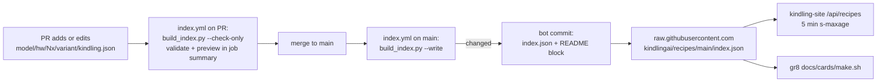

# kindlingai/recipes: consolidation plan

One repo for every serving recipe, laid out as `<model>/<hardware>/<count>x/<variant>/`, with a generated index in the
README and an `index.json` the website reads. Adding a recipe becomes: add a folder with a `kindling.json`, merge. No
website change, no new repo.

Survey date: 2026-11-25, from `gh repo list kindlingai` plus each repo's tree, `kindling.json`, workflows, submodules,
open PRs and issues. **Status: built locally, not pushed.** Section 7 has what is done and the remote steps left;
section 8 the decisions taken.

## 1. What exists today

21 recipe-shaped repos. Three distinct shapes:

- **gr8 compose recipes**: `compose.yaml` + `.env.example` + `check.py` + `kindling.json`, pull a pinned
  `ghcr.io/kindlingai/gr8` image. Tiny (9-11 files).
- **gr8 image recipes** (7): same, plus a `Dockerfile`, a `gr8` submodule, `knobs.sh` and `entrypoint.sh`. Five of
  them also carry a ~10 KB `.github/workflows/image.yml` that builds and pushes `ghcr.io/kindlingai/<repo>`; the five
  are near-copies. The two sage recipes have a Dockerfile but no image CI.
- **vLLM recipes**: scripts + README, no `kindling.json` (except the two gx10 stacks and `glm-5.3-full-exl3-tp6`, which
  are full projects with overlays, eval and image builds).

| Repo | Engine | Boxes (configs) | `kindling.json` | Image CI | gr8 submodule | ★ | Open PRs / issues |
|---|---|---|---|---|---|---|---|
| glm-5.3-exlr8-3x-spark | gr8 v1.1.1 | 3 | yes | – | – | 0 | – |
| glm-5.3-exlr8-4x-spark | gr8 v1.1.1 | 4 (3,4,5,6) | yes | – | – | 1 | PR #2 |
| glm-5.3-exlr8-5x-spark | gr8 v1.1.1 | 5 | yes | – | – | 0 | – |
| glm-5.3-exlr8-6x-spark | gr8 v1.1.1 | 6 | yes | – | – | 0 | – |
| glm-5.3-exlr8-k4-4x-spark | gr8 v1.1.1 | 4 | yes | image.yml | a3f44a0 | 10 | – |
| glm-5.3-flash-exlr8-1x-spark | gr8 | 1 | yes, no `engine` | image.yml | d598965 | 10 | – |
| glm-5.3-flash-exlr8-2x-spark | gr8 | 2 | yes, no `engine` | image.yml | 4057009 | 6 | – |
| deepseek-v4.1-flash-exlr8-4x-spark | gr8 | 4 | yes, no `engine` | image.yml | 933c885 | 3 | PR #39 |
| deepseek-v4.1-flash-exlr8-2x-spark (**private**, WIP) | gr8 | – (empty configs) | yes, no `engine` | image.yml | ca99a75 | 0 | – |
| sage-s2.1-flash-exlr8-2x-spark | gr8 main@ca7e874 | 2 | yes | – | ca7e874 | 0 | – |
| sage-s2.1-flash-exlr8-4x-spark | gr8 main@ca7e874 | 4 | yes | – | ca7e874 | 0 | – |
| qwen3.8-flash-next-exlr8-1x-spark | gr8 v1.2.0 (digest pending) | 1 | yes | – | – | 1 | – |
| qwen3.8-flash-next-exlr8-2x-spark | gr8 v1.2.0 (digest pending) | 2 | yes | – | – | 1 | – |
| qwen3.8-flash-next-exlr8-1x-gpu | gr8 main (PR #610) | 1× RTX 5090 + host RAM | **no** | – | – | 0 | – |
| glm-5.3-full-exl3-tp6 | vLLM | 6 (4,6) | yes | – | – | 5 | – |
| step5-tp4-gb10-recipe | vLLM | 4 | **no** | – | – | 1 | – |
| nemotron-3.5-super-vl-dgx-spark (branch `master`) | vLLM | 1 or 2 | **no** | – | – | 0 | – |
| nemotron-3.5-bolt-rtx5090 | vLLM | 1× RTX 5090 | **no** | – | – | 1 | – |
| glm-5.3-flash-gx10 | vLLM + mentat | 4 (2,3,4,6) | yes | – | – | **98** | **5 PRs / 17 issues** |
| glm-5.3-flash-exlr8-gx10 | vLLM + mentat | 4 (2,3,4,6) | yes | – | – | 15 | 3 PRs / 1 issue |

Not recipes, out of scope: `hardware-recipes` (a parts list), `gr8` itself, `graveyard` (already holds the retired
recipes `glm-5.3-tp3-3spark-recipe`, `glm-5.3-exlr8-{4x,6x}-spark-old`, `glm53-flash-gb10-recipe`,
`glm-5.3-full-nvfp4-tp6`).

What is broken about the current setup, concretely:

- The site (`kindling-site/recipes.config.json`) lists 4 repos: `glm-5.3-flash-gx10`, `glm-5.3-full-exl3-tp6`, `gr8`
  (as an "experimental" stand-in card) and the buried `glm-5.3-full-nvfp4-tp6` (hidden). None of the 14 gr8 recipes
  are on it, because each one needs a site PR.
- `gr8/recipes.json`, `gr8/README.md` (two hand-kept tables), `gr8/docs/cards/make.sh` and 7 `gr8/docs/*.md` files
  hard-code recipe repo URLs.
- `kindling.json` drifted: `hardware` is spelled four ways (`DGX Spark (GB10)`, `ASUS GX10 / DGX Spark (GB10)`,
  `ASUS GX10 (GB10)`, `DGX SPARK (GB10)`); four gr8 recipes have no `engine` pin; the v1 schema does not describe
  fields in use (`engine`, `weights_commit`, `per_stream_tps`, `ttft_p50_s`, `max_tokens_per_chat`, ...).

## 2. Layout

```
recipes/
├── README.md                 hand-written intro + generated index block
├── index.json                generated; the website's only input
├── hardware.json             hardware registry: slug → display name, aliases
├── schema/
│   ├── kindling.v1.json      moved here from kindling-site; source of truth
│   └── index.v1.json
├── tools/
│   ├── build_index.py        scan, validate (jsonschema), write index.json + README block
│   ├── check_pin.py          today's per-repo check.py, generalised: check_pin.py <dir> [--strict]
│   ├── engine.sh             check out the pinned gr8 commit into <dir>/gr8 for local image builds
│   └── adopt.sh              import a repo with history into <path> (from graveyard/bury.sh)
├── .github/workflows/
│   ├── index.yml             validate on PR; regenerate + commit on main
│   ├── recipes.yml           per changed recipe: check_pin, compose config, pinned image exists
│   └── recipe-image.yml      reusable (workflow_call): the one image.yml every Dockerfile recipe shares
├── CONTRIBUTING.md
├── cli/                      @kindlingai/recipe: npx <id> fetches one recipe, ready to run
├── glm-5.3/
│   └── dgx-spark/
│       ├── 3x/exlr8-gr8/     kindling.json, compose.yaml, .env.example, README.md, AGENTS.md, docs/
│       ├── 4x/exlr8-gr8/
│       ├── 4x/exlr8-k4-gr8/  Dockerfile, knobs.sh, entrypoint.sh, smoke.sh ...
│       ├── 5x/exlr8-gr8/
│       ├── 6x/exlr8-gr8/
│       └── 6x/exl3-vllm/
├── glm-5.3-flash/dgx-spark/{1x,2x}/exlr8-gr8/
└── ...
```

### Path rules

`<model>/<hardware>/<count>x/<variant>/`, always exactly four levels, so discovery is one glob (`*/*/*/*/kindling.json`)
and `tools/`, `schema/` can never be mistaken for recipes.

| Level | Rule | Examples |
|---|---|---|
| `model` | upstream model name, lowercased, dots kept | `glm-5.3`, `glm-5.3-flash`, `deepseek-v4.1-flash`, `qwen3.8-flash-next` |
| `hardware` | a key of `hardware.json` | `dgx-spark` (DGX Spark, ASUS GX10: any GB10), `rtx-5090` |
| `count` | boxes/GPUs the **default config** runs on, `<n>x` | `1x` … `6x` |
| `variant` | `<quant>[-<tag>]-<engine>` | `exlr8-gr8`, `exlr8-k4-gr8`, `nvfp4-vllm`, `exl3-vllm` |

The fourth level is what makes the user-proposed three levels unique: today `glm-5.3/dgx-spark/4x` already has two
recipes (`exlr8-gr8`, `exlr8-k4-gr8`), and `glm-5.3-flash/dgx-spark/4x` has two vLLM stacks.

Multi-size recipes (e.g. `glm-5.3-exlr8-4x-spark` carries TP=3..6 configs) live under their default config's count; the
other sizes stay as `configs[]` entries and show as tabs on the card, exactly as now.

`build_index.py` rejects a recipe when: the default config's `nodes` ≠ the path's count; the hardware slug is not in
`hardware.json`; `id` or `image` collides with another recipe; `kindling.json` fails the schema; `default_config` names
no config.

### `kindling.json` additions (schema stays v1, all additive and optional)

The site ignores unknown keys today, so nothing breaks.

```jsonc
{
  "version": 1,
  "id": "glm-5.3-exlr8-k4-4x-spark",       // stable slug: image name, site anchor, card file name.
                                            // Migrated recipes keep their old repo name.
  "status": "stable",                       // stable | experimental | wip | external | retired
  "image": "ghcr.io/kindlingai/glm-5.3-exlr8-k4-4x-spark",  // image recipes only: what recipe-image.yml pushes
  "engine": { "repo": "kindlingai/gr8", "ref": "v1.1.1", "commit": "<40 hex>", "pin": "image",
              "image": "ghcr.io/kindlingai/gr8:v1.1.1", "image_digest": "sha256:..." },  // existing field, now required for gr8
  "source": { "repo": "kindlingai/glm-5.3-flash-gx10" },   // status=external only: the card links here
  "site": { "hidden": false, "order": 10 },  // optional display hints
  "title": "GLM-5.3", "variant": "...", "summary": "...", "hardware": "...", "configs": [ ... ]
}
```

`hardware` (free text) stays for compatibility, but the index emits the display name from `hardware.json`, so the
four spellings above collapse to one.

## 3. Automatic index



Decision: **generated files are written only on `main`, by the bot**. If PRs had to carry `index.json` and the README
block, every two concurrent recipe PRs would conflict on them. PRs validate and show a rendered preview in the Actions
job summary instead.

`build_index.py`:

1. Glob `*/*/*/*/kindling.json`, parse, validate (schema + path rules above).
2. `updated_at` per recipe = `git log -1 --format=%cI -- <dir>` (the workflow checks out with `fetch-depth: 0`).
3. Write `index.json`, sorted by model → hardware → count → variant (`site.order` overrides). No wall-clock timestamp
   and no commit SHA in the file, so a run that changes nothing writes identical bytes and the bot commits nothing.
4. Replace the README text between `<!-- recipes:index:start -->` and `<!-- recipes:index:end -->` with one table per
   model:

   | Hardware | Boxes | Variant | Engine | Code tok/s | Prefill 32K | Max context | Status | |
   |---|---|---|---|---|---|---|---|---|
   | DGX Spark | 4 | exlr8 bit325, int4 KV, 1M context | gr8 v1.1.1 | 66.9 | 1,577 | 1,048,576 | stable | [open](glm-5.3/dgx-spark/4x/exlr8-gr8) |

`index.json` shape (`schema/index.v1.json`):

```jsonc
{
  "version": 1,
  "repo": "kindlingai/recipes",
  "recipes": [
    {
      "id": "glm-5.3-exlr8-4x-spark",
      "path": "glm-5.3/dgx-spark/4x/exlr8-gr8",
      "url": "https://github.com/kindlingai/recipes/tree/main/glm-5.3/dgx-spark/4x/exlr8-gr8",
      "model": "glm-5.3", "hardware": "dgx-spark", "hardware_name": "DGX Spark (GB10)",
      "count": 4, "variant": "exlr8-gr8", "status": "stable",
      "updated_at": "2026-11-22T10:14:03Z",
      "kindling": { /* the recipe's kindling.json, verbatim */ }
    }
  ]
}
```

`index.yml` details:

- `on: pull_request` (paths `**/kindling.json`, `hardware.json`, `schema/**`, `tools/build_index.py`) → validate +
  preview. Fork PRs work: read-only token suffices.
- `on: push: main` → regenerate; if `git diff --quiet` fails, commit as `github-actions[bot]` with
  `concurrency: index-main` so two merges never race. Pushes made with `GITHUB_TOKEN` do not retrigger workflows, so
  there is no loop.
- Prerequisite: the `main` ruleset must let `github-actions[bot]` push (bypass entry), or the job uses a GitHub App
  token. Decide before enabling branch protection.
- `.gitattributes`: `index.json linguist-generated=true` so diffs collapse in PR views.

## 4. Website sync (one-time kindling-site change)

After this, the site never changes for a new recipe.

- `recipes.config.json` becomes:

  ```json
  { "index": { "repo": "kindlingai/recipes", "path": "index.json", "ref": "main",
               "fallback": "data/fallback/index.json" } }
  ```

  The current per-repo `recipes[]` entries go away: `gr8` (the stand-in card) is replaced by the real gr8 recipes,
  `glm-5.3-full-nvfp4-tp6` is already buried, and the two vLLM projects arrive via the index (as migrated or `external`
  entries, section 6).
- `api/recipes.js`: one fetch of `index.json` plus one fetch of the recipes repo metadata, instead of 2 × N fetches. Map
  each entry to the object `app.js` already renders, so the card code is untouched:

  | card field | from |
  |---|---|
  | `repo` | `id` |
  | `url` | `url`, or `https://github.com/<source.repo>` when `status: external` |
  | `experimental` | `status` is `experimental` or `wip` |
  | `data` | `kindling` |
  | `meta.pushed_at` | `updated_at` |
  | `meta.private` | `false` (the recipes repo is public) |
  | `meta.stars` | dropped from cards: one shared count says nothing per recipe |
  | filtered out | `status: retired`, `site.hidden: true` |

- `app.js` static mode (no `/api`): same mapping, reading
  `https://raw.githubusercontent.com/kindlingai/recipes/main/index.json`.
- Fallback: `data/fallback/index.json` replaces the four per-repo snapshots. It is only used when GitHub is
  unreachable; refresh it whenever the site deploys anyway.
- `vercel.json` `includeFiles` stays (`recipes.config.json`, `data/**`).
- README "Adding a recipe" points at `kindlingai/recipes` instead.
- Freshness: raw.githubusercontent.com caches ~5 min, the API adds `s-maxage=300`; a merged recipe shows within ~10
  minutes with no deploy.

## 5. CI for recipes in one repo

- **`recipes.yml`** (all recipes): compute changed recipe dirs from `git diff --name-only $base...HEAD`, cut each path
  to four levels, dedupe → matrix. A change under `tools/`, `schema/` or the workflow selects every recipe. Per recipe:
  `tools/check_pin.py <dir>` (today's `check.py`, including `--strict` for the qwen recipes' pending digest),
  `docker compose config --quiet` with `.env.example`, `docker manifest inspect` of the pinned engine image.
- **`recipe-image.yml`** (reusable, `workflow_call`, inputs `dir`, `image`, `cache-id`): today's `image.yml` with
  `context: <dir>`, `images: <kindling.json image>` instead of `ghcr.io/${{ github.repository }}`, and the
  per-recipe smoke assertions (`want MAX_MODEL_LEN=...`) moved into `<dir>/smoke.sh`. The caller runs it only for
  changed recipes that have a `Dockerfile`; `workflow_dispatch` can build any or all.
- **Tags**: `<id>/<version>` (e.g. `glm-5.3-flash-exlr8-1x-spark/v1.0`) → image tag `v1.0`. `latest`/`main` follow
  `main` per recipe as today.
- **Image names do not change.** Every existing `ghcr.io/kindlingai/<old-repo>` keeps receiving pushes, so pinned
  `docker pull`s, docs (`gr8/docs/SWITCHING.md` names `deepseek-v4.1-flash-exlr8-4x-spark:sha-50a8773`) and compose
  files keep working. Prerequisite per package: GHCR → package settings → *Manage Actions access* → add
  `kindlingai/recipes` with write. Without it the push 403s.
- **gr8 submodule → data pin.** Seven recipes carry their own `gr8` submodule; in one repo that is seven gr8 checkouts
  (~22 MB each) on `clone --recursive`. Replace it with `kindling.json` `engine.commit` (already validated by
  `check.py` to be a full SHA) and have CI `actions/checkout` `kindlingai/gr8` at that commit into `<dir>/gr8`
  (gitignored). `tools/engine.sh <dir>` does the same locally. Dockerfiles keep `COPY gr8/...` unchanged, and the
  existing `ENGINE_SRC=image` path still skips compiling when gr8 has an image of that commit. Backfill `engine` for
  the four recipes that lack it, from their current submodule SHA: flash-1x `d598965`, flash-2x `4057009`,
  deepseek-4x `933c885`, deepseek-2x `ca99a75` (full SHAs from `git rev-parse HEAD:gr8` at adoption).

## 6. Migration

### Mechanics: `tools/adopt.sh <repo> <path>`

Built from `graveyard/bury.sh`, which already does history-preserving folder imports:

- Fetch heads, tags and `refs/pull/*`; commit a rename of the source tree into `<path>/` on top of the source head so
  `git blame` follows; merge with `-s ours` + `read-tree --prefix`. Change needed: `bury.sh` builds the rename with one
  `git mktree` entry, which cannot hold a slash, so nest one tree per path level.
- Other branches/tags become tags `<id>/<name>`; orphaned PR heads become `<id>/pull/<N>`.
- After import, in the same PR: delete `<path>/.github/` (ported to root workflows), `<path>/.gitmodules`, the
  submodule gitlink, `<path>/check.py`, and `LICENSE` copies identical to the root MIT `LICENSE` (keep
  `glm-5.3-full-exl3-tp6/LICENSES/` and `THIRD_PARTY_NOTICES.md`); add `id`/`status`/`engine`; rewrite the README
  Quickstart (below) and absolute links to the old repo.

Quickstart for a single recipe without cloning everything:

```bash
git clone --filter=blob:none --sparse https://github.com/kindlingai/recipes && cd recipes
git sparse-checkout set glm-5.3/dgx-spark/3x/exlr8-gr8 && cd glm-5.3/dgx-spark/3x/exlr8-gr8
cp .env.example .env && nano .env && docker compose up -d
```

### Old repos

Archive, do not delete: archived repos keep their URLs, stars, and the links from Hugging Face model cards, Discord
posts and `gr8` history. Before archiving, push one commit replacing the README with a pointer to
`https://github.com/kindlingai/recipes/tree/main/<path>`, and set the description to `Moved to kindlingai/recipes`.
Open PRs are merged or closed first (they cannot be transferred); open issues move with `gh issue transfer`.

### Proposed paths and waves

| Wave | Old repo | New path | `status` |
|---|---|---|---|
| 1 | glm-5.3-exlr8-3x-spark | `glm-5.3/dgx-spark/3x/exlr8-gr8` | stable |
| 1 | glm-5.3-exlr8-4x-spark | `glm-5.3/dgx-spark/4x/exlr8-gr8` | stable |
| 1 | glm-5.3-exlr8-5x-spark | `glm-5.3/dgx-spark/5x/exlr8-gr8` | stable |
| 1 | glm-5.3-exlr8-6x-spark | `glm-5.3/dgx-spark/6x/exlr8-gr8` | stable |
| 1 | qwen3.8-flash-next-exlr8-1x-spark | `qwen3.8-flash-next/dgx-spark/1x/exlr8-gr8` | experimental until the v1.2.0 digest lands |
| 1 | qwen3.8-flash-next-exlr8-2x-spark | `qwen3.8-flash-next/dgx-spark/2x/exlr8-gr8` | experimental until the v1.2.0 digest lands |
| 1 | qwen3.8-flash-next-exlr8-1x-gpu | `qwen3.8-flash-next/rtx-5090/1x/exlr8-gr8` | experimental; needs a `kindling.json` |
| 2 | glm-5.3-exlr8-k4-4x-spark | `glm-5.3/dgx-spark/4x/exlr8-k4-gr8` | stable |
| 2 | glm-5.3-flash-exlr8-1x-spark | `glm-5.3-flash/dgx-spark/1x/exlr8-gr8` | stable |
| 2 | glm-5.3-flash-exlr8-2x-spark | `glm-5.3-flash/dgx-spark/2x/exlr8-gr8` | stable |
| 2 | sage-s2.1-flash-exlr8-2x-spark | `sage-s2.1-flash/dgx-spark/2x/exlr8-gr8` | stable |
| 2 | sage-s2.1-flash-exlr8-4x-spark | `sage-s2.1-flash/dgx-spark/4x/exlr8-gr8` | stable |
| 2 | deepseek-v4.1-flash-exlr8-4x-spark | `deepseek-v4.1-flash/dgx-spark/4x/exlr8-gr8` | stable |
| 2 | deepseek-v4.1-flash-exlr8-2x-spark (private) | `deepseek-v4.1-flash/dgx-spark/2x/exlr8-gr8` | held back: importing publishes it |
| 3 | glm-5.3-full-exl3-tp6 | `glm-5.3/dgx-spark/6x/exl3-vllm` | stable |
| 3 | step5-tp4-gb10-recipe | `step-5-preview/dgx-spark/4x/nvfp4-vllm` | experimental ("recipe skeleton" per its README); needs a `kindling.json` |
| 3 | nemotron-3.5-super-vl-dgx-spark | `nemotron-3.5-super-vl/dgx-spark/1x/nvfp4-vllm` (TP2 as a second config) | needs a `kindling.json` |
| 3 | nemotron-3.5-bolt-rtx5090 | `nemotron-3.5-bolt/rtx-5090/1x/nvidia-24gb-vllm` | needs a `kindling.json` |
| ext | glm-5.3-flash-gx10 | `glm-5.3-flash/dgx-spark/4x/nvfp4-vllm` (folder holds only `kindling.json` + pointer README) | external |
| ext | glm-5.3-flash-exlr8-gx10 | `glm-5.3-flash/dgx-spark/4x/exlr8-vllm` (same) | external |

Wave 1 is compose-only (no image CI, no submodule) and proves the layout, index and site end to end. Wave 2 needs the
reusable image workflow, the submodule → pin change and GHCR access grants. Wave 3 needs `kindling.json` authoring
from each README's results tables.

The two gx10 repos stay standalone as `external` entries by recommendation: `glm-5.3-flash-gx10` is an active
community project (98★, 17 open issues, 5 open PRs, outside contributors) and both are full stacks (image, gate, dev
tooling, ~200 files) rather than launch recipes; archiving would strand that activity. The index still lists them, so
the site shows them with no special case.

### Cross-repo updates after each wave

- `gr8/recipes.json` → entries keyed by recipe `id`; `gr8/docs/cards/make.sh` fetches `index.json` once instead of
  each repo's `kindling.json` (its `KINDLING_DIR` local mode reads `<recipes clone>/<path>/kindling.json`).
- Recipe links in `gr8/README.md` (both tables), `gr8/docs/{GLM-5.3,FLASH,DEEPSEEK,SWITCHING,TP5-SERVE}.md`,
  `gr8/bench/README.md`, `gr8/config/cluster.env.example`. Leave `CHANGELOG.md` history as is.
- Hugging Face model cards (`kindlingai/glm-5.3-exlr8-k2-k3-k4`, `glm-5.3-flash-exlr8-k2-k3-k4`,
  `deepseek-v4.1-flash-exlr8-native`, `sage-s2.1-flash-exlr8-k4`, `Qwen3.8-Flash-Next-exlr8`) if they link recipe
  repos; not checked from here.
- `kindling-site` cutover (section 4) after wave 1 merges, so the site never shows fewer recipes than today: until then
  it keeps reading the old repos.

## 7. Status

Done locally (this repo, branch `main`; nothing pushed):

| Phase | State |
|---|---|
| 0. Bootstrap | Root files, `hardware.json`, schemas, tools, workflows (`index.yml`, `recipes.yml`, `recipe-image.yml`, `cli.yml`; actionlint clean). |
| 1-3. Waves | All 17 repos adopted with history (`tools/adopt.sh`); per-repo CI, submodules, `check.py` and duplicate licenses removed; `engine` pins backfilled; `smoke.sh` extracted from each image workflow; READMEs/AGENTS.md rewritten for the monorepo; `kindling.json` authored for the four recipes that had none. `build_index.py`: 19 recipes valid; `check_pin.py`: all pass. |
| 4. External | `glm-5.3-flash-gx10` and `glm-5.3-flash-exlr8-gx10` listed as `external` (`tools/sync_external.py`). |
| 5. Site | `kindling-site` branch `recipes-index`: reads `index.json` once, bundled fallback, hardware names/units from the index. |
| 6. gr8 | `gr8` branch `recipes-monorepo`: `recipes.json` by id, `docs/cards/make.sh` reads the index, doc links point at the monorepo. |
| 7. CLI | `cli/`: `npx @kindlingai/recipe <id>` (sparse folder fetch, `.env` from `.env.example`), `--history` (filter-branch, grafted onto the old repo's history with original ids and tags), `--engine`, `--list`; `cli/smoke.sh` passes. |

Remote steps left, in order:

1. Create `kindlingai/recipes` (public), push `main` and the tags (`git push origin main --tags`; GitHub creates no
   workflow events for more than three tags in one push, so the 150 adopted tags trigger nothing).
2. `main` ruleset: let `github-actions[bot]` push (the Index workflow commits `index.json`).
3. GHCR: give `kindlingai/recipes` write access to the four built images (`glm-5.3-exlr8-k4-4x-spark`,
   `glm-5.3-flash-exlr8-{1x,2x}-spark`, `deepseek-v4.1-flash-exlr8-4x-spark`).
4. npm: create the `@kindlingai` scope, add `NPM_TOKEN`, push tag `cli/v0.1.0`.
5. Push and merge `kindling-site` `recipes-index` and `gr8` `recipes-monorepo`.
6. Per old repo: merge or close open PRs (`glm-5.3-exlr8-4x-spark` #2, `deepseek-v4.1-flash-exlr8-4x-spark` #39),
   push a pointer README, archive.

## 8. Decisions taken

1. **Layout depth**: four fixed levels `<model>/<hardware>/<count>x/<variant>`.
2. **Hardware slug for GB10**: `dgx-spark`, with ASUS GX10 and GB10 as aliases.
3. **gx10 stacks**: `external` entries; they stay their own repos.
4. **deepseek-v4.1-flash-exlr8-2x-spark**: held back (private, empty configs); adopt with `tools/adopt.sh` when it has
   numbers and should be public.
5. **Bot push to `main`**: ruleset bypass for `github-actions[bot]` (`index.yml` uses `GITHUB_TOKEN`).
6. **qwen3.8-flash-next 1x-gpu hardware**: `rtx-5090`, what was measured.
7. **Sage images**: their repos never had image CI, so their `kindling.json` has no `build` object and CI does not
   build them, as before. Their READMEs say each commit is published as `sha-<commit>`; adding `build` and a
   `smoke.sh` would make that true.

## 9. Risks

- **GHCR push permissions** (wave 2): each existing package must grant the new repo write access first, or image
  builds fail on `main`. Check per package before adopting.
- **Clone size**: ~20 MB of history across waves 1-3 (sum of GitHub's repo sizes), mostly four 1.7-1.9 MB `docs/concurrency-4.gif` files and one
  1.37 MB manifest (`glm-5.3-exlr8-k4-4x-spark/manifests/exlr8-manifest-bit387.json`). Sparse/blobless clones avoid
  it for users; new large media should go to release assets, not the tree.
- **Stars and watchers** do not move; archived repos keep theirs. The recipes repo starts at 0.
- **Index churn**: anything time-dependent in `index.json` (generation time, HEAD SHA) would make the bot commit on
  every push. `updated_at` per recipe changes only when that recipe's folder changes.
- **CI cost**: arm64 image builds run up to 120 min. Path-filtered matrices keep a one-recipe PR to one build; a change
  to `recipe-image.yml` itself builds nothing until dispatched.
