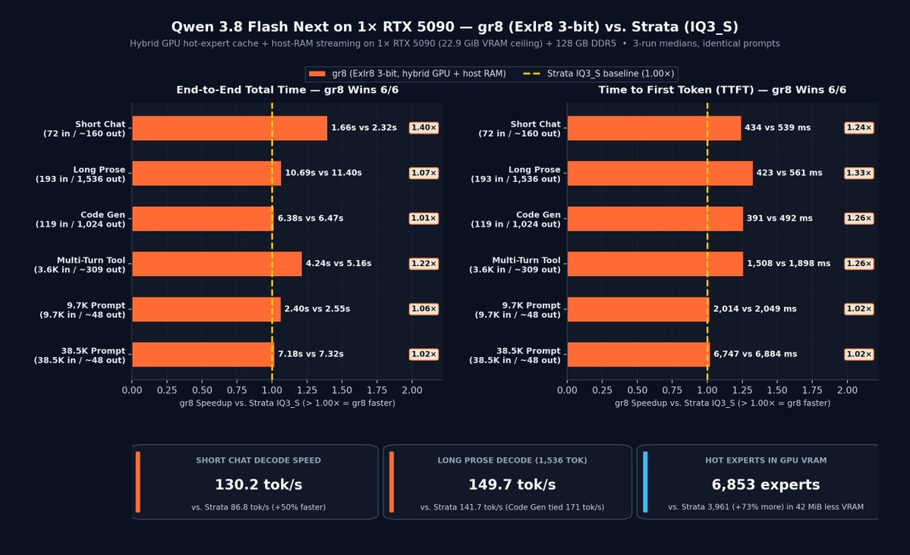

# KindlingAI: Qwen3.8-Flash-Next EXLR8 on one Blackwell GPU (K3, Hybrid GPU + Host RAM)

If you are an agent booting this for someone, read [AGENTS.md](AGENTS.md) first, then the Quickstart.

_**Join our discord to learn more about KindlingAI and `gr8`: https://discord.gg/8EAvYPV2rE**_

Qwen3.8-Flash-Next K3 (`bit300`, 3.00 bpw) on **one discrete Blackwell GPU** (tested on **1× RTX 5090 32 GB** + **128 GB DDR5** + AVX-512 CPU), served by [kindlingai/gr8](https://github.com/kindlingai/gr8) (`main`, [PR #610](https://github.com/kindlingai/gr8/pull/610)) using weights from [kindlingai/Qwen3.8-Flash-Next-exlr8](https://huggingface.co/kindlingai/Qwen3.8-Flash-Next-exlr8).

How it fits a 60+ GB MoE model comfortably on a single 32 GB GPU:
- **Adaptive VRAM hot-expert cache + pinned host-RAM backing:** Hot routed K3 experts live in GDDR7 VRAM (with zero-stall pointer swaps safe for CUDA Graphs); cold experts stay in pinned DDR5.
- **Hybrid AVX-512 CPU + GPU cold-expert execution:** Cold routed experts split across fast AVX-512 BF16/VBMI2 CPU threads and GPU PCIe reads in parallel with GPU-hot experts.
- **FP8 dense weights + INT4 MTP=4 speculative drafter + aliased workspace:** Keeps total VRAM under **22.9 GiB** (leaving room for other workloads on a 32 GB GPU, or scaling up the hot-expert cache automatically on larger GPUs).
- **Direct NVMe / mmap PLE streaming:** Streams Layer-1 Per-Layer Embeddings directly from local NVMe (`ple/exlr8-ple-L001.bin` from the Hugging Face release, or an optional compact GGUF PLE via `--ple`).



## Measured Results (1× RTX 5090 32 GB + Ryzen 7 9800X3D + 128 GB DDR5)

Measured apples-to-apples over HTTP streaming (`/v1/chat/completions`, `temperature=0.0`, 3-run medians) under a **22.9 GiB VRAM ceiling** (~7.2 GiB of other GPU services left resident on the card, so a dedicated clean 32 GB GPU caches even more hot experts):

| Workload | Prompt / Output | TTFT (`gr8`) | Total Time (`gr8`) | Decode Speed (`gr8`) | vs. Strata `IQ3_S` Total |
|---|---:|---:|---:|---:|---:|
| **Short chat** | 72 / 160 | **434 ms** | **1.66 s** | **130.2 tok/s** | **1.40× faster** |
| **Long prose** | 193 / 1,536 | **423 ms** | **10.69 s** | **149.7 tok/s** | **1.07× faster** |
| **Code generation** | 119 / 1,024 | **391 ms** | **6.38 s** | **171.1 tok/s** | **1.01× faster** |
| **Multi-turn tool** | 3.6K / 309 | **1,508 ms** | **4.24 s** | **113.0 tok/s** | **1.22× faster** |
| **9.7K prompt** | 9.7K / 48 | **2,014 ms** | **2.40 s** | **124.7 tok/s** | **1.06× faster** |
| **38.5K prompt** | 38.5K / 48 | **6,747 ms** | **7.18 s** | **108.7 tok/s** | **1.02× faster** |

- **6/6 total-time wins** and **6/6 TTFT wins** across all 3 runs, fitting **6,853 hot experts** in VRAM (`+73%` more than Strata's 3,961) in **42 MiB less VRAM** (`22,872 MiB` vs `22,914 MiB`).
- Bit-exact **32/32** greedy token parity verified between 100% GPU UVA mode and 100% AVX-512 CPU MoE mode (`MTP=0`).

## Requirements

- **GPU:** 1× NVIDIA Blackwell GPU with ≥24–32 GB VRAM (`sm_120a`, e.g. RTX 5090 / RTX PRO 6000; `sm_121a` for GB10)
- **Host RAM:** 96–128 GB DDR5 (46.7 GB pinned host RAM for routed K3 experts + OS page cache)
- **CPU:** x86_64 with AVX-512 (BF16/VBMI2 recommended for hybrid CPU cold-expert offload)
- **Storage:** Fast local NVMe (~165 GB free for the `bit300` release including the Layer-1 PLE rowstore)
- **Toolchain:** CUDA 13 (`nvcc`), `g++` (C++20), Rust (`cargo`), Python 3

## Quickstart

### 1. Build `gr8` (single-GPU Blackwell target)

```bash
git clone https://github.com/kindlingai/gr8.git
cd gr8

# Build the Qwen 3.8 TP=1 engine for RTX 5090 / Blackwell (sm_120a)
MODEL=qw38 GR8_NR=1 ARCH=120a GR8_TESTS=0 scripts/build.sh bin

# Build the OpenAI-compatible HTTP frontend
cargo build --release --locked --manifest-path frontend/g6front-rs/Cargo.toml
cd ..
```

### 2. Download the K3 (`bit300`) weights

```bash
pip install -U huggingface_hub
hf download kindlingai/Qwen3.8-Flash-Next-exlr8 \
  --local-dir ./models/Qwen3.8-Flash-Next-exlr8 \
  --exclude "experts/*-k2.safetensors" "experts/*-k4.safetensors"
```

### 3. Configure and start the server

```bash
cp .env.example .env
# Edit .env if your gr8 or model paths differ
./serve.sh
```

Test it:

```bash
curl -s http://127.0.0.1:8100/v1/models
curl -s http://127.0.0.1:8100/v1/chat/completions \
  -H "Content-Type: application/json" \
  -d '{
    "model": "qwen3.8-flash-next",
    "messages": [{"role": "user", "content": "Explain tail-biting trellis quantization in 3 sentences."}],
    "max_tokens": 256
  }'
```
