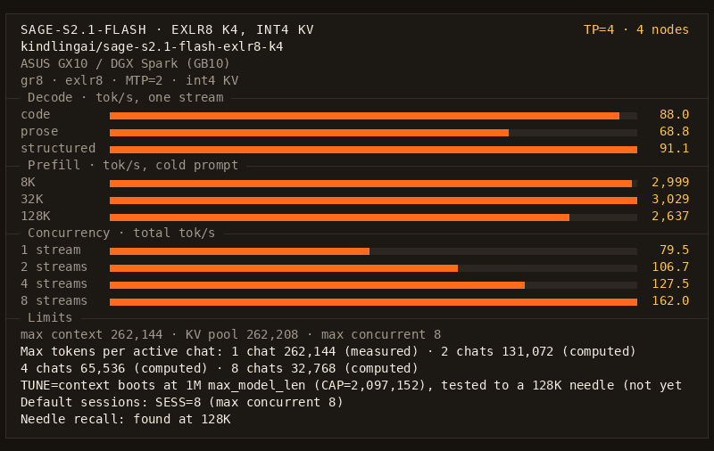
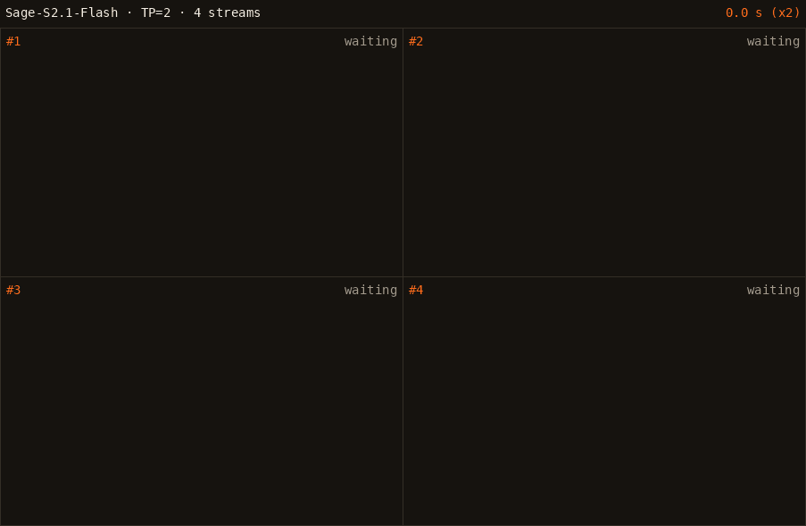

# KindlingAI: Sage-S2.1-Flash EXLR8 on four DGX Sparks

If you are an agent booting this for someone, read [AGENTS.md](AGENTS.md) first, then the Quickstart.

_**Join our discord to learn more about KindlingAI and `gr8`: https://discord.gg/8EAvYPV2rE**_

Sage-S2.1-Flash on four DGX Sparks (GB10, 128 GB each) at TP=4, served by [gr8](https://github.com/kindlingai/gr8) from
the `k4` manifest of [kindlingai/sage-s2.1-flash-exlr8-k4](https://huggingface.co/kindlingai/sage-s2.1-flash-exlr8-k4).
For a two-box deployment, see [sage-s2.1-flash-exlr8-2x-spark](https://github.com/kindlingai/sage-s2.1-flash-exlr8-2x-spark).





## What you need

- Four Sparks on a 200G switch, or cabled in a ring (see Clustering).
- Docker and the NVIDIA container toolkit on each box (both come with DGX OS).
- Free disk where Docker keeps volumes: about 47 GB per box for this box's part of the `k4` release, plus up to 64 GB
  for the prompt cache (`kv-store.yaml`).
- No other model running on any box.
- A LAN between the four boxes, with TCP ports 7340 and 7341 open.
- Proactive memory compaction off on each box, once, as root (it holds across reboots):

  ```bash
  echo 'vm.compaction_proactiveness = 0' > /etc/sysctl.d/90-gr8-no-proactive-compaction.conf
  sysctl -w vm.compaction_proactiveness=0
  ```

## Clustering

Give each box one address per PCIe root on a 200G switch (default `SHAPE=mesh`), or cable the four boxes directly in a
ring without a switch (`SHAPE=ring`; see `gr8/docs/DEPLOY.md`).

On a switch, the Spark's ConnectX card shows each physical port twice, once on each PCIe root, and the engines use both.
Run `ip -br link` on each box to list your port names; the names in the example below (`enp1s0f0np0` and `enP2p1s0f0np0`)
are examples, so use yours. `mtu: 9000` (jumbo frames) must be set on all four boxes and on the switch. For a cable on
the first port, with netplan:

```yaml
# /etc/netplan/60-connectx.yaml on box 1. Boxes 2-4 use 10.0.0.{2,3,4} and 10.0.1.{2,3,4}.
network:
  version: 2
  ethernets:
    enp1s0f0np0:        # the first port on PCIe root 1
      addresses: [10.0.0.1/24]
      mtu: 9000
    enP2p1s0f0np0:      # the same port on PCIe root 2
      addresses: [10.0.1.1/24]
      mtu: 9000
```

Then run `sudo netplan apply` on each box.

Two kinds of address are used below:

- The 10G LAN address is each box's address on your network (the Spark's 10G Ethernet port). `PEERS` holds the four
  boxes' 10G LAN addresses, head first, and the head serves the API on its LAN address.
- The ConnectX addresses are the ones you gave the ConnectX ports in the netplan file (`10.0.0.x` on PCIe root 1,
  `10.0.1.x` on PCIe root 2 in the example). `IPS` holds the four boxes' root-1 addresses and `IPS2` their root-2
  addresses, in `PEERS` order.
- For four boxes cabled in a ring without a switch, set `SHAPE=ring`, list `PEERS` in cable order (each box's `f0` port
  cabled to the next box's `f1` port), and leave out `IPS` and `IPS2`.

With [`mentat`](https://github.com/kindlingai/mentat) running on each box, the recipe finds the other boxes and their
ConnectX addresses by itself. On each box:

```bash
docker run -d --name mentat --network host --restart unless-stopped ghcr.io/kindlingai/mentat:0.27.0
```

Then start the recipe with `MENTAT=1` in place of `PEERS`, `IPS` and `IPS2`.

Without `mentat`, set the four boxes' 10G LAN addresses in `PEERS` (head first), and the matching ConnectX addresses in
`IPS` (PCIe root 1) and `IPS2` (PCIe root 2), in the same order. In `.env.example` these three lines are commented out,
with placeholders: edit them and remove the `#` from each.

## Quickstart

Run the published image on all four boxes with the same settings. Without `mentat`, replace `<head>`, `<box2>`, `<box3>`
and `<box4>` with the four boxes' 10G LAN addresses, the same list on every box. The head is the first box in `PEERS`:
it serves the API on port 8100. `IPS` and `IPS2` are the ConnectX addresses from the netplan example above: use yours.

```bash
docker run -d --name sage-4x-spark --gpus all --network host --pid host --device /dev/infiniband \
  --ulimit memlock=-1 --ulimit core=0 --cap-drop ALL --cap-add IPC_LOCK \
  --security-opt no-new-privileges --read-only --tmpfs /tmp:size=1g,mode=1777 --init --oom-score-adj 1000 \
  -e PEERS=<head>,<box2>,<box3>,<box4> \
  -e IPS=10.0.0.1,10.0.0.2,10.0.0.3,10.0.0.4 \
  -e IPS2=10.0.1.1,10.0.1.2,10.0.1.3,10.0.1.4 \
  -v sage-4x-cache:/var/lib/gr8/cache -v sage-4x-prompts:/var/lib/gr8/prompts -v sage-4x-home:/var/lib/gr8/home \
  ghcr.io/kindlingai/sage-s2.1-flash-exlr8-4x-spark:latest
docker logs -f sage-4x-spark     # on the head: ready at "serving: http://..."
```

With `mentat` running, replace the `PEERS`, `IPS` and `IPS2` settings with `-e MENTAT=1`. The head is then the box with
the lowest address. With a ring cable topology, replace `IPS` and `IPS2` with `-e SHAPE=ring`.

The first boot downloads each box's part from Hugging Face into the `sage-4x-cache` volume (about 47 GB per box). The
boxes wait up to 600 s (10 minutes) for each other, so start all four within that time.

The API is OpenAI-compatible on the head's port 8100. Because `gr8 glm53f` serves the Flash engine architecture, the
served model name is `glm-5.3-flash` (`glm53f` also works):

```bash
curl -s localhost:8100/v1/chat/completions -H 'Content-Type: application/json' -d '{
  "model": "glm-5.3-flash",
  "messages": [{"role": "user", "content": "Write a haiku about a small computer."}],
  "max_tokens": 4096
}'
```

The model thinks before it answers. The thinking comes back in `message.reasoning` and counts toward `max_tokens`.

```bash
docker exec sage-4x-spark gr8 glm53f smoke   # on the head: 14 checks against the API
docker stop sage-4x-spark && docker rm sage-4x-spark   # on all four boxes
```

`:latest` is `main`. Each commit is also published as `sha-<commit>`, and each tag under its name.

## Run it with compose

`compose.yaml` runs the same image with the same settings and reads `PEERS` and the knobs from `.env`. On all four
boxes:

```bash
git clone --recurse-submodules https://github.com/kindlingai/sage-s2.1-flash-exlr8-4x-spark
cd sage-s2.1-flash-exlr8-4x-spark
cp .env.example .env          # edit PEERS, IPS and IPS2 and remove their #: the same file on all four boxes
docker compose up -d
docker compose logs -f
```

`docker compose up -d --build` builds the image on each box instead.

## Knobs

Set these in `.env` next to `compose.yaml` (see `.env.example`), or with `docker run -e`, the same on all four boxes:

| knob | default | |
|---|---|---|
| `TUNE` | `speed` | What to prioritize, see below. Sets defaults of `VARIANT`, `SESS`, `CAP`, `MAX_MODEL_LEN`, `MTP` and `S2_SHARED_WATERFILL`. Any other value stops the boot. |
| `PEERS` | none | The four boxes' 10G LAN addresses, head first. Required unless `MENTAT=1`. |
| `IPS`, `IPS2` | none | Each box's ConnectX address on PCIe root 1 and root 2, in `PEERS` order. Omit with `SHAPE=ring` or `MENTAT=1`. |
| `SHAPE` | `mesh` | `mesh` (switch) or `ring` (four boxes directly cabled in a ring). |
| `VARIANT` | `k4` | The release's width manifest (`k4`). |
| `SESS` | `8` | The requests that decode at once, 1 to 8. |
| `CAP` | `262208` (`2097152` with `TUNE=context`) | The KV pool in tokens, shared by the sessions. Each request reserves its prompt + `max_tokens` from it. |
| `MAX_MODEL_LEN` | `262144` (`1048576` with `TUNE=context`) | The longest single request, prompt and output together. At most `CAP` less the guard rows (and at most 1,048,576). |
| `MTP` | `2` (`1` with `TUNE=quality`) | Speculative draft depth. `MTP=2` with `S2_SHARED_WATERFILL=1` is bit-exact to `MTP=1` on the pinned build. |
| `DFLASH` | `0` | `0` uses MTP only and downloads no drafter. |
| `FLASH_CACHE` | `aligned` | Prompt checkpoint cache on disk + spare RAM (`kv-store.yaml`, up to 64 GB per box). Checkpoints align to the 8,192-token prefill grid (`--prefill 4096 x 2 lanes`), so prompts of 8,192 tokens or fewer keep none (`gr8 bench`'s ~400-token short-prompt cache report returns 0/428 cached by design, while 8K/32K/128K prefill caches cleanly). |
| `MENTAT` | `0` | `1` finds the other boxes and ConnectX addresses through the host's `mentat` daemon, and registers the API in group `GROUP` (`gr8-sage-4x`). |
| `GR8_GLM53F_VISION` in `EXTRA_ENV` | unset (off) | Text-only by default. The HF release includes `dense/vision-bf16.safetensors` (1.13 GB), untested with this recipe; set `EXTRA_ENV="GR8_GLM53F_VISION=1"` on all four boxes to opt in. |
| `DEFAULT_MAX_TOKENS` | `32768` | `max_tokens` for a request that sends none, or the room the context leaves if that is less. |
| `UNDECLARED_TOOL_CALLS` | `emit` | A call to a tool the request did not declare comes back as a tool call, so your agent can answer it with an unknown-tool error. `text` leaves it in the reply's text. |

The image pins the weights to a fixed Hugging Face commit. Set `MODEL` in `.env` to change it
(`https://huggingface.co/<org>/<repo>@<commit>`).

[gr8/KNOBS.md](https://github.com/kindlingai/gr8/blob/ca7e8745bfed31d4417d263ff1bc14dd59919f9c/KNOBS.md) lists the
advanced `gr8` options, which you can also set in `.env`.

## Pick what to prioritize

`TUNE` picks one of three settings. When you set `VARIANT`, `SESS`, `CAP`, `MAX_MODEL_LEN`, `MTP` or
`S2_SHARED_WATERFILL` yourself, your value wins.

| `TUNE` | sets |
|---|---|
| `speed` (default) | `VARIANT=k4`, `SESS=8`, `CAP=262208`, `MAX_MODEL_LEN=262144`, `MTP=2`, `S2_SHARED_WATERFILL=1` |
| `context` | `VARIANT=k4`, `SESS=8`, `CAP=2097152`, `MAX_MODEL_LEN=1048576`, `MTP=2`, `S2_SHARED_WATERFILL=1`, and context-parallel KV (`GR8_CP=1`, experimental) |
| `quality` | `VARIANT=k4`, `SESS=8`, `CAP=262208`, `MAX_MODEL_LEN=262144`, `MTP=1`, `S2_SHARED_WATERFILL=0` |

With bit-exact shared waterfill `MTP=2` drafting (`S2_SHARED_WATERFILL=1`, `MTP=2`, `DFLASH=0`), `TUNE=speed` boots warm
in 18 s and measures 88.0 / 68.8 / 91.1 tok/s single-stream decode (code / prose / structured), 2,999 / 3,029 / 2,637
tok/s cold prefill (8K / 32K / 128K), and 79.5 / 106.7 / 127.5 / 162.0 tok/s aggregate concurrency (1 / 2 / 4 / 8
streams; paired quick ruler: 79.4 / 106.8 / 130.2 / 163.0 and 79.3 / 107.6 / 127.0 / 163.8 tok/s). `TUNE=context`
(`CAP=2097152`, `MAX_MODEL_LEN=1048576`, `SESS=8`, `GR8_CP=1`) boots warm in 17 s at 1M `max_model_len` with 46.5-48.2
GiB of post-capture memory free per box and is tested to a 128K needle (pass, same `T=0` output hash as `TUNE=speed`;
not yet tested at 1M tokens).

## Run another model

A box runs one model at a time. To switch, stop and remove this recipe's container on all four boxes:

```bash
docker stop sage-4x-spark && docker rm sage-4x-spark   # compose: docker compose down
```

Each box's part stays in its `sage-4x-cache` volume, so a later start downloads nothing. To free the disk (about 47 GB
of model weights per box and up to 64 GB of prompt checkpoints), remove the volumes on all four boxes:

```bash
docker volume rm sage-4x-cache sage-4x-prompts sage-4x-home   # compose: docker compose down -v
```

[gr8's Recipes](https://github.com/kindlingai/gr8#recipes) lists the other models and the number of boxes each one
needs.

## Help

Ask on Discord (https://discord.gg/8EAvYPV2rE) or open an issue in this repo
(https://github.com/kindlingai/sage-s2.1-flash-exlr8-4x-spark/issues). Include the command you ran and the end of
`docker logs sage-4x-spark`. Remove addresses and hostnames before you post.
