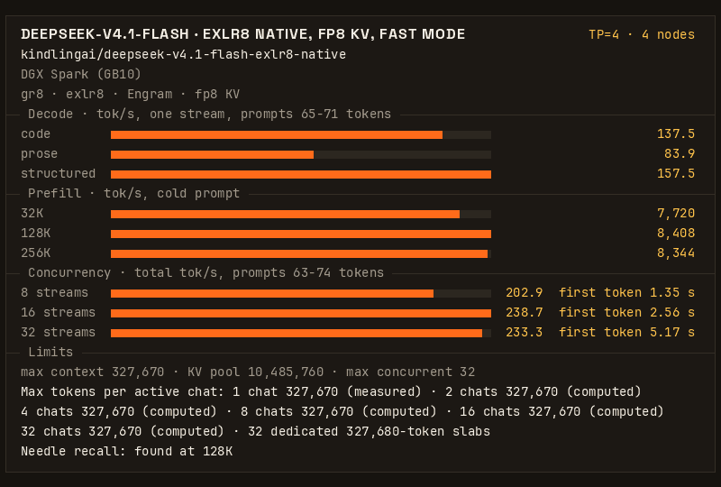

# DeepSeek-V4.1-Flash EXLR8 on 4× DGX Spark



If you are an agent booting this for someone, read [AGENTS.md](AGENTS.md) first, then the [Quickstart](#quickstart).

_**Join our Discord to learn more about KindlingAI and `gr8`: https://discord.gg/8EAvYPV2rE**_

DeepSeek-V4.1-Flash (DeepSeek's release [DeepSeek-V4.1-Flash-1017](https://huggingface.co/deepseek-ai/DeepSeek-V4.1-Flash-1017))
on four DGX Sparks (GB10, 128 GB each) at TP=4, served by [gr8](https://github.com/kindlingai/gr8) from
[kindlingai/deepseek-v4.1-flash-exlr8-native](https://huggingface.co/kindlingai/deepseek-v4.1-flash-exlr8-native), with
fp8 KV, Engram, and up to 32 concurrent chats in fast mode. This recipe runs gr8's published image (`v1.3.0`, pending
[kindlingai/gr8#630](https://github.com/kindlingai/gr8/pull/630)), with `.env`, a shipped `io_uring` seccomp profile,
and read-only launcher script mounts. Nothing is compiled here.

## Results

**`tp4` (`TUNE=speed`, default):** **137.5 tok/s** code decode · **83.9 tok/s** prose · **157.5 tok/s** structured ·
**7,720 / 8,408 / 8,344 tok/s** cold prefill at 32K / 128K / 256K · **202.9 / 238.7 / 233.3 tok/s** aggregate at
8 / 16 / 32 streams · **327,670**-token max context (32 dedicated 327,680-token slabs, `10,485,760`-token fp8 KV pool).

The card above ([kindling.json](kindling.json)) was measured on 2026-11-11 on the staged image built from gr8
[`c2220f2`](https://github.com/kindlingai/gr8/commit/c2220f2e876409cec3f9660f34589b97e7c899fd) in fast mode
(`TUNE=speed`, the default, with that commit's 12,288-row v2 prefill stack before `GR8_DS_PF_V2_BF16_TC=7`,
`GR8_DS_CACHE_MIB=1024` and `GR8_DS_ENGRAM_CACHE_MIB=2048`), on four GB10 boxes cabled in a ring (one boot,
`bench/bench.py`). Re-confirmation on published `gr8 v1.3.0` (`kindlingai/gr8#630`) is pending release and 4-box DGX
Spark hardware verification. Every speed is in tokens per second (tok/s).

Card summary (`kindling.json`, 2026-11-11, gr8 `c2220f2`, ring, `TUNE=speed`):

| metric | value |
|---|---|
| single-stream decode (65–71 tok prompts): code / prose / structured | 137.5 / 83.9 / 157.5 tok/s |
| cold prefill: 32K / 128K / 256K | 7,720 / 8,408 / 8,344 tok/s |
| concurrency (63–74 tok prompts): 8 / 16 / 32 streams (p50 TTFT) | 202.9 (1.35 s) / 238.7 (2.56 s) / 233.3 (5.17 s) tok/s |
| needle recall | found at 128K |
| longest chat / KV pool / max concurrent | 327,670 tokens / 10,485,760 tokens / 32 dedicated slabs |

The tables below are from earlier runs before those defaults: gr8
[`43cad38`](https://github.com/kindlingai/gr8/commit/43cad388ec8b7026b4feed2190fc5ce5a90c0c6d) in fast mode
(`TUNE=speed`) from image `sha-7c2088a` (`sha256:452d5fcc...`), on four DGX Sparks cabled in a ring (set A), on
2026-11-09. Rows and columns marked "release 1 settings" are from gr8 `0015fd0`; decode right after each prefill is
from set A on 2026-11-08; many-stream, boot, and switch rows are from set B on 2026-11-08 and 2026-11-09:

Prefill, cold prompt (set A):

| prompt | runs | first token | prefill tok/s | decode tok/s after it, same request (release 1 settings) |
|---|---:|---:|---:|---:|
| 32K tokens | 8 | 4.19 s | 7,835 | 103.5 |
| 128K tokens | 4 | 16.5 s | 7,940 | 98.2 |
| 256K tokens | 4 | 34.5 s | 7,590 | 101.0 |

One-stream decode on short prompts (65–72 tokens, up to 512 tokens out; set A, two series of 6 runs each):

| work | code | prose | structured | counting |
|---|---:|---:|---:|---:|
| tok/s | 142.8–144.2 | 83.3–85.8 | 159.7–160.1 | 161.5–162.2 |

Many streams at once (short mixed prompts, up to 512 tokens out per stream):

| streams | 8 | 16 | 32 |
|---|---:|---:|---:|
| total decode tok/s (set A, prompts 62–76 tokens) | 217.4 | 249.2 | 242.8 |
| first token, median (set A) | 1.39 s | 2.48 s | 5.04 s |
| total decode tok/s (set B, release 1 settings) | 200.3 | 221.3 | 226.4 |
| first token, median (set B, release 1 settings) | 2.5–2.7 s | 6.2–6.4 s | 14.2–14.6 s |

Sixteen streams in a closed loop (180 s window, prompts 61–78 tokens, up to 256 tokens out; set A): **236.0 tok/s**
total, first token median **1.47 s**.

| | |
|---|---|
| longest prompt measured | 262,420 tokens (`CAP` allows 327,680) |
| start with the release already in the OS page cache: container recreate to first chat answer (set A) | 93.3 s |
| first boot, cold disk: image `sha-ad3efdf` on four boxes, container start to `serving:` (gen cache written; release 1 settings) | 212.7 s |
| switch from GLM-5.3 to this recipe, gen cache on disk, to health ready (`./gr8 switch`, two runs; release 1 settings, image `sha-ad3efdf`) | 37.1 s / 39.2 s |
| switch from this recipe back to GLM-5.3, to health ready (two runs; release 1 settings, image `sha-ad3efdf`) | 76.0 s / 74.1 s |

Fast mode's replies are not bit-identical to the exact model's (`TUNE=quality`). On the 75-item quality check of gr8's
[FIRST-BOOT.md](https://github.com/kindlingai/gr8/blob/43cad388ec8b7026b4feed2190fc5ce5a90c0c6d/docs/FIRST-BOOT.md#3-deepseek-v41-flash-ds41-speed-against-exactness),
image `sha-7c2088a` scored 73 of 75 on 2026-11-09, the same score as the release 1 image on the same boxes that day.
Other hardware and other box counts were not measured.

### How we measure

- gr8's own benchmark (`bench/bench.py`) against the running server, with this recipe's settings. Set A rows used
  `bench.py` with the prompt-length output and closed-loop mode of gr8 PR [#471](https://github.com/kindlingai/gr8/pull/471).
- Set A rows used image `sha-7c2088a` (gr8 `43cad38`) on one boot, between two boots of release 1 (`sha-ad3efdf`) on the
  same boxes. "Decode after it" keeps release 1 numbers (gr8 `0015fd0`, set A, 2026-11-08; 16, 8 and 2 runs).
- No tracing or per-stage timing on measured requests. Single numbers are means; ranges are lowest and highest series.
  Full method: [gr8 docs/DEEPSEEK.md](https://github.com/kindlingai/gr8/blob/main/docs/DEEPSEEK.md#how-we-measure).

## Quickstart

First turn off proactive memory compaction, open TCP ports 7340 and 7341, and configure your ConnectX fabric on all four
boxes ([What you need](#what-you-need) and [Clustering](#clustering)).

Then, on **all four boxes** with the same `.env`:

```bash
npx @kindlingai/recipe deepseek-v4.1-flash-exlr8-4x-spark && cd deepseek-v4.1-flash-exlr8-4x-spark
# the CLI already copied .env.example to .env; edit it: uncomment and set PEERS, IPS and IPS2 (or MENTAT=1):
# the same file on every box
docker compose run --rm fetch        # once on every box: fetches all 604 files (510.6 GB) into ds41-release
docker compose up -d                 # pulls the pinned gr8 image, generates/verifies engram cmap on first boot, joins
docker compose logs -f               # on the head: ready at "serving: http://..." on 127.0.0.1:8100
```

This recipe lives in [kindlingai/recipes](https://github.com/kindlingai/recipes/tree/main/deepseek-v4.1-flash/dgx-spark/4x/exlr8-gr8)
at `deepseek-v4.1-flash/dgx-spark/4x/exlr8-gr8`; a [sparse clone](https://github.com/kindlingai/recipes#run-a-recipe) also works.

Fetch first on every box: `compose.yaml` restarts on failure, so without a complete release the container exits until
the fetch finishes. The fetch resumes where it left off and checks every file against Hugging Face's hash (use
`docker compose run --rm fetch --force` to re-download any mismatched file). On first boot, `gr8` automatically
generates and verifies `ds41.engram.cmap` against `kCmapSha256` from `<release>/tokenizer.json` into the writable home
volume (`/var/lib/gr8/home/engram/`).

Start all four boxes within 10 minutes (`JOIN_TIMEOUT=600` s). The head (the first address in `PEERS`, or lowest address
with `MENTAT=1`) serves the OpenAI-compatible API on port 8100 (`deepseek-v4.1-flash`):

```bash
curl -s localhost:8100/v1/models
curl -s localhost:8100/v1/chat/completions -H 'Content-Type: application/json' -d '{
  "model": "deepseek-v4.1-flash",
  "messages": [{"role": "user", "content": "Write a haiku about a small computer."}],
  "max_tokens": 4096
}'
```

A request that does not set a reasoning effort runs at effort `low`. Run the API smoke test on the head, and stop
cleanly on every box:

```bash
docker compose exec gr8 /opt/ds41-4x/entrypoint.sh smoke     # on the head: checks the API, tool calls included
docker compose down                                          # on every box
```

If you prefer `docker run` directly (from inside the recipe folder on every box, after editing `.env`):

```bash
# 1. Fetch the 510.6 GB release once per box:
docker run --rm --read-only --tmpfs /tmp:size=1g,mode=1777 \
  --env-file .env -e MODEL=/var/lib/gr8/cache/deepseek-v4.1-flash-exlr8-native \
  -v ds41-release:/var/lib/gr8/cache \
  -v "$PWD/fetch-release.sh:/opt/ds41-4x/fetch-release.sh:ro" \
  --entrypoint /opt/ds41-4x/fetch-release.sh \
  ghcr.io/kindlingai/gr8:v1.3.0

# 2. Boot on all four boxes:
docker run -d --name ds41-4x-spark --gpus all --network host --pid host --device /dev/infiniband \
  --ulimit memlock=-1 --ulimit core=0 --cap-drop ALL --cap-add IPC_LOCK \
  --security-opt no-new-privileges --security-opt "seccomp=$PWD/seccomp-iouring.json" \
  --read-only --tmpfs /tmp:size=1g,mode=1777 --init --oom-score-adj 1000 \
  --env-file .env \
  -e GR8_WORK_DIR=/var/lib/gr8/home -e MODEL_CACHE=/var/lib/gr8/cache \
  -e MODEL=/var/lib/gr8/cache/deepseek-v4.1-flash-exlr8-native \
  -e ENGRAM_PREFIX=/var/lib/gr8/home/engram/ds41 \
  -e PY=/usr/bin/python3 -e FRONT_BIN=/opt/gr8/bin/g6front-rs \
  -v ds41-release:/var/lib/gr8/cache -v ds41-home:/var/lib/gr8/home \
  -v "$PWD/entrypoint.sh:/opt/ds41-4x/entrypoint.sh:ro" \
  -v "$PWD/knobs.sh:/opt/ds41-4x/knobs.sh:ro" \
  -v "$PWD/fetch-release.sh:/opt/ds41-4x/fetch-release.sh:ro" \
  --entrypoint /opt/ds41-4x/entrypoint.sh \
  ghcr.io/kindlingai/gr8:v1.3.0
```

Note: the older recipe-specific image `ghcr.io/kindlingai/deepseek-v4.1-flash-exlr8-4x-spark` is no longer updated
(existing tags remain available). Existing `ds41-release` volumes keep their 510.6 GB download without re-fetching.

## What you need

- Four DGX Sparks (GB10, 128 GB each) on a 200G switch, or cabled in a ring (see [Clustering](#clustering)).
- Docker and the NVIDIA container toolkit on each box (both come with DGX OS).
- 510.6 GB of free disk on each box (every box holds the whole release). The gen cache that `.env.example` turns on
  needs about 80 GB more (up to ~160 GB with two cache keys, e.g. after a new image or switching `TUNE` between
  `quality` and `speed`/`context`).
- TCP ports 7340 and 7341 open between the four boxes.
- No other model running on any box.
- Proactive memory compaction off on each box, once, as root (holds across reboots):

  ```bash
  echo 'vm.compaction_proactiveness = 0' > /etc/sysctl.d/90-gr8-no-proactive-compaction.conf
  sysctl -w vm.compaction_proactiveness=0
  ```

## Settings

`cp .env.example .env` on all four boxes (the CLI already did) and keep every box's `.env` identical. Every knob is
documented in [.env.example](.env.example):

| knob | default | what it does |
|---|---|---|
| `PEERS` | none | The four boxes' 10G LAN addresses, head first. Required unless `MENTAT=1`. |
| `IPS`, `IPS2` | none | Each box's ConnectX address on PCIe root 1 and root 2, in `PEERS` order. |
| `SHAPE` | unset (switch) | `ring`: four boxes cabled in a ring, without `IPS` and `IPS2`. |
| `TUNE` | `speed` | What to prioritize, see [Pick what to prioritize](#pick-what-to-prioritize). `EXACT=1` (the old name) is now `TUNE=quality`. |
| `CAP` | `327680` (`1048576` for `context`, `262144` for `quality`) | Longest chat in tokens (prompt + reply); every slot gets this much KV at boot (request max is `CAP` less 10). |
| `SESS` | `32` (`16` for `context`, `5` for `quality`) | Chats at once, 1 to 32. Above 5, `knobs.sh` adds `GR8_DS_SESS_DRAFTS=1`. |
| `MENTAT` | `0` | `1` discovers peers and ConnectX addresses through the host's `mentat` daemon, in group `GROUP` (`gr8-ds41-4x`). |
| `RELEASE` | pinned HF commit | Release fetched by `fetch-release.sh` (`https://huggingface.co/<org>/<repo>@<commit>`). |
| `FETCH_JOBS` | `8` | Parallel file transfers / hash checks during fetch and pre-boot verification. |
| `EXTRA_ENV` | `GR8_GEN_CACHE=/var/lib/gr8/home/gen-cache` | Space-separated `NAME=value` engine settings; replaces the recipe's value and comes after `knobs.sh`. |
| `RELEASE_DIR`, `GR8_HOME_DIR` | named volumes (`ds41-release`, `ds41-home`) | Host directories (owned by uid 1000) in place of compose's named volumes. |
| `GR8_STOP_GRACE` | `30s` | Shutdown grace period for `docker stop` (set `150s` with a persistent `KV_STORE`). |
| `SECCOMP_PROFILE` | `./seccomp-iouring.json` | Seccomp profile allowing Engram's `io_uring` syscalls; set `builtin` for Docker's default (pread fallback). |
| `GR8_IMAGE` | `ghcr.io/kindlingai/gr8:v1.3.0` (pending) | Override the published `gr8` engine image. |

[gr8/KNOBS.md](https://github.com/kindlingai/gr8/blob/main/KNOBS.md) lists all other `gr8` options. Key `EXTRA_ENV`
cache knobs: `GR8_DS_CACHE_MIB` (1,024 MiB for `speed`, 2,048 for `context`, 4,096 for `quality`) and
`GR8_DS_ENGRAM_CACHE_MIB` (2,048 MiB for `speed`, 4,096 for `context`/`quality`).

### What `TUNE=speed` sets

`TUNE=speed` turns on the recipe's fast-mode and cache switches ([knobs.sh](knobs.sh)) and gr8's default v2 prefill
release stack (`gr8/scripts/engine_args.sh`). Any `GR8_*` setting in `EXTRA_ENV` replaces it. Rows marked "output"
change the reply; the others give the same reply faster or with less memory
([gr8/docs/ENV.md](https://github.com/kindlingai/gr8/blob/main/docs/ENV.md)):

| setting | what it does |
|---|---|
| `GR8_DS_RELAXED_ACCEPT=topp:0.9,ratio:0.1` | output: accepts a drafted token by a relaxed rule (top-p 0.9, ratio 0.1), not only exact match. |
| `GR8_DS_MOE_TOPK_DECODE=4` | output: a decode step takes 4 routed experts, fewer than prefill takes. |
| `GR8_DS41_HEAD_MX=1` | output: decode output head in MXFP8 (~half the bytes). |
| `GR8_DS_ATTN_TC_MF=2`, `GR8_DS_ATTN_TC_TILE=2` | grid order and persistent tile for tensor-core GEMM; identical output bits (`TUNE=context` keeps tile 1). |
| `GR8_DS_CACHE_MIB=1024` | 1,024 MiB in-memory prefix cache per box (`TUNE=context` sets `2048`; unset is `4096`). |
| `GR8_DS_ENGRAM_CACHE_MIB=2048` | 2,048 MiB host cache for Engram table rows per box (8M 256-byte rows; unset is `4096`). |
| `GR8_DS_PF_V2=1` | v2 prefill path for layers 0–20 (`GR8_DS_PF_V2=0` uses the 4,096-row path). |
| `GR8_DS_PF_LANES=1`, `GR8_DS_PF_TAIL=128` | one prefill lane and 128-row late-layer tail (required by v2). |
| `GR8_DS_PREFILL_W=12288`, `GR8_DS_PF_V2_W16K=1` | 12,288-row prefill chunks (`GR8_DS_PF_V2_W16K=0` uses 8,192-row chunks). |
| `GR8_DS_PF_V2_L20_TAIL=1` | output: layer 20 runs only the 128-row chunk tail on prefill, with bounded replay on interior prefix-cache hits. |
| `GR8_DS_PF_V2_SEND_FFN_OPT=3` | v2 prefill publishes each quarter from compute stream and unpacks both FFN halves together; identical bits. |
| `GR8_DS_PF_V2_BF16_TC=0` | v2 prefill keeps stock BF16 reductions by default (`GR8_DS_PF_V2_BF16_TC=7` in `EXTRA_ENV` opts into BF16 tensor cores for router gate, ratio-2 KV compressor, and indexer/`cmp_wkv`). |
| `GR8_DS_SH_TC=1` | output: prefill shared expert runs on tensor cores with MXFP8 input. |
| `GR8_DS_MHC_ROW_SHARD=0`, `GR8_DS_MHC_Y_MXFP8=0` | mHC row split off (v2 prefill requires it off). |
| `GR8_DS_PF_V2_RS_BLOCKS=48`, `GR8_DS_PF_V2_PACK_BLOCKS=48` | v2 reduce-scatter and wire pack/unpack with 48 blocks. |
| `GR8_DS_PF_V2_GATE_RO=1`, `GR8_DS_PF_V2_STRIPE_MIN=1048576`, `GR8_DS_PF_V2_ATTN_PIPE=1` | v2 read-once gate, dual-rail striping ≥1 MiB, pipelined attention key loads. |
| `GR8_DS_ENGRAM_IO_URING=128`, `GR8_DS_ENGRAM_IO_THREADS=64`, `GR8_DS_ENGRAM_COL_SHARD=1` | Engram `io_uring` reader (pread fallback if denied), column-sharded across TP=4. |
| `GR8_S2_ADMIT_HOLD=1`, `GR8_S2_TAIL_FIRST=1` | batch admission at step boundary and tail-first scheduling for lower burst TTFT. |

## Clustering

Give each box one address per PCIe root. The Spark's ConnectX card shows each physical port twice, once on each PCIe
root, and the engines use both. Run `ip -br link` on each box to check your interface names (`enp1s0f0np0` and
`enP2p1s0f0np0` are typical on DGX Spark). Set `mtu: 9000` on both boxes (requires switch/cable support):

```yaml
# /etc/netplan/60-connectx.yaml on the first box. On box N: 10.0.0.N and 10.0.1.N.
network:
  version: 2
  ethernets:
    enp1s0f0np0:        # first port on PCIe root 1
      addresses: [10.0.0.1/24]
      mtu: 9000
    enP2p1s0f0np0:      # same port on PCIe root 2
      addresses: [10.0.1.1/24]
      mtu: 9000
```

Then run `sudo netplan apply` on each box. With [`mentat`](https://github.com/kindlingai/mentat) running on each box,
the recipe discovers peers and ConnectX addresses automatically:

```bash
docker run -d --name mentat --network host --restart unless-stopped ghcr.io/kindlingai/mentat:0.27.0
```

What to set in `.env`:

| your boxes | set | leave out |
|---|---|---|
| on a switch, with `mentat` | `MENTAT=1` | `PEERS`, `IPS`, `IPS2` |
| on a switch, without `mentat` | `PEERS` (10G LAN addresses, head first), `IPS`, `IPS2` | |
| in a ring, without a switch | `PEERS` in cable order, `SHAPE=ring` | `IPS`, `IPS2` |

## Pick what to prioritize

`TUNE` picks one of three presets ([knobs.sh](knobs.sh)). A `CAP` or `SESS` you set yourself keeps your value:

| `TUNE` | tradeoff | what it sets |
|---|---|---|
| `speed` (default) | fast mode (not bit-identical to exact) | `SESS=32`, `CAP=327680` (327,670 max tokens/chat), v2 12K prefill + fast decode switches |
| `context` | fast mode, up to 1M context | `SESS=16`, `CAP=1048576` (1,048,566 max tokens/chat), `GR8_DS_MHC_ROW_SHARD=1`, `GR8_DS_CACHE_MIB=2048` |
| `quality` | exact model output | `EXACT=1`, `SESS=5`, `CAP=262144` (262,134 max tokens/chat), old prefill path |

## The seccomp profile for io_uring

Docker's default seccomp profile blocks `io_uring`, which Engram uses to read its table from disk. This recipe ships
[seccomp-iouring.json](seccomp-iouring.json) (Docker's default Moby seccomp profile with only `io_uring_setup`,
`io_uring_enter`, and `io_uring_register` added) and `compose.yaml` applies it automatically via
`security_opt: seccomp=${SECCOMP_PROFILE:-./seccomp-iouring.json}`.

The override applies only to this recipe's container; it does not alter Docker's daemon settings or other containers. To
use Docker's stock profile instead (Engram automatically falls back to its `pread` thread pool with identical output),
set `SECCOMP_PROFILE=builtin` in `.env`.

## Switch between this and GLM-5.3 on the same four boxes

To alternate between this recipe and [glm-5.3-exlr8-4x-spark](../../../../glm-5.3/dgx-spark/4x/exlr8-gr8) at TP=4 on
the same four boxes:

- `GR8_GEN_CACHE=/var/lib/gr8/home/gen-cache` (enabled by default in `.env.example`): keeps computed load tensors on
  disk per cache key (same image, rank, release, and `TUNE` kind).
- On GLM-5.3, `KV_STORE=ssd:/var/lib/gr8/cache/kv,size=200G,persist=on,keep=sessions` with `GR8_STOP_GRACE=150s`
  persists open chats across switches.

### The gen cache: disk, first boot, off

- **Disk:** ~80 GB per box (79.6 GB) in `ds41-home` (`GR8_HOME_DIR`), beside the 510.6 GB release. Keeps the two newest
  keys (up to ~160 GB).
- **First boot:** writing a new key is slower (new image, switching between `TUNE=quality` and `speed`/`context`,
  different rank, or new release). [SWITCHING.md](https://github.com/kindlingai/gr8/blob/0015fd04512ebc38e369475a1ce7dee76d445d77/docs/SWITCHING.md)
  measured 242 s first start (`sha-50a8773`), and [FIRST-BOOT.md](https://github.com/kindlingai/gr8/blob/0015fd04512ebc38e369475a1ce7dee76d445d77/docs/FIRST-BOOT.md)
  measured "engines ready" at 84 s without cache, 110 s writing cache, and 16 s warm.
- **After first boot:** switching from GLM-5.3 into this recipe took 37.1 s / 39.2 s to health ready (two runs,
  `sha-ad3efdf`, 2026-11-09).
- **Off:** comment out `EXTRA_ENV=GR8_GEN_CACHE=...` in `.env` on every box and restart; delete `gen-cache/` in
  `ds41-home` to free disk.

## Web console

gr8 ships a lightweight web console ([gr8/tools/console](https://github.com/kindlingai/gr8/tree/main/tools/console))
showing cluster stats, box status, head logs, presets, and model switching. Keep it on `localhost` behind an SSH tunnel
(no built-in auth; read-only unless `allow_control` is enabled).

## Run another model

A box runs one model at a time. To switch, stop and remove this recipe's container on every box:

```bash
docker compose down          # docker run: docker stop ds41-4x-spark && docker rm ds41-4x-spark
```

The 510.6 GB release stays in the `ds41-release` volume. To free disk (510.6 GB release + gen cache), remove the volumes
on every box:

```bash
docker volume rm ds41-release ds41-home
```

## Other sizes

DeepSeek-V4.1-Flash runs at TP=4 on four DGX Sparks. Other models and box counts are listed in
[kindlingai/recipes](../../../../README.md) and [gr8's Recipes](https://github.com/kindlingai/gr8#recipes).

## Help

Ask on Discord (https://discord.gg/8EAvYPV2rE) or open an issue in
[kindlingai/recipes](https://github.com/kindlingai/recipes/issues) with `deepseek-v4.1-flash-exlr8-4x-spark` in the
title. Say which step failed and include the end of `docker compose logs` before removing the container. See
[AGENTS.md](AGENTS.md#6-when-a-step-fails) for known errors. Remove addresses and hostnames before posting.

## Engine pin

This recipe has no engine code and no Dockerfile. It runs one published gr8 image, named in
[compose.yaml](compose.yaml) and in the `engine` field of [kindling.json](kindling.json):

| | |
|---|---|
| engine | [kindlingai/gr8](https://github.com/kindlingai/gr8) `v1.3.0` (pending [kindlingai/gr8#630](https://github.com/kindlingai/gr8/pull/630): `DS41_MX=48` default and first-boot `g6front-rs engram-cmap` verified against `kCmapSha256`) |
| image | `ghcr.io/kindlingai/gr8:v1.3.0` (digest pending release) |
| digest | pending `v1.3.0` publication |
| weights | [kindlingai/deepseek-v4.1-flash-exlr8-native](https://huggingface.co/kindlingai/deepseek-v4.1-flash-exlr8-native/commit/98076325aaa2c8dfec6095536d69c47bfcfbb3dc) (`98076325`) |

Once `gr8 v1.3.0` is published, fill `engine.commit` and `engine.image_digest` in [kindling.json](kindling.json) and
append `@sha256:<digest>` in [compose.yaml](compose.yaml), then verify from the monorepo root with
`python3 tools/check_pin.py --strict deepseek-v4.1-flash/dgx-spark/4x/exlr8-gr8` and `./check-config.sh`.

The older recipe-specific image `ghcr.io/kindlingai/deepseek-v4.1-flash-exlr8-4x-spark` stops updating with this change
(existing tags stay on GHCR).

## License

MIT, see [LICENSE](../../../../LICENSE). DeepSeek-V4.1-Flash has its own licence: see the
[model page](https://huggingface.co/deepseek-ai/DeepSeek-V4.1-Flash-1017).
