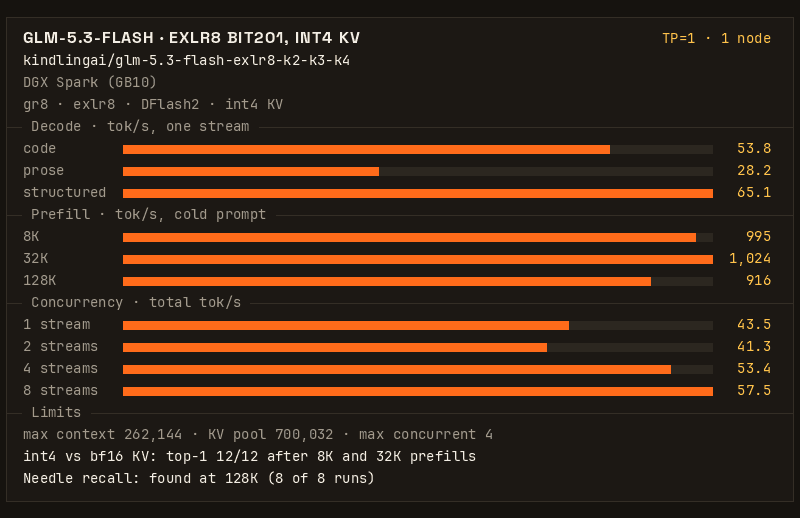
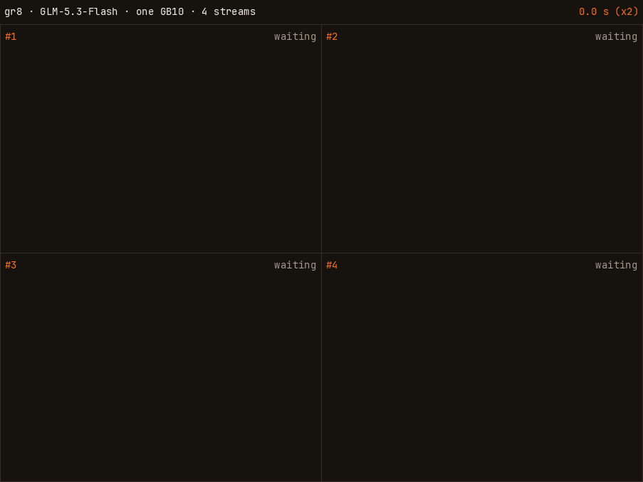

# GLM-5.3-Flash EXLR8 on 1× DGX Spark



If you are an agent booting this for someone, read [AGENTS.md](AGENTS.md) first, then the [Quickstart](#quickstart).

_**Join our Discord to learn more about KindlingAI and `gr8`: https://discord.gg/8EAvYPV2rE**_

GLM-5.3-Flash on one DGX Spark (GB10, 128 GB), served by [gr8](https://github.com/kindlingai/gr8) `v1.2.0` from the
`bit201` manifest of [kindlingai/glm-5.3-flash-exlr8-k2-k3-k4](https://huggingface.co/kindlingai/glm-5.3-flash-exlr8-k2-k3-k4):
K2, with the 124 routed experts that carry the most routing weight at tool-call positions at K3. This recipe runs gr8's
published image, pinned by digest, with `.env` and read-only config mounts. Nothing is compiled here.

K2, K3 and K4 are the release's three widths for the experts: 2, 3 and 4 bits a weight. A manifest is the file in the
release that says which width each expert is read at. `bit201` reads about 2.01 bits a routed weight; `VARIANT=k2`
(below) reads every expert at K2. The model card has the rest.



## Results

**`tp1` (`TUNE=speed`, default):** **53.8 tok/s** code decode · **28.2 tok/s** prose · **65.1 tok/s** structured ·
**995 / 1,024 / 916 tok/s** cold prefill at 8K / 32K / 128K · **43.5 / 41.3 / 53.4 / 57.5 tok/s** aggregate at 1 / 2 / 4 / 8
streams · **262,144**-token max context (`700,032`-token int4 KV pool, 4 concurrent sessions).

One GB10 box, TP=1, `TUNE=speed` (`bit201` manifest, `KV_FORMAT=int4`, `CAP=700032`, `SESS=4`, `DFLASH=1`), measured on
the prior `gr8` `main` build (`d598965`). Re-measurement on published `gr8 v1.2.0` (`ab2eb95`) is pending hardware
verification. Every speed is in tokens per second (tok/s).

Single-stream decode by workload:

| work | code | prose | structured |
|---|---:|---:|---:|
| tok/s | 53.8 | 28.2 | 65.1 |

Cold prefill:

| prompt | prefill tok/s |
|---|---:|
| 8K tokens | 995 |
| 32K tokens | 1,024 |
| 128K tokens | 916 |

Requests at once:

| streams | 1 | 2 | 4 | 8 |
|---|---:|---:|---:|---:|
| aggregate tok/s | 43.5 | 41.3 | 53.4 | 57.5 |

Quality and limits:

| check | result |
|---|---|
| int4 vs bf16 KV | top-1 12/12 after 8K and 32K prefills |
| needle recall | found at 128K (8 of 8 runs) |
| longest context (`max_model_len`) | 262,144 tokens (`700,018` with `TUNE=context`) |
| KV pool (`CAP`) | 700,032 tokens |
| max concurrent (`SESS`) | 4 |

Every number above also lives in [kindling.json](kindling.json); the card at the top is drawn from it.

## Quickstart

On the Spark:

```bash
npx @kindlingai/recipe glm-5.3-flash-exlr8-1x-spark && cd glm-5.3-flash-exlr8-1x-spark
# the CLI already copied .env.example to .env; edit it if you need to
docker compose up -d       # pulls the pinned gr8 image; the first boot fetches the model (~87 GB)
docker compose logs -f     # ready when it prints "serving: http://..." on 127.0.0.1:8100
```

This recipe lives in [kindlingai/recipes](https://github.com/kindlingai/recipes/tree/main/glm-5.3-flash/dgx-spark/1x/exlr8-gr8)
at `glm-5.3-flash/dgx-spark/1x/exlr8-gr8`; a [sparse clone](https://github.com/kindlingai/recipes#run-a-recipe) also works.

The first boot downloads 87 GB from Hugging Face into the cache volume and converts the drafter: about 10 minutes in
all. Later boots took about 45 s when measured on one GX10 with the K2 manifest (before `bit201`; not measured again).

Once serving, the OpenAI-compatible API listens on port 8100 (`glm-5.3-flash`, or `glm53f`):

```bash
curl -s localhost:8100/v1/models
curl -s localhost:8100/v1/chat/completions -H 'Content-Type: application/json' -d '{
  "model": "glm-5.3-flash",
  "messages": [{"role": "user", "content": "Write a haiku about a small computer."}],
  "max_tokens": 4096
}'
```

The model thinks before it answers. The thinking comes back in `message.reasoning` and counts toward `max_tokens`, so a
small `max_tokens` can end before `message.content` starts.

```bash
docker compose exec gr8 /opt/glm53f-1x/bin/gr8 glm53f smoke   # 14 checks against the API
docker compose down
```

If you prefer `docker run` directly (from inside the recipe folder, after `cp .env.example .env`):

```bash
docker run -d --name glm53f-1x-spark --gpus all --network host --pid host \
  --ulimit memlock=-1 --ulimit core=0 --cap-drop ALL --cap-add IPC_LOCK \
  --security-opt no-new-privileges --read-only --tmpfs /tmp:size=1g,mode=1777 --init --oom-score-adj 1000 \
  --env-file .env \
  -e GR8_WORK_DIR=/var/lib/gr8/home -e MODEL_CACHE=/var/lib/gr8/cache \
  -e PY=/usr/bin/python3 -e FRONT_BIN=/opt/gr8/bin/g6front-rs \
  -v glm53f-cache:/var/lib/gr8/cache -v glm53f-home:/var/lib/gr8/home \
  -v "$PWD/entrypoint.sh:/opt/glm53f-1x/entrypoint.sh:ro" \
  -v "$PWD/knobs.sh:/opt/glm53f-1x/knobs.sh:ro" \
  -v "$PWD/bin/gr8:/opt/glm53f-1x/bin/gr8:ro" \
  -v "$PWD/kv-store.yaml:/etc/gr8/kv-store.yaml:ro" \
  --entrypoint /opt/glm53f-1x/entrypoint.sh \
  ghcr.io/kindlingai/gr8:v1.2.0@sha256:3de05aab8cda21fd5d6b4af89ccdba6ff5abdbd704729601fd348fa638ade9fd
```

Note: the older recipe-specific image `ghcr.io/kindlingai/glm-5.3-flash-exlr8-1x-spark` is no longer updated (existing
tags remain available). This recipe now runs `ghcr.io/kindlingai/gr8` directly.

## What you need

- One DGX Spark, or another GB10 box such as the ASUS GX10 (128 GB).
- Docker and the NVIDIA container toolkit (both come with DGX OS).
- At least 87 GB of free disk for the download (the model and the drafter), plus up to 64 GB in the same cache volume
  for the prompt cache (`/var/lib/gr8/cache/prompts`).
- No other model running on the box: the weights take about 93 GB of memory (measured with the K2 manifest; `bit201`
  takes about 0.4 GB more).
- Optional: proactive memory compaction off (`sudo sysctl -w vm.compaction_proactiveness=0`; gr8's
  [DEPLOY.md](https://github.com/kindlingai/gr8/blob/v1.2.0/docs/DEPLOY.md#before-you-start) has the permanent form).

## Settings

`cp .env.example .env` (the CLI already did). Every knob is documented in [.env.example](.env.example); the active lines
are the default `TUNE=speed` settings. Override any knob in `.env` (or with `docker run -e`):

| knob | default | what it does |
|---|---|---|
| `TUNE` | `speed` | What to prioritize, see [Pick what to prioritize](#pick-what-to-prioritize). Any other value stops the boot. |
| `CAP` | `700032` | The KV pool in tokens, shared by the sessions. Each request reserves its prompt + `max_tokens` from it. |
| `MAX_MODEL_LEN` | `262144` (`700018` with `TUNE=context`) | The longest single request, prompt and output together. At most `CAP` less 14. |
| `VARIANT` | `bit201` | Which manifest of the release the engine reads: `bit201`, or `k2` for every expert at K2 (about 0.4 GB smaller). |
| `DFLASH` | `1` | `1` drafts with [DFlash2](https://huggingface.co/incoai/GLM-5.3-Flash-DFlash2) (CC BY-NC-ND 4.0), downloaded on the first boot. `0` uses MTP only and downloads nothing. |
| `MENTAT` | `0` | `1` registers with the [mentat](https://github.com/kindlingai/mentat) cluster manager through the host's mentat daemon, in group `GROUP` (`gr8-glm53f-1x`). |
| `DEFAULT_PRESENCE_PENALTY` | `greedy=0.2,greedy.thinking=0.5,nongreedy.thinking=0.5` | A presence penalty on thinking tokens (0.5) to stop the model repeating its own reasoning, plus 0.2 on the reply for greedy requests (temperature 0). Sampled replies get none. `0` turns it off. |
| `UNDECLARED_TOOL_CALLS` | `emit` | A call to a tool the request did not declare comes back as a tool call, so your agent can answer it with an unknown-tool error. `text` leaves it in the reply's text. |
| `DEFAULT_MAX_TOKENS` | `32768` | `max_tokens` for a request that names none. `0` lets gr8 choose: 8,192 for a long prompt, too little for long agent turns. |
| `DEFAULT_THINK_END_BOOST` | `start=16384,per1k=4,max=10` | After 16,384 thinking tokens, makes the end of thinking a little more likely with each token, so a long think ends where the model is ready to stop. Empty turns it off. |
| `DEFAULT_THINKING_BUDGET` | `28672` | The most thinking tokens a request gets, after which its thinking is closed and it answers. `0` means no limit. |
| `GR8_CACHE`, `GR8_HOME` | named volumes | Host directories (owned by uid 1000) in place of compose's named volumes for model/prompt cache and logs/state. |
| `GR8_STOP_GRACE` | `30s` | Shutdown grace period for `docker stop`. |
| `GR8_IMAGE` | pinned `gr8:v1.2.0` digest | Override the published `gr8` engine image. |

`CAP` was tuned on a standard DGX OS install. On [Kindling Spark OS](https://github.com/kindlingai/kindling-spark-os)
you may be able to raise `CAP` to `1000000`.

`.env.example` pins `MODEL` and `DRAFTER` to fixed Hugging Face commits. Set `MODEL` or `DRAFTER` in `.env` to change
them (`https://huggingface.co/<org>/<repo>@<commit>`).

[gr8/KNOBS.md](https://github.com/kindlingai/gr8/blob/v1.2.0/KNOBS.md) lists the advanced `gr8` options, which you can
also set in `.env`.

## Pick what to prioritize

`TUNE` picks one of three settings (implemented in [knobs.sh](knobs.sh)):

| `TUNE` | tradeoff | what it sets |
|---|---|---|
| `speed` (default) | balanced latency & concurrency | `MAX_MODEL_LEN=262144` |
| `context` | single ultra-long request | `MAX_MODEL_LEN=700018` (with `CAP` below `700032`, also set `MAX_MODEL_LEN` to at most `CAP` less 14) |
| `quality` | same as `speed` | `MAX_MODEL_LEN=262144` (K3 and K4 do not fit one box) |

If you set `MAX_MODEL_LEN` yourself in `.env`, `TUNE` leaves it alone.

## Run another model

A box runs one model at a time. To switch, stop and remove this one first:

```bash
docker compose down          # docker run: docker stop glm53f-1x-spark && docker rm glm53f-1x-spark
```

The model stays in the cache volume, so a later start downloads nothing. To free the disk (87 GB, plus up to 64 GB of
prompt checkpoints), remove the volumes:

```bash
docker compose down -v       # docker run: docker volume rm glm53f-cache glm53f-home
```

## Other sizes

- **2 boxes (TP=2, `bit349` / `k4`, 2M KV pool, image input):** [glm-5.3-flash-exlr8-2x-spark](../../2x/exlr8-gr8)

[gr8's Recipes](https://github.com/kindlingai/gr8#recipes) lists the other models and box counts.

## Help

Ask on Discord (https://discord.gg/8EAvYPV2rE) or open an issue in the recipes repo
(https://github.com/kindlingai/recipes/issues) with `glm-5.3-flash-exlr8-1x-spark` in the title. Say which step failed
and include the end of `docker compose logs` before you remove the container. Remove addresses and hostnames before you
post.

## Engine pin

This recipe has no engine code and no Dockerfile. It runs one published gr8 image, named in
[compose.yaml](compose.yaml) and in the `engine` field of [kindling.json](kindling.json):

| | |
|---|---|
| engine | [kindlingai/gr8](https://github.com/kindlingai/gr8) [`v1.2.0`](https://github.com/kindlingai/gr8/releases/tag/v1.2.0) at [`ab2eb95`](https://github.com/kindlingai/gr8/commit/ab2eb95f426ff908543d5d002218cf5a2a5c5be6) |
| image | `ghcr.io/kindlingai/gr8:v1.2.0` |
| digest | `sha256:3de05aab8cda21fd5d6b4af89ccdba6ff5abdbd704729601fd348fa638ade9fd` |
| weights | [kindlingai/glm-5.3-flash-exlr8-k2-k3-k4](https://huggingface.co/kindlingai/glm-5.3-flash-exlr8-k2-k3-k4/commit/901ad084f0afd2400820504910d3e684133ce183) (`901ad084`) |

`python3 tools/check_pin.py --strict glm-5.3-flash/dgx-spark/1x/exlr8-gr8`, run from the monorepo root, verifies that
`compose.yaml` and `kindling.json` agree on the immutable image digest. `./check-config.sh` runs a no-GPU check of
`docker compose config` and `show-config` against the pinned gr8 image.

The older recipe-specific image `ghcr.io/kindlingai/glm-5.3-flash-exlr8-1x-spark` stops updating with this change
(existing tags stay on GHCR).

## License

MIT, see [LICENSE](../../../../LICENSE). GLM-5.3-Flash and the DFlash2 drafter have their own licences: see the
[model page](https://huggingface.co/kindlingai/glm-5.3-flash-exlr8-k2-k3-k4) and
[incoai/GLM-5.3-Flash-DFlash2](https://huggingface.co/incoai/GLM-5.3-Flash-DFlash2) (CC BY-NC-ND 4.0).
