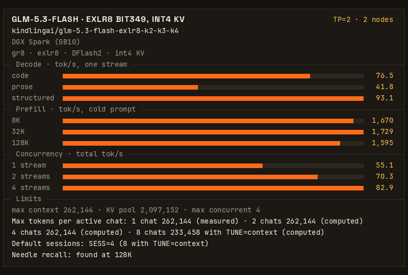
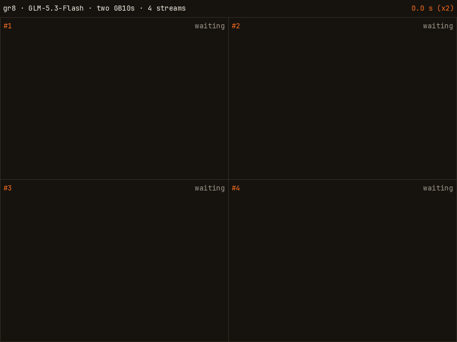

# GLM-5.3-Flash EXLR8 on 2× DGX Spark



If you are an agent booting this for someone, read [AGENTS.md](AGENTS.md) first, then the [Quickstart](#quickstart).

_**Join our Discord to learn more about KindlingAI and `gr8`: https://discord.gg/8EAvYPV2rE**_

GLM-5.3-Flash on two DGX Sparks (GB10, 128 GB each) at TP=2, served by [gr8](https://github.com/kindlingai/gr8) `v1.2.0`
from the `bit349` manifest of
[kindlingai/glm-5.3-flash-exlr8-k2-k3-k4](https://huggingface.co/kindlingai/glm-5.3-flash-exlr8-k2-k3-k4) (K3 with K4
where it lowers KL most, about 3.49 bits a routed weight), with int4 KV, a 2,097,152-token KV pool, DFlash2 speculative
decoding, shared waterfill MTP=3 drafting, a prompt cache on disk, and image input. This recipe runs gr8's published
image, pinned by digest, with `.env` and read-only config mounts. Nothing is compiled here.



## Results

**`tp2` (`TUNE=speed`, default):** **76.5 tok/s** code decode · **41.8 tok/s** prose · **93.1 tok/s** structured ·
**1,670 / 1,729 / 1,595 tok/s** cold prefill at 8K / 32K / 128K · **55.1 / 70.3 / 82.9 tok/s** aggregate at 1 / 2 / 4
streams · **262,144**-token max context (`2,097,152`-token int4 KV pool, 4 concurrent sessions; 8 sessions / 1M context
with `TUNE=context`).

Two GB10 boxes at TP=2, `TUNE=speed` (`bit349` manifest, `KV_FORMAT=int4`, `CAP=2097152`, `SESS=4`, `DFLASH=1`),
measured on the prior `gr8` `main` build (`4057009`). Re-measurement on published `gr8 v1.2.0` (`ab2eb95`) is pending
hardware verification. Every speed is in tokens per second (tok/s).

Single-stream decode by workload:

| work | code | prose | structured |
|---|---:|---:|---:|
| tok/s | 76.5 | 41.8 | 93.1 |

Cold prefill:

| prompt | prefill tok/s |
|---|---:|
| 8K tokens | 1,670 |
| 32K tokens | 1,729 |
| 128K tokens | 1,595 |

Requests at once:

| streams | 1 | 2 | 4 |
|---|---:|---:|---:|
| aggregate tok/s | 55.1 | 70.3 | 82.9 |

Max tokens per chat (`TUNE=speed`, `CAP=2,097,152`; 8 chats `233,458` with `TUNE=context`, computed):

| active chats | 1 (measured) | 2 (computed) | 4 (computed) |
|---|---:|---:|---:|
| max tokens per chat | 262,144 | 262,144 | 262,144 |

Quality and limits:

| check | result |
|---|---|
| default sessions | `SESS=4` (8 with `TUNE=context`) |
| needle recall | found at 128K |
| longest context (`max_model_len`) | 262,144 tokens (`1,048,576` with `TUNE=context`) |
| KV pool (`CAP`) | 2,097,152 tokens (`262,208` with `TUNE=quality`) |
| max concurrent (`SESS`) | 4 (`8` with `TUNE=context`) |

Every number above also lives in [kindling.json](kindling.json); the card at the top is drawn from it.

## Quickstart

First configure ConnectX addressing and disable proactive memory compaction on both boxes
([What you need](#what-you-need) and [Clustering](#clustering)). Then, on both boxes with the same `.env`:

```bash
npx @kindlingai/recipe glm-5.3-flash-exlr8-2x-spark && cd glm-5.3-flash-exlr8-2x-spark
# the CLI already copied .env.example to .env; edit PEERS, IPS and IPS2 and remove their # (or set MENTAT=1):
# the same .env on both boxes
docker compose up -d       # pulls the pinned gr8 image; first boot fetches this box's part (~77 GB) and joins
docker compose logs -f     # on the head: ready when it prints "serving: http://..." on 127.0.0.1:8100
```

This recipe lives in [kindlingai/recipes](https://github.com/kindlingai/recipes/tree/main/glm-5.3-flash/dgx-spark/2x/exlr8-gr8)
at `glm-5.3-flash/dgx-spark/2x/exlr8-gr8`; a [sparse clone](https://github.com/kindlingai/recipes#run-a-recipe) also works.

The boxes wait up to 600 s (10 minutes) for each other, so start both within that time. The head (the first address in
`PEERS`, or the lowest address with `MENTAT=1`) serves the OpenAI-compatible API on port 8100 (`glm-5.3-flash`, or
`glm53f`):

```bash
curl -s localhost:8100/v1/models
curl -s localhost:8100/v1/chat/completions -H 'Content-Type: application/json' -d '{
  "model": "glm-5.3-flash",
  "messages": [{"role": "user", "content": "Write a haiku about a small computer."}],
  "max_tokens": 4096
}'
```

The model thinks before it answers. The thinking comes back in `message.reasoning` and counts toward `max_tokens`.

The model also reads images. Send each one inline as an `image_url` content part with a `data:` URL (base64), up to 16
images a request; the API does not fetch URLs:

```bash
curl -s localhost:8100/v1/chat/completions -H 'Content-Type: application/json' -d '{
  "model": "glm-5.3-flash",
  "messages": [{"role": "user", "content": [
    {"type": "text", "text": "What is in this picture?"},
    {"type": "image_url", "image_url": {"url": "data:image/png;base64,<base64 of the PNG>"}}]}],
  "max_tokens": 4096
}'
```

Run the API smoke test on the head, and stop cleanly on both boxes:

```bash
docker compose exec gr8 /opt/glm53f-2x/bin/gr8 glm53f smoke   # on the head: 14 checks against the API
docker compose down                                           # on both boxes
```

If you prefer `docker run` directly (from inside the recipe folder on both boxes, after editing `.env` with `PEERS`,
`IPS`, `IPS2` or `MENTAT=1`):

```bash
docker run -d --name glm53f-2x-spark --gpus all --network host --pid host --device /dev/infiniband \
  --ulimit memlock=-1 --ulimit core=0 --cap-drop ALL --cap-add IPC_LOCK \
  --security-opt no-new-privileges --read-only --tmpfs /tmp:size=1g,mode=1777 --init --oom-score-adj 1000 \
  --env-file .env \
  -e GR8_WORK_DIR=/var/lib/gr8/home -e MODEL_CACHE=/var/lib/gr8/cache \
  -e PY=/usr/bin/python3 -e FRONT_BIN=/opt/gr8/bin/g6front-rs \
  -v glm53f-2x-cache:/var/lib/gr8/cache -v glm53f-2x-home:/var/lib/gr8/home \
  -v "$PWD/entrypoint.sh:/opt/glm53f-2x/entrypoint.sh:ro" \
  -v "$PWD/knobs.sh:/opt/glm53f-2x/knobs.sh:ro" \
  -v "$PWD/bin/gr8:/opt/glm53f-2x/bin/gr8:ro" \
  -v "$PWD/kv-store.yaml:/etc/gr8/kv-store.yaml:ro" \
  --entrypoint /opt/glm53f-2x/entrypoint.sh \
  ghcr.io/kindlingai/gr8:v1.2.0@sha256:3de05aab8cda21fd5d6b4af89ccdba6ff5abdbd704729601fd348fa638ade9fd
```

Note: the older recipe-specific image `ghcr.io/kindlingai/glm-5.3-flash-exlr8-2x-spark` is no longer updated (existing
tags remain available). This recipe now runs `ghcr.io/kindlingai/gr8` directly.

## What you need

- Two DGX Sparks (or ASUS GX10, 128 GB each) joined by a 200G cable between their ConnectX ports (see
  [Clustering](#clustering)).
- Docker and the NVIDIA container toolkit on each box (both come with DGX OS).
- Free disk per box: about 77 GB for this box's part of the model, vision tower, and drafter (~90 GB with
  `TUNE=quality`; ~130 GB if both are cached), plus up to 64 GB in the same cache volume for the prompt cache
  (`/var/lib/gr8/cache/prompts`), plus 73 GiB if you enable compact expert copies.
- No other model running on either box: the weights take about 76 GB a box (86 GB with `TUNE=quality`).
- A LAN between the two boxes, with TCP ports 7340 and 7341 open.
- Proactive memory compaction off on each box, once, as root (holds across reboots):

  ```bash
  echo 'vm.compaction_proactiveness = 0' > /etc/sysctl.d/90-gr8-no-proactive-compaction.conf
  sysctl -w vm.compaction_proactiveness=0
  ```

## Settings

`cp .env.example .env` on both boxes (the CLI already did). Edit `PEERS`, `IPS` and `IPS2` (or set `MENTAT=1`) so both
boxes have the identical `.env`. Every knob is documented in [.env.example](.env.example):

| knob | default | what it does |
|---|---|---|
| `TUNE` | `speed` | What to prioritize, see [Pick what to prioritize](#pick-what-to-prioritize). Sets defaults for `VARIANT`, `SESS`, `CAP` and `MAX_MODEL_LEN`. Any other value stops the boot. |
| `PEERS` | none | The two boxes' 10G LAN addresses, head first. Required unless `MENTAT=1`. |
| `IPS`, `IPS2` | none | Each box's ConnectX address on PCIe root 1 and root 2, in `PEERS` order. |
| `VARIANT` | `bit349` (`k4` with `TUNE=quality`) | The release's width manifest, such as `bit349` or `k4`. A width not in the cache yet downloads at boot. |
| `SESS` | `4` (`8` with `TUNE=context`) | The requests that decode at once, 1 to 8. |
| `CAP` | `2097152` (`262208` with `TUNE=quality`) | The KV pool in tokens, shared by the sessions. Each request reserves its prompt + `max_tokens` from it. |
| `MAX_MODEL_LEN` | `262144` (`1048576` with `TUNE=context`) | The longest single request, prompt and output together. At most 1,048,576. |
| `DFLASH` | `1` | `1` drafts with [DFlash2](https://huggingface.co/incoai/GLM-5.3-Flash-DFlash2) (CC BY-NC-ND 4.0) when a request runs alone, downloaded on the first boot. `0` uses MTP only and downloads nothing. |
| `MENTAT` | `0` | `1` finds the other box and the ConnectX addresses through the host's `mentat` daemon, and registers the API in group `GROUP` (`gr8-glm53f-2x`). |
| `GR8_GLM53F_VISION` in `EXTRA_ENV` | `1` | Image input. Each box loads the vision tower (~1.6 GiB of memory, ~1.1 GB download). `knobs.sh` adds `GR8_GLM53F_VISION=1` unless `EXTRA_ENV` already names it; set `EXTRA_ENV="GR8_GLM53F_VISION=0"` on both boxes to turn it off. |
| `DEFAULT_MAX_TOKENS` | `32768` | `max_tokens` for a request that sends none, or the room the context leaves if less. |
| `DEFAULT_THINK_END_BOOST` | `start=16384,per1k=4,max=10` | After 16,384 thinking tokens, boosts `</think>` logit so long thinking closes cleanly. Empty turns it off. |
| `DEFAULT_THINKING_BUDGET` | `28672` | Hard cap on thinking tokens before the model answers. `0` means no limit. |
| `DEFAULT_PRESENCE_PENALTY` | `greedy=0.2,greedy.thinking=0.5,nongreedy.thinking=0.5` | Presence penalty on thinking tokens (0.5) to stop reasoning loops, plus 0.2 on greedy replies. Sampled replies get none. `0` turns it off. |
| `UNDECLARED_TOOL_CALLS` | `emit` | Undeclared tool calls come back as `tool_calls` so agents can return an unknown-tool error. `text` leaves them in `content`. |
| `GR8_CACHE`, `GR8_HOME` | named volumes | Host directories (owned by uid 1000) in place of compose's named volumes for model/prompt cache and logs/state. |
| `GR8_STOP_GRACE` | `30s` | Shutdown grace period for `docker stop`. |
| `GR8_IMAGE` | pinned `gr8:v1.2.0` digest | Override the published `gr8` engine image. |

`.env.example` pins `MODEL` and `DRAFTER` to fixed Hugging Face commits. Set `MODEL` or `DRAFTER` in `.env` to change
them (`https://huggingface.co/<org>/<repo>@<commit>`). With a `MODEL` that follows a branch, set `VARIANT` to the
manifest's path.

[gr8/KNOBS.md](https://github.com/kindlingai/gr8/blob/v1.2.0/KNOBS.md) lists the advanced `gr8` options, which you can
also set in `.env`.

## Clustering

Give each box one address per PCIe root. The Spark's ConnectX card shows each physical port twice, once on each PCIe
root, and the engines use both. Run `ip -br link` on each box to list your port names; the names in the example below
(`enp1s0f0np0` and `enP2p1s0f0np0`) are examples, so use yours. `mtu: 9000` (jumbo frames) must be set on both boxes,
and a switch between them must pass it. For a cable on the first port, with netplan:

```yaml
# /etc/netplan/60-connectx.yaml on the first box. On the second box: 10.0.0.2 and 10.0.1.2.
network:
  version: 2
  ethernets:
    enp1s0f0np0:        # the first port on PCIe root 1
      addresses: [10.0.0.1/24]
      mtu: 9000
    enP2p1s0f0np0:      # the same port on PCIe root 2
      addresses: [10.0.1.1/24]
      mtu: 9000
```

Then run `sudo netplan apply` on each box.

Two kinds of address are used:

- The **10G LAN address** is the box's address on your network. `PEERS` holds both boxes' 10G LAN addresses, head first,
  and the head serves the API on port 8100.
- The **ConnectX addresses** are the ones in the netplan file (`10.0.0.x` on PCIe root 1, `10.0.1.x` on PCIe root 2).
  `IPS` holds the root-1 addresses and `IPS2` holds the root-2 addresses, in `PEERS` order.

With [`mentat`](https://github.com/kindlingai/mentat) running on each box, the recipe discovers the other box and its
ConnectX addresses automatically:

```bash
docker run -d --name mentat --network host --restart unless-stopped ghcr.io/kindlingai/mentat:0.27.0
```

Then set `MENTAT=1` in `.env` and leave `PEERS`, `IPS` and `IPS2` commented out.

## Pick what to prioritize

`TUNE` picks one of three presets (implemented in [knobs.sh](knobs.sh)). When you uncomment and set `VARIANT`, `SESS`,
`CAP` or `MAX_MODEL_LEN` yourself in `.env`, your value wins.

| `TUNE` | tradeoff | what it sets |
|---|---|---|
| `speed` (default) | balanced latency & 4 concurrent streams | `VARIANT=bit349`, `SESS=4`, `CAP=2097152`, `MAX_MODEL_LEN=262144` |
| `context` | 8 streams & up to 1M context | `VARIANT=bit349`, `SESS=8`, `CAP=2097152`, `MAX_MODEL_LEN=1048576`, `GR8_CP=1` (context-parallel KV, experimental) |
| `quality` | widest weights (K4) | `VARIANT=k4`, `SESS=4`, `CAP=262208`, `MAX_MODEL_LEN=262144` |

With shared waterfill MTP=3 drafting (`S2_SHARED_WATERFILL=1`, `MTP=3`) on the prior `gr8` build (`4057009`),
`TUNE=speed` leaves 8.9–9.2 GiB of post-capture memory free per box (25 s warm boot; 55.1 / 70.3 / 82.9 tok/s at
1 / 2 / 4 streams, against 56.0 / 63.9 / 78.5 tok/s on the prior `SESS=8` `MTP=1` build). `SESS=8` with `MTP=3` without
context-parallel KV leaves 6.4–6.9 GiB free; `TUNE=context` runs `SESS=8` with `GR8_CP=1` (8.7–9.1 GiB free, 29 s warm
boot, 53.0 / 69.2 / 79.8 / 97.4 tok/s at 1 / 2 / 4 / 8 streams). `TUNE=quality` runs `SESS=4` with `MTP=3` (9.4–9.6 GiB
free, 53.3 / 65.3 / 78.3 tok/s at 1 / 2 / 4 streams vs 53.1 / 58.7 / 72.4 tok/s with `GR8_S2_SHARED_WATERFILL=0`).

## Compact expert copies

Optional, and off by default. `GR8_LOAD_COMPACT` and `GR8_LOAD_MERGE_KB=1` in `EXTRA_ENV` make the loader read dense
per-rank copies of its expert ranges in place of the release's sparse files. The bytes it loads are the same, and a
switch into this recipe was faster in our runs. The numbers below are `VARIANT=k4` numbers, not the default `bit349`'s.

To turn it on, on both boxes: uncomment the `EXTRA_ENV` line in `.env` (`.env.example` has it commented out), write the
copies once before the first boot or with the recipe stopped, then start or restart:

```bash
docker compose run --rm gr8 prepare               # on both boxes
docker compose run --rm gr8 prepare --rank 0      # with MENTAT=1: rank 0 on head, rank 1 on second box
```

`prepare` fetches and checks the model and drafter, writes this box's expert ranges to `/var/lib/gr8/cache/compact-tp2`,
and reads every copy back to verify it. A directory that already exists is checked and reused, never overwritten.

- **If enabled without running `prepare`:** the loader falls back to the release, except `GR8_LOAD_MERGE_KB=1` still
  merges nearby reads (within 1 KB, gaps included; not separately measured).
- **Disk:** 73 GiB (~78 GB) per box for `VARIANT=k4` (43 copy files and maps; `bit349` size not measured), alongside
  the release.
- **Changing `VARIANT`, TP size, or release:** use a new `GR8_LOAD_COMPACT` directory on both boxes and run `prepare`
  again.
- **Turning off:** comment out `EXTRA_ENV` on both boxes and restart; delete `compact-tp2` in the cache volume to free
  space.

Measured on 2026-11-07 (Pacific time) on two DGX Sparks, GLM-5.3-Flash at TP=2, gr8 `d21ddaa`, `VARIANT=k4` on release
pin `867580abd28d142bb4c56218bb81a752b7dea988` (before the `bit349` default and current pin
`901ad084f0afd2400820504910d3e684133ce183`; `bit349` was not measured). Each experiment ran stock, knob, knob, stock
switching from GLM-5.3 to GLM-5.3-Flash until `/health` reported ready:

| Switch GLM-5.3 to GLM-5.3-Flash | Stock, total (n=2) | With the knob, total (n=2) | A rank's read, stock / knob |
|---|---|---|---|
| `GR8_LOAD_COMPACT` alone | 34.2 / 32.8 s | 31.4 / 33.0 s | 19.6–19.9 s / 19.4–19.7 s |
| `GR8_LOAD_COMPACT` with `GR8_LOAD_MERGE_KB=1` | 33.5 / 33.5 s | 26.9 / 25.2 s | 19.5–19.9 s / 12.6–12.9 s |

With both knobs, switches took 25.8 / 25.5 s from GLM-5.3 and 22.9 / 24.1 s from DeepSeek-V4.1-Flash (vs 33.4 / 33.5 s
and 30.7 / 29.5 s without copies), with 8/8 identical outputs on 8 fixed prompts
([gr8 docs/SWITCHING.md](https://github.com/kindlingai/gr8/blob/main/docs/SWITCHING.md#compact-copies-on-the-pair)).

## Run another model

A box runs one model at a time. To switch, stop and remove this recipe's container on both boxes:

```bash
docker compose down          # docker run: docker stop glm53f-2x-spark && docker rm glm53f-2x-spark
```

Each box's part stays in its cache volume, so a later start downloads nothing. To free the disk (~77 GB a box, ~130 GB
after `TUNE=quality` boots too, up to 73 GiB of compact copies if written, and up to 64 GB of prompt checkpoints),
remove the volumes on both boxes:

```bash
docker compose down -v       # docker run: docker volume rm glm53f-2x-cache glm53f-2x-home
```

## Other sizes

- **1 box (TP=1, `bit201`, 700K KV pool):** [glm-5.3-flash-exlr8-1x-spark](../../1x/exlr8-gr8)

[gr8's Recipes](https://github.com/kindlingai/gr8#recipes) lists the other models and box counts.

## Help

Ask on Discord (https://discord.gg/8EAvYPV2rE) or open an issue in the recipes repo
(https://github.com/kindlingai/recipes/issues) with `glm-5.3-flash-exlr8-2x-spark` in the title. Say which step failed
and include the end of `docker compose logs` before you remove the container. Remove addresses and hostnames before you
post.

## Engine pin

This recipe has no engine code and no Dockerfile. It runs one published gr8 image, named in
[compose.yaml](compose.yaml) and in the `engine` field of [kindling.json](kindling.json):

| | |
|---|---|
| engine | [kindlingai/gr8](https://github.com/kindlingai/gr8) [`v1.2.0`](https://github.com/kindlingai/gr8/releases/tag/v1.2.0) at [`ab2eb95`](https://github.com/kindlingai/gr8/commit/ab2eb95f426ff908543d5d002218cf5a2a5c5be6) |
| image | `ghcr.io/kindlingai/gr8:v1.2.0` |
| digest | `sha256:3de05aab8cda21fd5d6b4af89ccdba6ff5abdbd704729601fd348fa638ade9fd` |
| weights | [kindlingai/glm-5.3-flash-exlr8-k2-k3-k4](https://huggingface.co/kindlingai/glm-5.3-flash-exlr8-k2-k3-k4/commit/901ad084f0afd2400820504910d3e684133ce183) (`901ad084`) |

`python3 tools/check_pin.py --strict glm-5.3-flash/dgx-spark/2x/exlr8-gr8`, run from the monorepo root, verifies that
`compose.yaml` and `kindling.json` agree on the immutable image digest. `./check-config.sh` runs a no-GPU check of
`docker compose config` and `show-config` against the pinned gr8 image.

The older recipe-specific image `ghcr.io/kindlingai/glm-5.3-flash-exlr8-2x-spark` stops updating with this change
(existing tags stay on GHCR).

## License

MIT, see [LICENSE](../../../../LICENSE). GLM-5.3-Flash and the DFlash2 drafter have their own licences: see the
[model page](https://huggingface.co/kindlingai/glm-5.3-flash-exlr8-k2-k3-k4) and
[incoai/GLM-5.3-Flash-DFlash2](https://huggingface.co/incoai/GLM-5.3-Flash-DFlash2) (CC BY-NC-ND 4.0).
