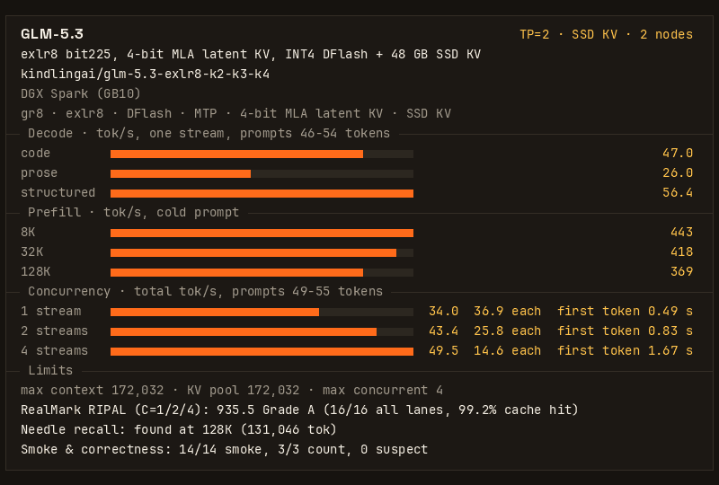

# GLM-5.3 EXLR8 on 2× DGX Spark



If you are an agent booting this for someone, read [AGENTS.md](AGENTS.md) first, then the Quickstart. Join the
[KindlingAI Discord](https://discord.gg/8EAvYPV2rE) for help and updates.

Full **GLM-5.3 (743B)** on just **two DGX Sparks** (GB10, 128 GB unified memory each — 256 GB total) at `TP=2`, served
by upstream [gr8](https://github.com/kindlingai/gr8) (`main@530312e6`) from the `bit225` mixed-precision profile of
[kindlingai/glm-5.3-exlr8-k2-k3-k4](https://huggingface.co/kindlingai/glm-5.3-exlr8-k2-k3-k4/tree/501d259894bf0de607ee4aa6f8a564a14d0c6b63)
with **4-bit MLA latent KV** (`172,032`-token pool, `416 B/layer/tok` excl. indexer vs `656 B` FP8), **native INT4
DFlash** (`incoai/GLM-5.3-DFlash2`, auto-packed to `tp2-int4` on first boot) + `MTP=1`, and built-in **48 GB NVMe SSD
KV offloading** (`KV_STORE`). This recipe runs gr8's published image pinned by immutable digest with one `.env` file.
Nothing is compiled.

## Results

**`TP=2` (`bit225`, 4-bit MLA latent KV `CAP=172,032`, INT4 DFlash + 48 GB SSD KV):** **RealMark RIPAL 935.5 Grade A**
(`833.2 / 980.9 / 1,001.8` at `C=1 / 2 / 4`, `16/16` completed on every lane, `72.9 tok/s` C=4 aggregate decode,
`99.23%` prefix cache hit across `307K` active `C=4` context) · **47.0 tok/s** code decode (`26.0` prose, `56.4`
structured, `60.5` counting) · **443 / 418 / 369 tok/s** cold prefill (`8K / 32K / 128K`, cached TTFT `0.20 / 0.24 /
0.32 s`) · **34.0 / 43.4 / 49.5 tok/s** mixed-prompt concurrency (`1 / 2 / 4` streams) · **14/14** smoke & **128K needle
PASS** (`131,046` tok, `0` suspect replies) · **86 s** warm boot · **0.686 GiB** live `MemAvailable` floor (`10.7×`
more headroom than the prior `131K` build) · **0** API errors.

Measured **2026-11-28** across two DGX Sparks on a 200G RoCE v2 switch running `kindlingai/gr8` `main` (`530312e6`)
with this recipe's `.env` (`CAP=172032, MAX_MODEL_LEN=172032, SESS=4`), one fresh boot, GPU clocks uncapped in timed
stages (`0%` thermal throttle).

Single-stream decode (`bench/bench.py`, default level, `46–54` tok prompts, up to `512` tok out, `6` runs each):

| work | code | prose | structured | counting |
|---|---:|---:|---:|---:|
| tok/s, mean | **47.0** | **26.0** | **56.4** | **60.5** |
| lowest – highest run | 41.9 – 52.5 | 23.4 – 28.1 | 52.6 – 60.5 | 59.8 – 61.4 |

Cold prefill (`bench/bench.py`, salted prompts, `0` cached tokens on cold pass):

| prompt | first token | prefill tok/s | decode after it | first token, same prompt again (cached) |
|---|---:|---:|---:|---:|
| 8K tokens (`8,231`) | 18.57 s | **443** | 24.0 tok/s | 0.20 s |
| 32K tokens (`32,728`) | 78.30 s | **418** | 23.9 tok/s | 0.24 s |
| 128K tokens (`130,890`) | 354.38 s | **369** | 23.5 tok/s | 0.32 s |

Concurrent streams (`bench/bench.py`, short mixed prompts `49–55` tok, up to `512` tok out each):

| requests at once | 1 | 2 | 4 |
|---|---:|---:|---:|
| total tok/s | **34.0** | **43.4** | **49.5** |
| tok/s per request | 36.9 | 25.8 | 14.6 |
| first token, median | 0.49 s | 0.83 s | 1.67 s |

Official RealMark multi-lane agentic concurrency (`ripal.py --lanes 1 2 4 --probe`, Thinking OFF):

| concurrency | RIPAL score | aggregate decode | per-lane decode | aggregate prefill | active context | cache hit | done | wall time |
|---|---:|---:|---:|---:|---:|---:|---:|---:|
| `C=1` | **833.2** | 26.1 tok/s | 26.1 tok/s | 345.4 tok/s | 97K | 99.29% | **16/16** | 568.9 s |
| `C=2` | **980.9** | 40.5 tok/s | 20.3 tok/s | 225.1 tok/s | 166K | 99.21% | **16/16** | 467.4 s |
| `C=4` | **1,001.8** | **72.9 tok/s** | 18.2 tok/s | 118.5 tok/s | 307K | 99.18% | **16/16** | 455.4 s |

Quality & verification checks (same fresh boot):

| check | result |
|---|---|
| Official RealMark RIPAL (`C=1/2/4`, Thinking OFF) | **935.5 Grade A** (`16/16` all lanes, `99.23%` cache hit, `95.7%–96.4%` match) |
| Smoke test (`bench/bench.py`) | **14 / 14 PASS** |
| Count to 200 (`bench/bench.py`) | **3 / 3 PASS** |
| Prompt cache (`bench/bench.py`) | **422 / 423 cached PASS** |
| 128K needle recall (`bench/bench.py`) | **PASS** (`131,046` tokens) |
| Suspect characters (`bench/bench.py`) | **0 replies PASS** |
| Live memory floor (`MemAvailable`) | **0.686 GiB** across RealMark & bench (`0` OOMs, `0` API errors, max temp `84°C`, `0%` throttle) |

## Quickstart

Run on **both** DGX Sparks with the exact same `.env`:

```bash
cp .env.example .env
# Edit PEERS in .env to your two Spark LAN IPs (head first).
# If cabled directly without a switch, set SHAPE=direct.
docker compose up -d
docker compose logs -f
```

Verify from the head node once ready (~86 s warm boot):

```bash
docker compose exec gr8 /opt/gr8/gr8 glm53 health
curl -s http://localhost:8100/v1/models
```

Stop both ranks cleanly from the head:

```bash
docker compose exec gr8 /opt/gr8/gr8 glm53 down
docker compose down
```

## What you need

- **2× NVIDIA DGX Spark** (GB10, 128 GB unified memory each — 256 GB total) connected over 200G RoCE v2 (switch or
  direct cable).
- **No other GPU or heavy RAM workloads** running on either Spark — `TP=2` runs tight on unified RAM (`0.686 GiB` live
  `MemAvailable` floor at `CAP=172,032` with `GR8_MEM_MIN=1`).
- **>= 175 GB free fast local NVMe** per Spark (~115 GB for weights/drafter + **48 GB** for the built-in NVMe SSD
  `KV_STORE`).
- Docker with the NVIDIA Container Toolkit, `/dev/infiniband` present, TCP ports `7340`/`7341` open between peers, and
  `sysctl -w vm.compaction_proactiveness=0` on both nodes.

## Settings

Key `.env` knobs:
- `VARIANT=bit225`: 2.25 bpw EXLR8 mixed-precision expert widths (required to fit 743B on 2 Sparks).
- `KV_FORMAT=int4`, `KVB=fp8`: **4-bit MLA latent KV** (`416 B/layer/tok` excl. indexer) for 36.6% lower KV footprint.
- `KV_STORE=ssd:/var/lib/gr8/home/kv-store,size=48G,persist=off,keep=all`: spills cold prefix pages to NVMe so 4
  concurrent sessions retain 99.2% prefix cache hit across ~307K active context.
- `DFLASH=1`, `MTP=1`, `SPEC_ADAPT=1`: native INT4 DFlash (`tp2-int4`) + MTP=1 speculative decoding (with gr8's updated
  TP=2 launcher defaults: `GR8_DFL_VERIFY_CAP=0.18`, `GR8_DFL_DEDUP=1`, `GR8_S2_SHARED_WATERFILL=1`,
  `GR8_DEC_BK=4096`, `GR8_CP_ONECHAIN=1`).
- `CAP=172032`, `MAX_MODEL_LEN=172032`, `SESS=4`: +31.3% KV pool over prior 131K default while raising live free RAM
  floor from `0.064 GiB` to `0.686 GiB`.

## Other sizes

- [3× DGX Spark (`bit273`, 384K context)](../../3x/exlr8-gr8/)
- [4× DGX Spark (`bit325`, 4-bit MLA latent KV, 1M context)](../../4x/exlr8-gr8/)
- [4× DGX Spark (`bit325`, pure FP8 KV, 640K context)](../../4x/exlr8-fp8kv-gr8/)
- [5× DGX Spark](../../5x/exlr8-gr8/) and [6× DGX Spark](../../6x/exlr8-gr8/)

## Help

Join the [KindlingAI Discord](https://discord.gg/8EAvYPV2rE) or open an issue on
[kindlingai/recipes](https://github.com/kindlingai/recipes) or [kindlingai/gr8](https://github.com/kindlingai/gr8).

## Engine pin

- Engine: `kindlingai/gr8` `main` (`fa5d82d37751d8c71703e3d1e6f4c010427357d2` — pending official GHCR release pin for `530312e6`)
- Image: `ghcr.io/kindlingai/gr8:main@sha256:494c44b2315f607a3fabe1fb38cd1b1ddd7074bddfea81a7227451ad207f3c59`
- Weights: `kindlingai/glm-5.3-exlr8-k2-k3-k4@501d259894bf0de607ee4aa6f8a564a14d0c6b63` (`bit225`)
- Drafter: `incoai/GLM-5.3-DFlash2@425aa615ce320caac34400208b30808c8f14f76c` (`tp2-int4`)

## License

Recipe files are MIT. Model weights follow GLM-5.3's upstream license; `incoai/GLM-5.3-DFlash2` is CC BY-NC-ND.
