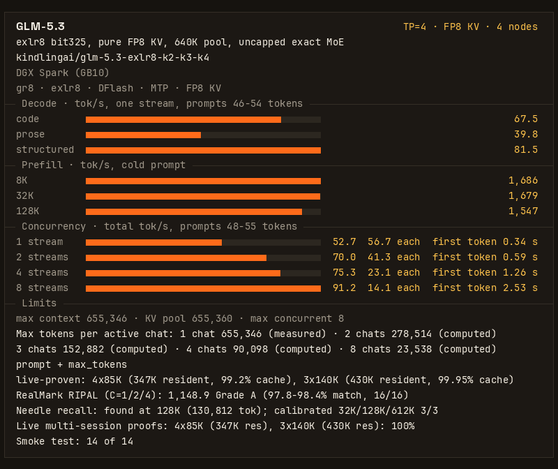
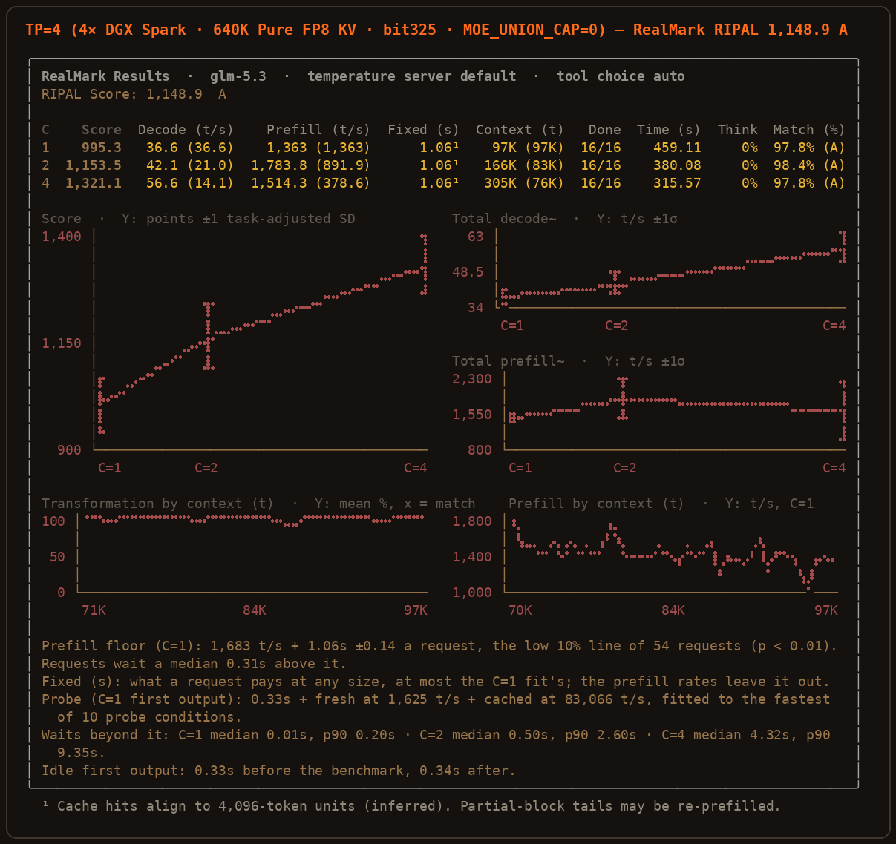

# GLM-5.3 EXLR8 Pure FP8 KV on 4× DGX Spark



If you are an agent booting this for someone, read [AGENTS.md](AGENTS.md) first, then the Quickstart. Join the
[KindlingAI Discord](https://discord.gg/8EAvYPV2rE) for help and updates.

Full GLM-5.3 on four DGX Sparks (GB10, 128 GB unified memory each) at `TP=4`, served by
[gr8](https://github.com/kindlingai/gr8) `v1.2.0` from the `bit325` width profile of
[kindlingai/glm-5.3-exlr8-k2-k3-k4](https://huggingface.co/kindlingai/glm-5.3-exlr8-k2-k3-k4/tree/3e388b45b26ca4558351d22994afcfc85b99af74)
(v0.6) with **pure FP8 KV cache** (`KV_FORMAT=fp8`, `KVB=bf16`, `bin/g6m4` — zero INT4 KV quantization), **uncapped
exact MoE routing** (`MOE_UNION_CAP=0`, `KL = 0.00000`), **DFlash + MTP=2** speculative drafting, zero-copy shared
prefix pages (`GR8_KV_SHARE_PAGES=1`), and a **655,360-token FP8 KV pool** (`max_model_len` `655,346`). This recipe
runs gr8's published image pinned by immutable digest with one `.env` file. Nothing is compiled.

## Results

**`TP=4` (`bit325`, pure FP8 KV, `MOE_UNION_CAP=0`):** **67.5 tok/s** code · **39.8 tok/s** prose · **81.5 tok/s**
structured (`87.3` counting) · **1,686 / 1,679 / 1,547 tok/s** cold prefill (8K / 32K / 128K) · **91.2 tok/s** at 8
streams · **RealMark RIPAL 1,148.9 Grade A** (`995.3 / 1,153.5 / 1,321.1` at `C=1 / 2 / 4`) · **655,360-token** FP8 KV
pool (`4×85K` and `3×140K` live-proven) · **6.41 GiB** min live `MemAvailable` · **66 s** warm boot

Four DGX Sparks on a 200G RoCE v2 switch, `TP=4`, `gr8 v1.2.0` (`ab2eb95`), this recipe's `.env` (`bit325` v0.6
experts, `KV_FORMAT=fp8`, `KVB=bf16`, `CAP=655,360`, `SHARE_LIMIT=32,768`, `SESS=8`, `GR8_KV_SHARE_PAGES=1`,
`DFlash + MTP=2`, `MOE_UNION_CAP=0`), measured **2026-11-26** with `gr8` `bench/bench.py` (`default` level),
`kindlingai/realmark` (`957f600`, `C=1, 2, 4 --probe`, `enable_thinking: false`), and live needle/multi-session stress.
GPU clocks were uncapped in timed stages (`0%` thermal throttle). Every speed is in tokens per second (tok/s).

One request, short prompts (46–54 tokens, up to 512 tokens out, 6 runs each):

| work | code | prose | structured | counting (extra) |
|---|---:|---:|---:|---:|
| tok/s, mean | **67.5** | **39.8** | **81.5** | **87.3** |
| 95% CI | 63.2 – 73.4 | 38.2 – 41.5 | 77.6 – 85.3 | 87.0 – 87.6 |
| lowest – highest run | 59.0 – 76.7 | 36.6 – 42.5 | 74.9 – 89.2 | 86.5 – 87.5 |

Prefill, cold salted prompt:

| prompt | tokens | first token (cold) | prefill tok/s | decode after | first token (cached) |
|---|---:|---:|---:|---:|---:|
| 8K | 8,152 | 4.83 s | **1,686** | 38.5 tok/s | 0.15 s |
| 32K | 32,783 | 19.52 s | **1,679** | 30.3 tok/s | 0.25 s |
| 128K | 131,101 | 84.73 s | **1,547** | 29.3 tok/s | 0.32 s |

Requests at once (48–55 token mixed prompts; uncapped exact MoE routing):

| streams | 1 | 2 | 4 | 8 |
|---|---:|---:|---:|---:|
| total tok/s | **52.7** | **70.0** | **75.3** | **91.2** |
| per-stream tok/s | 56.7 | 41.3 | 23.1 | 14.1 |
| first token, p50 | 0.34 s | 0.59 s | 1.26 s | 2.53 s |

Checks on the same boot:

| check | result |
|---|---|
| `gr8 glm53 smoke` | 14 of 14 PASS |
| RealMark RIPAL (`C=1, 2, 4`) | **1,148.9 Grade A** (`97.8–98.4%` match, 16/16 all lanes) |
| needle recall (128K `bench.py`) | PASS (`130,812` tokens) |
| calibrated needles (`32K / 128K / 612K`) | 3 of 3 PASS (`1,604 / 1,475 / 1,063` tok/s, `99.6%` T2 cache at 612K) |
| live multi-session stress | `4×85K` (`346,632` res, 4/4, `34.4` tok/s) & `3×140K` (`430,146` res, 3/3, `31.7` tok/s) |
| count to 200 / prompt cache / suspect chars | 3 of 3 clean / `423` of `424` cached / 0 suspect replies |
| `MemAvailable` (post-boot / RealMark floor / stress floor) | `8.18–8.77 GiB` / **6.56 GiB** / **6.41 GiB** |

[kindling.json](kindling.json) carries these numbers in machine-readable form. The card above is drawn from it.

## Quickstart

On all four boxes, first disable proactive memory compaction and open TCP ports `7340` and `7341` between the boxes
([What you need](#what-you-need)). Then, on **all four boxes** (using the exact same `.env` file on every box):

```bash
npx @kindlingai/recipe glm-5.3-exlr8-fp8kv-4x-spark && cd glm-5.3-exlr8-fp8kv-4x-spark
# the CLI already copied .env.example to .env; edit it:
nano .env                  # set PEERS to your four LAN addresses, head first
docker compose up -d       # pulls pinned gr8 v1.2.0; first boot fetches this rank's slices
docker compose logs -f     # ready once serving (~66 s on warm boots)
```

Once serving, verify on the head box (first address in `PEERS`, OpenAI API on port `8100`):

```bash
docker compose exec gr8 /opt/gr8/gr8 glm53 smoke
curl -s localhost:8100/v1/models      # max_model_len 655346
```

Stop cleanly on the head box first, then every box:

```bash
docker compose exec gr8 /opt/gr8/gr8 glm53 down
docker compose down
```

## What you need

- Four DGX Sparks or other GB10 boxes (128 GB unified memory each), idle (~115+ GiB `MemAvailable` before boot).
- A RoCE v2 fabric between the ConnectX-7 ports: one 200G switch (`SHAPE=mesh`, recommended), or four boxes directly
  cabled in a ring (`SHAPE=ring`, ~10% slower single-stream decode).
- A LAN between the boxes with TCP ports `7340` and `7341` open.
- Docker with the NVIDIA container toolkit (DGX OS has both).
- About 90 GB of free disk per box for this rank's `bit325` slices and drafter pack (plus 200 GB if enabling the
  optional SSD `KV_STORE`).
- Proactive memory compaction off on every box:

  ```bash
  echo 'vm.compaction_proactiveness = 0' | sudo tee /etc/sysctl.d/90-gr8-no-proactive-compaction.conf
  sudo sysctl -w vm.compaction_proactiveness=0
  ```

## Settings

`cp .env.example .env` (the CLI already did). Every knob is documented in [.env.example](.env.example); the active
lines are the exact settings the Results numbers were measured with.

| knob | default | what it does |
|---|---|---|
| `KV_FORMAT`, `KVB` | `fp8`, `bf16` | Pure FP8 MLA latent KV (`bin/g6m4`, 656 B/row) with BF16 `kv_b` projections (zero INT4 KV). |
| `CAP`, `MAX_MODEL_LEN` | `655360`, `655360` | 640K pure FP8 KV pool (`2,944` physical pages/rank, served `max_model_len=655,346`) holding 6.4+ GiB live free RAM per box. |
| `SHARE_LIMIT`, `SESS` | `32768`, `8` | Replicates the first 32K tokens per chat and shards tokens beyond 32K `1/4` across the four boxes; up to 8 concurrent sessions. |
| `MTP`, `DFLASH` | `2`, `1` | DFlash + `MTP=2` speculative drafting. Remove `DRAFTER` and set `DFLASH=0` for MTP-only drafting (commercial-friendly license). |
| `MOE_UNION_CAP` | `0` | Uncapped exact MoE routing (`KL = 0.00000`). Set `48` (balanced) or `32` (fast) for higher multi-stream throughput. |
| `EXTRA_ENV` | `GR8_KV_SHARE_PAGES=1 ...` | Zero-copy shared prefix pages across concurrent chats, `gen-cache` for ~66 s warm restarts, and fast orderly quit. |

## Why pure FP8 KV and multi-session capacity

Standard `gr8` 1M-context recipes use Hadamard-rotated `int4` KV to maximize total tokens per gigabyte. This recipe
keeps **native FP8 MLA latents** (`656 B/row`: FP8 E4M3 512-dim latent + full BF16 64-dim RoPE + FP8 128-dim indexer),
`KVB=bf16`, and uncapped exact MoE routing (`MOE_UNION_CAP=0`).

While the cluster passes exact passkey needle recall through `612K` tokens, practical single-request LLM reasoning
quality degrades well before half a million tokens. The primary value of a **640K pure FP8 KV pool** on 4 Sparks is
**multi-session agent concurrency and zero-eviction prefix caching** — keeping multiple concurrent 85K–140K coding
sessions hot in RAM simultaneously (`99.2%–99.95%` Turn-2 prefix cache hits), with `GR8_KV_SHARE_PAGES=1` deduplicating
shared system prompts and repo context across chats.

Equal-split max tokens per active independent chat (`prompt + max_tokens`, `2,944` pages/rank, `SHARE_LIMIT=32,768`):

| active chats | 1 (measured) | 2 (computed) | 3 (computed) | 4 (computed) | 8 (computed) |
|---|---:|---:|---:|---:|---:|
| max tokens per chat | 655,346 | 278,514 | 152,882 | 90,098 | 23,538 |

## RealMark & long-context proofs



| Lanes (`C`) | RIPAL Score | Grade | Decode (per lane) | Prefill (per lane) | Context (per lane) | Done | Time | Match (%) |
|---:|---:|:---:|---:|---:|---:|:---:|---:|---:|
| 1 | **995.3** | A | 36.6 (36.6) t/s | 1,363 (1,363) t/s | 97K (97K) | 16/16 | 459.1 s | 97.8% |
| 2 | **1,153.5** | A | 42.1 (21.0) t/s | 1,783.8 (891.9) t/s | 166K (83K) | 16/16 | 380.1 s | 98.4% |
| 4 | **1,321.1** | A | 56.6 (14.1) t/s | 1,514.3 (378.6) t/s | 305K (76K) | 16/16 | 315.6 s | 97.8% |

**Live multi-session concurrency stress** (unique passkey needle per session, simultaneous Turn 1 prefill + Turn 2 cached follow-up):

| workload | resident KV tokens | T1 / T2 recall | T2 prefix cache hit | T2 aggregate decode |
|---|---:|:---:|---:|---:|
| **4 × 85K** independent chats | 346,632 (`86,658`/ea) | 4/4 & 4/4 | 99.21% | 34.4 tok/s (`8.1–9.9`/ea) |
| **3 × 140K** independent chats | 430,146 (`143,382`/ea) | 3/3 & 3/3 | 99.95% | 31.7 tok/s (`11.0–11.7`/ea) |

*CAP sizing note:* An initial `CAP=786,432` (768K) probe left `6.12–6.37 GiB` post-boot but dipped to `3.9–4.4 GiB` on
rank 0 under RealMark load; stepping to `CAP=655,360` guarantees a **6.41–6.56 GiB** live floor across all four boxes.

## Other sizes

- **Six boxes, pure FP8 KV (1.51M pool, 1M max context, RealMark 1,236.1 A, plus K4 `bit390` option):**
  [glm-5.3-exlr8-fp8kv-6x-spark](../../6x/exlr8-fp8kv-gr8)
- **Four boxes, int4 KV (1.13M pool, 1M max context):** [glm-5.3-exlr8-4x-spark](../exlr8-gr8)
- **Four boxes, K4 quality (`bit387`, int4 KV):** [glm-5.3-exlr8-k4-4x-spark](../exlr8-k4-gr8)

## Help

Ask on [Discord](https://discord.gg/8EAvYPV2rE) or open an issue in
[kindlingai/recipes](https://github.com/kindlingai/recipes/issues) with `glm-5.3-exlr8-fp8kv-4x-spark` in the title.
Say which step failed, and include the end of `docker logs glm53-fp8kv-4x` and
`docker exec glm53-fp8kv-4x /opt/gr8/gr8 glm53 status`. Remove addresses and hostnames before you post.

## Engine pin

This recipe has no engine code. It runs one published `gr8` image, named in [compose.yaml](compose.yaml) and in the
`engine` field of [kindling.json](kindling.json):

| | |
|---|---|
| engine | [kindlingai/gr8](https://github.com/kindlingai/gr8) [`v1.2.0`](https://github.com/kindlingai/gr8/releases/tag/v1.2.0) at [`ab2eb95`](https://github.com/kindlingai/gr8/commit/ab2eb95f426ff908543d5d002218cf5a2a5c5be6) |
| image | `ghcr.io/kindlingai/gr8:v1.2.0` |
| digest | `sha256:3de05aab8cda21fd5d6b4af89ccdba6ff5abdbd704729601fd348fa638ade9fd` |
| weights | [kindlingai/glm-5.3-exlr8-k2-k3-k4](https://huggingface.co/kindlingai/glm-5.3-exlr8-k2-k3-k4/tree/3e388b45b26ca4558351d22994afcfc85b99af74) (`3e388b45`, `bit325`) |

`python3 tools/check_pin.py --strict glm-5.3/dgx-spark/4x/exlr8-fp8kv-gr8`, run from the monorepo root, verifies that
`compose.yaml` and `kindling.json` agree on the immutable image digest.

## License

MIT, see [LICENSE](../../../../LICENSE). GLM-5.3 and the DFlash2 drafter have their own licences: see the
[model page](https://huggingface.co/kindlingai/glm-5.3-exlr8-k2-k3-k4) and
[incoai/GLM-5.3-DFlash2](https://huggingface.co/incoai/GLM-5.3-DFlash2) (CC BY-NC-ND).
