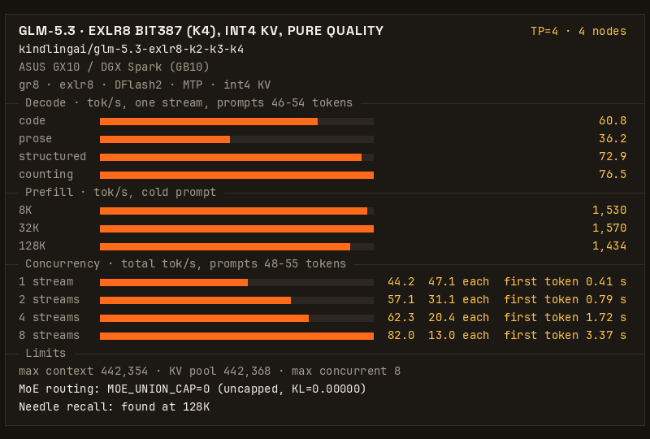

# GLM-5.3 EXLR8 K4 on 4× DGX Spark



If you are an agent booting this for someone, read [AGENTS.md](AGENTS.md) first, then the Quickstart. Join the
[KindlingAI Discord](https://discord.gg/8EAvYPV2rE) for help and updates.

Quality-first GLM-5.3 on four DGX Sparks (GB10, 128 GB each), served by [gr8](https://github.com/kindlingai/gr8)
`v1.1.1` from the `bit387` profile of
[kindlingai/glm-5.3-exlr8-k2-k3-k4](https://huggingface.co/kindlingai/glm-5.3-exlr8-k2-k3-k4/tree/9e25c28a2e8808d8b2599d780521fd6af24e7558)
(v0.7): every routed expert at 4 bits a weight except the first ten MoE layers (3–12) at 3, and the MTP layer at 3 (the
only width the release stores for it). `bit387` is statistically identical to all-K4 `bit400` (full-vocabulary KL
against BF16 of 0.0385 vs 0.0381 on model-written text, 1.5 SE apart) in 12 GB less (89 vs 92 GB of experts per box).
This recipe runs gr8's published image pinned by digest, bind-mounts `manifests/exlr8-manifest-bit387.json` read-only,
uses mixed-precision `int4` KV, enables all eight bit-exact `gr8 v1.1.0` kernels (`KL = 0.00000`), and pins
**`MOE_UNION_CAP=0`** so routed experts stay 100% uncapped. Nothing is compiled.

## Results

**`TP=4` (`bit387`, `MOE_UNION_CAP=0`):** **60.8 tok/s** code · **36.2 tok/s** prose · **72.9 tok/s** structured · **76.5 tok/s** counting · **1,570 tok/s** 32K prefill (**1,434 tok/s** at 128K) · **82.0 tok/s** at 8 streams · **442,368-token** KV pool · **128K needle recall PASS**

Four DGX Sparks on a 200G switch, TP=4, `gr8 v1.1.0` (`cdd1e09`), `bit387` v0.7 experts (`9e25c28a`), int4 KV, DFlash2
+ MTP drafter, `MOE_UNION_CAP=0` (uncapped), `DEC_BK=2048 DEC_BK_MAX=2048` (`.env.example`), measured 2026-11-20 with
gr8's benchmark (`bench/bench.py`, default level), one fresh boot, GPU clocks uncapped in timed stages. Every speed is
in tokens per second (tok/s).

One request, short prompts (46–54 tokens, up to 512 tokens out, 6 runs each):

| work | code | prose | structured | counting |
|---|---|---|---|---|
| tok/s, mean | 60.8 | 36.2 | 72.9 | 76.5 |
| lowest - highest run | 54.5 - 66.2 | 33.5 - 37.7 | 67.3 - 78.7 | 75.5 - 77.0 |

Prefill, cold prompt (one run each):

| prompt | first token | prefill tok/s | decode after it | first token, same prompt again (cached) |
|---|---|---|---|---|
| 8K tokens | 5.34 s | 1,530 | 34.6 tok/s | 0.17 s |
| 32K tokens | 20.90 s | 1,570 | 31.0 tok/s | 0.47 s |
| 128K tokens | 91.44 s | 1,434 | 29.6 tok/s | 0.29 s |

Requests at once (short mixed prompts, 48–55 tokens, up to 512 tokens out each):

| requests at once | 1 | 2 | 4 | 8 |
|---|---|---|---|---|
| total tok/s | 44.2 | 57.1 | 62.3 | 82.0 |
| tok/s per request | 47.1 | 31.1 | 20.4 | 13.0 |
| first token, median | 0.41 s | 0.79 s | 1.72 s | 3.37 s |

Checks on the same boot:

| check | result |
|---|---|
| smoke test | 14 of 14 |
| fact hidden in a 131,475-token prompt | found |
| count to 200, three times | 3 of 3 clean |
| prompt cache | 437 of 438 cached |
| suspect characters | 0 replies |
| quality / routing | `MOE_UNION_CAP=0` (uncapped), 8 bit-exact `v1.1.0` kernels (`KL = 0.00000`) |
| longest context (`max_model_len`) | 442,354 tokens |
| lowest `MemAvailable` recorded on any box | 3.78 GiB (4.32 - 4.72 GiB after boot) |

### Why `int4` KV preserves quality on a quality-first K4 recipe

Even on this quality-first `bit387` (`MOE_UNION_CAP=0`) recipe, `gr8` uses **mixed-precision** `KV_FORMAT=int4` rather
than naive blanket 4-bit quantization — compressing each part of the KV cache differently depending on its sensitivity:

- **RoPE positional keys (64 dims) stay full BF16 (128 B/tok)** — positional geometry is never 4-bit quantized.
- **Sparse-attention indexer keys (128 dims) stay FP8 E4M3 (132 B/tok)** — top-K sparse token retrieval stays sharp at
  long context.
- **Only the 512-dim MLA latent is stored in 4-bit**, after an orthonormal **512-point Sylvester Hadamard rotation**
  (`H x`) with **per-32-dim FP16 scales** (`288 B` vs `528 B` in FP8). The rotation spreads channel outliers evenly
  across all 512 dims (+4–6 dB worst-case SQNR in layers 2–3), hitting **20.3 dB median SQNR at 416 B/row** (beating
  MXFP4 and matching NVFP4 in fewer bytes) while folding `H` directly into the decode weights (`KV4_FOLD=1`).
- **Measured quality:** On full-vocabulary KL vs. BF16, INT4 adds only **+0.010 KL** over FP8 (~6.5% of weight
  quantization's own KL, at the BF16 microbatch noise floor), with **97.0%** top-1 token agreement vs. FP8
  (`KL=0.0145`) and `qeval` **73/75 vs 74/75** (`McNemar p=1.0`). Shrinking each KV page block from 3.50 MB to 2.29 MB
  lets K4 experts (~89 GB/box) coexist with a 442K-token KV pool and 4.3+ GiB free RAM per box. Set `KV_FORMAT=fp8` in
  `.env` if you want FP8 KV with a smaller pool. Full math and study:
  [gr8 KV4.md](https://github.com/kindlingai/gr8/blob/main/docs/KV4.md).

[kindling.json](kindling.json) has these numbers in a form a program can read. The card above is drawn from it.

## Quickstart

On every box, first turn off proactive memory compaction and open TCP ports 7340 and 7341 between the boxes
([What you need](#what-you-need)). Then, on each of the four boxes:

```bash
npx @kindlingai/recipe glm-5.3-exlr8-k4-4x-spark && cd glm-5.3-exlr8-k4-4x-spark
# the CLI already copied .env.example to .env; edit it:
nano .env                  # uncomment and fill in PEERS (and IPS, IPS2) unless the boxes run mentat
docker compose up -d       # pulls the pinned gr8 image; the first boot fetches this box's part of the model
docker compose logs -f     # this box's supervisor; ready when the cluster serves
```

This recipe lives in
[kindlingai/recipes](https://github.com/kindlingai/recipes/tree/main/glm-5.3/dgx-spark/4x/exlr8-k4-gr8) at
`glm-5.3/dgx-spark/4x/exlr8-k4-gr8`; a [sparse clone](https://github.com/kindlingai/recipes#run-a-recipe) also works.

Once serving, verify the API on the head (the first address in `PEERS`, serving the OpenAI API on port 8100):

```bash
docker compose exec gr8 /opt/gr8/gr8 glm53 smoke        # 14 of 14 checks
curl -s localhost:8100/v1/models                        # max_model_len 442354
```

Stop and update cleanly:

```bash
docker compose exec gr8 /opt/gr8/gr8 glm53 down         # on the head: stops every box
docker compose down                                     # on every box
```

For a newer version of the recipe itself, `git pull` in a clone of `kindlingai/recipes` (or fetch the folder again with
the CLI and keep your `.env`), then run `docker compose pull && docker compose up -d` on every box.

## What you need

- Four DGX Sparks, or other GB10 boxes such as the ASUS GX10 (128 GB unified memory each), with no other model running.
- A RoCE v2 fabric between the ConnectX ports (a 200G switch, or direct cables between the boxes).
- A LAN between the boxes with TCP ports 7340 and 7341 open.
- Docker and the NVIDIA container toolkit on each box (both come with DGX OS).
- About 110 GB free on each box for its part of the model (~100 GB) and DFlash2 drafter conversion.
- Proactive memory compaction off on each box, as root, once:

  ```bash
  echo 'vm.compaction_proactiveness = 0' > /etc/sysctl.d/90-gr8-no-proactive-compaction.conf
  sysctl -w vm.compaction_proactiveness=0
  ```

## Settings

`cp .env.example .env` (the CLI already did). Every knob is documented in [.env.example](.env.example); the active
lines are the exact settings the Results numbers were measured with.

| knob | default | what it does |
|---|---|---|
| `MOE_UNION_CAP` | `0` | Pins 100% uncapped MoE routing (`KL = 0.00000`) instead of gr8 v1.1.x's TP=4 default (`48`). Checked by [check.sh](check.sh). |
| `VARIANT` | `/etc/gr8/exlr8-manifest-bit387.json` | Boots the `bit387` K4 manifest bind-mounted read-only from `./manifests` (`gr8 v1.1.1` does not yet list `bit387` by name). |
| `DEC_BK`, `DEC_BK_MAX` | `2048`, `2048` | Captures three decode graph buckets (2K, 16K, cap) instead of 16K/32K/cap: bit-exact, leaves 4.3+ GiB `MemAvailable` per box after boot (`3.78 GiB` minimum during benchmark). |
| `CAP`, `SHARE_LIMIT`, `S2_ADAPT` | `442368`, `16384`, `0` | Sizes the int4 KV pool for one session up to `442,354` tokens or four ~74K sessions sharing prefixes, and fixes MTP draft count to save graph memory. |
| `KV_FORMAT` | `int4` | Mixed-precision int4 MLA latent KV (BF16 RoPE keys, FP8 indexer keys). Set `fp8` for FP8 KV with a smaller pool. |
| `DISPRAM` | `1` | Lends each box's 2 GiB display carveout to the KV cache when Kindling OS runs `dispramd` (`0` turns it off). |
| `DRAFTER` | `incoai/GLM-5.3-DFlash2@425aa615` | DFlash2 drafter (CC BY-NC-ND), converted on first boot. Remove to draft with MTP only. |
| `PEERS`, `IPS`, `IPS2` | commented (mentat) | Explicit LAN and ConnectX addresses when not using mentat auto-discovery. |

Every other option is gr8's launcher default, listed in
[gr8/KNOBS.md](https://github.com/kindlingai/gr8/blob/a3f44a075854fc9af0ed56c6d43f7739705bc871/KNOBS.md).

## Other sizes

- **Three boxes (`TP=3`, `bit273`, 384K context):** [glm-5.3-exlr8-3x-spark](../../3x/exlr8-gr8)
- **Four boxes (`TP=4`, `bit325`, 1M context):** [glm-5.3-exlr8-4x-spark](../exlr8-gr8)
- **Five boxes (`TP=5`, `bit325`, 983K context):** [glm-5.3-exlr8-5x-spark](../../5x/exlr8-gr8)
- **Six boxes (`TP=6`, `bit325`, 1M context / 2.18M KV pool):** [glm-5.3-exlr8-6x-spark](../../6x/exlr8-gr8)

## Help

Ask on [Discord](https://discord.gg/8EAvYPV2rE) or open an issue in
[kindlingai/recipes](https://github.com/kindlingai/recipes/issues) with `glm-5.3-exlr8-k4-4x-spark` in the title. Say
which step failed, and include:

- the command you ran, and the end of `docker logs glm53-k4-4x-spark`, before you remove the container;
- if it still runs, `docker exec glm53-k4-4x-spark /opt/gr8/gr8 glm53 status`.

Remove addresses and hostnames before you post.

## Engine pin

This recipe has no engine code. It runs one published gr8 image, named by tag and digest in [compose.yaml](compose.yaml)
and in the `engine` field of [kindling.json](kindling.json):

| | |
|---|---|
| engine | [kindlingai/gr8](https://github.com/kindlingai/gr8) [`v1.1.1`](https://github.com/kindlingai/gr8/releases/tag/v1.1.1) at [`a3f44a0`](https://github.com/kindlingai/gr8/commit/a3f44a075854fc9af0ed56c6d43f7739705bc871) |
| image | `ghcr.io/kindlingai/gr8:v1.1.1` |
| digest | `sha256:fa5c9f66fbfa55d162782578b3262893b782e6365a76562bcab951b54acc6d96` |
| weights | [kindlingai/glm-5.3-exlr8-k2-k3-k4](https://huggingface.co/kindlingai/glm-5.3-exlr8-k2-k3-k4/tree/9e25c28a2e8808d8b2599d780521fd6af24e7558) (`9e25c28a`, `bit387`) |

The Results tables above were measured on 2026-11-20 on `gr8 v1.1.0` (`cdd1e09`); `v1.1.1` (`a3f44a0`) is a hotfix on
top of `v1.1.0` fixing the 150K+ multi-session TP=4 CP staged index ordering bug.

`python3 tools/check_pin.py --strict glm-5.3/dgx-spark/4x/exlr8-k4-gr8`, run from the monorepo root, verifies that
`compose.yaml` and `kindling.json` agree on the immutable image digest, and `bash glm-5.3/dgx-spark/4x/exlr8-k4-gr8/check.sh`
verifies `MOE_UNION_CAP=0`, the read-only `bit387` manifest mount, and the pinned weights commit.

## License

MIT, see [LICENSE](../../../../LICENSE). GLM-5.3 and the DFlash2 drafter have their own licences: see the
[model page](https://huggingface.co/kindlingai/glm-5.3-exlr8-k2-k3-k4) and
[incoai/GLM-5.3-DFlash2](https://huggingface.co/incoai/GLM-5.3-DFlash2) (CC BY-NC-ND).
