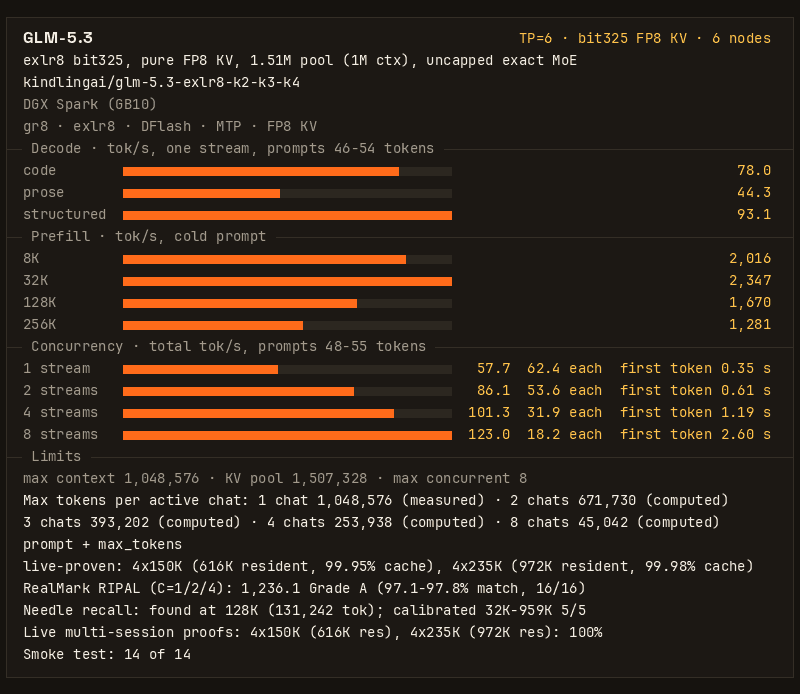
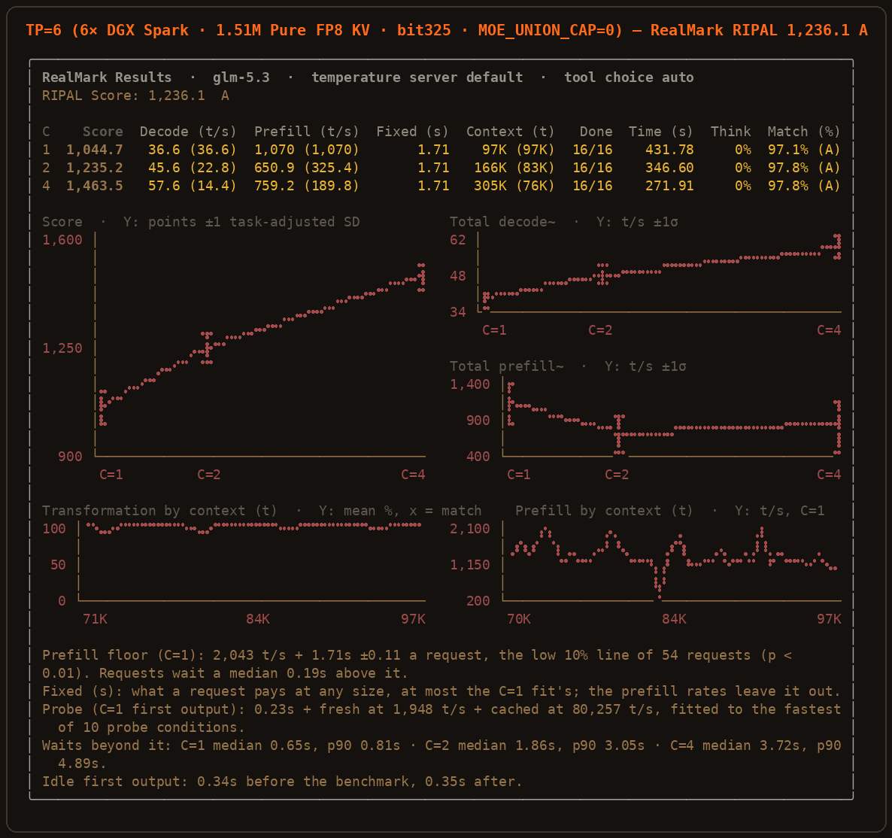

# GLM-5.3 EXLR8 Pure FP8 KV on 6× DGX Spark



If you are an agent booting this for someone, read [AGENTS.md](AGENTS.md) first, then the Quickstart. Join the
[KindlingAI Discord](https://discord.gg/8EAvYPV2rE) for help and updates.

Full GLM-5.3 on six DGX Sparks (GB10, 128 GB unified memory each) at `TP=6`, served by
[gr8](https://github.com/kindlingai/gr8) `v1.2.0` from [kindlingai/glm-5.3-exlr8-k2-k3-k4](https://huggingface.co/kindlingai/glm-5.3-exlr8-k2-k3-k4/tree/3e388b45b26ca4558351d22994afcfc85b99af74)
(v0.6) with **pure FP8 KV cache** (`KV_FORMAT=fp8`, `KVB=bf16`, `bin/g6m4` — zero INT4 KV quantization), **uncapped
exact MoE routing** (`MOE_UNION_CAP=0`, `KL = 0.00000`), **DFlash + MTP=2** speculative drafting, zero-copy shared
prefix pages (`GR8_KV_SHARE_PAGES=1`), and a **1,507,328-token FP8 KV pool** (`1,048,576` max context) — plus a
verified **K4 quality option (`VARIANT=bit390`, 512K FP8 KV, 10.4+ GiB free RAM)**. This recipe runs gr8's published
image pinned by immutable digest with one `.env` file. Nothing is compiled.

## Results

**`TP=6` (`bit325`, pure FP8 KV, `MOE_UNION_CAP=0`):** **78.0 tok/s** code · **44.3 tok/s** prose · **93.1 tok/s**
structured (`99.7` counting) · **2,016 / 2,347 / 1,670 / 1,281 tok/s** cold prefill (8K / 32K / 128K / 256K) · **123.0
tok/s** at 8 streams · **RealMark RIPAL 1,236.1 Grade A** (`1,044.7 / 1,235.2 / 1,463.5` at `C=1 / 2 / 4`) · **1.51M**
FP8 KV pool (`4×150K` and `4×235K = 972K` resident live-proven; calibrated needles 5/5 through `959K`) · **6.41 GiB**
min live `MemAvailable`

**`TP=6` K4 option (`bit390`, 512K pure FP8 KV, `MOE_UNION_CAP=0`):** **72.2 tok/s** code · **42.4 tok/s** prose ·
**2,125 / 2,293 / 2,019 tok/s** cold prefill (8K / 32K / 128K) · **106.6 tok/s** at 8 streams · **14/14** smoke ·
**10.41 GiB** min `MemAvailable`

Six DGX Sparks on a 200G RoCE v2 switch, `TP=6`, `gr8 v1.2.0` (`ab2eb95`), this recipe's `.env` (`bit325` v0.6 experts,
`KV_FORMAT=fp8`, `KVB=bf16`, `CAP=1,507,328`, `MAX_MODEL_LEN=1,048,576`, `SHARE_LIMIT=32,768`, `SESS=8`,
`GR8_KV_SHARE_PAGES=1`, `DFlash + MTP=2`, `PF_OWN=3` + `QO_CACHE`, `MOE_UNION_CAP=0`), measured **2026-11-26** with
`gr8` `bench/bench.py` (`default` level for `bit325`, `--quick` for `bit390`), `kindlingai/realmark` (`957f600`,
`C=1, 2, 4 --probe`, `enable_thinking: false`), and live needle/multi-session stress. GPU clocks were uncapped in timed
stages (`0%` thermal throttle across all six nodes). Every speed is in tokens per second (tok/s).

One request, short prompts (46–54 tokens, up to 512 tokens out, 6 runs each):

| work | code | prose | structured | counting (extra) |
|---|---:|---:|---:|---:|
| `bit325` mean (95% CI) | **78.0** (74.2 – 82.6) | **44.3** (41.3 – 47.5) | **93.1** (89.0 – 97.3) | **99.7** (99.1 – 100.3) |
| `bit325` lowest – highest | 71.0 – 84.5 | 38.1 – 49.9 | 84.9 – 102.2 | 98.6 – 100.9 |
| `bit390` K4 mean (95% CI) | **72.2** (67.4 – 79.0) | **42.4** (40.9 – 43.8) | — | — |

Prefill, cold salted prompt (`bit325`):

| prompt | tokens | first token (cold) | prefill tok/s | decode after | first token (cached) |
|---|---:|---:|---:|---:|---:|
| 8K | 8,246 | 4.09 s | **2,016** | 41.1 tok/s | 0.14 s |
| 32K | 32,685 | 13.92 s | **2,347** | 30.8 tok/s | 0.19 s |
| 128K | 131,132 | 78.50 s | **1,670** | 26.0 tok/s | 1.47 s |
| 256K | 261,658 | 204.33 s | **1,281** | 28.7 tok/s | 2.15 s |

Requests at once (48–55 token mixed prompts; uncapped exact MoE routing):

| streams | 1 | 2 | 4 | 8 |
|---|---:|---:|---:|---:|
| `bit325` total tok/s (per stream) | **57.7** (62.4) | **86.1** (53.6) | **101.3** (31.9) | **123.0** (18.2) |
| `bit325` first token, p50 | 0.35 s | 0.61 s | 1.19 s | 2.60 s |
| `bit390` K4 total tok/s (per stream) | **54.9** (57.8) | **79.5** (44.5) | **90.0** (27.0) | **106.6** (16.5) |

Checks on the same boot (`bit325`):

| check | result |
|---|---|
| `gr8 glm53 smoke` | 14 of 14 PASS |
| RealMark RIPAL (`C=1, 2, 4`) | **1,236.1 Grade A** (`97.1–97.8%` match, 16/16 all lanes) |
| needle recall (128K `bench.py`) | PASS (`131,242` tokens) |
| calibrated needles (`32K / 128K / 256K / 512K / 959K`) | 5 of 5 PASS (`2,206 / 1,701 / 1,239 / 953 / 930` tok/s; `100.0%` T2 cache at 959K) |
| live multi-session stress | `4×150K` (`616,096` res, 4/4, `24.0` tok/s) & `4×235K` (`971,544` res, 4/4, `20.4` tok/s) |
| count to 200 / prompt cache / suspect chars | 3 of 3 clean / `426` of `427` cached / 0 suspect replies |
| `MemAvailable` (post-boot / RealMark floor / stress floor) | `7.29–7.80 GiB` / **6.56 GiB** / **6.41 GiB** |

[kindling.json](kindling.json) carries these numbers in machine-readable form. The card above is drawn from it.

## Quickstart

On all six boxes, first disable proactive memory compaction, create the `qocache` directory (owned by uid 1000), and
open TCP ports `7340` and `7341` between the boxes ([What you need](#what-you-need)). Then, on **all six boxes** (using
the exact same `.env` file on every box):

```bash
sudo mkdir -p /srv/gr8/cache/qocache && sudo chown -R 1000:1000 /srv/gr8/cache
npx @kindlingai/recipe glm-5.3-exlr8-fp8kv-6x-spark && cd glm-5.3-exlr8-fp8kv-6x-spark
# the CLI already copied .env.example to .env; edit it:
nano .env                  # set PEERS to your six LAN addresses, head first
docker compose up -d       # pulls pinned gr8 v1.2.0; first boot fetches slices + writes QO cache
docker compose logs -f     # ready once serving
```

Once serving, verify on the head box (first address in `PEERS`, OpenAI API on port `8100`):

```bash
docker compose exec gr8 /opt/gr8/gr8 glm53 smoke
curl -s localhost:8100/v1/models      # max_model_len 1048576
```

Stop cleanly on the head box first, then every box:

```bash
docker compose exec gr8 /opt/gr8/gr8 glm53 down
docker compose down
```

## What you need

- Six DGX Sparks or other GB10 boxes (128 GB unified memory each), idle (~115+ GiB `MemAvailable` before boot).
- A 200G RoCE v2 switch fabric (`SHAPE=mesh`). Six boxes do not work as a ring.
- A LAN between the boxes with TCP ports `7340` and `7341` open.
- Docker with the NVIDIA container toolkit (DGX OS has both).
- About 65 GB of free disk per box for `bit325` slices plus 13 GB for `/srv/gr8/cache/qocache` (add ~15 GB for the
  optional `bit390` K4 profile and 200 GB if enabling the optional SSD `KV_STORE`).
- Proactive memory compaction off on every box:

  ```bash
  echo 'vm.compaction_proactiveness = 0' | sudo tee /etc/sysctl.d/90-gr8-no-proactive-compaction.conf
  sudo sysctl -w vm.compaction_proactiveness=0
  ```

## Settings

`cp .env.example .env` (the CLI already did). Every knob is documented in [.env.example](.env.example); the active
lines are the exact settings the Results numbers were measured with.

| knob | default | what it does |
|---|---|---|
| `KV_FORMAT`, `KVB` | `fp8`, `bf16` | Pure FP8 MLA latent KV (`bin/g6m4`, 656 B/row) with BF16 `kv_b` projections (zero INT4 KV). |
| `CAP`, `MAX_MODEL_LEN` | `1507328`, `1048576` | 1.51M pure FP8 KV pool (`4,352` physical pages/rank, `1M` max context) holding 6.4+ GiB live free RAM per box. |
| `SHARE_LIMIT`, `SESS` | `32768`, `8` | Keeps 4 independent chats up to 253K each (`SHARE_LIMIT=65,536` would cap 4 chats at ~90K); up to 8 concurrent sessions. |
| `MTP`, `DFLASH` | `2`, `1` | DFlash + `MTP=2` speculative drafting (replicated drafter body on TP=6). Remove `DRAFTER` and set `DFLASH=0` for MTP-only. |
| `PF_OWN`, `QO_CACHE` | `3`, `/var/lib/gr8/cache/qocache` | Caches prefill QO tensors (13 GB/box) for fast warm restarts; create `/srv/gr8/cache/qocache` owned by `1000:1000` first. |
| `MOE_UNION_CAP` | `0` | Uncapped exact MoE routing (`KL = 0.00000`). Set `48` (balanced) or `32` (fast) for higher multi-stream throughput. |

### Optional K4 quality profile (`VARIANT=bit390`)

For higher-precision 3.90 bpw experts (~60.0 GB/rank) alongside pure FP8 KV and **10.4+ GiB** free RAM per box, edit
three lines in `.env`:

```ini
VARIANT=bit390
CAP=524288
MAX_MODEL_LEN=524288
```

Verified live on 2026-11-26 (`bench/bench.py --quick`, `14/14` smoke, 0 suspect replies): `72.2` tok/s code, `42.4`
tok/s prose, `54.9 / 79.5 / 90.0 / 106.6` tok/s at `C=1 / 2 / 4 / 8`, `2,125 / 2,293 / 2,019` tok/s cold prefill
(`8K / 32K / 128K`), `max_model_len=524,274`, `10.60–11.08 GiB` post-boot / `10.41–10.92 GiB` post-bench `MemAvailable`.

## Why pure FP8 KV and multi-session capacity

Standard `gr8` 1M-context recipes use Hadamard-rotated `int4` KV to maximize total tokens per gigabyte. This recipe
keeps **native FP8 MLA latents** (`656 B/row`: FP8 E4M3 512-dim latent + full BF16 64-dim RoPE + FP8 128-dim indexer),
`KVB=bf16`, and uncapped exact MoE routing (`MOE_UNION_CAP=0`).

While TP=6 passes exact passkey needle recall all the way to `959,246` tokens (`100.0%` T2 prefix cache hit), practical
single-request LLM reasoning quality degrades well before a million tokens. The real superpower of a **1.51M pure FP8
KV pool** is **high-concurrency multi-agent serving with zero KV eviction** — holding four simultaneous 150K–235K
coding sessions (`971,544` resident tokens proven live) hot in RAM with `99.95%–99.98%` Turn-2 prefix cache reuse, while
`GR8_KV_SHARE_PAGES=1` deduplicates shared system/repo prefixes across sessions at zero copy cost.

Equal-split max tokens per active independent chat (`prompt + max_tokens`, `SHARE_LIMIT=32,768`):

| active chats | 1 (measured) | 2 (computed) | 3 (computed) | 4 (computed) | 8 (computed) |
|---|---:|---:|---:|---:|---:|
| `bit325` (1.51M pool, `4,352` pg/rank) | 1,048,576 | 671,730 | 393,202 | 253,938 | 45,042 |
| `bit390` K4 (512K pool, `1,792` pg/rank) | 524,274 | 180,210 | 65,522 | 28,658 | 14,322 |

## RealMark & long-context proofs



| Lanes (`C`) | RIPAL Score | Grade | Decode (per lane) | Prefill (per lane) | Context (per lane) | Done | Time | Match (%) |
|---:|---:|:---:|---:|---:|---:|:---:|---:|---:|
| 1 | **1,044.7** | A | 36.6 (36.6) t/s | 1,070 (1,070) t/s | 97K (97K) | 16/16 | 431.8 s | 97.1% |
| 2 | **1,235.2** | A | 45.6 (22.8) t/s | 650.9 (325.4) t/s | 166K (83K) | 16/16 | 346.6 s | 97.8% |
| 4 | **1,463.5** | A | 57.6 (14.4) t/s | 759.2 (189.8) t/s | 305K (76K) | 16/16 | 271.9 s | 97.8% |

**Live multi-session concurrency stress** (unique passkey needle per session, simultaneous Turn 1 prefill + Turn 2 cached follow-up):

| workload | resident KV tokens | T1 / T2 recall | T2 prefix cache hit | T2 aggregate decode |
|---|---:|:---:|---:|---:|
| **4 × 150K** independent chats | 616,096 (`154,024`/ea) | 4/4 & 4/4 | 99.95% | 24.0 tok/s (`6.4–6.8`/ea) |
| **4 × 235K** independent chats | 971,544 (`242,886`/ea) | 4/4 & 4/4 | 99.98% | 20.4 tok/s (`5.0–5.9`/ea) |

## Other sizes

- **Four boxes, pure FP8 KV (640K pool, RealMark 1,148.9 A, 4×85K & 3×140K live-proven):**
  [glm-5.3-exlr8-fp8kv-4x-spark](../../4x/exlr8-fp8kv-gr8)
- **Six boxes, int4 KV (2.18M pool, 1M max context):** [glm-5.3-exlr8-6x-spark](../exlr8-gr8)

## Help

Ask on [Discord](https://discord.gg/8EAvYPV2rE) or open an issue in
[kindlingai/recipes](https://github.com/kindlingai/recipes/issues) with `glm-5.3-exlr8-fp8kv-6x-spark` in the title.
Say which step failed, and include the end of `docker logs glm53-fp8kv-6x` and
`docker exec glm53-fp8kv-6x /opt/gr8/gr8 glm53 status`. Remove addresses and hostnames before you post.

## Engine pin

This recipe has no engine code. It runs one published `gr8` image, named in [compose.yaml](compose.yaml) and in the
`engine` field of [kindling.json](kindling.json):

| | |
|---|---|
| engine | [kindlingai/gr8](https://github.com/kindlingai/gr8) [`v1.2.0`](https://github.com/kindlingai/gr8/releases/tag/v1.2.0) at [`ab2eb95`](https://github.com/kindlingai/gr8/commit/ab2eb95f426ff908543d5d002218cf5a2a5c5be6) |
| image | `ghcr.io/kindlingai/gr8:v1.2.0` |
| digest | `sha256:3de05aab8cda21fd5d6b4af89ccdba6ff5abdbd704729601fd348fa638ade9fd` |
| weights | [kindlingai/glm-5.3-exlr8-k2-k3-k4](https://huggingface.co/kindlingai/glm-5.3-exlr8-k2-k3-k4/tree/3e388b45b26ca4558351d22994afcfc85b99af74) (`3e388b45`, `bit325` / `bit390`) |

`python3 tools/check_pin.py --strict glm-5.3/dgx-spark/6x/exlr8-fp8kv-gr8`, run from the monorepo root, verifies that
`compose.yaml` and `kindling.json` agree on the immutable image digest.

## License

MIT, see [LICENSE](../../../../LICENSE). GLM-5.3 and the DFlash2 drafter have their own licences: see the
[model page](https://huggingface.co/kindlingai/glm-5.3-exlr8-k2-k3-k4) and
[incoai/GLM-5.3-DFlash2](https://huggingface.co/incoai/GLM-5.3-DFlash2) (CC BY-NC-ND).
