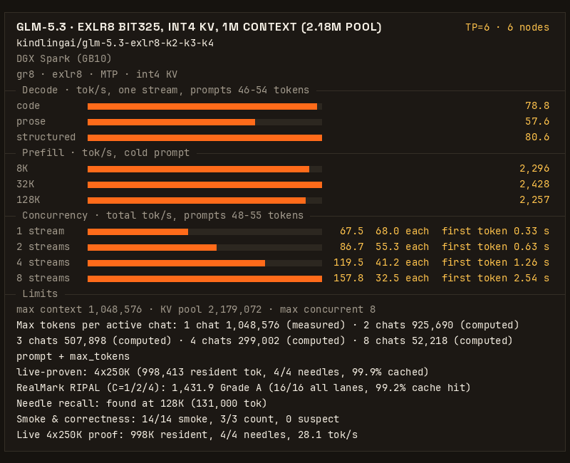

# KindlingAI: GLM-5.3 EXLR8 on six DGX Sparks (1M context, 2.18M KV pool)



If you are an agent booting this for someone, read [AGENTS.md](AGENTS.md) first, then the Quickstart.

_**Join our discord to learn more about KindlingAI and `gr8`: https://discord.gg/8EAvYPV2rE**_

Full GLM-5.3 on six DGX Sparks (GB10, 128 GB each) at TP=6, served by [gr8](https://github.com/kindlingai/gr8) `v1.1.1` from
the `bit325` width profile of [kindlingai/glm-5.3-exlr8-k2-k3-k4](https://huggingface.co/kindlingai/glm-5.3-exlr8-k2-k3-k4/tree/3e388b45b26ca4558351d22994afcfc85b99af74) (v0.6):
a full **1,048,576-token** context window backed by a **2,179,072-token** int4 KV pool (`SHARE_LIMIT=65,536`, keeping 32K–64K prompts 100% unsharded),
zero-copy shared prefix pages, MTP=3 drafting with confidence stopping, up to 8 concurrent chats, 7.4+ GiB free RAM per box,
and a QO cache for ~58 s boots. This recipe is the published gr8 image, pinned by digest, and one `.env` file. Nothing is compiled.

These TP=6 settings build on the TP=6 recipe
[knapcio/GLM-5.3-gr8-6x-DGX-Spark-TP6](https://github.com/knapcio/GLM-5.3-gr8-6x-DGX-Spark-TP6). Thank you.

78.8 tok/s for one request writing code · 57.6 tok/s prose · 2,428 tok/s prefill at 32K (2,257 tok/s at 128K, +19.7% vs v1.1.1; cached 128K TTFT 0.22 s) · 8 requests at once, 157.8 tok/s in total (119.5 at C=4; 180.2 in fast mode) · RealMark 1,431.9 Grade A (C=4 1,571.3, 16/16 all lanes, 99.2% cache hit) · 2.18M-token KV pool · 7.25+ GiB free RAM per box

## Results

Six DGX Sparks on a 200G switch, TP=6, `gr8 main` (`530312e6`), this recipe's `.env` (`bit325` v0.6 experts, int4 KV `CAP=2,179,072`, `MAX_MODEL_LEN=1,048,576`, `SHARE_LIMIT=65,536`, `SESS=8`, `GR8_KV_SHARE_PAGES=1`, MTP=3 with confidence stopping, default quality preset `MOE_UNION_CAP=48`), measured 2026-11-28 with gr8's own benchmark (`bench/bench.py`, default level) and Official RealMark C=1/2/4 on one fresh boot. GPU clocks were uncapped on all six boxes in the timed stages (`0%` throttle across all six boxes). Every speed is in tokens per second (tok/s).

One request, short prompts (46-54 tokens, up to 512 tokens out, 6 runs each):

| work | code | prose | structured | counting |
|---|---|---|---|---|
| tok/s, mean | 78.8 | 57.6 | 80.6 | 83.9 |
| lowest - highest run | 76.2 - 80.6 | 54.6 - 60.4 | 77.3 - 84.1 | 83.0 - 84.2 |
| 95% interval | 77.5 - 80.3 | 55.9 - 59.2 | 78.8 - 82.5 | 83.6 - 84.3 |

Prefill, cold prompt (one run each):

| prompt | first token | prefill tok/s | decode after it | first token, same prompt again (cached) |
|---|---|---|---|---|
| 8K tokens | 3.59 s | 2,296 | 50.5 tok/s | 0.12 s |
| 32K tokens | 13.52 s | 2,428 | 52.9 tok/s | 0.15 s |
| 128K tokens | 58.05 s | 2,257 | 34.5 tok/s | 0.22 s |

Because `SHARE_LIMIT=65,536` keeps the first 64K tokens unsharded on every box, decode after a 32K prompt holds **52.9 tok/s**, while 128K cold prefill climbs to **2,257 tok/s** (`+19.7%` vs `v1.1.1`) and 128K cached TTFT drops to **0.22 s** (`7.7×` faster than `v1.1.1`). (Note: in the 8K and 32K runs, 8–12 shared chat-template tokens hit the prefix cache, 0.04–0.11% of the prompt; 128K was 100% cold with 0 cached tokens.)

Requests at once (short mixed prompts, 48-55 tokens, up to 512 tokens out each):

| requests at once | 1 | 2 | 4 | 8 |
|---|---|---|---|---|
| total tok/s (quality default, `MOE_UNION_CAP=48`) | 67.5 | 86.7 | 119.5 | 157.8 |
| tok/s per request (quality default) | 68.0 | 55.3 | 41.2 | 32.5 |
| first token, median | 0.33 s | 0.63 s | 1.26 s | 2.54 s |

### Official RealMark RIPAL (C=1 / C=2 / C=4)

Measured on the same boot (`--lanes 1 2 4 --probe`, Thinking OFF, server default temperature): **RIPAL Score 1,431.9 Grade A** (`99.23%` prefix cache hit across 11.19M prompt tokens, C=1 prefill floor `2,387 tok/s`, idle TTFT `0.33 s`, lowest `MemAvailable` `7.42 GiB`):

| lanes | RIPAL score | aggregate decode (per lane) | prefill (per lane) | active context | done | match |
|---|---:|---:|---:|---:|---:|---:|
| **C=1** | **1,312.1** | 43.5 (43.5) tok/s | 1,898 (1,898) tok/s | 97K (97K) | 16/16 | 96.2% (A) |
| **C=2** | **1,424.1** | 49.8 (24.9) tok/s | 1,093.6 (546.8) tok/s | 166K (83K) | 16/16 | 98.2% (A) |
| **C=4** | **1,571.3** | 58.2 (14.6) tok/s | 1,212.3 (303.1) tok/s | 305K (76K) | 16/16 | 97.0% (A) |

### Speed and quality presets (`MOE_UNION_CAP`)

`gr8` enables bit-exact decode and prefill kernels (`KL = 0.00000`), `DEC_BK_MAX=2048` (allowing a **2.18M-token** int4 KV pool and **8 concurrent sessions** while keeping **7.25+ GiB** free RAM per box), and a batch-budgeted MoE expert union cap (`MOE_UNION_CAP`):

| preset (`.env`) | code decode | 4 streams total (per req) | 8 streams total (per req) | prefill 8K / 32K / 128K |
|---|---:|---:|---:|---:|
| **Quality (default, `MOE_UNION_CAP=48`)** | 78.8 tok/s | 119.5 (41.2) tok/s | 157.8 (32.5) tok/s | 2,296 / 2,428 / 2,257 tok/s |
| **Fast (`MOE_UNION_CAP=32`, v1.1.0)** | 77.8 tok/s | 128.2 (49.4) tok/s | 180.2 (36.8) tok/s | 2,320 / 2,435 / 1,909 tok/s |

Fast mode (`MOE_UNION_CAP=32`) was measured on a fresh boot on 2026-11-20 (`bench/bench.py --quick`, 57.6 tok/s prose, 67.0 / 92.0 / 128.2 / 180.2 tok/s at 1 / 2 / 4 / 8 streams, 0 suspect characters, 7.36 GiB lowest `MemAvailable`). Set `MOE_UNION_CAP=0` for uncapped exact routing (`KL = 0.00000`).

### How long each chat can be

The int4 KV pool holds **2,179,072 tokens** (`6,528` physical pages of 64 tokens per rank), with `MAX_MODEL_LEN=1,048,576` (full 1M context). The first 65,536 tokens (`SHARE_LIMIT`) of each chat are stored on every box, and the rest is spread across the six boxes. Each active chat reserves its prompt plus `max_tokens`:

| active chats | 1 | 2 | 3 | 4 | 8 |
|---|---:|---:|---:|---:|---:|
| max tokens per chat, equal split | 1,048,576 | 925,690 | 507,898 | 299,002 | 52,218 |

The 1-chat value is measured (the served `max_model_len`); the multi-chat values are computed from the 6,528-page pool. Up to 8 chats decode simultaneously (`SESS=8`).

### Live 4 × 250K long-context concurrency proof

Measured immediately after the benchmark on the same `v1.1.0` quality-default boot on 2026-11-20 (four simultaneous ~250K-token independent chats, unique passkey needle per chat, zero evictions):

| live concurrent workload | resident KV tokens | needle recall | turn-2 prefix cache hit | aggregate decode |
|---|---:|---:|---:|---:|
| **4 × 250K** independent chats | 998,413 | 4/4 (T1) & 4/4 (T2) | 99.9% (249.5K–249.7K cached each) | 28.1 tok/s (8.1–9.3 each) |

Checks on the 2026-11-28 `gr8 main` (`530312e6`) default boot:

| check | result |
|---|---|
| smoke test | 14 of 14 |
| fact hidden in a 131,000-token prompt | found |
| count to 200, three times | 3 of 3 clean |
| prompt cache | 419 of 420 cached |
| suspect characters | 0 replies |
| RealMark RIPAL (C=1/2/4) | 1,431.9 Grade A (16/16 all lanes, 99.23% prefix cache hit) |
| longest context (`max_model_len`) | 1,048,576 tokens (`2,179,072`-token KV pool) |
| boot to `/health` 200 with the QO cache | 119 s (cold page cache, model + QO cache on disk) |
| lowest `MemAvailable` recorded on any box | 7.25 GiB during bench, 7.42 GiB during RealMark (8.07 - 9.22 GiB after boot) |

### Why `int4` KV preserves quality while unlocking a 2.18M-token pool

`KV_FORMAT=int4` is **mixed-precision**, not naive blanket 4-bit quantization — `gr8` compresses each part of the KV cache differently depending on its sensitivity:

- **RoPE positional keys (64 dims) stay full BF16 (128 B/tok)** — positional geometry is never 4-bit quantized, preserving accuracy past 1M context.
- **Sparse-attention indexer keys (128 dims) stay FP8 E4M3 (132 B/tok)** — top-K sparse token retrieval stays sharp across long contexts.
- **Only the 512-dim MLA latent is stored in 4-bit**, after an orthonormal **512-point Sylvester Hadamard rotation** (`H x`) with **per-32-dim FP16 scales** (`288 B` vs `528 B` in FP8). The rotation spreads channel outliers evenly across all 512 dims (+4–6 dB worst-case SQNR in layers 2–3), hitting **20.3 dB median SQNR at 416 B/row** (beating MXFP4 and matching NVFP4 in fewer bytes) while folding `H` directly into the decode weights (`KV4_FOLD=1`) for zero extra rotation overhead.
- **Measured quality:** Adds just **+0.010 KL** over FP8 on held-out text vs. BF16 (~6.5% of weight quantization's own KL), with **97.0%** top-1 agreement vs. FP8 (`KL=0.0145`), `qeval` **73/75 vs 74/75** (`p=1.0`), and **4/4 needle recall** across the live 4×250K (998K resident tokens) concurrency proof above.
- **Combined with context-parallel sharding & shared prefix pages:** Only the first 65,536 tokens (`SHARE_LIMIT`) are replicated per box (everything past that is sharded `1/6` across the 6 Sparks), and `GR8_KV_SHARE_PAGES=1` deduplicates shared system/repo prefixes across concurrent chats. Set `KV_FORMAT=fp8` in `.env` anytime to roll back to FP8 KV. Full math and study: [gr8 KV4.md](https://github.com/kindlingai/gr8/blob/main/docs/KV4.md).

[kindling.json](kindling.json) has these numbers in a form a program can read. The card above is drawn from it.

## Quickstart

On every box, first turn off proactive memory compaction and open TCP ports 7340 and 7341 between the boxes
([What you need](#what-you-need)). Then, on every box:

```bash
npx @kindlingai/recipe glm-5.3-exlr8-6x-spark && cd glm-5.3-exlr8-6x-spark
sudo mkdir -p /srv/gr8/cache/qocache && sudo chown -R 1000:1000 /srv/gr8/cache
# the CLI already copied .env.example to .env; edit it:
nano .env                  # PEERS: the six LAN addresses, head first. The same file on every box.
docker compose up -d       # pulls the pinned gr8 image; the first boot fetches this box's part of the model
docker compose logs -f     # this box's supervisor; ready when the cluster serves
```

This recipe lives in [kindlingai/recipes](https://github.com/kindlingai/recipes/tree/main/glm-5.3/dgx-spark/6x/exlr8-gr8)
at `glm-5.3/dgx-spark/6x/exlr8-gr8`; a [sparse clone](https://github.com/kindlingai/recipes#run-a-recipe) also works.

The first boot also writes the QO cache (13 GB a box) to `/srv/gr8/cache/qocache`. Later boots read it (~58 s). The engine
does not make that directory: without the `mkdir` line no cache is written, and every boot takes the long time.
For another place, change `GR8_CACHE` in `.env` and make its `qocache` directory the same way.

Then, on the head (the first address in `PEERS`):

```bash
docker compose exec gr8 /opt/gr8/gr8 glm53 smoke
curl -s localhost:8100/v1/models      # max_model_len 1048576
```

The head serves an OpenAI-compatible API on port 8100. Stop the cluster with
`docker compose exec gr8 /opt/gr8/gr8 glm53 down` on the head, then `docker compose down` on every box.

A box that ran the earlier form of this recipe (its own image) has its part of the model in the docker volume
`glm53-6x-cache`. To use that volume again, set `GR8_CACHE` in `.env` to its directory
(`docker volume inspect glm53-6x-cache --format '{{.Mountpoint}}'`). The cache is keyed by Hugging Face commit: the box
reads what the volume holds at the commits pinned in `.env`, and fetches the rest.

## What you need

- Six DGX Sparks or other GB10 boxes (128 GB unified memory), with nothing else holding much memory (7.4+ GiB free
  per box measured at `CAP=2,179,072`).
- A RoCE v2 fabric between the ConnectX-7 ports through one 200G switch. Six boxes do not work as a ring.
- A LAN between the boxes with TCP ports 7340 and 7341 open.
- Docker with the NVIDIA container toolkit (DGX OS has both).
- About 65 GB of disk a box for the model and 13 GB for the QO cache.
- Proactive memory compaction off on every box:
  `sudo sysctl -w vm.compaction_proactiveness=0` (gr8's
  [DEPLOY.md](https://github.com/kindlingai/gr8/blob/main/docs/DEPLOY.md#before-you-start) has the permanent form).

## Settings

`cp .env.example .env` (the CLI already did). Every knob is documented in [.env.example](.env.example); the active
lines are the exact settings the Results numbers were measured with. Highlights over the `v1.0` recipe:

- `gr8 v1.1.0` with `bit325` v0.6 weights, seven bit-exact decode/prefill kernels, `DEC_BK_MAX=2048`, and `MOE_UNION_CAP=48` (`32` for fast concurrency: 180.2 tok/s at 8 streams; `0` for uncapped exact).
- `KV_FORMAT=int4` with `KVB=bf16`, `KV4_FOLD=1`, `KV4_TC=1`, `CAP=2,179,072` (6,528 physical pages/rank), `MAX_MODEL_LEN=1,048,576`, `SHARE_LIMIT=65,536`, `SESS=8`, `GR8_KV_SHARE_PAGES=1`, and `REUSE_GRID=64`.
- `MTP=3` with solo (`MTP_KSTOP`) and shared-batch (`MTP_KSTOPB`) confidence stopping, `MTP_LASTROW=1`, `DRAFT_HEAD2=1`, `L2PF=31`, `MTP_L2PF=3`.
- `PF_OWN=3` with `QO_CACHE` (~58 s boot) and `PF_GEMMF32=1`.

| knob | default | what it does |
|---|---|---|
| `PEERS` | `192.0.2.1,...,192.0.2.6` | LAN addresses of the six boxes in rank order (head first; `SHAPE=mesh` on a switch) |
| `KV_FORMAT` / `CAP` / `MAX_MODEL_LEN` / `SESS` | `int4` / `2179072` / `1048576` / `8` | Mixed-precision int4 KV pool (2.18M tokens, 1M max context, `SHARE_LIMIT=65536`) across up to 8 concurrent chats |
| `MOE_UNION_CAP` | `48` | Decode speed/quality preset (`48` quality default, `32` fast, `0` uncapped exact) |
| `QO_CACHE` / `GR8_CACHE` | `/var/lib/gr8/cache/qocache` / `/srv/gr8/cache` | Host cache directory holding the model and 13 GB QO cache for ~58 s boots |
| `GR8_HOME` / `GR8_STOP_GRACE` / `GR8_IMAGE` | unset | Optional host state directory, shutdown grace, or image override |

gr8's [SETTINGS.md](https://github.com/kindlingai/gr8/blob/main/docs/SETTINGS.md) explains each setting.

## Other sizes

- **Three boxes (384K context, `bit273`):** [glm-5.3-exlr8-3x-spark](../../3x/exlr8-gr8)
- **Four boxes (1M context, `bit325`, DFlash2):** [glm-5.3-exlr8-4x-spark](../../4x/exlr8-gr8)
- **Four boxes K4 (`bit387`, uncapped routing):** [glm-5.3-exlr8-k4-4x-spark](../../4x/exlr8-k4-gr8)
- **Five boxes (983K context, `bit325`):** [glm-5.3-exlr8-5x-spark](../../5x/exlr8-gr8)

## Help

Ask on Discord (https://discord.gg/8EAvYPV2rE) or open an issue in the recipes repo
(https://github.com/kindlingai/recipes/issues) with `glm-5.3-exlr8-6x-spark` in the title. Say which step failed, and include:

- the command you ran, and the end of `docker logs glm53-6x-spark`, before you remove the container;
- if it still runs, `docker exec glm53-6x-spark /opt/gr8/gr8 glm53 status`.

Remove addresses and hostnames before you post.

## Engine pin

This recipe has no engine code. It runs one published gr8 image, named by tag and digest in
[compose.yaml](compose.yaml) and in the `engine` field of [kindling.json](kindling.json):

| | |
|---|---|
| engine | [kindlingai/gr8](https://github.com/kindlingai/gr8) [`v1.1.1`](https://github.com/kindlingai/gr8/releases/tag/v1.1.1) at [`a3f44a0`](https://github.com/kindlingai/gr8/commit/a3f44a075854fc9af0ed56c6d43f7739705bc871) |
| image | `ghcr.io/kindlingai/gr8:v1.1.1` |
| digest | `sha256:fa5c9f66fbfa55d162782578b3262893b782e6365a76562bcab951b54acc6d96` |

The TP=6 benchmark tables above were measured on 2026-11-20 on `gr8 v1.1.0` (`cdd1e09`); `v1.1.1` (`a3f44a0`) adds the `v1.1.1` hotfix and TP=5/6 default launcher parity.

After v1.0, the pin moves to a newer gr8 release only after this recipe was booted and measured on it.
`python3 tools/check_pin.py glm-5.3/dgx-spark/6x/exlr8-gr8`, run from the monorepo root, checks that `compose.yaml` and
`kindling.json` name the same image; the root `.github/workflows/recipes.yml` runs it on every pull request that touches
this folder.

## License

MIT, see [LICENSE](../../../../LICENSE). GLM-5.3 has its own licence: see the
[model page](https://huggingface.co/kindlingai/glm-5.3-exlr8-k2-k3-k4).
