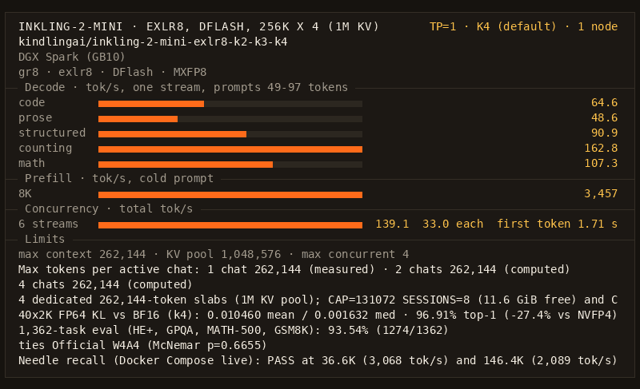
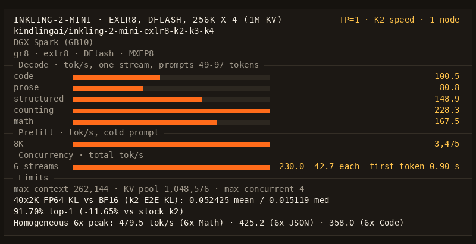

# KindlingAI: Inkling-2-Mini EXLR8 on one DGX Spark (K4, bit325 & K2)

If you are an agent booting this for someone, read [AGENTS.md](AGENTS.md) first, then the Quickstart.

_**Join our discord to learn more about KindlingAI and `gr8`: https://discord.gg/8EAvYPV2rE**_

Inkling-2-Mini on **one DGX Spark** (GB10, 128 GB) at `TP=1`, served by [gr8](https://github.com/kindlingai/gr8) (`main`, [PR #615](https://github.com/kindlingai/gr8/pull/615)) from [kindlingai/inkling-2-mini-exlr8-k2-k3-k4](https://huggingface.co/kindlingai/inkling-2-mini-exlr8-k2-k3-k4/tree/34fbad15ce2164208aa33cbe49488d68380d7b70):
one single pack gives load-time width selection across **`k4`** (`-27.4%` KL vs Official NVFP4, ties Official W4A4 on 1,362 tasks), **`bit325`** (`8/8` exact DFlash greedy parity, `3,484 tok/s` 8K prefill), **`bit250`**, and **`k2`** (`-11.65%` E2E KL vs stock `k2`, up to `230 tok/s` C=6 / `480 tok/s` 6× Math), with a bundled **279 MB DFlash speculative drafter** auto-discovered with zero extra flags and a **`1,048,576`-token (`1M`) KV pool** (`CAP=262144 × 4` by default, or `131072 × 8`, or full **`1M` single-stream `1048576 × 1`**).
This recipe is the published `gr8` image, one launcher script, and one `.env` file. Nothing is compiled.



**K4 (`k4`, default):** **64.6 tok/s** code · **107.3 tok/s** math · **90.9 tok/s** JSON · **48.6 tok/s** prose · **162.8 tok/s** counting · **3,457 tok/s** 8K prefill · **139.1 tok/s** C=6 mixed · **`0.010460` mean KL** (`-27.4%` vs Official NVFP4) · **93.54%** on 1,362 tasks · 10.3 s boot from local NVMe
**K2 (`k2`, speed preset):** **100.5 tok/s** code · **167.5 tok/s** math · **148.9 tok/s** JSON · **80.8 tok/s** prose · **228.3 tok/s** counting · **3,475 tok/s** 8K prefill · **230.0 tok/s** C=6 mixed (`479.5 tok/s` 6× Math) · **0.827 s** 3-user 1K avg TTFT

## Results

One DGX Spark (GB10, 128 GB) with local NVMe storage, `TP=1`, measured 2026-11-25 on `gr8` commit `6b874803` ([PR #615](https://github.com/kindlingai/gr8/pull/615)) with bundled DFlash (`MTP=7`, auto-discovered, zero extra flags), `GR8_INK2_PF_MX8_MOE=2`, `GR8_INK2_MX8_DENSE=2`, `GR8_INK2_MX8_LM_HEAD=0` (and `MX8_DENSE=1`, `MX8_LM_HEAD=1`, `GR8_S2_ADAPT=1` for `k2` speed). Every speed is in tokens per second (tok/s).

### One request, 8 domains & concurrency (`MTP=7`, 49–97 prompt tokens, 256 max tokens)

| Metric | `k4` (default, 18.72 GB) | `bit325` (16.43 GB) | `bit250` (14.13 GB) | **`k2` speed (12.60 GB)** |
|---|---:|---:|---:|---:|
| Code (tok/s) | 64.6 | 90.6 | **111.3** | **100.5** |
| Math (tok/s) | 107.3 | 105.2 | 133.4 | **167.5** |
| JSON / structured (tok/s) | 90.9 | 91.2 | 108.3 | **148.9** |
| HTML (tok/s) | 77.4 | 85.3 | 100.0 | **144.1** |
| Prose (tok/s) | 48.6 | 49.5 | 55.3 | **80.8** |
| Narrative (tok/s) | 42.6 | 46.6 | 46.1 | **74.1** |
| Summary (tok/s) | 55.2 | 61.8 | 66.0 | **97.4** |
| Counting (tok/s) | 162.8 | 172.4 | 186.3 | **228.3** |
| C=6 Mixed Agg Decode (tok/s) | 139.1 | 160.0 | 167.6 | **230.0** |
| Homogeneous C=6 Peak (`6× Math`) | — | 298.6 | — | **479.5** |
| 8K Cold Prefill (tok/s) | 3,457 | **3,484** | 3,480 | 3,475 |
| 3-User 1K Avg TTFT | 0.935 s | 0.935 s | 0.942 s | **0.827 s** |

*Thinking-ON prose (`512` tokens, `c=1/2/4/6`):*
- **`k2` speed:** `66.9` / `98.0` / `150.5` / `166.3` tok/s at `t=0.6` (`72.5` / `114.4` / `158.7` / `191.2` tok/s at `t=0.0`).
- **`bit325`:** `48.5` / `70.2` / `100.3` / `122.6` tok/s at `t=0.6` (`48.8` / `72.3` / `105.1` / `128.2` tok/s at `t=0.0`).



### Cold prefill sweep (`bit325`, `CAP=139264`, `PREFILL=4096`)

| Prompt length | 4K | 8K | 32K | 64K | 128K |
|---|---:|---:|---:|---:|---:|
| Prefill speed (tok/s) | **3,436** (`1.19 s`) | **3,472** (`2.36 s`) | **3,150** (`10.40 s`) | **2,732** (`23.99 s`) | **2,162** (`60.63 s`) |

### Choosing a preset (`VARIANT`): KL divergence & 1,362-task evaluation

Matched 40×2K (`81,920`-token) full-vocabulary `float64` KL against BF16 (`PPL = 5.3840`) and controlled execution-/SymPy-verified 1,362-task evaluation (HumanEval+ 164, GPQA-Diamond 198, MATH-500 500, GSM8K-500 500 at `temp=0.0`, `max_tokens=6144`, `reasoning_effort="low"`, `0` errors):

| Variant | Device image | Mean / Med KL vs BF16 | Top-1 | 1,362-Task Pooled | Note |
|---|---:|---:|---:|---:|---|
| **`k4`** *(default)* | **18.72 GB** | **0.010460 / 0.001632** | **96.91%** | **93.54%** (`1274/1362`) | **-27.4% KL** vs Official NVFP4 (`0.014407`); ties Official W4A4 (`93.83%`, McNemar `p=0.6655`) |
| **`bit325`** | 16.43 GB | 0.015019 / 0.003027 | 96.00% | **92.80%** (`1264/1362`) | 91.46% HE+, 97.80% MATH-500, 8/8 exact DFlash greedy parity |
| **`bit250`** | 14.13 GB | 0.030018 / 0.007401 | 93.93% | — | `-3.81%` KL vs stock `bit250` |
| **`k2`** *(E2E KL)* | 12.60 GB | **0.052425 / 0.015119** | **91.70%** | — | **-11.65% KL** vs stock `k2` (`0.059341`), zero extra bytes |

### How long each chat can be (`1M` KV pool on 128 GB Spark)

The default configuration allocates a **`1,048,576`-token (`1M`) total KV pool** (`CAP=262144`, `SESSIONS=4` — 4 dedicated 256K slots, leaving `12.2 GiB` free OS memory with `k4` + `23.5 GiB` cached MXFP8 prefill MoE):

| Mode (`.env`) | Active chats | Max tokens per chat | Boot time | Verified free OS memory |
|---|---:|---:|---:|---:|
| Default (`CAP=262144`, `SESSIONS=4`) | 4 | **262,144** | 10.3 s | `12.2 GiB` (after 146.4K needle PASS) |
| Multi-user (`CAP=131072`, `SESSIONS=8`) | 8 | **131,072** | ~10.3 s | `11.6 GiB` |
| Full 1M native (`CAP=1048576`, `SESSIONS=1`) | 1 | **1,048,576** | 10.5 s | `7.8 GiB` |

### Quality checks

Measured on 2026-11-25 via live Docker Compose (`ghcr.io/kindlingai/gr8:sha-6b87480`, `k4`, `CAP=262144`, `SESSIONS=4`) and live `bit325` parity runs:

| Check | Result |
|---|---|
| DFlash `K=7` vs `MTP=0` greedy parity (`bit325`) | **8 of 8 exact token-for-token** (`1.41×–5.18×` speedup) |
| Needle recall at `36.6K` (`k4`, Docker Compose) | **PASS** (`3,068 tok/s`) |
| Needle recall at `146.4K` (`k4`, Docker Compose) | **PASS** (`2,089 tok/s`, `12.2 GiB` free after run) |
| Boot to serving from local NVMe | `10.3 s` (`256K × 4`) / `10.5 s` (`1M × 1`) |

[kindling.json](kindling.json) holds the `tp1-k4`, `tp1-bit325`, and `tp1-k2` results in machine-readable form. Both cards above are drawn from it.

## Quickstart

First turn off proactive memory compaction on the Spark ([What you need](#what-you-need)). Then:

```bash
npx @kindlingai/recipe inkling-2-mini-exlr8-1x-spark && cd inkling-2-mini-exlr8-1x-spark
# the CLI already copied .env.example to .env
hf download kindlingai/inkling-2-mini-exlr8-k2-k3-k4 \
  --local-dir ./models/inkling-2-mini-exlr8-k2-k3-k4
docker compose up -d       # pulls the pinned gr8 image; ready in ~10.3 s
docker compose logs -f
```

This recipe lives in [kindlingai/recipes](https://github.com/kindlingai/recipes/tree/main/inkling-2-mini/dgx-spark/1x/exlr8-gr8) at `inkling-2-mini/dgx-spark/1x/exlr8-gr8`; a [sparse clone](https://github.com/kindlingai/recipes#run-a-recipe) also works.

Once serving, verify the API:

```bash
curl -s http://127.0.0.1:8100/v1/models
curl -s http://127.0.0.1:8100/v1/chat/completions \
  -H "Content-Type: application/json" \
  -d '{
    "model": "inkling-2-mini",
    "messages": [{"role": "user", "content": "Write a thread-safe Python LRU cache with TTL."}],
    "max_tokens": 512,
    "temperature": 0.0
  }'
```

Stop the server cleanly with:

```bash
docker compose down
```

## What you need

- One DGX Spark or other GB10 box (128 GB unified memory), with no other model running on it.
- Docker with the NVIDIA container toolkit (DGX OS has both).
- **Local NVMe disk:** ~35 GB free for `kindlingai/inkling-2-mini-exlr8-k2-k3-k4` (`~31 GB` on disk).
- Proactive memory compaction off:
  `sudo sysctl -w vm.compaction_proactiveness=0` (`gr8`'s [DEPLOY.md](https://github.com/kindlingai/gr8/blob/main/docs/DEPLOY.md#before-you-start) has the permanent form).

`gr8`'s [Inkling-2-Mini page](https://github.com/kindlingai/gr8/blob/main/docs/INKLING.md) documents the architecture and `GR8_INK2_*` runtime knobs.

## Help

Ask on Discord (https://discord.gg/8EAvYPV2rE) or open an issue in the recipes repo (https://github.com/kindlingai/recipes/issues) with `inkling-2-mini-exlr8-1x-spark` in the title. Include the command you ran and the end of `docker logs inkling-2-mini-1x-spark`. Remove addresses and hostnames before posting.

## Engine pin

This recipe has no engine code. It runs one published `gr8` image, named in [compose.yaml](compose.yaml) and in the `engine` field of [kindling.json](kindling.json):

| | |
|---|---|
| engine | [kindlingai/gr8](https://github.com/kindlingai/gr8) [`6b874803`](https://github.com/kindlingai/gr8/commit/6b8748038bc74cd746c2f83075b0fbb6ba5aa99e) ([PR #615](https://github.com/kindlingai/gr8/pull/615)) |
| image | `ghcr.io/kindlingai/gr8:sha-6b87480` |
| digest | `sha256:63465222330e8b938da2a5b6543912e2ddcd0fbb280b932eb5e7485df16b991c` |

`python3 tools/check_pin.py --strict inkling-2-mini/dgx-spark/1x/exlr8-gr8`, run from the monorepo root, verifies that `compose.yaml` and `kindling.json` agree on the immutable image digest.

## License

MIT, see [LICENSE](../../../../LICENSE). Inkling-2-Mini ([thinkingmachines/Inkling-2-Mini](https://huggingface.co/thinkingmachines/Inkling-2-Mini)) and the upstream DFlash drafter ([incoai/Inkling-2-Mini-DFlash2](https://huggingface.co/incoai/Inkling-2-Mini-DFlash2)) are released under the Apache-2.0 License; see the [model page](https://huggingface.co/kindlingai/inkling-2-mini-exlr8-k2-k3-k4).
