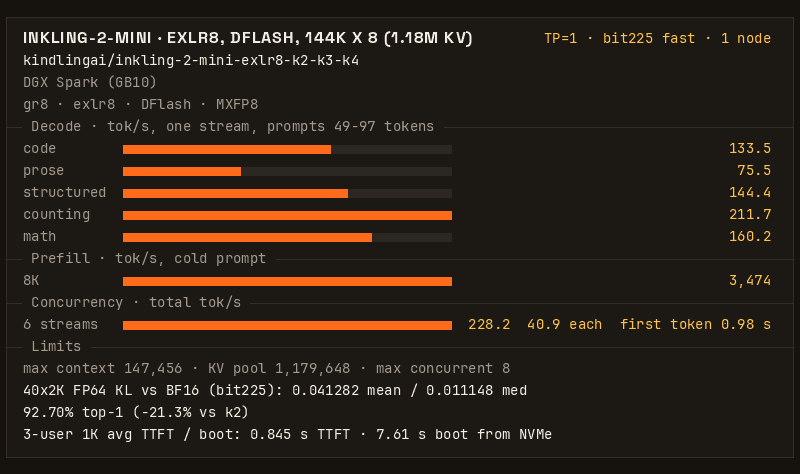

# KindlingAI: Inkling-2-Mini EXLR8 on one DGX Spark (bit325, K4 & bit225)

If you are an agent booting this for someone, read [AGENTS.md](AGENTS.md) first, then the Quickstart.

_**Join our discord to learn more about KindlingAI and `gr8`: https://discord.gg/8EAvYPV2rE**_

Inkling-2-Mini on **one DGX Spark** (GB10, 128 GB) at `TP=1`, served by [gr8](https://github.com/kindlingai/gr8) (`main`, [PR #615](https://github.com/kindlingai/gr8/pull/615)) from [kindlingai/inkling-2-mini-exlr8-k2-k3-k4](https://huggingface.co/kindlingai/inkling-2-mini-exlr8-k2-k3-k4/tree/3037e66b3f01003ddf2c62b7e1d9469c59104609):
one single pack gives load-time width selection across:
- **`bit325` (3.25-bit, default)** — in our 1,362-task evals, 3.25-bit performed nearly the same as 4-bit across coding and math except for graduate-level science (GPQA), while running faster (**90.6** Code / **160.0** `C=6` / **3,484** 8K prefill, **8/8 exact DFlash greedy parity**) and unlocking a **`1,179,648`-token (`1.18M`) KV pool** at the maximum **8 concurrent sessions** (`147,456 × 8`, `~9.6 GiB` free OS memory) — or up to **`1.31M`–`2.10M`** KV pools via `.env`.
- **`k4` (4-bit, higher quality)** — recommended for maximum quality and graduate-level science (GPQA): **`-27.4%` KL** vs Official NVFP4 and ties Official W4A4 on 1,362 tasks (`93.54%`, McNemar `p=0.6655`), with a **`1M` KV pool** (`262K × 4`, `128K × 8`, or `1M × 1`).
- **`bit225` (2.25-bit, fast version)** — `13.37 GB` device image (`0` extra weight bytes), **`0.041282` mean KL** (`-21.3%` lower KL than `k2`), hitting **`133.5 tok/s`** Code, **`160.2 tok/s`** Math, **`144.4 tok/s`** JSON, **`228.2 tok/s`** `C=6` mixed, **`3,474 tok/s`** 8K prefill, and **`7.61 s`** NVMe boot.

A bundled **279 MB DFlash speculative drafter** is auto-discovered with zero extra flags. This recipe is the published `gr8` image, one launcher script, and one `.env` file. Nothing is compiled.


**`bit325` (3.25-bit, default):** **90.6 tok/s** code · **105.2 tok/s** math · **91.2 tok/s** JSON · **49.5 tok/s** prose · **172.4 tok/s** counting · **3,484 tok/s** 8K prefill · **160.0 tok/s** `C=6` mixed (`298.6` 6× Math) · **8/8 exact DFlash greedy parity** · **`1.18M` KV pool (`144K × 8`)** · **9.95 s** boot
**`k4` (4-bit, higher quality / GPQA):** **64.6 tok/s** code · **107.3 tok/s** math · **90.9 tok/s** JSON · **48.6 tok/s** prose · **162.8 tok/s** counting · **3,457 tok/s** 8K prefill · **`0.010460` mean KL** (`-27.4%` vs Official NVFP4) · **93.54%** on 1,362 tasks · **10.3 s** boot
**`bit225` (2.25-bit, fast version):** **133.5 tok/s** code · **160.2 tok/s** math · **144.4 tok/s** JSON · **75.5 tok/s** prose · **211.7 tok/s** counting · **3,474 tok/s** 8K prefill · **228.2 tok/s** `C=6` mixed · **0.845 s** 3-user 1K TTFT · **`0.041282` mean KL** (`-21.3%` vs `k2`) · **7.61 s** boot

## Results

One DGX Spark (GB10, 128 GB) with local NVMe storage, `TP=1`, measured 2026-11-25 on `gr8` commit `6b874803` ([PR #615](https://github.com/kindlingai/gr8/pull/615)) with bundled DFlash (`MTP=7`, auto-discovered, zero extra flags), `GR8_INK2_PF_MX8_MOE=2`, `GR8_INK2_MX8_DENSE=2`, `GR8_INK2_MX8_LM_HEAD=0` (and `MX8_DENSE=1`, `MX8_LM_HEAD=1`, `GR8_S2_ADAPT=1` for `bit225` fast and `k2` fast). Every speed is in tokens per second (tok/s).

### One request, 8 domains & concurrency (`MTP=7`, 49–97 prompt tokens, 256 max tokens)

| Metric | **`bit325` (default, 16.43 GB)** | `k4` (quality, 18.72 GB) | `bit225` (std, 13.37 GB) | **`bit225` fast (13.37 GB)** | `k2` fast (12.60 GB) |
|---|---:|---:|---:|---:|---:|
| Code (tok/s) | 90.6 | 64.6 | 112.6 | **133.5** | 100.5 |
| Math (tok/s) | 105.2 | 107.3 | 141.0 | 160.2 | **167.5** |
| JSON / structured (tok/s) | 91.2 | 90.9 | 119.3 | 144.4 | **148.9** |
| HTML (tok/s) | 85.3 | 77.4 | 106.2 | 112.7 | **144.1** |
| Prose (tok/s) | 49.5 | 48.6 | 56.4 | 75.5 | **80.8** |
| Narrative (tok/s) | 46.6 | 42.6 | 51.1 | 71.9 | **74.1** |
| Summary (tok/s) | 61.8 | 55.2 | 62.0 | 88.7 | **97.4** |
| Counting (tok/s) | 172.4 | 162.8 | 194.7 | 211.7 | **228.3** |
| `C=6` Mixed Agg Decode (tok/s) | 160.0 | 139.1 | 185.6 | 228.2 | **230.0** |
| Homogeneous `C=6` Peak (`6× Math`) | 298.6 | — | — | — | **479.5** |
| 8K Cold Prefill (tok/s) | **3,484** | 3,457 | 3,467 | 3,474 | 3,475 |
| 3-User 1K Avg TTFT | 0.935 s | 0.935 s | 0.936 s | 0.845 s | **0.827 s** |

*Thinking-ON prose (`512` tokens, `c=1/2/4/6`):*
- **`bit325`:** `48.5` / `70.2` / `100.3` / `122.6` tok/s at `t=0.6` (`48.8` / `72.3` / `105.1` / `128.2` tok/s at `t=0.0`).
- **`k2` fast:** `66.9` / `98.0` / `150.5` / `166.3` tok/s at `t=0.6` (`72.5` / `114.4` / `158.7` / `191.2` tok/s at `t=0.0`).



### Cold prefill sweep (`bit325`, `CAP=139264`, `PREFILL=4096`)

| Prompt length | 4K | 8K | 32K | 64K | 128K |
|---|---:|---:|---:|---:|---:|
| Prefill speed (tok/s) | **3,436** (`1.19 s`) | **3,472** (`2.36 s`) | **3,150** (`10.40 s`) | **2,732** (`23.99 s`) | **2,162** (`60.63 s`) |

### Choosing a preset (`VARIANT`): KL divergence & 1,362-task evaluation

Matched 40×2K (`81,920`-token) full-vocabulary `float64` KL against BF16 (`PPL = 5.3840`) and controlled execution-/SymPy-verified 1,362-task evaluation (HumanEval+ 164, GPQA-Diamond 198, MATH-500 500, GSM8K-500 500 at `temp=0.0`, `max_tokens=6144`, `reasoning_effort="low"`, `0` errors):

| Variant | Device image | Mean / Med KL vs BF16 | Top-1 | 1,362-Task Pooled | Guidance |
|---|---:|---:|---:|---:|---|
| **`bit325`** *(default)* | **16.43 GB** | `0.015019 / 0.003027` | `96.00%` | **92.80%** (`1264/1362`) | **Default:** performed nearly the same as 4-bit in evals (`91.46%` HE+, `97.80%` MATH-500) except graduate-level science (GPQA `72.22%`); 8/8 exact DFlash greedy parity |
| **`k4`** *(higher quality)* | **18.72 GB** | **0.010460 / 0.001632** | **96.91%** | **93.54%** (`1274/1362`) | **Higher quality:** recommended for maximum quality & graduate-level science (GPQA `75.25%`); `-27.4%` KL vs Official NVFP4, ties Official W4A4 (`p=0.6655`) |
| **`bit225`** *(fast version)* | **13.37 GB** | `0.041282 / 0.011148` | `92.70%` | — | **Fast version:** `-21.3%` lower KL than `k2`, `0` extra weight bytes, `133.5` Code / `160.2` Math / `228.2` `C=6` tok/s |
| `bit250` | 14.13 GB | `0.030018 / 0.007401` | `93.93%` | — | Compact mid-tier (`-3.81%` vs stock `bit250`) |
| `k2` *(E2E KL)* | 12.60 GB | `0.052425 / 0.015119` | `91.70%` | — | Minimum footprint (`-11.65%` KL vs stock `k2`) |

### Maximized concurrency & KV pools on 128 GB Spark (`bit325`, live verified)

`g6m4_ink2` supports up to **8 concurrent sessions** (`SESSIONS=1..8`). The default **`bit325`** configuration maximizes both concurrency and prefill speed with a **`1,179,648`-token (`1.18M`) KV pool** (`147,456 × 8`, full `PF_MX8_MOE=2`, **`9.52–9.69 GiB` free OS memory**), with verified higher-capacity `.env` options up to **`2.10M` tokens (`256K × 8`)**:

| Mode (`.env`, `bit325`) | `PF_MX8_MOE` | Active chats | Max tokens / chat | Total KV pool | Boot time | Verified free OS memory | 37.8K prefill |
|---|---:|---:|---:|---:|---:|---:|---:|
| **Default (`144K × 8`)** | `2` | **8** | **147,456** | **1,179,648 (`1.18M`)** | `9.95 s` | **`9.52–9.69 GiB`** | `2,945 tok/s` |
| Max `moe=2` (`160K × 8`) | `2` | 8 | 163,840 | 1,310,720 (`1.31M`) | `9.92 s` | `5.45 GiB` | `2,876 tok/s` |
| Long-chat `moe=2` (`256K × 5`) | `2` | 5 | 262,144 | 1,310,720 (`1.31M`) | `9.92 s` | `5.54 GiB` | `2,893 tok/s` |
| Expanded pool (`192K × 8`) | `1` | 8 | 196,608 | 1,572,864 (`1.57M`) | `9.72 s` | `9.12 GiB` | `2,589 tok/s` |
| Ultra pool (`256K × 8`) | `0` | **8** | **262,144** | **2,097,152 (`2.10M`)** | `9.52 s` | `4.44 GiB` | `1,955 tok/s` |
| Full 1M native (`1M × 1`) | `2` | 1 | **1,048,576** | 1,048,576 (`1.05M`) | `10.5 s` | `7.8+ GiB` (`k4`) | — |

*For `VARIANT=k4` with `PF_MX8_MOE=2`, verified live pools are `262,144 × 4` (`1M`, `12.2 GiB` free), `131,072 × 8` (`1M`, `11.6 GiB` free), and `1,048,576 × 1` (`1M`, `7.8 GiB` free).*

### Quality checks

Measured live on 2026-11-25 on 1× DGX Spark (`gr8` commit `6b874803` / `ghcr.io/kindlingai/gr8:sha-6b87480`):

| Check | Result |
|---|---|
| DFlash `K=7` vs `MTP=0` greedy parity (`bit325`) | **8 of 8 exact token-for-token** (`1.41×–5.18×` speedup) |
| Needle recall (`bit325`, `144K × 8 = 1.18M` KV pool) | **PASS** at `35.4K` (`2,360 tok/s`, `9.52 GiB` free) |
| Needle recall (`k4`, Docker Compose `256K × 4 = 1M` KV pool) | **PASS** at `36.6K` (`3,068 tok/s`) and `146.4K` (`2,089 tok/s`, `12.2 GiB` free) |
| Boot to serving from local NVMe | `9.95 s` (`bit325` `144K × 8`) / `10.3 s` (`k4` `256K × 4`) / `7.61 s` (`bit225` fast) |

[kindling.json](kindling.json) holds the `tp1-bit325`, `tp1-k4`, and `tp1-bit225` results in machine-readable form. Both cards above are drawn from it.

## Quickstart

First turn off proactive memory compaction on the Spark ([What you need](#what-you-need)). Then:

```bash
npx @kindlingai/recipe inkling-2-mini-exlr8-1x-spark && cd inkling-2-mini-exlr8-1x-spark
# the CLI already copied .env.example to .env (defaults to bit325, 144K x 8 = 1.18M KV pool)
hf download kindlingai/inkling-2-mini-exlr8-k2-k3-k4 \
  --local-dir ./models/inkling-2-mini-exlr8-k2-k3-k4
docker compose up -d       # pulls the pinned gr8 image; ready in ~10 s
docker compose logs -f
```

This recipe lives in [kindlingai/recipes](https://github.com/kindlingai/recipes/tree/main/inkling-2-mini/dgx-spark/1x/exlr8-gr8) at `inkling-2-mini/dgx-spark/1x/exlr8-gr8`; a [sparse clone](https://github.com/kindlingai/recipes#run-a-recipe) also works.

Once serving, verify the API:

```bash
curl -s http://127.0.0.1:8100/v1/models
curl -s http://127.0.0.1:8100/v1/chat/completions \
  -H "Content-Type: application/json" \
  -d '{
    "model": "inkling-2-mini",
    "messages": [{"role": "user", "content": "Write a thread-safe Python LRU cache with TTL."}],
    "max_tokens": 512,
    "temperature": 0.0
  }'
```

Stop the server cleanly with:

```bash
docker compose down
```

## What you need

- One DGX Spark or other GB10 box (128 GB unified memory), with no other model running on it.
- Docker with the NVIDIA container toolkit (DGX OS has both).
- **Local NVMe disk:** ~35 GB free for `kindlingai/inkling-2-mini-exlr8-k2-k3-k4` (`~31 GB` on disk).
- Proactive memory compaction off:
  `sudo sysctl -w vm.compaction_proactiveness=0` (`gr8`'s [DEPLOY.md](https://github.com/kindlingai/gr8/blob/main/docs/DEPLOY.md#before-you-start) has the permanent form).

`gr8`'s [Inkling-2-Mini page](https://github.com/kindlingai/gr8/blob/main/docs/INKLING.md) documents the architecture and `GR8_INK2_*` runtime knobs.

## Help

Ask on Discord (https://discord.gg/8EAvYPV2rE) or open an issue in the recipes repo (https://github.com/kindlingai/recipes/issues) with `inkling-2-mini-exlr8-1x-spark` in the title. Include the command you ran and the end of `docker logs inkling-2-mini-1x-spark`. Remove addresses and hostnames before posting.

## Engine pin

This recipe has no engine code. It runs one published `gr8` image, named in [compose.yaml](compose.yaml) and in the `engine` field of [kindling.json](kindling.json):

| | |
|---|---|
| engine | [kindlingai/gr8](https://github.com/kindlingai/gr8) [`2c221e98`](https://github.com/kindlingai/gr8/commit/2c221e984112e9f1081b4f5a9555600239072f19) ([PR #640](https://github.com/kindlingai/gr8/pull/640) — 19× smaller prefill workspace + `GR8_INK2_PF_MX8_MOE=3\|4` streaming FP8 MoE prefill for co-resident / low-RAM setups) |
| image | `ghcr.io/kindlingai/gr8:sha-2c221e9` |
| digest | `sha256:b50f14c667fb7877e21c05669494807f612d57073adc3efde79024acef1dbfc1` |

`python3 tools/check_pin.py --strict inkling-2-mini/dgx-spark/1x/exlr8-gr8`, run from the monorepo root, verifies that `compose.yaml` and `kindling.json` agree on the immutable image digest.

## License

MIT, see [LICENSE](../../../../LICENSE). Inkling-2-Mini ([thinkingmachines/Inkling-2-Mini](https://huggingface.co/thinkingmachines/Inkling-2-Mini)) and the upstream DFlash drafter ([incoai/Inkling-2-Mini-DFlash2](https://huggingface.co/incoai/Inkling-2-Mini-DFlash2)) are released under the Apache-2.0 License; see the [model page](https://huggingface.co/kindlingai/inkling-2-mini-exlr8-k2-k3-k4).
