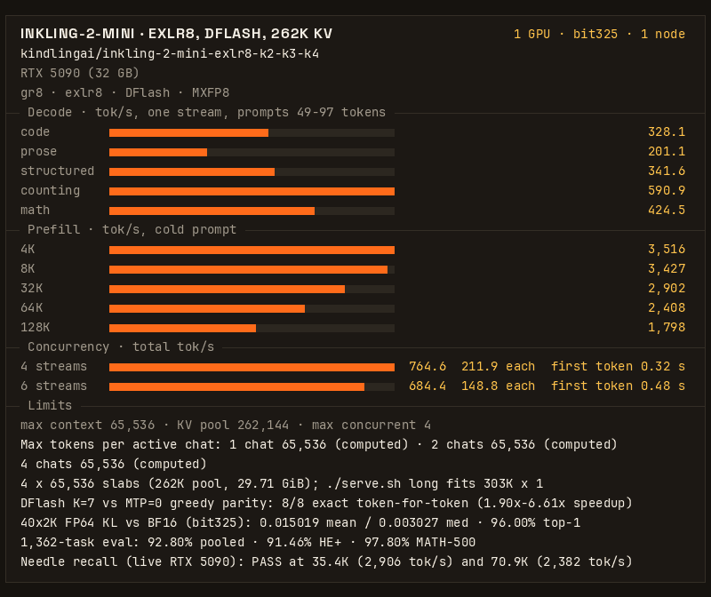

# KindlingAI: Inkling-2-Mini EXLR8 on one RTX 5090 (bit325, K4 & bit225)

If you are an agent booting this for someone, read [AGENTS.md](AGENTS.md) first, then the Quickstart.

_**Join our discord to learn more about KindlingAI and `gr8`: https://discord.gg/8EAvYPV2rE**_

Inkling-2-Mini on **one NVIDIA RTX 5090 (32 GB)** at `TP=1`, served by [gr8](https://github.com/kindlingai/gr8) (`main`, [PR #615](https://github.com/kindlingai/gr8/pull/615)) from [kindlingai/inkling-2-mini-exlr8-k2-k3-k4](https://huggingface.co/kindlingai/inkling-2-mini-exlr8-k2-k3-k4):
one single pack gives load-time width selection across:
- **`bit325` (3.25-bit, default)** — in our 1,362-task evals, 3.25-bit performed nearly the same as 4-bit across coding and math except for graduate-level science (GPQA), while running faster and fitting a **`262,144`-token KV pool** (`65,536 × 4`) or **`303K` single-stream** on 32 GB VRAM with **8/8 exact DFlash greedy parity** (`1.90×–6.61×` speedup).
- **`k4` (4-bit, higher quality)** — recommended for maximum quality and graduate-level science (GPQA): **`-27.4%` KL** vs Official NVFP4 and ties Official W4A4 on 1,362 tasks (`93.54%`, McNemar `p=0.6655`), fitting a **`196,608`-token KV pool** (`49,152 × 4`) or **`245K` single-stream**.
- **`bit225` (2.25-bit, fast version)** — `13.37 GB` device image (`0` extra weight bytes), **`0.041282` mean KL** (`-21.3%` lower KL than `k2`), hitting up to **`354.4 tok/s`** code, **`768.3 tok/s`** `C=4` agg, and **`528.1 tok/s`** `C=6` Thinking-ON prose, fitting a **`327K–360K` KV pool** or **`385K` single-stream**.

A compact **279 MB DFlash speculative drafter** is bundled inside the weight pack and auto-discovered with zero extra flags.



**`bit325` (3.25-bit, default):** **328.1 tok/s** code · **424.5 tok/s** math · **341.6 tok/s** JSON · **201.1 tok/s** prose · **590.9 tok/s** counting · **764.6 tok/s** `C=4` agg (`211.9`/user) · **418.3 tok/s** `C=6` thinking-ON · **8/8 exact DFlash greedy parity** · **4.27 s** boot from local NVMe
**`k4` (4-bit, higher quality / GPQA):** **274.4 tok/s** code · **438.5 tok/s** math · **337.1 tok/s** JSON · **183.6 tok/s** prose · **593.8 tok/s** counting · **649.1 tok/s** `C=4` agg · **`0.010460` mean KL** (`-27.4%` vs Official NVFP4) · **93.54%** on 1,362 tasks · **4.76 s** boot
**`bit225` (2.25-bit, fast version):** **354.4 tok/s** code · **394.0 tok/s** math (`436.3` std) · **376.5 tok/s** JSON (`384.1` std) · **506.2 tok/s** counting (`604.8` std) · **768.3 tok/s** `C=4` agg · **528.1 tok/s** `C=6` thinking-ON · **`0.041282` mean KL** (`-21.3%` vs `k2`) · **3.76 s** boot

## Results

One NVIDIA GeForce RTX 5090 (32 GB, `sm_120a`) with local NVMe storage, `TP=1`, measured 2026-11-25 on `gr8` commit `6b874803` ([PR #615](https://github.com/kindlingai/gr8/pull/615)) with bundled DFlash (`MTP=7`, auto-discovered, zero extra flags), `GR8_INK2_PF_MX8_MOE=0`, `GR8_INK2_MX8_DENSE=2`, `GR8_INK2_MX8_LM_HEAD=0` (and `MX8_DENSE=1`, `MX8_LM_HEAD=1`, `GR8_S2_ADAPT=1` for `bit225-fast` and `k2-fast`). Every speed is in tokens per second (tok/s).

### One request, 8 domains & concurrency (`MTP=7`, 49–97 prompt tokens, 256 max tokens)

| Metric | **`bit325` (default, 16.43 GB)** | `k4` (quality, 18.72 GB) | `bit225` (std, 13.37 GB) | **`bit225-fast` (13.37 GB)** | `k2-fast` (12.60 GB) |
|---|---:|---:|---:|---:|---:|
| Code (tok/s) | 328.1 | 274.4 | 243.3 | **354.4** | 244.5 |
| Math (tok/s) | 424.5 | **438.5** | 436.3 | 394.0 | 418.7 |
| JSON / structured (tok/s) | 341.6 | 337.1 | **384.1** | 376.5 | 360.6 |
| HTML (tok/s) | 314.3 | 297.1 | **343.4** | 278.6 | 336.9 |
| Prose (tok/s) | 201.1 | 183.6 | 187.3 | 190.4 | **218.4** |
| Narrative (tok/s) | 171.8 | 166.2 | 161.4 | 185.7 | **188.2** |
| Summary (tok/s) | 224.0 | 200.9 | 202.7 | 218.5 | **231.0** |
| Counting (tok/s) | 590.9 | 593.8 | **604.8** | 506.2 | 510.8 |
| `C=2` Agg Decode (tok/s) | **520.1** | 441.2 | 408.6 | 519.1 | 410.2 |
| `C=4` Agg Decode (tok/s) | 764.6 (`211.9`/u) | 649.1 (`198.9`/u) | 642.2 (`220.1`/u) | **768.3** (`200.1`/u) | 608.4 (`170.7`/u) |
| `C=6` Agg Decode (tok/s) | 684.4 (`148.8`/u) | 575.4 (`135.3`/u) | 638.8 (`152.8`/u) | **701.8** (`129.6`/u) | 670.9 (`126.5`/u) |
| Thinking-ON `C=1 / 2 / 4 / 6` (512 tok, `t=0.6`) | `143.3 / 236.5 / 354.0 / 418.3` | — | `159.4 / 256.9 / 398.7 / 490.9` | **`161.1 / 263.9 / 420.5 / 528.1`** | `171.8 / 258.2 / 436.6 / 516.5` |
| NVMe Boot Time | **4.27 s** | 4.76 s | 4.02 s | **3.76 s** | 3.76 s |


### Cold prefill sweep (1× RTX 5090, `GR8_INK2_PF_MX8_MOE=0`, `GR8_INK2_MX8_DENSE=2`)

| Prefill chunk | 4K | 8K | 32K | 64K | 128K |
|---|---:|---:|---:|---:|---:|
| **`PREFILL=512` (default)** | **5,033.5** (`0.81 s`) | **4,990.9** (`1.64 s`) | **4,448.8** (`7.37 s`) | **3,851.5** (`17.02 s`) | **3,031.7** (`43.23 s`) |
| `PREFILL=256` (`long` mode, `bit325`) | 3,516.3 (`1.16 s`) | 3,426.8 (`2.39 s`) | 2,902.1 (`11.29 s`) | 2,407.5 (`27.22 s`) | 1,798.1 (`72.89 s`) |
| `PREFILL=256` (`long` mode, `k4`) | 3,480.3 (`1.18 s`) | 3,394.3 (`2.41 s`) | 2,878.9 (`11.38 s`) | 2,392.7 (`27.39 s`) | — |

### Choosing a preset (`VARIANT`): KL divergence & 1,362-task evaluation

Matched 40×2K (`81,920`-token) full-vocabulary `float64` KL against BF16 (`PPL = 5.3840`) and controlled execution-/SymPy-verified 1,362-task evaluation (HumanEval+ 164, GPQA-Diamond 198, MATH-500 500, GSM8K-500 500 at `temp=0.0`, `max_tokens=6144`, `reasoning_effort="low"`, `0` errors):

| Variant | Device image | Mean / Med KL vs BF16 | Top-1 | 1,362-Task Pooled | Guidance |
|---|---:|---:|---:|---:|---|
| **`bit325`** *(default)* | **16.43 GB** | `0.015019 / 0.003027` | `96.00%` | **92.80%** (`1264/1362`) | **Default:** nearly identical to 4-bit in evals (`91.46%` HE+, `97.80%` MATH-500) except graduate-level science (GPQA `72.22%`); `262K` KV pool on 32 GB |
| **`k4`** *(higher quality)* | **18.72 GB** | **0.010460 / 0.001632** | **96.91%** | **93.54%** (`1274/1362`) | **Higher quality:** recommended for maximum quality & graduate-level science (GPQA `75.25%`); `-27.4%` KL vs Official NVFP4, ties Official W4A4 (`p=0.6655`) |
| **`bit225`** *(fast version)* | **13.37 GB** | `0.041282 / 0.011148` | `92.70%` | — | **Fast version:** `-21.3%` lower KL than `k2`, `0` extra weight bytes, up to `354` Code / `768` `C=4` / `528` `C=6` thinking, `327K–360K` KV pool |
| `bit250` | 14.13 GB | `0.030018 / 0.007401` | `93.93%` | — | Compact mid-tier (`327K` KV pool) |
| `k2` *(E2E KL)* | 12.60 GB | `0.052425 / 0.015119` | `91.70%` | — | Minimum footprint (`-11.65%` KL vs stock `k2`, `360K` KV pool / `401K` single-stream) |

### Maximized 32 GB VRAM context & concurrency presets

`serve.sh` automatically selects each variant's maximized dedicated 32 GB RTX 5090 (`32,607 MiB`) geometry, leaving ~2 GiB free VRAM headroom (computed from an exact linear VRAM model verified within `+/-8 MiB` across 12 live `nvidia-smi` measurements):

| Preset command | Active chats | Max tokens per chat | Total KV pool | `PREFILL` | `g6m4_ink2` VRAM | Dedicated 32 GB free |
|---|---:|---:|---:|---:|---:|---:|
| **`./serve.sh` (`bit325`, default)** | **4** | **65,536** | **262,144** | 512 | `29.71 GiB` | `~2.13 GiB` |
| `./serve.sh k4` | 4 | **49,152** | **196,608** | 512 | `29.74 GiB` | `~2.10 GiB` |
| `./serve.sh bit225-fast` | 4 | **81,920** | **327,680** | 512 | `29.40 GiB` | `~2.45 GiB` |
| `./serve.sh bit225` | 4 | **90,112** | **360,448** | 512 | `30.00 GiB` | `~1.84 GiB` |
| `./serve.sh long` (`bit325`) | 1 | **303,104** | **303,104** | 256 | `29.87 GiB` | `~1.97 GiB` |
| `VARIANT=k4 ./serve.sh long` | 1 | **245,760** | **245,760** | 256 | `29.92 GiB` | `~1.93 GiB` |
| `VARIANT=bit225 ./serve.sh long` | 1 | **385,024** | **385,024** | 256 | `29.99 GiB` | `~1.85 GiB` |
| `VARIANT=k2 ./serve.sh long` | 1 | **401,408** | **401,408** | 256 | `29.87 GiB` | `~1.97 GiB` |

*Shared-GPU host note:* If other services occupy VRAM on the card (for example ~7 GiB), override `CAP` and `PREFILL` in `.env` (e.g. `CAP=16384`, `SESSIONS=4`, `PREFILL=256`).

### Quality checks

Measured live on 2026-11-25 on 1× NVIDIA RTX 5090 (32 GB, `gr8` commit `6b874803`):

| Check | Result |
|---|---|
| DFlash `K=7` vs `MTP=0` greedy parity (`bit325`) | **8 of 8 exact token-for-token** (`1.90×–6.61×` speedup) |
| Needle recall at `35.4K` (`bit325`) | **PASS** (`2,906 tok/s`, `12.17 s`) |
| Needle recall at `70.9K` (`bit325`) | **PASS** (`2,382 tok/s`, `29.78 s`) |
| Cold prefill at `131,072` tokens | **PASS** (`3,031.7 tok/s` at `PREFILL=512`, `1,798.1 tok/s` at `PREFILL=256`) |
| Boot to serving from local NVMe | `4.27 s` (`bit325`) / `4.76 s` (`k4`) / `3.76 s` (`bit225-fast`) |

[kindling.json](kindling.json) holds the `1gpu-bit325`, `1gpu-k4`, and `1gpu-bit225` results in machine-readable form. Both cards above are drawn from it.

## Quickstart

```bash
git clone https://github.com/kindlingai/inkling-2-mini-exlr8-rtx5090.git
cd inkling-2-mini-exlr8-rtx5090

# 1. Build gr8 (sm_120a g6m4_ink2 + g6front-rs) at the pinned commit
./build.sh

# 2. Download the weight pack (~31 GB, includes bundled 279 MB DFlash drafter)
hf download kindlingai/inkling-2-mini-exlr8-k2-k3-k4 \
  --local-dir ./models/inkling-2-mini-exlr8-k2-k3-k4

# 3. Copy .env and launch (defaults to bit325, 65536 x 4 = 262K KV pool)
cp .env.example .env
./serve.sh                 # default: bit325 (3.25-bit)
# ./serve.sh k4            # higher quality / graduate-level science (4-bit)
# ./serve.sh bit225-fast   # fast version (2.25-bit)
# ./serve.sh long          # single-stream long context (303K on bit325)
```

This recipe also lives in [kindlingai/recipes](https://github.com/kindlingai/recipes/tree/main/inkling-2-mini/rtx-5090/1x/exlr8-gr8) at `inkling-2-mini/rtx-5090/1x/exlr8-gr8` (`npx @kindlingai/recipe inkling-2-mini-exlr8-1x-rtx5090`).

Once serving, verify the API:

```bash
curl -s http://127.0.0.1:8100/v1/models
curl -s http://127.0.0.1:8100/v1/chat/completions \
  -H "Content-Type: application/json" \
  -d '{
    "model": "inkling-2-mini",
    "messages": [{"role": "user", "content": "Write a thread-safe Python LRU cache with TTL."}],
    "max_tokens": 512,
    "temperature": 0.0
  }'
```

Included helper scripts: `bench.py` (smoke, 8-domain decode, concurrent, and prefill sweep), `needle.py` (needle-in-a-haystack recall), and `parity.py` (greedy DFlash vs `MTP=0` parity check).

## What you need

- **GPU:** 1× NVIDIA GeForce RTX 5090 (32 GB GDDR7, `sm_120a`) or equivalent 32 GB+ Blackwell GPU.
- **Local NVMe disk:** ~35 GB free for `kindlingai/inkling-2-mini-exlr8-k2-k3-k4` (`~31 GB` on disk).
- **Build toolchain:** CUDA 13 (`nvcc` with `sm_120a`), `g++` (C++20), `cmake`, `clang`, `libclang-dev`, `libibverbs-dev`, Rust 1.85+ (`cargo`), and Python 3.

`gr8`'s [Inkling-2-Mini page](https://github.com/kindlingai/gr8/blob/main/docs/INKLING.md) documents the architecture and `GR8_INK2_*` runtime knobs.

## Help

Ask on Discord (https://discord.gg/8EAvYPV2rE) or open an issue in [kindlingai/recipes](https://github.com/kindlingai/recipes/issues) with `inkling-2-mini-exlr8-1x-rtx5090` in the title. Include `nvidia-smi` output and the end of the `serve.sh` log.

## Engine pin

This recipe builds [kindlingai/gr8](https://github.com/kindlingai/gr8) from source at one exact pinned commit, matching `engine.commit` in [kindling.json](kindling.json):

| | |
|---|---|
| engine | [kindlingai/gr8](https://github.com/kindlingai/gr8) [`6b874803`](https://github.com/kindlingai/gr8/commit/6b8748038bc74cd746c2f83075b0fbb6ba5aa99e) ([PR #615](https://github.com/kindlingai/gr8/pull/615)) |
| target | `ARCH=120a GR8_WIDTHS=1 MODEL=ink2` (`g6m4_ink2` + `g6front-rs`) |
| pin | `source` (`./build.sh`) |

## License

MIT, see [LICENSE](../../../../LICENSE). Inkling-2-Mini ([thinkingmachines/Inkling-2-Mini](https://huggingface.co/thinkingmachines/Inkling-2-Mini)) and the upstream DFlash drafter ([incoai/Inkling-2-Mini-DFlash2](https://huggingface.co/incoai/Inkling-2-Mini-DFlash2)) are released under the Apache-2.0 License; see the [model page](https://huggingface.co/kindlingai/inkling-2-mini-exlr8-k2-k3-k4).
