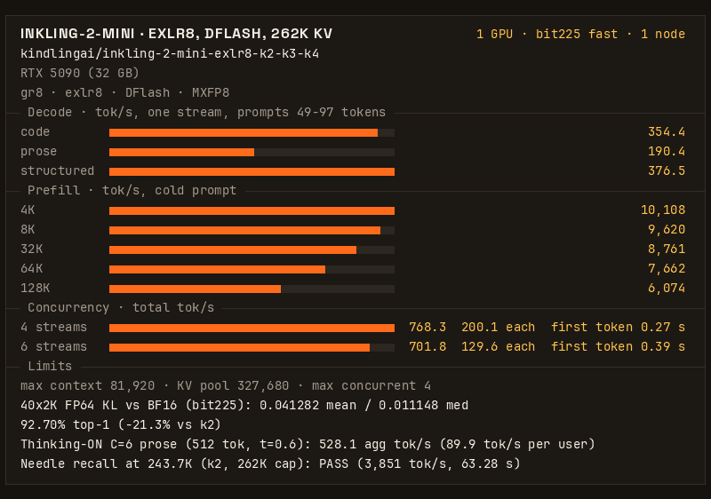

# KindlingAI: Inkling-2-Mini EXLR8 on one RTX 5090 (bit325, K4 & bit225)


If you are an agent booting this for someone, read [AGENTS.md](AGENTS.md) first, then the Quickstart.

_**Join our discord to learn more about KindlingAI and `gr8`: https://discord.gg/8EAvYPV2rE**_

Inkling-2-Mini on **one NVIDIA RTX 5090 (32 GB)** at `TP=1`, served by [gr8](https://github.com/kindlingai/gr8) (`main@2c221e9`, multi-arch `linux/amd64` `sm_120a`) from [kindlingai/inkling-2-mini-exlr8-k2-k3-k4](https://huggingface.co/kindlingai/inkling-2-mini-exlr8-k2-k3-k4):
one single pack gives load-time width selection across:
- **`bit325` (3.25-bit, default)** — in our 1,362-task evals, 3.25-bit performed nearly the same as 4-bit across coding and math except for graduate-level science (GPQA), while running faster and fitting a **`262,144`-token KV pool** (`65,536 × 4`) or **`303K` single-stream** on 32 GB VRAM with **10,076 tok/s** 4K cold prefill and **8/8 exact DFlash greedy parity** (`1.90×–6.58×` speedup).
- **`k4` (4-bit, higher quality)** — recommended for maximum quality and graduate-level science (GPQA): **`-27.4%` KL** vs Official NVFP4 and ties Official W4A4 on 1,362 tasks (`93.54%`, McNemar `p=0.6655`), fitting a **`196,608`-token KV pool** (`49,152 × 4`) or **`224K` single-stream**.
- **`bit225` (2.25-bit, fast version)** — `13.37 GB` device image (`0` extra weight bytes), **`0.041282` mean KL** (`-21.3%` lower KL than `k2`), hitting up to **`354.4 tok/s`** code, **`768.3 tok/s`** `C=4` agg, **`528.1 tok/s`** `C=6` Thinking-ON prose, and **`10,108 tok/s`** 4K cold prefill, fitting a **`327K–360K` KV pool** or **`385K` single-stream**.

A compact **279 MB DFlash speculative drafter** is bundled inside the weight pack and auto-discovered with zero extra flags. This recipe runs the published `linux/amd64` `gr8` image with `compose.yaml`, `entrypoint.sh`, and `.env` — nothing is compiled on the host.

## Results

**`bit325` (3.25-bit, default):** **328.1 tok/s** code · **424.5 tok/s** math · **341.6 tok/s** JSON · **201.1 tok/s** prose · **592.5 tok/s** counting · **777.0 tok/s** `C=4` agg (`213.8`/user) · **10,076 tok/s** 4K prefill (`0.41 s` TTFT) · **8/8 exact DFlash greedy parity** · **4.01 s** boot from local NVMe
**`k4` (4-bit, higher quality / GPQA):** **274.4 tok/s** code · **438.5 tok/s** math · **337.1 tok/s** JSON · **183.6 tok/s** prose · **593.8 tok/s** counting · **649.1 tok/s** `C=4` agg · **`0.010460` mean KL** (`-27.4%` vs Official NVFP4) · **93.54%** on 1,362 tasks · **4.76 s** boot
**`bit225` (2.25-bit, fast version):** **354.4 tok/s** code · **394.0 tok/s** math (`436.3` std) · **376.5 tok/s** JSON (`384.1` std) · **506.2 tok/s** counting (`604.8` std) · **768.3 tok/s** `C=4` agg · **528.1 tok/s** `C=6` thinking-ON · **10,108 tok/s** 4K prefill (`10,454` 2-slot) · **`0.041282` mean KL** (`-21.3%` vs `k2`) · **3.56–3.76 s** boot

One NVIDIA GeForce RTX 5090 (32 GB, `sm_120a`) with local NVMe storage, `TP=1`, measured 2026-11-26 on `gr8` [PR #640](https://github.com/kindlingai/gr8/pull/640) (`main` commit `2c221e98`; single-stream 8-domain decode baselines from 2026-11-25 commit `6b874803`, re-verified 8/8 exact greedy parity + `C=1 328.8` / `C=2 544.6` / `C=4 777.0 tok/s`) with bundled DFlash (`MTP=7`, auto-discovered, zero extra flags), `GR8_INK2_PF_MX8_MOE=3`, `PREFILL=4096`, `GR8_INK2_MX8_DENSE=2`, `GR8_INK2_MX8_LM_HEAD=0` (and `MX8_DENSE=1`, `MX8_LM_HEAD=1`, `GR8_S2_ADAPT=1` for `bit225-fast` and `k2-fast`). Every speed is in tokens per second (tok/s).

### One request, 8 domains & concurrency (`MTP=7`, 49–97 prompt tokens, 256 max tokens)

| Metric | **`bit325` (default, 16.43 GB)** | `k4` (quality, 18.72 GB) | `bit225` (std, 13.37 GB) | **`bit225-fast` (13.37 GB)** | `k2-fast` (12.60 GB) |
|---|---:|---:|---:|---:|---:|
| Code (tok/s) | 328.1 | 274.4 | 243.3 | **354.4** | 244.5 |
| Math (tok/s) | 424.5 | **438.5** | 436.3 | 394.0 | 418.7 |
| JSON / structured (tok/s) | 341.6 | 337.1 | **384.1** | 376.5 | 360.6 |
| HTML (tok/s) | 314.3 | 297.1 | **343.4** | 278.6 | 336.9 |
| Prose (tok/s) | 201.1 | 183.6 | 187.3 | 190.4 | **218.4** |
| Narrative (tok/s) | 171.8 | 166.2 | 161.4 | 185.7 | **188.2** |
| Summary (tok/s) | 224.0 | 200.9 | 202.7 | 218.5 | **231.0** |
| Counting (tok/s) | 592.5 | 593.8 | **604.8** | 506.2 | 510.8 |
| `C=2` Agg Decode (tok/s) | **544.6** (`296.7`/u) | 441.2 | 408.6 | 519.1 | 410.2 |
| `C=4` Agg Decode (tok/s) | **777.0** (`213.8`/u) | 649.1 (`198.9`/u) | 642.2 (`220.1`/u) | 768.3 (`200.1`/u) | 608.4 (`170.7`/u) |
| `C=6` Agg Decode (tok/s) | 684.4 (`148.8`/u) | 575.4 (`135.3`/u) | 638.8 (`152.8`/u) | **701.8** (`129.6`/u) | 670.9 (`126.5`/u) |
| Thinking-ON `C=1 / 2 / 4 / 6` (512 tok, `t=0.6`) | `143.3 / 236.5 / 354.0 / 418.3` | — | `159.4 / 256.9 / 398.7 / 490.9` | **`161.1 / 263.9 / 420.5 / 528.1`** | `171.8 / 258.2 / 436.6 / 516.5` |
| NVMe Boot Time | **4.01 s** | 4.76 s | 4.02 s | **3.56–3.76 s** | **3.56 s** |



### Cold prefill sweep (1× RTX 5090, `GR8_INK2_MX8_DENSE=2`, `bit325`)

| Mode / prefill chunk | 4K | 8K | 32K | 64K | 128K |
|---|---:|---:|---:|---:|---:|
| **`PF_MX8_MOE=3`, `PREFILL=4096` (default, 0.98 GiB)** | **10,076.1** (`0.41 s`) | **9,579.9** (`0.86 s`) | **8,728.5** (`3.75 s`) | **7,636.6** (`8.58 s`) | **6,056.6** (`21.64 s`) |
| `PF_MX8_MOE=4`, `PREFILL=4096` (2-slot, 1.96 GiB) | **10,395.5** (`0.39 s`) | **9,851.5** (`0.83 s`) | **9,010.7** (`3.64 s`) | **7,882.8** (`8.31 s`) | 6,257.5* (`20.95 s`) |
| `PF_MX8_MOE=3`, `PREFILL=2048` | 7,239.8 (`0.57 s`) | 6,964.6 (`1.18 s`) | 6,536.8 (`5.01 s`) | 5,927.3 (`11.06 s`) | 4,951.1 (`26.47 s`) |
| `PF_MX8_MOE=0`, `PREFILL=512` *(prior v1.3.1 baseline)* | 5,033.5 (`0.81 s`) | 4,990.9 (`1.64 s`) | 4,448.8 (`7.37 s`) | 3,851.5 (`17.02 s`) | 3,031.7 (`43.23 s`) |
| `PF_MX8_MOE=0`, `PREFILL=256` *(prior `long` baseline)* | 3,516.3 (`1.16 s`) | 3,426.8 (`2.39 s`) | 2,902.1 (`11.29 s`) | 2,407.5 (`27.22 s`) | 1,798.1 (`72.89 s`) |

*\*`PF_MX8_MOE=4` 128K measured on `k2` (`10,453.6` @ 4K, `6,257.5` @ 128K).*

### Choosing a preset (`VARIANT`): KL divergence & 1,362-task evaluation

Matched 40×2K (`81,920`-token) full-vocabulary `float64` KL against BF16 (`PPL = 5.3840`) and controlled execution-/SymPy-verified 1,362-task evaluation (HumanEval+ 164, GPQA-Diamond 198, MATH-500 500, GSM8K-500 500 at `temp=0.0`, `max_tokens=6144`, `reasoning_effort="low"`, `0` errors):

| Variant | Device image | Mean / Med KL vs BF16 | Top-1 | 1,362-Task Pooled | Guidance |
|---|---:|---:|---:|---:|---|
| **`bit325`** *(default)* | **16.43 GB** | `0.015019 / 0.003027` | `96.00%` | **92.80%** (`1264/1362`) | **Default:** nearly identical to 4-bit in evals (`91.46%` HE+, `97.80%` MATH-500) except graduate-level science (GPQA `72.22%`); `262K` KV pool on 32 GB |
| **`k4`** *(higher quality)* | **18.72 GB** | **0.010460 / 0.001632** | **96.91%** | **93.54%** (`1274/1362`) | **Higher quality:** recommended for maximum quality & graduate-level science (GPQA `75.25%`); `-27.4%` KL vs Official NVFP4, ties Official W4A4 (`p=0.6655`) |
| **`bit225`** *(fast version)* | **13.37 GB** | `0.041282 / 0.011148` | `92.70%` | — | **Fast version:** `-21.3%` lower KL than `k2`, `0` extra weight bytes, up to `354` Code / `768` `C=4` / `528` `C=6` thinking, `327K–360K` KV pool |
| `bit250` | 14.13 GB | `0.030018 / 0.007401` | `93.93%` | — | Compact mid-tier (`327K` KV pool) |
| `k2` *(E2E KL)* | 12.60 GB | `0.052425 / 0.015119` | `91.70%` | — | Minimum footprint (`-11.65%` KL vs stock `k2`, `360K` KV pool / `401K` single-stream) |

### Maximized 32 GB VRAM context & concurrency presets

`entrypoint.sh` automatically selects each variant's maximized dedicated 32 GB RTX 5090 (`32,607 MiB`) geometry with `GR8_INK2_PF_MX8_MOE=3` and `PREFILL=4096`, leaving `~2.5–3.3 GiB` free at boot (`>=1.65 GiB` free even after `~0.9 GiB` lazy CUDA graph capture growth at `110K+` context, computed from an exact linear VRAM model calibrated to live `nvidia-smi` measurements):

| Preset (`.env`) | Active chats | Max tokens per chat | Total KV pool | `PREFILL` | `g6m4_ink2` VRAM | Dedicated 32 GB free |
|---|---:|---:|---:|---:|---:|---:|
| **Default (`VARIANT=bit325`)** | **4** | **65,536** | **262,144** | 4096 | `28.75 GiB` | `~3.10 GiB` |
| `VARIANT=k4` (or `PROFILE=k4`) | 4 | **49,152** | **196,608** | 4096 | `28.83 GiB` | `~3.01 GiB` |
| `PROFILE=bit225-fast` | 4 | **81,920** | **327,680** | 4096 | `28.58 GiB` | `~3.26 GiB` |
| `VARIANT=bit225` | 4 | **90,112** | **360,448** | 4096 | `28.97 GiB` | `~2.87 GiB` |
| `PROFILE=long` (`VARIANT=bit325`) | 1 | **303,104** | **303,104** | 4096 | `29.34 GiB` | `~2.50 GiB` |
| `VARIANT=k4`, `PROFILE=long` | 1 | **229,376** | **229,376** | 4096 | `29.18 GiB` | `~2.66 GiB` |
| `VARIANT=bit225`, `PROFILE=long` | 1 | **385,024** | **385,024** | 4096 | `29.05 GiB` | `~2.79 GiB` |
| `VARIANT=k2`, `PROFILE=long` | 1 | **401,408** | **401,408** | 4096 | `28.83 GiB` | `~3.02 GiB` |

*Shared-GPU host note:* If other services occupy VRAM on the card (for example ~7 GiB), override `CAP` in `.env` (e.g. `CAP=16384`, `SESSIONS=4`, `PREFILL=4096` or `CAP=135168`, `SESSIONS=1`, `PREFILL=4096`).

### Quality checks

Measured live on 2026-11-26 on 1× NVIDIA RTX 5090 (32 GB, `gr8` PR #640 / `2c221e98`, `GR8_INK2_PF_MX8_MOE=3`, `PREFILL=4096`):

| Check | Result |
|---|---|
| DFlash `K=7` vs `MTP=0` greedy parity (`bit325`) | **8 of 8 exact token-for-token** (`1.90×–6.58×` speedup) |
| Needle recall at `35.4K` (`bit325`) | **PASS** (`8,328 tok/s`, `4.25 s`) |
| Needle recall at `70.9K` (`bit325`) | **PASS** (`7,287 tok/s`, `9.74 s`) |
| Needle recall at `127.3K` (`bit325`) | **PASS** (`6,036 tok/s`, `21.09 s`) |
| Needle recall at `243.7K` (`k2`, `262K` cap, `PF=2048`) | **PASS** (`3,851 tok/s`, `63.28 s`) |
| Cold prefill at `131,072` tokens (`bit325`) | **PASS** (`6,056.6 tok/s`, `21.64 s` at `PREFILL=4096`) |
| Boot to serving from local NVMe | `4.01 s` (`bit325`) / `3.56 s` (`k2`) |

[kindling.json](kindling.json) holds the `1gpu-bit325`, `1gpu-k4`, and `1gpu-bit225` results in machine-readable form. Both cards above are drawn from it.

## Quickstart

```bash
npx @kindlingai/recipe inkling-2-mini-exlr8-1x-rtx5090 && cd inkling-2-mini-exlr8-1x-rtx5090
# the CLI already copied .env.example to .env (defaults to bit325, 65536 x 4 = 262K KV pool, PREFILL=4096)

# Download the weight pack (~31 GB, includes bundled 279 MB DFlash drafter)
hf download kindlingai/inkling-2-mini-exlr8-k2-k3-k4 \
  --local-dir ./models/inkling-2-mini-exlr8-k2-k3-k4

docker compose up -d       # pulls the published linux/amd64 gr8 image; ready in ~5 s
docker compose logs -f
```

This recipe lives in [kindlingai/recipes](https://github.com/kindlingai/recipes/tree/main/inkling-2-mini/rtx-5090/1x/exlr8-gr8) at `inkling-2-mini/rtx-5090/1x/exlr8-gr8`; a [sparse clone](https://github.com/kindlingai/recipes#run-a-recipe) also works.

Once serving, verify the API:

```bash
curl -s http://127.0.0.1:8100/v1/models
curl -s http://127.0.0.1:8100/v1/chat/completions \
  -H "Content-Type: application/json" \
  -d '{
    "model": "inkling-2-mini",
    "messages": [{"role": "user", "content": "Write a thread-safe Python LRU cache with TTL."}],
    "max_tokens": 512,
    "temperature": 0.0
  }'
```

Stop the server cleanly with:

```bash
docker compose down
```

## What you need

- **GPU:** 1× NVIDIA GeForce RTX 5090 (32 GB GDDR7, `sm_120a`) or equivalent 32 GB+ Blackwell GPU.
- **Docker:** Docker Engine with the NVIDIA Container Toolkit.
- **Local NVMe disk:** ~35 GB free for `kindlingai/inkling-2-mini-exlr8-k2-k3-k4` (`~31 GB` on disk).

`gr8`'s [Inkling-2-Mini page](https://github.com/kindlingai/gr8/blob/main/docs/INKLING.md) documents the architecture and `GR8_INK2_*` runtime knobs.

## Settings

`cp .env.example .env` (the CLI already did). Every knob is documented in [.env.example](.env.example); the active lines match the `bit325` configuration used for the Results numbers.

| knob | default | what it does |
|---|---|---|
| `MODEL_DIR` | `./models/inkling-2-mini-exlr8-k2-k3-k4` | Host directory holding the weight pack, mounted read-only inside the container |
| `VARIANT` | `bit325` | Width manifest preset: `bit325` (default), `k4`, `bit225`, `bit250`, or `k2` |
| `PROFILE` | unset | Optional shortcut (`bit325`, `k4`, `bit225`, `bit225-fast`, `bit250`, `k2`, `k2-fast`, `long`) |
| `CAP` / `SESSIONS` / `PREFILL` | auto (`65536`) / `4` / `4096` | Per-session context cap, concurrent session count, and prefill chunk budget |
| `MTP` | `7` | Bundled DFlash speculative drafting depth (auto-discovered in `MODEL_DIR`) |
| `HOST` / `PORT` | `127.0.0.1` / `8100` | OpenAI API bind address and port on the host network |
| `REASONING_EFFORT` | `none` | Default reasoning effort exposed by the frontend (`none`, `low`, `medium`, `high`) |
| `GR8_INK2_*` | `PF_MX8_MOE=3`, `MX8_DENSE=2`, `MX8_LM_HEAD=0` | Unified 32 GB RTX 5090 precision and VRAM knobs (`PF_MX8_MOE=4` enables 2-slot 1.96 GiB double-buffering) |
| `GR8_IMAGE` | unset | Optional override for the pinned `gr8` container image |

## Other sizes

- **One DGX Spark (`TP=1`, 128 GB unified memory, `144K × 8 = 1.18M` KV pool):** [inkling-2-mini-exlr8-1x-spark](../../../dgx-spark/1x/exlr8-gr8)

## Help

Ask on Discord (https://discord.gg/8EAvYPV2rE) or open an issue in [kindlingai/recipes](https://github.com/kindlingai/recipes/issues) with `inkling-2-mini-exlr8-1x-rtx5090` in the title. Include `nvidia-smi` output and the end of `docker logs inkling-2-mini-1x-rtx5090` before removing the container. Remove addresses and hostnames before posting.

## Engine pin

This recipe has no engine code. It runs one published multi-arch `gr8` image (`linux/amd64` `sm_120a`), named in [compose.yaml](compose.yaml) and in the `engine` field of [kindling.json](kindling.json):

| | |
|---|---|
| engine | [kindlingai/gr8](https://github.com/kindlingai/gr8) `main` ([`2c221e984112e9f1081b4f5a9555600239072f19`](https://github.com/kindlingai/gr8/commit/2c221e984112e9f1081b4f5a9555600239072f19)) |
| image | `ghcr.io/kindlingai/gr8:sha-2c221e9` |
| digest | `sha256:b50f14c667fb7877e21c05669494807f612d57073adc3efde79024acef1dbfc1` |
| weights | [kindlingai/inkling-2-mini-exlr8-k2-k3-k4](https://huggingface.co/kindlingai/inkling-2-mini-exlr8-k2-k3-k4/commit/3037e66b3f01003ddf2c62b7e1d9469c59104609) (`3037e66b`) |

`python3 tools/check_pin.py --strict inkling-2-mini/rtx-5090/1x/exlr8-gr8`, run from the monorepo root, verifies that [compose.yaml](compose.yaml) and [kindling.json](kindling.json) agree on the immutable image digest.

## License

MIT, see [LICENSE](../../../../LICENSE). Inkling-2-Mini ([thinkingmachines/Inkling-2-Mini](https://huggingface.co/thinkingmachines/Inkling-2-Mini)) and the upstream DFlash drafter ([incoai/Inkling-2-Mini-DFlash2](https://huggingface.co/incoai/Inkling-2-Mini-DFlash2)) are released under the Apache-2.0 License; see the [model page](https://huggingface.co/kindlingai/inkling-2-mini-exlr8-k2-k3-k4).
