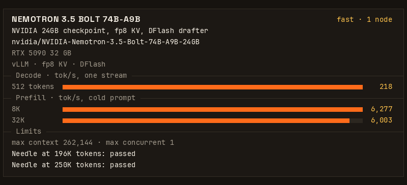

# Nemotron 3.5 Bolt 74B-A9B (24GB) on 1× RTX 5090



[nvidia/NVIDIA-Nemotron-3.5-Bolt-74B-A9B-24GB](https://huggingface.co/nvidia/NVIDIA-Nemotron-3.5-Bolt-74B-A9B-24GB)
(IQ2 24GB packed checkpoint, fp8 KV cache, DFlash LiLiCorr drafter) on a single 32 GB RTX 5090, served by the
digest-pinned published `vllm/vllm-openai:v0.34.0` image. Nothing is compiled or installed at boot: `v0.34.0` bundles
`flashinfer-python==0.7.3` (which ships `b12x`), precompiled FlashInfer kernels, and the built-in `nemotron_v3`
reasoning parser. Three `.env` profiles (`fast`, `long`, `multi`) cover single-user speed, maximum KV headroom, and
8-way concurrency.

## Results

**fast:** ~218 tok/s single-stream decode · 6,277 tok/s 8K prefill · 6,003 tok/s 32K prefill · 262K context (needle passed at 196K and 250K)
**long:** 6,675 tok/s 8K prefill · 6,263 tok/s 32K prefill · 262K context (needle passed at 196K; 4,460–4,490 tok/s 196K prefill)
**multi:** 172 tok/s single-stream decode · 463 tok/s at 4 concurrent streams (121/stream) · 738 tok/s at 8 concurrent streams (95/stream) · 32K context

RTX 5090 32 GB, power limit 408 W, stock clocks, fp8 KV cache, warm runs, 512-token decode. Originally measured on
`vllm/vllm-openai:nightly-77154ca6` (with `b12x`); re-confirmation on the pinned `vllm/vllm-openai:v0.34.0` image is
pending RTX 5090 hardware access. Every number below also lives in [kindling.json](kindling.json). All speeds are in
tokens per second (tok/s).

| profile | prefill 8K | prefill 32K | decode, 1 stream | concurrent / long-context |
|---|---:|---:|---:|---|
| `fast` | 6,277 | 6,003 | ~218 (see below) | needle passed at 196K (4,391 tok/s) and 250K (3,704 tok/s) |
| `multi` | 6,537 | 6,092 | 172 | 8 requests: 95/stream, 738 total; 4 requests: 121/stream, 463 total |
| `long` | 6,675 | 6,263 | — | needle passed at 196K (4,460–4,490 tok/s prefill) |

`fast` long-context checks (drafter on, 262K window): needle at 196K tokens passed (prefill 4,391 tok/s), needle at
250K tokens passed (prefill 3,704 tok/s, measured with the 2048 chunk). Run them with
`python3 bench/needle.py 250000 [seed]`. Use a new seed for each cold run: the same seed gives the same prompt, and
the prefix cache answers it in ~2 s.

Decode speed changes from boot to boot by about ±5%, so each decode figure is the median of 8 runs per boot. Power
during single-stream decode: mean ~390 W, peaks at the 408 W limit.

### Draft token count (`fast` profile)

The first version of `fast` used 7 draft tokens and 98K context. 5 draft tokens is faster and fits the full context:

| draft tokens | max context with drafter | decode, 1 stream (tok/s) | mean acceptance length |
|---:|---:|---:|---:|
| 7 (old `fast`) | ~108K (served at 98K) | ~203 (2 boots: 204, 202) | 2.23–2.30 |
| 5 (default `fast`) | 262K (KV pool 301K tokens) | ~218 (3 boots: 226, 213, 217) | 2.22–2.25 |
| 3 | ~195K | 214–220 (3 runs) | 2.14 |
| 2 | — | 197–215 (3 runs) | 1.96 |

Why it is faster: draft positions 6 and 7 are rarely accepted (mean acceptance length stays at ~2.3), so 5 tokens gives
about the same accepted tokens per step with a cheaper verify pass (6 tokens, not 8): 96–99 verify steps/s instead of
89–90.

Why more context fits: in `--mamba-cache-mode align`, every Mamba layer keeps one state page per draft token, so the
per-request KV need grows with the draft count (2.59 / 2.69 / 2.88 / 2.99 GiB for a 262K request at 3 / 4 / 6 / 7
tokens, against ~2.27 GiB available). At 5 tokens the attention block (4,416 tokens) matches the Mamba page size
exactly, no padding is added, and a 262K request fits. The LiLiCorr drafter accepts at most 7.

## Quickstart

If you are an agent booting this for someone, read [AGENTS.md](AGENTS.md) first.

```bash
npx @kindlingai/recipe nemotron-3.5-bolt-rtx5090 && cd nemotron-3.5-bolt-rtx5090
# the CLI already copied .env.example to .env; edit PROFILE=fast|long|multi if needed
docker compose up -d       # pulls the pinned vLLM image; the first boot fetches the model
docker compose logs -f     # ready in ~2 min when the OpenAI API answers on 127.0.0.1:8100
```

Once serving, send one smoke request:

```bash
curl -s localhost:8100/v1/models
curl -s localhost:8100/v1/chat/completions -H 'Content-Type: application/json' -d '{
  "model": "nemotron-3.5-bolt",
  "messages": [{"role": "user", "content": "Write a haiku about a small computer."}],
  "max_tokens": 256
}'
```

Stop the server cleanly with `docker compose down`.

## What you need

- One Linux x86_64 host with an NVIDIA RTX 5090 (32 GB VRAM) and no other model running on it.
- Docker with the NVIDIA container toolkit and an NVIDIA driver supporting CUDA 13.0+.
- At least 40 GB of free disk space for the 24 GB model, LiLiCorr drafter, and kernel caches (`CACHE_DIR` or Docker's
  named volume).
- Internet access to Docker Hub (first image pull) and Hugging Face (first model download).

## Settings

`cp .env.example .env` (the CLI already did). Every knob is documented in [.env.example](.env.example); the active
lines boot the `fast` profile.

| knob | default | what it does |
|---|---|---|
| `PROFILE` | `fast` | Selects `fast`, `long`, or `multi` preset defaults below |
| `MODEL` | `nvidia/NVIDIA-Nemotron-3.5-Bolt-74B-A9B-24GB` | Hugging Face repo id or local mounted path |
| `MODEL_REVISION` | `e0590ed2...` | Pinned Hugging Face commit passed as `--revision` |
| `PORT` | `8100` | OpenAI API host port |
| `MAX_MODEL_LEN` | profile default | Context window override (262144 for `fast`/`long`, 32768 for `multi`) |
| `MAX_NUM_SEQS` | profile default | Concurrent sequences override (1 for `fast`/`long`, 8 for `multi`) |
| `GPU_MEMORY_UTILIZATION` | profile default | VRAM fraction override (0.95 `fast`, 0.96 `long`, 0.88 `multi`) |
| `MAX_NUM_BATCHED_TOKENS` | profile default | Prefill chunk size override (4096 `fast`/`long`, 2048 `multi`) |
| `DRAFTER` | LiLiCorr (`fast`) | DFlash drafter repo id; set empty to disable speculative decoding |
| `NUM_SPECULATIVE_TOKENS` | `5` | Draft tokens per verify step when `DRAFTER` is set |
| `VLLM_MEMORY_PROFILER_ESTIMATE_CUDAGRAPHS` | `1` (`0` in `multi`) | Disables CUDA-graph VRAM over-estimation for multi-sequence boots |
| `REASONING_PARSER` | `nemotron_v3` | Built-in vLLM reasoning parser for `<think>...</think>` blocks |
| `CACHE_DIR` | Docker volume `cache` | Host directory for `/root/.cache` (HF weights + JIT kernel caches) |

Profile presets (`PROFILE` in `.env`):

| `PROFILE` | drafter | max seqs | context | GPU mem util | prefill chunk |
|---|---|---:|---:|---:|---:|
| `fast` | DFlash LiLiCorr, 5 tokens | 1 | 262,144 | 0.95 | 4,096 |
| `long` | none | 1 | 262,144 | 0.96 | 4,096 |
| `multi` | none | 8 | 32,768 | 0.88 (`ESTIMATE_CUDAGRAPHS=0`) | 2,048 |

## Notes for 32 GB cards

- Keep `--limit-mm-per-prompt '{"video":1,"image":1}'` (set in `compose.yaml`). Without it, the vision encoder's memory
  profiling runs out of memory at startup.
- The DFlash drafter takes most of the KV headroom. With 7 draft tokens about 107K tokens of context fit; with 5, the
  full 262K fits (KV pool ~301K tokens). Without the drafter (`PROFILE=long`) the KV pool is ~776K tokens (~773K with
  chunk 4096).
- Prefill chunk (`MAX_NUM_BATCHED_TOKENS`, default 2048 in vLLM). `fast` and `long` use 4096. Cold 196K-token prefill,
  two seeds each: `fast` 4,148–4,176 → 4,384–4,391 tok/s (+5%), `long` 4,279–4,283 → 4,460–4,490 tok/s (+4.5%); 32K
  +3%; decode unchanged within boot-to-boot noise; KV pool `fast` 301K → 296K, `long` 776K → 773K tokens. 8192 runs out
  of memory at startup in both (the profile run needs a 2 GiB buffer). `multi` keeps 2048: 4096 needs a 1 GiB buffer
  that its full KV budget does not leave.
- `multi`: turns off vLLM's CUDA-graph memory estimate (`VLLM_MEMORY_PROFILER_ESTIMATE_CUDAGRAPHS=0`). With 4+
  sequences vLLM otherwise reserves ~3.8 GiB for CUDA graphs that use ~0.04 GiB, leaving 0.4 GiB of KV cache (only 3
  short requests ran at once). With the estimate off, the KV pool grows from 34K to 148K tokens:

  | `multi` setting | KV pool | 4 requests total | 8 requests total |
  |---|---:|---:|---:|
  | old: 4 seqs, GMU 0.96 | 34K tokens | 271 tok/s (3 at once) | — |
  | 4 seqs, GMU 0.88, estimate off | 148K tokens | 463 tok/s | — |
  | default `multi`: 8 seqs, GMU 0.88, estimate off | 148K tokens | 429–434 tok/s | 738 tok/s (all 8 at once) |
  | 16 seqs, GMU 0.86, estimate off | 91K tokens | 434 tok/s | 741 tok/s; 16 requests 692 tok/s (~8 at once) |

  GMU has to drop with the estimate off, because about 4 GiB of GPU memory sits outside PyTorch and is not counted: at
  0.96 and 0.90 the server OOMs at startup; 0.88 boots. Stress test with 8 seqs: 8 concurrent 30K-token prompts all
  complete (the scheduler preempts and resumes when the pool is full).

## Benchmarks

Scripts live in `bench/` and default to `http://localhost:8100/v1/chat/completions` (override with `URL=...`):

- `bench/bench.py smoke|prefill|decode <N>` — smoke test, 8K/32K prefill, and single/multi-stream decode
- `bench/bench_s4.py [URL] [N]` — fires N concurrent streams simultaneously (requires `aiohttp`)
- `bench/needle.py [TOKENS] [SEED]` — long-context needle recall test (e.g. `python3 bench/needle.py 250000 7`)
- `bench/stress.py <N> <WORDS>` — N concurrent long prompts (e.g. `python3 bench/stress.py 8 30000`)

## Other sizes

- **Nemotron 3.5 Super VL 120B-A12B NVFP4 on 1× or 2× DGX Spark:**
  [nemotron-3.5-super-vl-dgx-spark](../../../../nemotron-3.5-super-vl/dgx-spark/1x/nvfp4-vllm)

## Help

Ask on Discord (https://discord.gg/8EAvYPV2rE) or open an issue in
[kindlingai/recipes](https://github.com/kindlingai/recipes/issues) with `nemotron-3.5-bolt-rtx5090` in the title. Say
which step failed and include the end of `docker compose logs` before you remove the container. Remove addresses and
hostnames before you post.

## Engine pin

This recipe has no engine code and installs nothing at boot. It runs one published multi-arch vLLM image, named in
[compose.yaml](compose.yaml) and in the `engine` field of [kindling.json](kindling.json):

| | |
|---|---|
| engine | [vllm-project/vllm](https://github.com/vllm-project/vllm) [`v0.34.0`](https://github.com/vllm-project/vllm/releases/tag/v0.34.0) at [`62d4bc3`](https://github.com/vllm-project/vllm/commit/62d4bc3c7e33b1b6c906e233e6af2d3506c482ca) |
| image | `vllm/vllm-openai:v0.34.0` |
| digest | `sha256:20fdb089454afbb324efa4110a2c025ff7b27cc1a086e07aa580b18df8ad1ce1` |
| weights | [nvidia/NVIDIA-Nemotron-3.5-Bolt-74B-A9B-24GB](https://huggingface.co/nvidia/NVIDIA-Nemotron-3.5-Bolt-74B-A9B-24GB/commit/e0590ed2f3a564fd99725d9d891cb09deb7cc201) (`e0590ed2`) |
| drafter | [nvidia/NVIDIA-Nemotron-3.5-Bolt-74B-A9B-24GB-LiLiCorr](https://huggingface.co/nvidia/NVIDIA-Nemotron-3.5-Bolt-74B-A9B-24GB-LiLiCorr/commit/449d24140160b8e51871bfc0f0a7338abf640aa1) (`449d2414`) |

`vllm/vllm-openai:v0.34.0` ships `flashinfer-python==0.7.3` (including the top-level `b12x` package) and runs
`flashinfer download-kernels` at image build time, replacing the earlier `nightly-77154ca6` tag (now pruned from Docker
Hub) and removing the boot-time `pip install b12x && vllm download-kernels` step.

`python3 tools/check_pin.py --strict nemotron-3.5-bolt/rtx-5090/1x/nvidia-24gb-vllm`, run from the monorepo root,
verifies that `compose.yaml` and `kindling.json` agree on the immutable image digest.

## License

MIT, see [LICENSE](../../../../LICENSE). Nemotron 3.5 Bolt and its LiLiCorr drafter are licensed under the
[NVIDIA Open Model License (OpenMDW-1.1)](https://huggingface.co/nvidia/NVIDIA-Nemotron-3.5-Bolt-74B-A9B-24GB).
