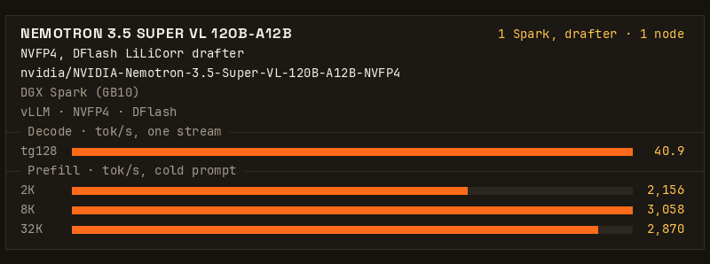

# Nemotron 3.5 Super VL 120B-A12B NVFP4 on 1× DGX Spark



[nvidia/NVIDIA-Nemotron-3.5-Super-VL-120B-A12B-NVFP4](https://huggingface.co/nvidia/NVIDIA-Nemotron-3.5-Super-VL-120B-A12B-NVFP4)
on one DGX Spark (GB10, 128 GB unified memory) via [compose.yaml](compose.yaml), or tensor-parallel across two DGX
Sparks (no Ray) via [compose.tp2.yaml](compose.tp2.yaml), served by the digest-pinned published
`vllm/vllm-openai:v0.34.0` image. Nothing is compiled or installed at boot: `v0.34.0` bundles `flashinfer-python==0.7.3`
(which ships `b12x`) and precompiled FlashInfer kernels. Supports 1M context and DFlash LiLiCorr speculative decoding.

## Results

**1 Spark, drafter (`PROFILE=1spark`):** 40.9 tok/s `tg128` (25–26 tok/s 512-tok bench) · 3,058 tok/s 8K prefill · 2,870 tok/s 32K prefill · 1M context
**1 Spark, no drafter (`PROFILE=1spark-nospec`):** 18.7 tok/s single-stream · 47 tok/s across 4 streams (11.9/stream) · 250K needle found
**TP=2, balanced (`TP2_PROFILE=balanced`, `b12x` + 4-tok drafter):** 65.0 tok/s `tg128` (43–44 prose / 59–74 code) · 3,314–3,372 tok/s 8K prefill · 129 tok/s at c10 · 250K needle found
**TP=2, decode (`TP2_PROFILE=decode`, `marlin` + 4-tok drafter):** 64.1 tok/s `tg128` (44–46 prose / 71–79 code) · 95 prose / 155 code tok/s at 4 streams · 141 tok/s at c4 · 250K needle found

512-token decode, warm runs. "Streams fired at once" = all requests sent at the same moment; total = all tokens / wall
time. Context 1M (`max-model-len` default from the model). With TP=2 each box holds half the weights and half of each
token's KV cache (the model has 2 KV heads), so far more KV memory is free per box. Originally measured on
`vllm/vllm-openai:nightly-3f1bcfd8` (with `b12x` installed for `balanced`); re-confirmation on the pinned
`vllm/vllm-openai:v0.34.0` image is pending DGX Spark hardware access. Every headline number also lives in
[kindling.json](kindling.json). All speeds are in tokens per second (tok/s).

| setup | GPU clock | context booted | prefill 8K | prefill 32K | 1 stream | 4 streams fired at once |
|---|---|---:|---:|---:|---:|---|
| 1 Spark, drafter | stock | 1M | 3,058 | 2,870 | 25–26 | — |
| 1 Spark, no drafter | stock | 1M | — | — | 18.7 | 47 total, 11.9 per stream |
| 2 Sparks TP2, drafter | capped 2000 MHz | 1M | 4,216 | 3,968 | 26–27 | — |
| 2 Sparks TP2, no drafter | capped 2000 MHz | 1M | 4,046 | 3,946 | 17.9 | 53 total, 13.5 per stream |

Long context, 1 Spark, no drafter: a needle at 60% depth of a 250K-token prompt was found (first token after 137 s).
At 900K tokens the model did not find it (1 try).

### TP2 decode tuning

Two extra TP2 profiles (`TP2_PROFILE=balanced` and `TP2_PROFILE=decode` in `.env` with `compose.tp2.yaml`). Both Sparks
GPU clock capped at 2000 MHz. 512-token decode, thinking off. "prose" = a story prompt, "code" = a Python module with
tests. Code decode varies between runs (sampling at temperature 1.0 changes how many drafted tokens are accepted).

**Which one:** for one user, use **balanced** (`b12x`): same single-stream speed as `marlin` and ~14% faster prefill.
Use **decode** (`marlin`) for the highest total throughput with 4 parallel chats.

| TP2 profile | prefill 8K | prefill 32K | 1 stream prose | 1 stream code | 4 streams at once (total) | 250K needle |
|---|---:|---:|---:|---:|---|---|
| `prefill` (card default, drafter 7 tokens) | 4,216 | 3,968 | 26–27 | — | — | — |
| `balanced`: `b12x` MoE + linear, drafter 4 tokens | 3,314–3,372 | 3,300–3,314 | 43–44 | 59–74 | 82 prose / 140 code | found, 1st token 102 s |
| `decode`: `marlin` MoE, drafter 4 tokens | 2,798–3,014 | 2,892–2,900 | 44–46 | 71–79 | 95 prose / 155 code | found, 1st token 113 s |

The 4-stream rows used `MAX_NUM_SEQS=4`; single-stream speed is the same with that setting (re-checked: `marlin`
45.4–45.6 tok/s prose with 4 sequences, two fresh boots).

Draft-token count (`marlin`, 1 stream, prose): 2, 3 and 4 tokens all give 43–46 tok/s; 7 tokens (the card value) gives
26–28. Measured per verify step: 2 tokens = 44.8 ms and 2.0 tokens accepted per step; 4 tokens = 51.8 ms and 2.3 tokens
per step. On our prompts only ~1–1.3 drafted tokens are accepted per step, so longer drafts mostly add verify cost. (An
early 2-token boot measured 30 tok/s; two fresh boots did not reproduce it.)

### llama-benchy (forum settings)

`llama-benchy`, pp2048 + tg128, 1 request at a time, 3 runs per depth, prompt depth 0 / 4K / 8K / 16K tokens. All rows:
GPU clock capped at 2000 MHz. tg = decode tok/s, pp = prefill tok/s (mean of 3 runs).

| setup | tg d0 | tg d4K | tg d8K | tg d16K | pp d0 | pp d4K | pp d8K | pp d16K |
|---|---:|---:|---:|---:|---:|---:|---:|---:|
| 2 Sparks TP2, `decode` (`marlin`, drafter 4) | 64.1 | 64.0 | 61.9 | 65.1 | 2,584 | 2,887 | 2,937 | 2,943 |
| 2 Sparks TP2, `balanced` (`b12x`, drafter 4) | 65.0 | 58.1 | 51.6 | 62.6 | 3,357 | 3,179 | 3,435 | 3,408 |
| 1 Spark, `1spark` (card recipe, drafter 7) | 40.9 | 34.8 | 31.0 | 37.7 | 2,156 | 2,919 | 2,862 | 2,896 |

`tg128` decode here is higher than our 512-token prose decode above (likely higher draft acceptance on the
`llama-benchy` prompt; not verified).

### Many chats at once (llama-benchy concurrency)

2 Sparks TP2, `MAX_NUM_SEQS=16`, GPU clock capped at 2000 MHz. `llama-benchy` pp2048 + tg128, 3 runs, c = requests sent
at once. total = all decode tokens / wall time. per chat = mean decode speed of one request. TTFT = mean time to first
token at c10.

Depth 0 (short prompt):

| TP2 profile | total c1 | total c4 | total c8 | total c10 | per chat c10 | TTFT c10 |
|---|---:|---:|---:|---:|---:|---:|
| `balanced`: `b12x`, drafter 4 | 68 | 108 | 116 | 129 | 19 | 4.2 s |
| `b12x`, no drafter | 27 | 59 | 78 | 79 | 11 | 4.8 s |
| `decode`: `marlin`, drafter 4 | 50 | 141 | 113 | 122 | 20 | 5.4 s |

Depth 16K (each request has an extra 16K-token history):

| TP2 profile | total c1 | total c10 | per chat c10 | peak per chat c10 | TTFT c10 |
|---|---:|---:|---:|---:|---:|
| `balanced`: `b12x`, drafter 4 | 54 | 24 | 7 | 29 | 31 s |
| `b12x`, no drafter | 27 | 23 | 5 | 15 | 27 s |
| `decode`: `marlin`, drafter 4 | 44 | 21 | 7 | 29 | 36 s |

At 16K depth, ten 18K-token prefills run one after another (prefill stays at ~3.0–3.8K tok/s total), so the last
request waits ~30 s and total decode over the wall time is low. "peak per chat" is the decode speed of a request once
it runs. The drafter still helps at c10: about 1.6× total decode at depth 0, 2× peak per chat at 16K.

KV pool reported by vLLM at boot (model max length 1M): drafter 4 profiles 10.1–10.3M tokens (~9.7 full 1M requests),
no drafter 23.3M tokens. These are hybrid-model counts (only 8 attention layers hold KV), so do not compare them with
dense-model token counts.

## Quickstart

If you are an agent booting this for someone, read [AGENTS.md](AGENTS.md) first.

For one DGX Spark (for two boxes, see [Two Sparks (TP2)](#two-sparks-tp2)):

```bash
npx @kindlingai/recipe nemotron-3.5-super-vl-dgx-spark && cd nemotron-3.5-super-vl-dgx-spark
# the CLI already copied .env.example to .env; edit PROFILE=1spark|1spark-nospec if needed
docker compose up -d       # pulls the pinned vLLM image; the first boot fetches the model
docker compose logs -f     # ready in ~8 min first boot (4–5 min later) on 127.0.0.1:8100
```

Once serving, send one smoke request:

```bash
curl -s localhost:8100/v1/models
curl -s localhost:8100/v1/chat/completions -H 'Content-Type: application/json' -d '{
  "model": "nemotron-3.5-super-vl",
  "messages": [{"role": "user", "content": "Write a haiku about a small computer."}],
  "max_tokens": 256
}'
```

Stop the server cleanly with `docker compose down`.

## What you need

- One DGX Spark (GB10, 128 GB unified memory) — or two connected over a direct RoCE link for TP=2 — with no other model
  or large `/dev/shm` files holding RAM.
- Docker with the NVIDIA container toolkit (DGX OS has both).
- At least 100 GB of free disk space per box for the NVFP4 model, LiLiCorr drafter, and kernel caches (`CACHE_DIR` or
  Docker's named volume).
- Internet access to Docker Hub (first image pull) and Hugging Face (first model download).

## Settings

`cp .env.example .env` (the CLI already did). Every knob is documented in [.env.example](.env.example); the active
lines boot the 1-Spark card recipe (`PROFILE=1spark`).

| knob | default | what it does |
|---|---|---|
| `PROFILE` | `1spark` | 1-Spark preset (`1spark` or `1spark-nospec`) for `compose.yaml` |
| `TP2_PROFILE` | `balanced` | 2-Spark preset (`balanced`, `decode`, `prefill`, or `nospec`) for `compose.tp2.yaml` |
| `MODEL` | `nvidia/NVIDIA-Nemotron-3.5-Super-VL-120B-A12B-NVFP4` | Hugging Face repo id or local mounted path |
| `MODEL_REVISION` | `ae136832...` | Pinned Hugging Face commit passed as `--revision` |
| `PORT` | `8100` | OpenAI API host port (served on rank 0 in TP=2) |
| `MAX_NUM_SEQS` | profile default | Concurrent sequences override (1 `1spark`/`prefill`, 4 `1spark-nospec`/`balanced`/`decode`, 16 for c10) |
| `GPU_MEMORY_UTILIZATION` | `0.75` | Unified memory fraction reserved by vLLM (leaves room for OS + vision encoder) |
| `DRAFTER` | LiLiCorr | DFlash drafter repo id; set empty to disable speculative decoding |
| `NUM_SPECULATIVE_TOKENS` | `7` (1×) / `4` (TP2) | Draft tokens per verify step when `DRAFTER` is set |
| `MOE_BACKEND` / `LINEAR_BACKEND` | TP2 profile default | Backend overrides (`b12x` in `balanced`, `marlin` MoE in `decode`) |
| `HEAD` / `IFACE` / `NODE_RANK` | unset (TP2 only) | Rank 0 fast-link IP, fast-link NIC, and rank (`0` or `1`) for `compose.tp2.yaml` |
| `CACHE_DIR` | Docker volume `cache` | Host directory for `/root/.cache` (HF weights + JIT kernel caches) |

Presets:

| compose file | preset | drafter | backends | max seqs |
|---|---|---|---|---:|
| `compose.yaml` | `PROFILE=1spark` | LiLiCorr, 7 tokens | default | 1 |
| `compose.yaml` | `PROFILE=1spark-nospec` | none | default | 4 |
| `compose.tp2.yaml` | `TP2_PROFILE=balanced` | LiLiCorr, 4 tokens | `b12x` MoE + linear | 4 |
| `compose.tp2.yaml` | `TP2_PROFILE=decode` | LiLiCorr, 4 tokens | `marlin` MoE | 4 |
| `compose.tp2.yaml` | `TP2_PROFILE=prefill` | LiLiCorr, 7 tokens | default | 1 |
| `compose.tp2.yaml` | `TP2_PROFILE=nospec` | none | default | 4 |

## Two Sparks (TP2)

Both boxes need the model cached in `CACHE_DIR` (or Docker volume `cache`) and a direct high-speed RoCE link (NCCL
picks it up via `/dev/infiniband`). Use the same `TP2_PROFILE` and overrides in `.env` on both boxes, setting `HEAD` to
box A's fast-link IP, `IFACE` to each box's fast-link NIC, and `NODE_RANK=0` on box A / `NODE_RANK=1` on box B. Start
rank 0 first, then rank 1; rank 0 serves the OpenAI API on port 8100 while rank 1 runs `--headless`:

```bash
# box A (rank 0)
docker compose -f compose.tp2.yaml up -d
# box B (rank 1)
docker compose -f compose.tp2.yaml up -d
```

Stop both boxes with `docker compose -f compose.tp2.yaml down`.

## Notes

- With the card's flags, TP=2 helps prefill (+35%) and multi-stream decode but not single-stream decode. The `balanced`
  (`b12x` + 4-token drafter) and `decode` (`marlin` + 4-token drafter) TP2 profiles above fix that.
- First boot takes about 8 minutes (kernel compile and autotune); later boots take about 4–5 minutes.
- Unified memory: anything else in RAM (for example files in `/dev/shm`) counts against the model and can trigger the
  OOM killer.
- `GPU_MEMORY_UTILIZATION=0.75` is kept on purpose: it leaves room for DGX OS and the vision encoder.

## Benchmarks

Scripts live in `bench/` and default to `http://localhost:8100/v1/chat/completions` (override with `URL=...`):

- `bench/bench.py smoke|prefill|decode <N>` — smoke test, 8K/32K prefill, and single/multi-stream decode
- `bench/bench_streams.py <N> [prose|code]` — fires N streams at the same moment
- `bench/needle.py <WORDS>` — long-context needle recall test

## Other sizes

- **2× DGX Spark (TP=2):** included in this folder via [compose.tp2.yaml](compose.tp2.yaml)
- **Nemotron 3.5 Bolt 74B-A9B (24GB) on 1× RTX 5090:**
  [nemotron-3.5-bolt-rtx5090](../../../../nemotron-3.5-bolt/rtx-5090/1x/nvidia-24gb-vllm)

## Help

Ask on Discord (https://discord.gg/8EAvYPV2rE) or open an issue in
[kindlingai/recipes](https://github.com/kindlingai/recipes/issues) with `nemotron-3.5-super-vl-dgx-spark` in the title.
Say which step failed and include the end of `docker compose logs` (or `docker compose -f compose.tp2.yaml logs`) before
you remove the container. Remove addresses and hostnames before you post.

## Engine pin

This recipe has no engine code and installs nothing at boot. Both [compose.yaml](compose.yaml) and
[compose.tp2.yaml](compose.tp2.yaml) run the same published multi-arch vLLM image named in the `engine` field of
[kindling.json](kindling.json):

| | |
|---|---|
| engine | [vllm-project/vllm](https://github.com/vllm-project/vllm) [`v0.34.0`](https://github.com/vllm-project/vllm/releases/tag/v0.34.0) at [`62d4bc3`](https://github.com/vllm-project/vllm/commit/62d4bc3c7e33b1b6c906e233e6af2d3506c482ca) |
| image | `vllm/vllm-openai:v0.34.0` |
| digest | `sha256:20fdb089454afbb324efa4110a2c025ff7b27cc1a086e07aa580b18df8ad1ce1` |
| weights | [nvidia/NVIDIA-Nemotron-3.5-Super-VL-120B-A12B-NVFP4](https://huggingface.co/nvidia/NVIDIA-Nemotron-3.5-Super-VL-120B-A12B-NVFP4/commit/ae1368329b1fc76b71534c5d04b87b35d9cc6e15) (`ae136832`) |
| drafter | [nvidia/NVIDIA-Nemotron-3.5-Super-VL-120B-A12B-NVFP4-LiLiCorr](https://huggingface.co/nvidia/NVIDIA-Nemotron-3.5-Super-VL-120B-A12B-NVFP4-LiLiCorr/commit/292bf1efc06ba39567da7351f2ad7a522afa3959) (`292bf1ef`) |

`vllm/vllm-openai:v0.34.0` ships `flashinfer-python==0.7.3` (including the top-level `b12x` package) and runs
`flashinfer download-kernels` at image build time, replacing the earlier `nightly-3f1bcfd8` tag (now pruned from Docker
Hub) and removing the boot-time `pip install b12x && vllm download-kernels` step used by `TP2_PROFILE=balanced`.

`python3 tools/check_pin.py --strict nemotron-3.5-super-vl/dgx-spark/1x/nvfp4-vllm`, run from the monorepo root,
verifies that `compose.yaml`, `compose.tp2.yaml`, and `kindling.json` agree on the immutable image digest.

## License

MIT, see [LICENSE](../../../../LICENSE). Nemotron 3.5 Super VL and its LiLiCorr drafter are licensed under the
[NVIDIA Open Model License (OpenMDW-1.1)](https://huggingface.co/nvidia/NVIDIA-Nemotron-3.5-Super-VL-120B-A12B-NVFP4).
