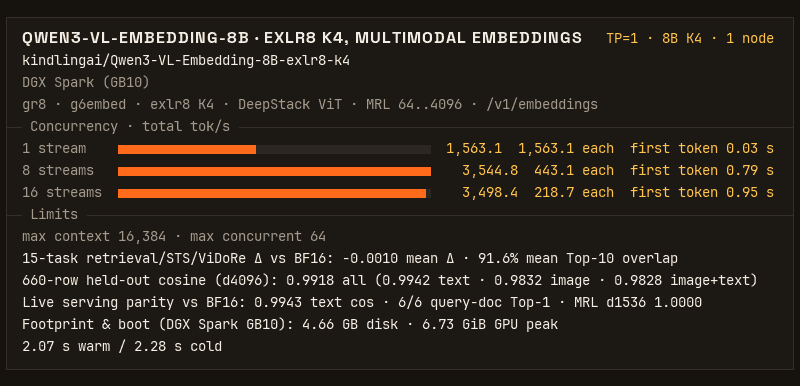

# Qwen3-VL-Embedding-8B exlr8 K4 on 1× DGX Spark (GB10)



If you are an agent booting this for someone, read [AGENTS.md](AGENTS.md) first, then the Quickstart.

Qwen3-VL-Embedding-8B on **one DGX Spark** (GB10, 128 GB) at `TP=1`, served natively by [gr8](https://github.com/kindlingai/gr8) (`g6embed` + `g6front-rs`) from [kindlingai/Qwen3-VL-Embedding-8B-exlr8-k4](https://huggingface.co/kindlingai/Qwen3-VL-Embedding-8B-exlr8-k4): calibrated 4-bit trellis quantization (`4.66 GB` on disk, `6.73 GiB` GPU peak) with full multimodal text + image DeepStack vision, last-token pooling, and Matryoshka dimensions (`64..4096`) on OpenAI-compatible `/v1/embeddings`. This recipe is the published `gr8` image and one `.env` file. Nothing is compiled.

## Results

**8B exlr8 K4 (`TP=1`):** **31.8 ms** instructed query p50 (**29.8 ms** raw text, **46.7 ms** 32-item multimodal suite p50) · **3,545 tok/s** at 8 concurrent streams (**3,484 tok/s** array batch 8, **48.4 items/s** array batch 64) · **-0.0010** mean 15-task Δ vs BF16 (**0.9942** text / **0.9832** image held-out cosine) · **6.73 GiB** GPU peak · **2.07 s** warm / **2.28 s** cold boot.

Measured 2026-11-27 on one NVIDIA DGX Spark (GB10, 128 GB unified LPDDR5X, ARM64 64 KiB page kernel, 2200 MHz SM clock cap) running `gr8` (`g6embed` + `g6front-rs`, `CAP=16384`, `MAX_MODEL_LEN=16384`, full 65-file XXH64 checksum verification enabled). Throughput is in tokens per second (tok/s).

### Throughput & latency (`/v1/embeddings`)

| Workload | Requests / batch | Median latency | Items/s | Throughput (tok/s) |
|---|---:|---:|---:|---:|
| Concurrent HTTP (`1` client, 52 tok) | 1 | **33.3 ms** | 30.1 | **1,563** |
| Concurrent HTTP (`8` clients, 2,800 tok) | 8 | **789.9 ms** | 10.1 | **3,545** |
| Concurrent HTTP (`16` clients, 3,327 tok) | 16 | **951.0 ms** | 16.8 | **3,498** |
| Array batch (`batch=1`, 52 tok) | 1 | **32.1 ms** | 31.1 | **1,619** |
| Array batch (`batch=8`, 2,800 tok) | 8 | **803.6 ms** | 10.0 | **3,484** |
| Array batch (`batch=16`, 3,327 tok) | 16 | **963.9 ms** | 16.6 | **3,452** |
| Array batch (`batch=64`, 4,099 tok) | 64 | **1,321.4 ms** | **48.4** | **3,102** |

### Multimodal latency breakdown (32-item suite)

| Modality | p50 latency | Notes |
|---|---:|---|
| Unprefixed raw text | **29.80 ms** | p95 `41.10 ms` |
| Instructed query | **31.77 ms** | p95 `42.31 ms` |
| Instructed document | **49.58 ms** | 2,371-tok long document: `656.66 ms` |
| Image-only (`64×64` → `2048×1536`) | **244.48 ms** | `40.0 ms` (`64×64`) · `65.1 ms` (`256×256`) · `301.4 ms` (`1024×512`) · `725.4 ms` (`2048×1536`) |
| Image + text | **235.07 ms** | `640×480`: `177–179 ms` · `1024×512`: `291 ms` |

### Quality & footprint

| Check | Result |
|---|---|
| 15-task eval (BEIR, XPQA, CSN, STS-B, ViDoRe) | **-0.0010** mean Δ vs BF16 · **91.6%** mean Top-10 overlap |
| 660-row held-out cosine (`d4096`) | **0.9918** all (`0.9942` text · `0.9832` image · `0.9828` image+text) · `91.1%` Top-10 neighbour overlap |
| Live serving parity vs 8B BF16 | **0.9943** text cosine · exact `6/6` query-doc Top-1 · MRL `d1536` cos `1.0000` |
| Kernel parity (`--verify-kernels` vs cuBLAS BF16) | **0.99994–0.99998** across text & multimodal (`max_abs_diff 1.22e-3`) |
| Weight size on disk | **4.66 GB** (`4.34 GiB`, `3.50×` smaller than `16.29 GB` BF16) |
| GPU memory peak (`nvidia-smi`) | **6.73 GiB** (`4,334 MiB` weights + `2,180 MiB` workspace) |
| Cold / warm boot → `/health` | **2.28 s** cold / **2.07 s** warm (`1.36 s` / `1.16 s` engine load w/ full checksums) |

[kindling.json](kindling.json) holds these numbers in machine-readable form; [docs/card.png](docs/card.png) is drawn from it.

## Quickstart

```bash
npx @kindlingai/recipe qwen3-vl-embedding-8b-exlr8-1x-spark && cd qwen3-vl-embedding-8b-exlr8-1x-spark
# the CLI already copied .env.example to .env; edit it if you need to
docker compose up -d       # pulls the pinned gr8 image; first boot fetches 4.66 GB
docker compose logs -f     # ready at "serving: http://127.0.0.1:8100/v1" (~2 s once cached)
```

Once serving, run the built-in 5-part smoke check and query `/v1/embeddings`:

```bash
docker compose exec gr8 /opt/gr8/gr8 embed smoke
curl -s localhost:8100/v1/models
curl -s localhost:8100/v1/embeddings -H 'Content-Type: application/json' -d '{
  "model": "qwen3-vl-embedding-8b",
  "input": ["A dog running in a sunny park.", "TCP congestion control window size."],
  "dimensions": 1024
}'
```

Stop the server cleanly with:

```bash
docker compose exec gr8 /opt/gr8/gr8 embed down
docker compose down
```

## What you need

- One DGX Spark or other GB10 box (128 GB unified memory); only ~6.7 GiB GPU memory is used, so it can also coexist cleanly alongside other workloads with headroom.
- Docker with the NVIDIA container toolkit (DGX OS has both).
- **Disk:** about **6 GB** free for the cached `exlr8 K4` release (`4.66 GB`) and logs.
- Internet access to `huggingface.co` on the first boot (cached locally for offline restarts thereafter).

## Settings

`cp .env.example .env` (the CLI already did). Every knob is documented in [.env.example](.env.example); the active lines match the measured Results above.

| knob | default | what it does |
|---|---|---|
| `GR8_MODEL` | `embed` | Selects `g6embed` (TP=1 dense multimodal embedding engine) |
| `MODEL` | pinned HF URL | Hugging Face repo `@commit` (or a local release directory) |
| `PORT` | `8100` | OpenAI-compatible HTTP API port (`/v1/embeddings`, `/v1/models`, `/health`) |
| `CAP` / `MAX_MODEL_LEN` | `16384` / `16384` | Max batched tokens per forward pass and max input sequence length |
| `NOHASH` | `0` | Set `1` to skip load-time XXH64 checksum verification (default `0`: full verification) |
| `EXTRA_ARGS` | unset | Extra `g6embed` flags (e.g. `--weight-mode bf16`) |
| `GR8_CACHE` / `GR8_HOME` | named volumes | Optional host directories (owned by uid 1000) for model cache and logs/state |
| `GR8_STOP_GRACE` / `GR8_IMAGE` | unset | Optional container stop grace or image override |

## Multimodal & Matryoshka usage

- **Matryoshka Representation Learning (MRL):** pass `"dimensions": 256|512|1024|2048|4096` (any `1..4096`) to truncate and re-normalize embeddings on GPU with zero extra compute; pass `"encoding_format": "base64"` for compact little-endian FP32 output.
- **Multimodal images (`messages`):** pass OpenAI/vLLM-style `messages` with `image_url` data URIs (`min_pixels=4096`, `max_pixels=1310720`, `4..1,280` merged visual tokens per image). Pass `"add_generation_prompt": true` to match the official `chat_template.jinja` convention or `false` to match vLLM's default; pre-formatted strings passed via `"input"` are unaffected.

## Other sizes

- **Smaller & faster (2B, `1.33 GB` on disk, `2.61 GiB` GPU peak, `10.6 ms` query p50, `14,568 tok/s` at 8 streams):** [qwen3-vl-embedding-2b-exlr8-1x-spark](../../../../qwen3-vl-embedding-2b/dgx-spark/1x/exlr8-gr8)

## Help

Ask on Discord (https://discord.gg/8EAvYPV2rE) or open an issue in the recipes repo
(https://github.com/kindlingai/recipes/issues) with `qwen3-vl-embedding-8b-exlr8-1x-spark` in the title. Say which step failed and include the end of `docker compose logs` before you remove the container. Remove addresses and hostnames before you post.

## Engine pin

This recipe has no engine code. It runs one published `gr8` image, named in [compose.yaml](compose.yaml) and in the `engine` field of [kindling.json](kindling.json):

| | |
|---|---|
| engine | [kindlingai/gr8](https://github.com/kindlingai/gr8) `v1.5.0` ([`dd253a4f12a5f6eb46dd6229c5bbba839f5e981c`](https://github.com/kindlingai/gr8/commit/dd253a4f12a5f6eb46dd6229c5bbba839f5e981c)) |
| image | `ghcr.io/kindlingai/gr8:v1.5.0` |
| digest | `sha256:6d40ab08ad3de8c51571b6ab55ea20df5865e7e2adee0c3be259b5b814f50c16` |
| weights | [kindlingai/Qwen3-VL-Embedding-8B-exlr8-k4](https://huggingface.co/kindlingai/Qwen3-VL-Embedding-8B-exlr8-k4/commit/3028d460328defb90f3a53f336258fed714b4f6e) (`3028d460`) |

`python3 tools/check_pin.py --strict qwen3-vl-embedding-8b/dgx-spark/1x/exlr8-gr8`, run from the monorepo root, verifies that `compose.yaml` and `kindling.json` agree on the immutable image digest.

## License

MIT, see [LICENSE](../../../../LICENSE). The Qwen3-VL-Embedding-8B weights are licensed under Apache-2.0 (see the model page).
