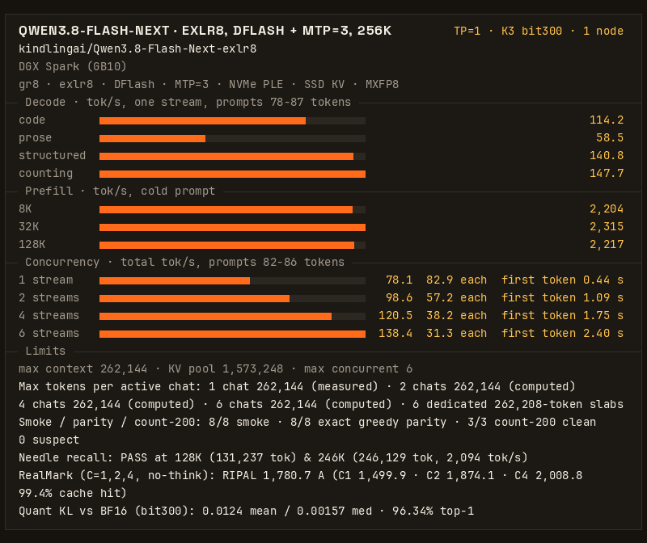
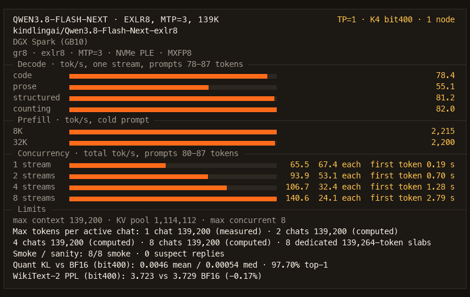

# KindlingAI: Qwen3.8-Flash-Next EXLR8 on one DGX Spark (K3 & K4)



If you are an agent booting this for someone, read [AGENTS.md](AGENTS.md) first, then the Quickstart.

_**Join our discord to learn more about KindlingAI and `gr8`: https://discord.gg/8EAvYPV2rE**_

Qwen3.8-Flash-Next on **one DGX Spark** (GB10, 128 GB) at `TP=1`, served by [gr8](https://github.com/kindlingai/gr8) from
[kindlingai/Qwen3.8-Flash-Next-exlr8](https://huggingface.co/kindlingai/Qwen3.8-Flash-Next-exlr8):
both **`bit300` (K3, 3.00 bpw)** and **`bit400` (K4, 4.00 bpw)** run at the model's **full native 262,144-token context** on a single 128 GB box — **6 dedicated 262K chats** (`1,573,248` KV rows) on K3 or **4 dedicated 262K chats** (`1,048,832` KV rows; **5** with `NO_MTP=1`) on K4 — with auto-loaded **DFlash** + Layer-48 `MTP=3` hybrid speculative decoding, Blackwell MXFP8 dense kernels, async `O_DIRECT` NVMe streaming for the 102.4 GB Layer-1 PLE rowstore, a 32 GiB `O_DIRECT` SSD KV prefix cache (`0.56 s` 128K restore), and an opt-in BF16 vision tower (`GR8_QW38_VISION=1`).
This recipe is the published `gr8` image and one `.env` file. Nothing is compiled.

**K3 (`bit300`, default, `6 × 262K`):** **114.2 tok/s** code · **58.5 tok/s** prose · **140.8 tok/s** structured · **147.7 tok/s** counting · **2,315 tok/s** 32K prefill (**0.56 s** 128K SSD restore) · **138.4 tok/s** at 6 streams · **246K needle recall PASS** · **RealMark RIPAL 1,780.7 A** · 28 s boot from local NVMe
**K4 (`bit400`, `4 × 262K`):** **108.3 tok/s** code · **56.6 tok/s** prose · **130.8 tok/s** structured · **134.7 tok/s** counting · **2,285 tok/s** 32K prefill (**0.61 s** 128K SSD restore) · **105.7 tok/s** at 4 streams · **246K needle recall PASS** · near-lossless `0.0046` mean KL (`97.70%` top-1) · 28 s boot from local NVMe

## Results

One DGX Spark (GB10, 128 GB) with local NVMe release storage, `TP=1`, measured 2026-11-25 on `gr8 main` (`6b874803` + [PR #621](https://github.com/kindlingai/gr8/pull/621) zero-flag DFlash auto-discovery, merged as `fa5d82d3`) with `gr8`'s live S2 serving path and benchmark (`bench/bench.py`, `--runs 6` on K3, `--runs 3` on K4, `CAP=262,208`, `MAX_MODEL_LEN=262,144`, `MTP=3`, auto-loaded DFlash, `REUSE=1`, `KV_STORE=ssd:/var/lib/gr8/cache/kv,size=32G,keep=all`, `GR8_QW38_PLE_CACHE_MIB=1024`), one fresh boot per manifest. GPU clocks were uncapped in the timed stages. Every speed is in tokens per second (tok/s).

### One request, short prompts (DFlash, 78–87 prompt tokens)

| manifest | code (95% CI) | prose (95% CI) | structured (95% CI) | counting (95% CI) | tok/step (code / prose) | ms/step | accept (code / struct) |
|---|---:|---:|---:|---:|---:|---:|---:|
| **`bit300` (K3, default)** | **114.2** (105.7–125.8) | **58.5** (56.9–60.3) | **140.8** (137.6–144.2) | **147.7** (147.3–148.1) | 5.74 / 2.37 | 49.3 / 40.7 ms | 83% / 96% |
| **`bit400` (K4)** | **108.3** (104.0–111.8) | **56.6** (54.2–58.1) | **130.8** (128.1–134.4) | **134.7** (131.9–136.3) | 6.05 / 2.51 | 55.3 / 43.5 ms | 84% / 98% |

DFlash runs automatically on single-stream decode (`c1`) with 100% lossless target verification (**8/8 byte-identical greedy parity** vs. `GR8_QW38_DFL=0`), then seamlessly hands off to Layer-48 `MTP=3` when concurrent requests arrive (`c2..c6`).

### Requests at once (Hybrid DFlash + `MTP=3`, mixed prompts, 82–86 tokens)

| manifest | metric | 1 stream | 2 streams | 4 streams | 6 streams |
|---|---|---:|---:|---:|---:|
| **`bit300` (K3, `SESS=6`)** | **total tok/s** | **78.1** | **98.6** | **120.5** | **138.4** |
| `bit300` | tok/s per request | 82.9 | 57.2 | 38.2 | 31.3 |
| `bit300` | first token, median (p90) | 0.44 s (0.44 s) | 1.09 s (1.10 s) | 1.75 s (2.50 s) | 2.40 s (4.01 s) |
| **`bit400` (K4, `SESS=4`)** | **total tok/s** | **78.4** | **93.2** | **105.7** | — |
| `bit400` | tok/s per request | 83.3 | 52.2 | 33.3 | — |
| `bit400` | first token, median (p90) | 0.47 s (0.47 s) | 1.18 s (1.20 s) | 1.85 s (2.69 s) | — |

### Prefill, cold salted prompts & `O_DIRECT` SSD KV cached restore

| manifest | 8K prompt (cold · cached) | 32K prompt (cold · cached) | 128K prompt (cold · cached) |
|---|---:|---:|---:|
| **`bit300` (K3, default)** | **2,204 tok/s** (`3.73 s` · **`0.27 s`**) | **2,315 tok/s** (`14.20 s` · **`0.32 s`**) | **2,217 tok/s** (`59.08 s` · **`0.56 s`**) |
| **`bit400` (K4)** | **2,160 tok/s** (`3.80 s` · **`0.26 s`**) | **2,285 tok/s** (`14.33 s` · **`0.32 s`**) | **2,170 tok/s** (`60.31 s` · **`0.61 s`**) |

Cached TTFT restores `130,963/130,964` (`bit300`) and `130,856/130,857` (`bit400`) tokens directly from the 32 GiB `O_DIRECT` NVMe KV store (`0 GiB` extra host RAM; `19,553` blocks ≈ `1.25M` cached tokens on SSD).

### Agentic load benchmark (Kindling AI RealMark, `C=1, 2, 4`)

Measured on `bit300` (`6 × 262K`, Hybrid DFlash + `MTP=3`, `enable_thinking=false`, RealMark commit `957f600d`, 14/14 API probe checks passed):

| concurrency | RIPAL score | active context (per lane) | done | wall time | match / grade | prefix cache hit | eff. completion tok/s | API errors |
|---|---:|---:|---:|---:|---:|---:|---:|---:|
| **`C=1`** | **1,499.9** | 101K (101K) | 15/16* | 245.5 s | 98.8% (**A**) | **99.29%** (`3.92M / 3.94M`) | 53.7 tok/s | 0 |
| **`C=2`** | **1,874.1** | 177K (88K) | 16/16 | 181.7 s | 99.0% (**A**) | **99.45%** (`3.88M / 3.90M`) | 73.0 tok/s | 0 |
| **`C=4`** | **2,008.8** | 325K (81K) | 16/16 | 166.4 s | 99.1% (**A**) | **99.42%** (`3.87M / 3.89M`) | 83.3 tok/s | 0 |
| **Overall** | **1,780.7  A** | up to **325K** live | — | — | **Grade A** | **99.39%** (`11.74M` tok) | — | **0** |

*\*`C=1` reached its 240 s stage time cap at 15/16 tasks (~261.7 s projected full batch). With `enable_thinking=false`, RealMark turns are pure tool calls buffered by the Qwen tool-call parser until closing tag, so effective completion tok/s and prefix cache hit % above are computed directly from raw telemetry. Minimum Linux `MemAvailable` across the entire benchmark + 246K needle + 4-lane 325K RealMark sweep was **5.59 GiB**.*

### Choosing K3 (`bit300`) vs K4 (`bit400`) & optional `NO_MTP=1`

| profile | routed bpw | slots × 262K (KV pool) | min `MemAvailable` | model-written KL (mean / median) | model-written top-1 | WikiText-2 PPL (BF16 ref `3.729`) |
|---|---:|---|---:|---:|---:|---:|
| **`bit300` (K3, default)** | 3.00 | **6 × 262K** (`1.57M` rows) | **5.59 GiB** | **0.0124 / 0.00157** | 96.34% | 3.737 (+0.23%) |
| **`bit400` (K4, Hybrid)** | 4.00 | **4 × 262K** (`1.05M` rows) | **4.55 GiB** | **0.0046 / 0.00054** | 97.70% | 3.723 (-0.17%) |
| `bit400` (K4, `NO_MTP=1`) | 4.00 | **5 × 262K** (`1.31M` rows) | **8.01 GiB** | **0.0046 / 0.00054** | 97.70% | 3.723 (-0.17%) |

*Optional `NO_MTP=1` (`MTP=0`, `GR8_QW38_NO_MTP=1`):* omits the 5.2 GB Layer-48 MTP weights to add one full 262K session slot (`5 × 262K` on `bit400` with **109.8** code / **57.0** prose solo and **8.01 GiB** min free, or `7 × 262K` on `bit300` with `10.32 GiB` post-boot free). Multi-stream decode runs without MTP (`c2 54.6 / c4 77.1 / c5 84.7` on `bit400`), so Hybrid DFlash + `MTP=3` is the default.



### How long each chat can be

Qwen3.8-Flash-Next has only 12 full-attention layers (with 2 KV heads, GQA-12; the other 36 layers are fixed-state Gated DeltaNet), so `gr8` gives each concurrent session slot its own dedicated `262,208`-token KV slab (`MAX_MODEL_LEN=262,144`). Concurrent chats do not split each other's context limit:

| active chats | 1 | 2 | 4 | 6 (`bit300`) |
|---|---:|---:|---:|---:|
| max tokens per chat (`bit300`, `SESS=6`) | 262,144 | 262,144 | 262,144 | 262,144 |
| max tokens per chat (`bit400`, `SESS=4`) | 262,144 | 262,144 | 262,144 | — |

The 1-chat limit is measured (`max_model_len=262,144`, verified at **246,129** tokens on `bit300` and **245,478** tokens on `bit400` in the 246K needle checks); the multi-chat values follow directly from the dedicated per-slot KV slabs.

### Quality checks

Measured on the same 2026-11-25 boots:

| check | `bit300` (K3, `6 × 262K`) | `bit400` (K4, `4 × 262K`) |
|---|---|---|
| smoke test (`./gr8 qw38 smoke`) | 8 of 8 PASS | 8 of 8 PASS |
| exact greedy parity (`DFlash ON` vs `DFlash OFF`) | **8 of 8 exact (`100%`)** | same lossless verifier |
| fact hidden in a 128K prompt | PASS (`131,237` tokens) | PASS (`131,115` tokens) |
| fact hidden in a 246K prompt | **PASS (`246,129` tokens, `2,094 tok/s`)** | **PASS (`245,478` tokens, `2,050 tok/s`)** |
| count to 200, three times | 3 of 3 clean | 3 of 3 clean |
| suspect characters | 0 replies | 0 replies |
| lowest `MemAvailable` across entire suite | **5.59 GiB** | **4.55 GiB** |
| boot to serving from local NVMe | 27.9 s | 27.9 s |

[kindling.json](kindling.json) has both the K3 (`tp1-k3`) and K4 (`tp1-k4`) numbers in a form a program can read. Both cards above are drawn from it.

## Quickstart

First turn off proactive memory compaction on the Spark ([What you need](#what-you-need)). Then:

```bash
npx @kindlingai/recipe qwen3.8-flash-next-exlr8-1x-spark && cd qwen3.8-flash-next-exlr8-1x-spark
# the CLI already copied .env.example to .env
# Optional: edit .env for K4 (VARIANT=bit400, SESS=4), NO_MTP=1, or GR8_QW38_VISION=1
docker compose up -d       # pulls the pinned gr8 image; first boot fetches the model (~164 GB)
docker compose logs -f     # ready at "serving: http://127.0.0.1:8100/v1"
```

This recipe lives in [kindlingai/recipes](https://github.com/kindlingai/recipes/tree/main/qwen3.8-flash-next/dgx-spark/1x/exlr8-gr8) at `qwen3.8-flash-next/dgx-spark/1x/exlr8-gr8`; a [sparse clone](https://github.com/kindlingai/recipes#run-a-recipe) also works.

Once serving, verify the API:

```bash
docker compose exec gr8 /opt/gr8/gr8 qw38 smoke
curl -s localhost:8100/v1/models      # id: qwen3.8-flash-next, max_model_len: 262144
```

Send a chat completion request (the model name is `qwen3.8-flash-next`, alias `qw38`; Qwen XML tool calls and `<think>` reasoning work out of the box):

```bash
curl -s localhost:8100/v1/chat/completions -H 'Content-Type: application/json' -d '{
  "model": "qwen3.8-flash-next",
  "messages": [{"role": "user", "content": "Write a haiku about a small computer."}],
  "max_tokens": 2048
}'
```

Stop the server cleanly with:

```bash
docker compose exec gr8 /opt/gr8/gr8 qw38 down
docker compose down
```

## What you need

- One DGX Spark or other GB10 box (128 GB unified memory), with no other model running on it.
- Docker with the NVIDIA container toolkit (DGX OS has both).
- **Local NVMe disk:** about **200 GB** free for `bit300` (`45.4 GB` experts + `15.1 GB` dense/vocab/MTP + `0.52 GB` DFlash drafter + `102.4 GB` Layer-1 PLE rowstore + `32 GB` SSD KV store) or **215 GB** for `bit400` (`60.5 GB` experts), plus `0.9 GB` if enabling vision. Keep Docker's storage (or `GR8_CACHE`) on fast local NVMe — both Layer-1 PLE and the SSD KV store stream over `O_DIRECT`.
- Proactive memory compaction off:
  `sudo sysctl -w vm.compaction_proactiveness=0` (`gr8`'s
  [DEPLOY.md](https://github.com/kindlingai/gr8/blob/main/docs/DEPLOY.md#before-you-start) has the permanent form).

## Settings

`cp .env.example .env` (the CLI already did). Every knob is documented in [.env.example](.env.example); the active
lines are the exact settings the Results numbers for K3 (`bit300`) were measured with.

| knob | default | what it does |
|---|---|---|
| `VARIANT` | `bit300` | Expert width profile (`bit300` K3 with `SESS=6`; `bit400` K4 with `SESS=4`) |
| `CAP` / `MAX_MODEL_LEN` / `SESS` | `262208` / `262144` / `6` | Dedicated 262K KV slab per concurrent chat (`SESS=4` on `bit400`) |
| `MTP` | `3` | Hybrid speculative decoding (auto-loaded DFlash solo + Layer-48 `MTP=3` multi-stream) |
| `REUSE` / `KV_STORE` | `1` / `ssd:...,size=32G,keep=all` | Prefix reuse backed by a 32 GiB `O_DIRECT` SSD KV store |
| `EXTRA_ENV` | `GR8_QW38_PLE_CACHE_MIB=1024` | 1 GiB PLE LRU cache; add `GR8_QW38_VISION=1`, `GR8_QW38_NO_MTP=1`, or `GR8_QW38_DFL=0` |
| `GR8_CACHE` / `GR8_HOME` | named volumes | Optional local NVMe host directories (owned by uid 1000) for model cache and logs/state |
| `GR8_STOP_GRACE` / `GR8_IMAGE` | unset | Optional shutdown grace (for `persist=on` KV store) or image override |

`gr8`'s [Qwen3.8-Flash-Next page](https://github.com/kindlingai/gr8/blob/main/docs/QWEN38.md) explains the architecture and every `GR8_QW38_*` rollback knob, and [DEPLOY.md](https://github.com/kindlingai/gr8/blob/main/docs/DEPLOY.md) explains the launcher options.

### Multimodal vision (opt-in)

The weights include the unquantized 27-layer BF16 vision tower (`dense/vision-bf16.safetensors`, `898 MB`). To enable OpenAI `image_url` inputs, add `GR8_QW38_VISION=1` to `EXTRA_ENV` in `.env` (and reduce `SESS` by 1 to keep ~10+ GiB headroom: `SESS=5` on `bit300`, `SESS=3` on `bit400`):

```bash
SESS=5
EXTRA_ENV="GR8_QW38_PLE_CACHE_MIB=1024 GR8_QW38_VISION=1"
```

Then restart (`docker compose up -d`) and verify with `docker compose exec -e GR8_QW38_VISION_SMOKE=1 gr8 /opt/gr8/gr8 qw38 smoke` (9/9 checks).

## Other sizes

- **Two boxes (`TP=2`, full native 256K context/chat, 8 concurrent slots):** [qwen3.8-flash-next-exlr8-2x-spark](../../2x/exlr8-gr8)

## Help

Ask on Discord (https://discord.gg/8EAvYPV2rE) or open an issue in the recipes repo
(https://github.com/kindlingai/recipes/issues) with `qwen3.8-flash-next-exlr8-1x-spark` in the title. Say which step failed, and include:

- the command you ran, and the end of `docker logs qw38-1x-spark`, before you remove the container;
- if it still runs, `docker exec qw38-1x-spark /opt/gr8/gr8 qw38 status`.

Remove addresses and hostnames before you post.

## Engine pin

This recipe has no engine code. It runs one published `gr8` image, named in [compose.yaml](compose.yaml) and in the `engine` field of [kindling.json](kindling.json):

| | |
|---|---|
| engine | [kindlingai/gr8](https://github.com/kindlingai/gr8) [`fa5d82d3`](https://github.com/kindlingai/gr8/commit/fa5d82d37751d8c71703e3d1e6f4c010427357d2) ([PR #621](https://github.com/kindlingai/gr8/pull/621)) |
| image | `ghcr.io/kindlingai/gr8:sha-fa5d82d` |
| digest | `sha256:494c44b2315f607a3fabe1fb38cd1b1ddd7074bddfea81a7227451ad207f3c59` |
| weights | [kindlingai/Qwen3.8-Flash-Next-exlr8](https://huggingface.co/kindlingai/Qwen3.8-Flash-Next-exlr8/commit/9eac06b31c42a4e3a2811823d66e3dddf13ac019) (`9eac06b3`, `v0.3`) |

Benchmarks above were measured on 2026-11-25 on `gr8 main` (`6b874803` + [PR #621](https://github.com/kindlingai/gr8/pull/621), merged as `fa5d82d3`). `python3 tools/check_pin.py --strict qwen3.8-flash-next/dgx-spark/1x/exlr8-gr8`, run from the monorepo root, verifies that `compose.yaml` and `kindling.json` agree on the immutable image digest.

## License

MIT, see [LICENSE](../../../../LICENSE). Qwen3.8-Flash-Next has its own licence (`qwen-community-1.0`): see the
[model page](https://huggingface.co/kindlingai/Qwen3.8-Flash-Next-exlr8).
