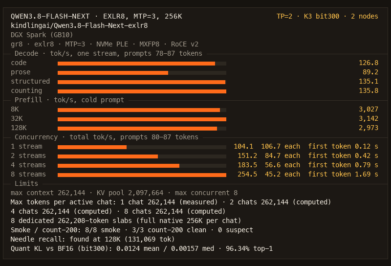
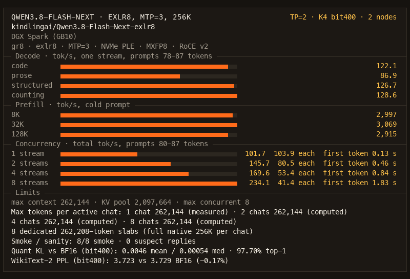

# KindlingAI: Qwen3.8-Flash-Next EXLR8 on two DGX Sparks (K3 & K4, 256K context)

If you are an agent booting this for someone, read [AGENTS.md](AGENTS.md) first, then the Quickstart.

_**Join our discord to learn more about KindlingAI and `gr8`: https://discord.gg/8EAvYPV2rE**_

Qwen3.8-Flash-Next on **two DGX Sparks** (GB10, 128 GB each) at `TP=2` over ConnectX-7 RoCE v2, served by [gr8](https://github.com/kindlingai/gr8) `v1.2.0` from
[kindlingai/Qwen3.8-Flash-Next-exlr8](https://huggingface.co/kindlingai/Qwen3.8-Flash-Next-exlr8/tree/4943478fdd54d8a59f2f9824b2389799e79f564b) (`v0.2`):
both **`bit300` (K3, 3.00 bpw)** and **`bit400` (K4, 4.00 bpw)** run with **8 dedicated full native 262,144-token** chats (`2,097,664` total KV rows), Layer-48 `MTP=3` speculative decoding, Blackwell MXFP8 dense kernels, single-step device-driven RDMA all-reduce (`GR8_QW38_FAST_AR=1`), async `O_DIRECT` NVMe streaming for the 102.4 GB Layer-1 PLE rowstore, and an opt-in BF16 vision tower (`GR8_QW38_VISION=1`).
This recipe is the published `gr8` image and one `.env` file. Nothing is compiled.



**K3 (`bit300`, default):** **126.8 tok/s** code · **89.2 tok/s** prose · **135.1 tok/s** structured · **135.8 tok/s** counting · **3,142 tok/s** 32K prefill (**2,973** at 128K) · **254.5 tok/s** at 8 streams · 128K needle recall PASS · 17 s boot from local NVMe
**K4 (`bit400`, 1-line switch):** **122.1 tok/s** code · **86.9 tok/s** prose · **126.7 tok/s** structured · **128.6 tok/s** counting · **3,069 tok/s** 32K prefill (**2,915** at 128K) · **234.1 tok/s** at 8 streams · near-lossless `0.0046` mean KL (`97.70%` top-1) · 19 s boot from local NVMe

## Results

Two DGX Sparks (GB10, 128 GB each) over dual-rail ConnectX-7 RoCE v2 with local NVMe release storage, `TP=2`, measured 2026-11-23 on the `gr8 v1.2.0` candidate ([PR #599](https://github.com/kindlingai/gr8/pull/599)) with `gr8`'s live S2 serving path and benchmark (`bench/bench.py`, `--runs 3`, `SESS=8`, `CAP=262,208`, `MAX_MODEL_LEN=262,144`, `MTP=3`, `GR8_QW38_PLE_CACHE_MIB=4096`), one fresh boot per manifest. GPU clocks were uncapped in the timed stages. Every speed is in tokens per second (tok/s).

### One request, short prompts (`MTP=3`, 78–87 prompt tokens, 3 runs each)

| manifest | code (95% CI) | prose (95% CI) | structured (95% CI) | counting (95% CI) | tok/step (code / prose) | ms/step | TTFT |
|---|---:|---:|---:|---:|---:|---:|---:|
| **`bit300` (K3, default)** | **126.8** (122.3–129.8) | **89.2** (86.3–92.4) | **135.1** (134.3–135.7) | **135.8** (135.3–136.5) | 3.74 / 2.60 | 29.0–29.1 ms | 109 ms |
| **`bit400` (K4)** | **122.1** (121.0–124.2) | **86.9** (84.7–90.2) | **126.7** (125.8–128.2) | **128.6** (128.0–128.9) | 3.73 / 2.65 | 30.7–30.8 ms | 120 ms |

### Requests at once (`MTP=3`, mixed prompts, 80–87 tokens)

| manifest | metric | 1 stream | 2 streams | 4 streams | 8 streams |
|---|---|---:|---:|---:|---:|
| **`bit300` (K3, default)** | **total tok/s** | **104.1** | **151.2** | **183.5** | **254.5** |
| `bit300` | tok/s per request | 106.7 | 84.7 | 56.6 | 45.2 |
| `bit300` | first token, median (p90) | 0.12 s (0.12 s) | 0.42 s (0.44 s) | 0.79 s (1.27 s) | 1.69 s (3.27 s) |
| **`bit400` (K4)** | **total tok/s** | **101.7** | **145.7** | **169.6** | **234.1** |
| `bit400` | tok/s per request | 103.9 | 80.5 | 53.4 | 41.4 |
| `bit400` | first token, median (p90) | 0.13 s (0.13 s) | 0.46 s (0.47 s) | 0.84 s (1.36 s) | 1.83 s (3.57 s) |

### Prefill, cold salted prompts (`MTP=3`)

| manifest | 8K prompt (TTFT · decode after) | 32K prompt (TTFT · decode after) | 128K prompt (TTFT · decode after) |
|---|---:|---:|---:|
| **`bit300` (K3, default)** | **3,027 tok/s** (`2.74 s` · `90.8 tok/s`) | **3,142 tok/s** (`10.46 s` · `78.3 tok/s`) | **2,973 tok/s** (`44.09 s` · `37.2 tok/s`) |
| **`bit400` (K4)** | **2,997 tok/s** (`2.74 s` · `90.5 tok/s`) | **3,069 tok/s** (`10.71 s` · `70.9 tok/s`) | **2,915 tok/s** (`45.04 s` · `41.2 tok/s`) |

### Choosing K3 (`bit300`) vs K4 (`bit400`)

At `TP=2`, both profiles leave over **50 GB of free unified memory per box** at full native 256K context (`CAP=262,208`, `SESS=8`). `bit400` (K4) trades only **~3–4%** single-stream decode speed (`86.9` vs `89.2` prose, `122.1` vs `126.8` code) to cut full-vocabulary KL divergence by **2.7×** (`0.0046` vs `0.0124`). Switch by changing one line in `.env` (`VARIANT=bit300` or `VARIANT=bit400`).

| profile | routed bpw | experts / box | total disk / box (incl. PLE) | model-written KL (mean / median) | model-written top-1 | WikiText-2 PPL (BF16 ref `3.729`) |
|---|---:|---:|---:|---:|---:|---:|
| **`bit300` (K3, default)** | 3.00 | 22.7 GB | ~141 GB | **0.0124 / 0.00157** | 96.34% | 3.737 (+0.23%) |
| **`bit400` (K4)** | 4.00 | 30.3 GB | ~148 GB | **0.0046 / 0.00054** | 97.70% | 3.723 (-0.17%) |



### How long each chat can be

Qwen3.8-Flash-Next has only 12 full-attention layers (1 KV head per box at `TP=2`; the other 36 layers are fixed-state Gated DeltaNet), so `gr8` gives each of the `SESS=8` concurrent session slots its own dedicated `262,208`-token KV slab (`2,097,664` total KV rows). All 8 active chats get the model's full native **262,144-token** context window without splitting each other's budget:

| active chats | 1 | 2 | 4 | 8 |
|---|---:|---:|---:|---:|
| max tokens per chat (prompt + `max_tokens`) | 262,144 | 262,144 | 262,144 | 262,144 |

The 1-chat limit is measured (the served `max_model_len`, verified with 128K prefill and 128K needle recall at 131,069 tokens); the multi-chat values follow directly from the 8 dedicated per-slot KV slabs.

### Quality checks

Measured on the same 2026-11-23 boots:

| check | `bit300` (K3) | `bit400` (K4) |
|---|---|---|
| smoke test (`./gr8 qw38 smoke`) | 8 of 8 PASS | 8 of 8 PASS |
| fact hidden in a 128K prompt | found (`131,069` tokens) | — |
| count to 200, three times | 3 of 3 clean | — |
| suspect characters | 0 replies | 0 replies |
| boot to serving from local NVMe | 17 s | 19 s |

[kindling.json](kindling.json) has both the K3 (`tp2-k3`) and K4 (`tp2-k4`) numbers in a form a program can read. Both cards above are drawn from it.

## Quickstart

On both boxes, first turn off proactive memory compaction and open TCP ports 7340 and 7341 between the boxes
([What you need](#what-you-need)). Then, on **both** boxes:

```bash
git clone https://github.com/kindlingai/qwen3.8-flash-next-exlr8-2x-spark && cd qwen3.8-flash-next-exlr8-2x-spark
cp .env.example .env
nano .env                  # PEERS: the two LAN addresses, head first (plus IPS/IPS2 if pinning RoCE rails). Same file on both boxes.
docker compose up -d       # pulls the pinned gr8 image; the first boot fetches this box's part (~141 GB for bit300)
docker compose logs -f     # this box's supervisor; ready when the cluster serves
```

Then, on the head (the first address in `PEERS`):

```bash
docker compose exec gr8 /opt/gr8/gr8 qw38 smoke
curl -s localhost:8100/v1/models      # id: qwen3.8-flash-next, max_model_len: 262144
```

Send a chat completion request (the model name is `qwen3.8-flash-next`, alias `qw38`; Qwen XML tool calls and `<think>` reasoning work out of the box):

```bash
curl -s localhost:8100/v1/chat/completions -H 'Content-Type: application/json' -d '{
  "model": "qwen3.8-flash-next",
  "messages": [{"role": "user", "content": "Write a haiku about two small computers."}],
  "max_tokens": 2048
}'
```

Stop the cluster cleanly with `docker compose exec gr8 /opt/gr8/gr8 qw38 down` on the head, then `docker compose down` on both boxes.

### Multimodal vision (opt-in)

The pinned `v0.2` weights include the unquantized 27-layer BF16 vision tower (`dense/vision-bf16.safetensors`, `898 MB`). To enable OpenAI `image_url` inputs, add `GR8_QW38_VISION=1` to `EXTRA_ENV` in `.env` on **both** boxes:

```bash
EXTRA_ENV="GR8_QW38_PLE_CACHE_MIB=4096 GR8_QW38_VISION=1"
```

Then restart both boxes (`docker compose up -d`) and verify on the head with `docker compose exec -e GR8_QW38_VISION_SMOKE=1 gr8 /opt/gr8/gr8 qw38 smoke` (9/9 checks).

## What you need

- Two DGX Sparks or other GB10 boxes (128 GB unified memory each), with no other model running on them.
- A ConnectX-7 RoCE v2 link between the two boxes: direct-cabled (single or dual 200G DAC/AOC cables — dual-rail gives the best latency and was used for the measured numbers) or on a 200G switch.
- A LAN between the boxes with TCP ports 7340 and 7341 open.
- Docker with the NVIDIA container toolkit (DGX OS has both).
- **Local NVMe disk per box:** about **141 GB** free for `bit300` (`22.7 GB` experts + `15.1 GB` dense/vocab/MTP + `102.4 GB` Layer-1 PLE rowstore) or **148 GB** for `bit400` (`30.3 GB` experts), plus `0.9 GB` if enabling vision. Keep Docker's storage (or `GR8_CACHE`) on fast local NVMe — Layer-1 PLE streams per token over async `O_DIRECT` `pread` behind Layer 0 rather than consuming GPU memory.
- Proactive memory compaction off on both boxes:
  `sudo sysctl -w vm.compaction_proactiveness=0` (`gr8`'s
  [DEPLOY.md](https://github.com/kindlingai/gr8/blob/main/docs/DEPLOY.md#before-you-start) has the permanent form).

`gr8`'s [Qwen3.8-Flash-Next page](https://github.com/kindlingai/gr8/blob/main/docs/QWEN38.md) explains the architecture and every `GR8_QW38_*` rollback knob, and [DEPLOY.md](https://github.com/kindlingai/gr8/blob/main/docs/DEPLOY.md) explains the launcher options.

## Other box counts

- **One box (`TP=1`, 139K context/chat, 83.0 code / 61.5 prose / 155.2 at 8 streams on K3, 78.4 code / 55.1 prose on K4):** [qwen3.8-flash-next-exlr8-1x-spark](https://github.com/kindlingai/qwen3.8-flash-next-exlr8-1x-spark)

## Help

Ask on Discord (https://discord.gg/8EAvYPV2rE) or open an issue in this repo
(https://github.com/kindlingai/qwen3.8-flash-next-exlr8-2x-spark/issues). Say which step failed, and include:

- the command you ran, and the end of `docker logs qw38-2x-spark`, before you remove the container;
- if it still runs, `docker exec qw38-2x-spark /opt/gr8/gr8 qw38 status`.

Remove addresses and hostnames before you post.

## Engine pin

This recipe has no engine code. It runs one published `gr8` image, named in [compose.yaml](compose.yaml) and in the `engine` field of [kindling.json](kindling.json):

| | |
|---|---|
| engine | [kindlingai/gr8](https://github.com/kindlingai/gr8) [`v1.2.0`](https://github.com/kindlingai/gr8/releases/tag/v1.2.0) *(commit pin pending `v1.2.0` tag)* |
| image | `ghcr.io/kindlingai/gr8:v1.2.0` |
| digest | *pending `v1.2.0` GHCR publish (will be pinned as `@sha256:<digest>` once released)* |

Benchmarks above were measured on 2026-11-23 on the `gr8 v1.2.0` candidate branch ([PR #599](https://github.com/kindlingai/gr8/pull/599)). `python3 check.py` checks that `compose.yaml` and `kindling.json` agree; CI runs it on every pull request and automatically enforces `check.py --strict` plus `docker manifest inspect` once the `v1.2.0` digest is pinned.

## License

MIT, see [LICENSE](LICENSE). Qwen3.8-Flash-Next has its own licence (`qwen-community-1.0`): see the
[model page](https://huggingface.co/kindlingai/Qwen3.8-Flash-Next-exlr8).
