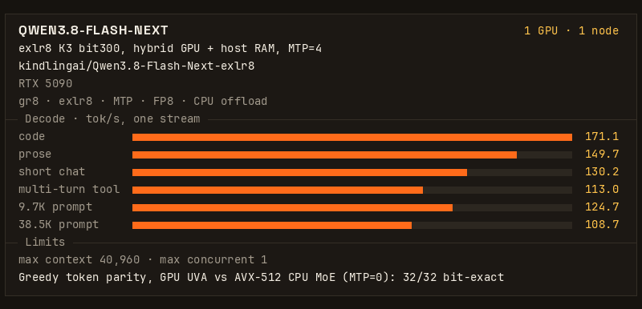

# KindlingAI: Qwen3.8-Flash-Next EXLR8 on one RTX 5090 (K3, Hybrid GPU + Host RAM)



If you are an agent booting this for someone, read [AGENTS.md](AGENTS.md) first, then the Quickstart.

_**Join our discord to learn more about KindlingAI and `gr8`: https://discord.gg/8EAvYPV2rE**_

Qwen3.8-Flash-Next K3 (`bit300`, 3.00 bpw) on **one discrete Blackwell GPU** (tested on **1× RTX 5090 32 GB** + **128 GB DDR5** + AVX-512 CPU), served by [kindlingai/gr8](https://github.com/kindlingai/gr8) (`v1.3.1`, containing [PR #610](https://github.com/kindlingai/gr8/pull/610) and [PR #629](https://github.com/kindlingai/gr8/pull/629)) using weights from [kindlingai/Qwen3.8-Flash-Next-exlr8](https://huggingface.co/kindlingai/Qwen3.8-Flash-Next-exlr8). This recipe is the published `linux/amd64` `gr8` image and one `.env` file. Nothing is compiled on the host.

How it fits a 60+ GB MoE model comfortably on a single 32 GB GPU:
- **Adaptive VRAM hot-expert cache + pinned host-RAM backing:** Hot routed K3 experts live in GDDR7 VRAM (with zero-stall pointer swaps safe for CUDA Graphs); cold experts stay in pinned DDR5.
- **Hybrid AVX-512 CPU + GPU cold-expert execution:** Cold routed experts split across fast AVX-512 BF16/VBMI2 CPU threads and GPU PCIe reads in parallel with GPU-hot experts.
- **FP8 dense weights + INT4 MTP=4 speculative drafter + aliased workspace:** Keeps total VRAM under **22.9 GiB** (leaving room for other workloads on a 32 GB GPU, or scaling up the hot-expert cache automatically on larger GPUs).
- **Direct NVMe / mmap PLE streaming:** Streams Layer-1 Per-Layer Embeddings directly from local NVMe (`ple/exlr8-ple-L001.bin` from the Hugging Face release, or an optional compact GGUF PLE via `--ple` in `EXTRA_ARGS`).

## Results

1× RTX 5090 32 GB + Ryzen 7 9800X3D + 128 GB DDR5, `TP=1`, `CAP=40960`, `PREFILL=13312`, `MTP=4`, `GR8_QW38_STRATA=1`, `GR8_QW38_VRAM_RESERVE_MIB=1920`, measured on `gr8 main` ([PR #610](https://github.com/kindlingai/gr8/pull/610), commit `5cedece3`) apples-to-apples over HTTP streaming (`/v1/chat/completions`, `temperature=0.0`, 3-run medians) under a **22.9 GiB VRAM ceiling** (~7.2 GiB of other GPU services left resident on the card, so a dedicated clean 32 GB GPU caches even more hot experts). Every speed is in tokens per second (tok/s). Re-measurement on the published `gr8 v1.3.1` `linux/amd64` container image is pending RTX 5090 hardware.

| Workload | Prompt / Output | TTFT (`gr8`) | Total Time (`gr8`) | Decode Speed (`gr8`) | vs. Strata `IQ3_S` Total |
|---|---:|---:|---:|---:|---:|
| **Short chat** | 72 / 160 | **434 ms** | **1.66 s** | **130.2 tok/s** | **1.40× faster** |
| **Long prose** | 193 / 1,536 | **423 ms** | **10.69 s** | **149.7 tok/s** | **1.07× faster** |
| **Code generation** | 119 / 1,024 | **391 ms** | **6.38 s** | **171.1 tok/s** | **1.01× faster** |
| **Multi-turn tool** | 3.6K / 309 | **1,508 ms** | **4.24 s** | **113.0 tok/s** | **1.22× faster** |
| **9.7K prompt** | 9.7K / 48 | **2,014 ms** | **2.40 s** | **124.7 tok/s** | **1.06× faster** |
| **38.5K prompt** | 38.5K / 48 | **6,747 ms** | **7.18 s** | **108.7 tok/s** | **1.02× faster** |

- **6/6 total-time wins** and **6/6 TTFT wins** across all 3 runs, fitting **6,853 hot experts** in VRAM (`+73%` more than Strata's 3,961) in **42 MiB less VRAM** (`22,872 MiB` vs `22,914 MiB`).
- Bit-exact **32/32** greedy token parity verified between 100% GPU UVA mode and 100% AVX-512 CPU MoE mode (`MTP=0`).

[kindling.json](kindling.json) has these numbers in a form a program can read. The card above is drawn from it.

## Quickstart

First turn off proactive memory compaction on the host ([What you need](#what-you-need)). Then:

```bash
npx @kindlingai/recipe qwen3.8-flash-next-exlr8-1x-gpu && cd qwen3.8-flash-next-exlr8-1x-gpu
# the CLI already copied .env.example to .env; edit it if you use a local MODEL_DIR or custom knobs
docker compose up -d       # pulls the published linux/amd64 gr8 image; first boot fetches bit300 (~164 GB)
docker compose logs -f     # ready when the OpenAI API answers on 127.0.0.1:8100
```

This recipe lives in [kindlingai/recipes](https://github.com/kindlingai/recipes/tree/main/qwen3.8-flash-next/rtx-5090/1x/exlr8-gr8) at `qwen3.8-flash-next/rtx-5090/1x/exlr8-gr8`; a [sparse clone](https://github.com/kindlingai/recipes#run-a-recipe) also works.

If you already downloaded `kindlingai/Qwen3.8-Flash-Next-exlr8` locally on NVMe, point `MODEL_DIR` in `.env` at that folder and set `MODEL=/var/lib/gr8/model` — `compose.yaml` bind-mounts it read-only (including its `manifests/exlr8-manifest-bit300.json` and `ple/exlr8-ple-L001.bin`).

Once serving, verify the API:

```bash
docker compose exec gr8 /opt/gr8/gr8 qw38 smoke
curl -s http://127.0.0.1:8100/v1/models
curl -s http://127.0.0.1:8100/v1/chat/completions \
  -H "Content-Type: application/json" \
  -d '{
    "model": "qwen3.8-flash-next",
    "messages": [{"role": "user", "content": "Explain tail-biting trellis quantization in 3 sentences."}],
    "max_tokens": 256
  }'
```

Stop the server cleanly with:

```bash
docker compose exec gr8 /opt/gr8/gr8 qw38 down
docker compose down
```

## What you need

- **GPU:** 1× NVIDIA Blackwell GPU with ≥24–32 GB VRAM (`sm_120a`, e.g. RTX 5090 32 GB or RTX PRO 6000; `sm_121a` on DGX Spark uses the `linux/arm64` variant of the same multi-arch image).
- **Host RAM:** **96–128 GB DDR5** (46.7 GB pinned host RAM for routed K3 experts + OS page cache).
- **CPU:** **x86_64 with AVX-512** (AVX-512 BF16/VBMI2 recommended for hybrid CPU cold-expert offload).
- **Docker:** Docker Engine with the NVIDIA Container Toolkit.
- **Storage:** Fast local NVMe (~165 GB free for the `bit300` release including the 102.4 GB Layer-1 PLE rowstore). Keep Docker's storage (or `GR8_CACHE` / `MODEL_DIR`) on local NVMe — Layer-1 PLE streams over `O_DIRECT`.
- Proactive memory compaction off:
  `sudo sysctl -w vm.compaction_proactiveness=0` (`gr8`'s
  [DEPLOY.md](https://github.com/kindlingai/gr8/blob/main/docs/DEPLOY.md#before-you-start) has the permanent form).

## Settings

`cp .env.example .env` (the CLI already did). Every knob is documented in [.env.example](.env.example); the active
lines match the single-GPU Strata configuration used for the Results numbers.

| knob | default | what it does |
|---|---|---|
| `MODEL` / `VARIANT` | HF release / `bit300` | Model source (HF URL or `/var/lib/gr8/model` read-only mount) and K3 width manifest |
| `CAP` / `MAX_MODEL_LEN` / `SESS` | `40960` / `40960` / `1` | Context window and single-session KV budget |
| `MTP` | `4` | INT4 Layer-48 MTP speculative drafting depth |
| `REUSE` / `ALLOW_THINKING_OFF` | `1` / `1` | Prefix reuse and opt-out `<think>` control |
| `EXTRA_ENV` | `GR8_QW38_STRATA=1 GR8_QW38_VRAM_RESERVE_MIB=1920 ...` | Enables Strata hot-expert VRAM cache, 1,920 MiB VRAM reserve, and host-RAM loader tuning; optional `GR8_QW38_EXPERT_PROFILE` / `GR8_QW38_EXPERT_CACHE_SLOTS` |
| `EXTRA_ARGS` | `--prefill 13312` | Prefill chunk budget; append `--ple /var/lib/gr8/model/<file>` to override the default PLE path |
| `MODEL_DIR` | named volume | Optional host model directory bind-mounted read-only at `/var/lib/gr8/model:ro` |
| `GR8_CACHE` / `GR8_HOME` | named volumes | Optional local NVMe host directories (owned by uid 1000) for model cache and logs/state |
| `GR8_STOP_GRACE` / `GR8_IMAGE` | unset | Optional shutdown grace (for `persist=on` KV store) or image override |

`gr8`'s [Qwen3.8-Flash-Next page](https://github.com/kindlingai/gr8/blob/main/docs/QWEN38.md) explains the architecture and `GR8_QW38_*` knobs, and [DEPLOY.md](https://github.com/kindlingai/gr8/blob/main/docs/DEPLOY.md) explains the launcher options.

## Other sizes

- **One DGX Spark (`TP=1`, 128 GB unified memory, 6× 262K on K3 / 4× 262K on K4, DFlash + `MTP=3`):** [qwen3.8-flash-next-exlr8-1x-spark](../../../dgx-spark/1x/exlr8-gr8)
- **Two DGX Sparks (`TP=2`, 8× 262K on K3 / K4, `MTP=3`):** [qwen3.8-flash-next-exlr8-2x-spark](../../../dgx-spark/2x/exlr8-gr8)

## Help

Ask on Discord (https://discord.gg/8EAvYPV2rE) or open an issue in the recipes repo
(https://github.com/kindlingai/recipes/issues) with `qwen3.8-flash-next-exlr8-1x-gpu` in the title. Say which step failed, and include:

- the command you ran, and the end of `docker logs qw38-1x-rtx5090`, before you remove the container;
- if it still runs, `docker exec qw38-1x-rtx5090 /opt/gr8/gr8 qw38 status`.

Remove addresses and hostnames before you post.

## Engine pin

This recipe has no engine code. It runs one published multi-arch `gr8` image (`linux/amd64` `sm_120a`), named in [compose.yaml](compose.yaml) and in the `engine` field of [kindling.json](kindling.json):

| | |
|---|---|
| engine | [kindlingai/gr8](https://github.com/kindlingai/gr8) `v1.3.1` ([`9f4f9c4f700d8a53c753e98f5388a92cc8cfd869`](https://github.com/kindlingai/gr8/commit/9f4f9c4f700d8a53c753e98f5388a92cc8cfd869)) |
| image | `ghcr.io/kindlingai/gr8:v1.3.1` |
| digest | `sha256:e4e709eab32df3868b74b14c08b75fc89d891fde0f9650d0c4a42fcda54b9863` |

`python3 tools/check_pin.py --strict qwen3.8-flash-next/rtx-5090/1x/exlr8-gr8`, run from the monorepo root, verifies that [compose.yaml](compose.yaml) and [kindling.json](kindling.json) agree on the immutable image digest.

## License

MIT, see [LICENSE](../../../../LICENSE). Qwen3.8-Flash-Next has its own licence (`qwen-community-1.0`): see the
[model page](https://huggingface.co/kindlingai/Qwen3.8-Flash-Next-exlr8).
