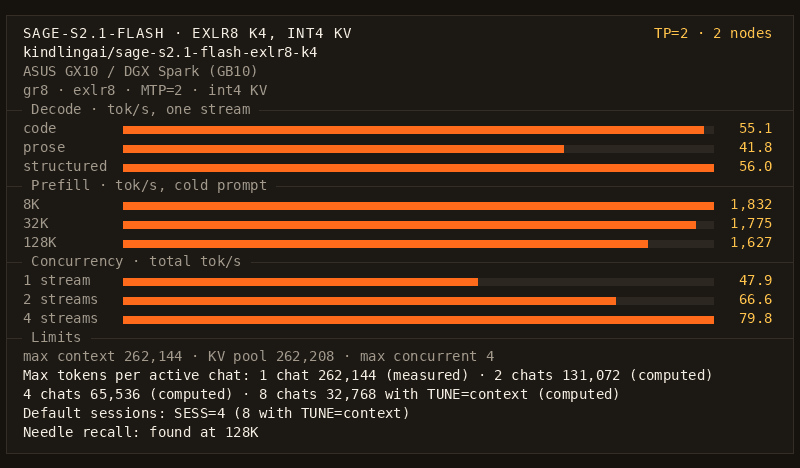
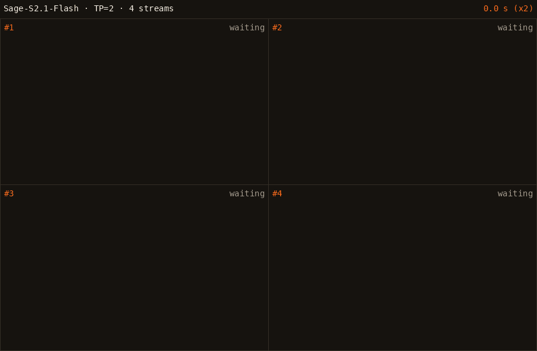

# Sage-S2.1-Flash EXLR8 on 2× DGX Spark



If you are an agent booting this for someone, read [AGENTS.md](AGENTS.md) first, then the Quickstart. Join the
[KindlingAI Discord](https://discord.gg/8EAvYPV2rE) for help and updates.

Sage-S2.1-Flash on two DGX Sparks (GB10, 128 GB each) at `TP=2`, served by [gr8](https://github.com/kindlingai/gr8)
`v1.2.0` from the `k4` manifest of
[kindlingai/sage-s2.1-flash-exlr8-k4](https://huggingface.co/kindlingai/sage-s2.1-flash-exlr8-k4) with `int4` KV,
bit-exact shared-waterfill `MTP=2` drafting, and an aligned prompt checkpoint cache on disk. This recipe runs gr8's
published image pinned by digest, with `.env` and a read-only `kv-store.yaml` mount. Nothing is compiled.

## Results

**`TP=2` (`k4`, `SESS=4`, `MTP=2`):** **55.1 tok/s** code · **41.8 tok/s** prose · **56.0 tok/s** structured · **1,832 / 1,775 / 1,627 tok/s** cold prefill (8K / 32K / 128K) · **79.8 tok/s** at 4 streams (**94.1 tok/s** at 8 streams with `SESS=8`) · **262,144** max context · **128K needle recall PASS** · 24 s warm boot

Two DGX Sparks joined by a 200G ConnectX cable, `TP=2`, `gr8` `ca7e874`, `k4` (`e55da468`), `int4` KV, `SESS=4`,
`CAP=262208`, `MAX_MODEL_LEN=262144`, `MTP=2`, `S2_SHARED_WATERFILL=1`, `DFLASH=0`, `FLASH_CACHE=aligned`, measured
2026-11-18 with `gr8` `bench/bench.py`. Every speed is in tokens per second (tok/s).

One request, short prompts:

| work | code | prose | structured |
|---|---:|---:|---:|
| tok/s, mean | 55.1 | 41.8 | 56.0 |

Prefill, cold prompt:

| prompt | prefill tok/s |
|---|---:|
| 8K tokens | 1,832 |
| 32K tokens | 1,775 |
| 128K tokens | 1,627 |

Requests at once (aggregate tok/s):

| streams | 1 | 2 | 4 |
|---|---:|---:|---:|
| total tok/s (`SESS=4`, `MTP=2`, `S2_SHARED_WATERFILL=1`) | 47.9 | 66.6 | 79.8 |
| total tok/s (`MTP=1` baseline) | 44.5 | 60.8 | 74.2 |

Paired quick ruler: `48.3 / 64.4 / 78.5` and `47.9 / 66.3 / 78.7` tok/s at 1 / 2 / 4 streams. With `SESS=8`, aggregate
concurrency reaches `94.1` tok/s at 8 streams (`48.6 / 66.5 / 77.4 / 94.1` tok/s at 1 / 2 / 4 / 8 streams).

Checks:

| check | result |
|---|---|
| needle recall at 128K | found |
| longest context (`max_model_len`) | 262,144 tokens (262,208-token KV pool) |
| max tokens per chat (1 / 2 / 4 chats) | 262,144 (measured) / 131,072 / 65,536 (computed; 8 chats 32,768 with `SESS=8`, `GR8_CP=1`) |
| warm boot | 24 s |



[kindling.json](kindling.json) has these numbers in a form a program can read. The card above is drawn from it.

## Quickstart

On both boxes, first turn off proactive memory compaction, configure ConnectX addresses ([Clustering](#clustering)), and
open TCP ports 7340 and 7341 between the boxes ([What you need](#what-you-need)). Then, on both boxes:

```bash
npx @kindlingai/recipe sage-s2.1-flash-exlr8-2x-spark && cd sage-s2.1-flash-exlr8-2x-spark
# the CLI already copied .env.example to .env; edit it:
nano .env                  # set PEERS (and IPS, IPS2), or comment PEERS and uncomment MENTAT=localhost
docker compose up -d       # pulls the pinned gr8 image; first boot fetches this box's part (~82 GiB)
docker compose logs -f     # on the head: ready at "serving: http://..."
```

This recipe lives in
[kindlingai/recipes](https://github.com/kindlingai/recipes/tree/main/sage-s2.1-flash/dgx-spark/2x/exlr8-gr8) at
`sage-s2.1-flash/dgx-spark/2x/exlr8-gr8`; a [sparse clone](https://github.com/kindlingai/recipes#run-a-recipe) also
works. Start both boxes within 600 s (`JOIN_TIMEOUT`) of each other.

Once serving, verify the OpenAI-compatible API on the head's port 8100 (because `gr8 glm53f` serves the Flash engine
architecture, the served model name is `glm-5.3-flash`; `glm53f` also works):

```bash
docker compose exec gr8 /opt/gr8/gr8 glm53f smoke        # 14 checks against the API
curl -s localhost:8100/v1/chat/completions -H 'Content-Type: application/json' -d '{
  "model": "glm-5.3-flash",
  "messages": [{"role": "user", "content": "Write a haiku about a small computer."}],
  "max_tokens": 4096
}'
```

The model thinks before it answers; thinking is returned in `message.reasoning` and counts toward `max_tokens`.

Stop cleanly:

```bash
docker compose exec gr8 /opt/gr8/gr8 glm53f down         # on the head: stops every box
docker compose down                                      # on both boxes (add -v to remove volumes)
```

### Running with `docker run` directly

If you prefer `docker run` without Compose, run the same pinned `gr8` image with your `.env` and read-only
`kv-store.yaml` mount on both boxes:

```bash
docker run -d --name sage-2x-spark --gpus all --network host --pid host --device /dev/infiniband \
  --ulimit memlock=-1 --ulimit core=0 --cap-drop ALL --cap-add IPC_LOCK \
  --security-opt no-new-privileges --read-only --tmpfs /tmp:size=1g,mode=1777 --init --oom-score-adj 1000 \
  --env-file .env \
  -v "$PWD/kv-store.yaml:/etc/gr8/kv-store.yaml:ro" \
  -v sage-2x-cache:/var/lib/gr8/cache -v sage-2x-home:/var/lib/gr8/home \
  ghcr.io/kindlingai/gr8:v1.2.0@sha256:3de05aab8cda21fd5d6b4af89ccdba6ff5abdbd704729601fd348fa638ade9fd
docker logs -f sage-2x-spark
docker exec sage-2x-spark /opt/gr8/gr8 glm53f smoke      # on the head
```

## What you need

- Two DGX Sparks (or other GB10 boxes, 128 GB unified memory each) joined by a 200G cable between their ConnectX ports
  ([Clustering](#clustering)), with no other model running on either box.
- Docker and the NVIDIA container toolkit on each box (both come with DGX OS).
- Free disk where Docker keeps volumes: about 82 GiB (~88 GB) per box for this box's part of the `k4` release, plus up
  to 64 GB for the prompt cache (`kv-store.yaml`).
- A LAN between the two boxes with TCP ports 7340 and 7341 open.
- Proactive memory compaction off on each box, once, as root (it holds across reboots):

  ```bash
  echo 'vm.compaction_proactiveness = 0' > /etc/sysctl.d/90-gr8-no-proactive-compaction.conf
  sysctl -w vm.compaction_proactiveness=0
  ```

## Settings

`cp .env.example .env` (the CLI already did). Every knob is documented in [.env.example](.env.example); the active
lines are the exact settings the Results numbers were measured with.

| knob | default | what it does |
|---|---|---|
| `GR8_MODEL` | `glm53f` | Selects gr8's Flash engine (`g6m4_flash-int4`). |
| `MODEL` | `kindlingai/sage-s2.1-flash-exlr8-k4@e55da468` | Weights pinned to the measured Hugging Face commit. |
| `VARIANT` | `k4` | The release's K4 width manifest (natively supported by `gr8`). |
| `TP`, `PEERS` | `2`, two LAN IPs | Two boxes' 10G LAN addresses, head first. Comment out `PEERS` and set `MENTAT=localhost` when using mentat. |
| `IPS`, `IPS2` | commented | ConnectX addresses on PCIe root 1 and root 2, in `PEERS` order. |
| `SESS` | `4` | Concurrent decoding sessions (1 to 8). |
| `CAP`, `MAX_MODEL_LEN` | `262208`, `262144` | Shared KV pool in tokens and longest single request (`<= CAP` less guard rows). |
| `MTP`, `S2_SHARED_WATERFILL` | `2`, `1` | Bit-exact shared-waterfill `MTP=2` drafting. Set `MTP=1`, `S2_SHARED_WATERFILL=0` for the strict `MTP=1` baseline. |
| `DFLASH` | `0` | Uses MTP only and downloads no DFlash2 drafter. |
| `KV_FORMAT` | `int4` | Mixed-precision int4 MLA latent KV. |
| `FLASH_CACHE`, `KV_STORE` | `aligned`, `@/etc/gr8/kv-store.yaml` | Aligned prompt checkpoint cache on disk (`/var/lib/gr8/cache/prompts`, up to 64 GB/box) + spare RAM. Checkpoints align to the 8,192-token prefill grid (`4096 × 2` lanes). |
| `GROUP` | `gr8-sage-2x` | Mentat cluster group name when `MENTAT=localhost`. |
| `EXTRA_ENV` | unset | Space-separated engine env overrides: `GR8_CP=1` (experimental context-parallel KV for 8 sessions), `GR8_GLM53F_VISION=1` (untested 1.13 GB vision tower), or compact copies below. |
| `DEFAULT_MAX_TOKENS` | `32768` | Default `max_tokens` when omitted by a client. |
| `UNDECLARED_TOOL_CALLS` | `emit` | Returns undeclared tool calls as tool calls (`text` leaves them in text). |

### Tradeoff presets (edit `.env`)

| preset | `.env` overrides over default | tradeoff |
|---|---|---|
| **speed (default)** | `SESS=4`, `CAP=262208`, `MAX_MODEL_LEN=262144`, `MTP=2`, `S2_SHARED_WATERFILL=1` | Measured default (55.1 / 41.8 / 56.0 tok/s decode; 79.8 tok/s at 4 streams). |
| **context (experimental)** | `SESS=8`, `EXTRA_ENV=GR8_CP=1` | Up to 8 concurrent sessions sharing the 262K pool (94.1 tok/s at 8 streams). |
| **quality baseline** | `MTP=1`, `S2_SHARED_WATERFILL=0` | Strict `MTP=1` baseline (44.5 / 60.8 / 74.2 tok/s at 1 / 2 / 4 streams). |

Every other option is gr8's launcher default, listed in
[gr8/KNOBS.md](https://github.com/kindlingai/gr8/blob/ab2eb95f426ff908543d5d002218cf5a2a5c5be6/KNOBS.md).

## Clustering

Give each box one address per PCIe root. The Spark's ConnectX card shows each physical port twice, once on each PCIe
root, and the engines use both. Run `ip -br link` on each box to list your port names; the names below
(`enp1s0f0np0` and `enP2p1s0f0np0`) are examples. `mtu: 9000` (jumbo frames) must be set on both boxes and any switch
between them:

```yaml
# /etc/netplan/60-connectx.yaml on the first box. On the second box: 10.0.0.2 and 10.0.1.2.
network:
  version: 2
  ethernets:
    enp1s0f0np0:        # the first port on PCIe root 1
      addresses: [10.0.0.1/24]
      mtu: 9000
    enP2p1s0f0np0:      # the same port on PCIe root 2
      addresses: [10.0.1.1/24]
      mtu: 9000
```

Then run `sudo netplan apply` on each box.

- **Without `mentat`:** set both boxes' 10G LAN addresses in `PEERS` (head first), and their matching ConnectX addresses
  in `IPS` (PCIe root 1) and `IPS2` (PCIe root 2) in the same order.
- **With [`mentat`](https://github.com/kindlingai/mentat):** run `mentat` on each box
  (`docker run -d --name mentat --network host --restart unless-stopped ghcr.io/kindlingai/mentat:0.27.0`), comment out
  `PEERS`, `IPS`, and `IPS2` in `.env`, and uncomment `MENTAT=localhost`.

## Compact expert copies

Optional, and off by default. `GR8_LOAD_COMPACT` and `GR8_LOAD_MERGE_KB=1` in `EXTRA_ENV` make the loader read dense
per-rank copies of its expert ranges in place of the release's sparse files.

To turn it on, uncomment the compact-copies `EXTRA_ENV` line in `.env` on both boxes, write the copies once while
stopped, then start:

```bash
docker compose run --rm gr8 prepare               # on both boxes
docker compose run --rm gr8 prepare --rank 0      # with MENTAT=localhost: name rank 0 on head, rank 1 on box 2
```

- **Disk:** 72.8 GiB (78.2 GB) per box beside the release (`prepare` took 170 s/box).
- **`EXTRA_ENV` holds one line:** combine variables on one space-separated line if you also enable `GR8_CP=1` or
  `GR8_GLM53F_VISION=1`.

Measured 2026-11-18 on two DGX Sparks at `TP=2`, `gr8 ca7e874`, cold disk (`echo 3 > /proc/sys/vm/drop_caches`):

| Boot from a cold disk | Total (n=2) | A rank's read |
|---|---|---|
| Stock | 29.4 / 29.0 s | 21.9–22.3 s (4.1 GB/s) |
| `GR8_LOAD_COMPACT` with `GR8_LOAD_MERGE_KB=1` | 18.6 / 18.5 s | 11.9–12.3 s (7.3–7.6 GB/s) |
| `GR8_LOAD_MERGE_KB=1` alone, no copies (n=1) | 28.6 s | 22.1–22.3 s |

## Remote KV store

Optional, and off by default. The prompt cache can keep checkpoints on an RDMA KV node instead of local disk
([REMOTE-TIER.md](https://github.com/kindlingai/gr8/blob/ab2eb95f426ff908543d5d002218cf5a2a5c5be6/engine/kvman-rs/REMOTE-TIER.md)).

1. Start the KV node on the donor box using the same pinned `gr8` image:

   ```bash
   docker run -d --name sage-kv-node --network host --pid host --device /dev/infiniband \
     --ulimit memlock=-1 --ulimit core=0 --cap-drop ALL --cap-add IPC_LOCK \
     --security-opt no-new-privileges --read-only --tmpfs /tmp:size=256m,mode=1777 --init \
     -v sage-kv-home:/var/lib/gr8/home --entrypoint /opt/gr8/gr8 \
     ghcr.io/kindlingai/gr8:v1.2.0@sha256:3de05aab8cda21fd5d6b4af89ccdba6ff5abdbd704729601fd348fa638ade9fd \
     kv up --gb 4 --port 7350 --bind 0.0.0.0 --min-free-gb 6 --mentat none \
       --work-dir /var/lib/gr8/home --bin /opt/gr8/bin/kvman-remote --foreground
   docker exec sage-kv-node /opt/gr8/gr8 kv status --work-dir /var/lib/gr8/home --mentat none
   ```

2. Replace `kv-store.yaml` (mounted read-only at `/etc/gr8/kv-store.yaml`) with the remote store (one store only — do
   not combine `ssd` and `remote` in the same file; use `address: auto` with `MENTAT=localhost`):

   ```yaml
   caches:
     spare: {kind: spare_ram, floor: 2G}
   tiers:
     - cache: spare
       store:
         remote: {address: 10.0.0.2:7350, size_per_rank: 1G}
   ```

Measured 2026-11-18 on two DGX Sparks at `TP=2`, `gr8 ca7e874`, 44,633-token prompt, 64 output tokens:

| `kv-store.yaml` | first request | repeat | cached tokens on repeat | checkpoint restore |
|---|---|---|---|---|
| remote only | 26.2 s | 3.7 s | 40,960 | 45 ms/rank |
| remote with `spare` RAM cache | 26.7 s | 3.7 s | 40,960 | 18 ms/rank |

## Other sizes

- **Four boxes (`TP=4`, 8 sessions, 1M context option):** [sage-s2.1-flash-exlr8-4x-spark](../../4x/exlr8-gr8)

## Help

Ask on [Discord](https://discord.gg/8EAvYPV2rE) or open an issue in
[kindlingai/recipes](https://github.com/kindlingai/recipes/issues) with `sage-s2.1-flash-exlr8-2x-spark` in the title.
Say which step failed, and include:

- the command you ran, and the end of `docker logs sage-2x-spark`, before you remove the container;
- if it still runs, `docker exec sage-2x-spark /opt/gr8/gr8 glm53f status`.

Remove addresses and hostnames before you post.

## Engine pin

This recipe has no engine code. It runs one published gr8 image, named in [compose.yaml](compose.yaml) and in the
`engine` field of [kindling.json](kindling.json):

| | |
|---|---|
| engine | [kindlingai/gr8](https://github.com/kindlingai/gr8) [`v1.2.0`](https://github.com/kindlingai/gr8/releases/tag/v1.2.0) at [`ab2eb95`](https://github.com/kindlingai/gr8/commit/ab2eb95f426ff908543d5d002218cf5a2a5c5be6) |
| image | `ghcr.io/kindlingai/gr8:v1.2.0` |
| digest | `sha256:3de05aab8cda21fd5d6b4af89ccdba6ff5abdbd704729601fd348fa638ade9fd` |
| weights | [kindlingai/sage-s2.1-flash-exlr8-k4](https://huggingface.co/kindlingai/sage-s2.1-flash-exlr8-k4/tree/e55da4682c090821efcac7f5fb85622cb06d1c54) (`e55da468`, `k4`) |

`gr8 v1.2.0` includes commit `ca7e874` (PR #541 literal control tokens for Sage-S2.1-Flash) and ships `g6m4_flash-int4`
for TP 1–4. Results above were measured on 2026-11-18 on `ca7e874`.

`python3 tools/check_pin.py --strict sage-s2.1-flash/dgx-spark/2x/exlr8-gr8`, run from the monorepo root, verifies that
`compose.yaml` and `kindling.json` agree on the immutable image digest.

## License

MIT, see [LICENSE](../../../../LICENSE). Sage-S2.1-Flash has its own licence: see the
[model page](https://huggingface.co/kindlingai/sage-s2.1-flash-exlr8-k4).
