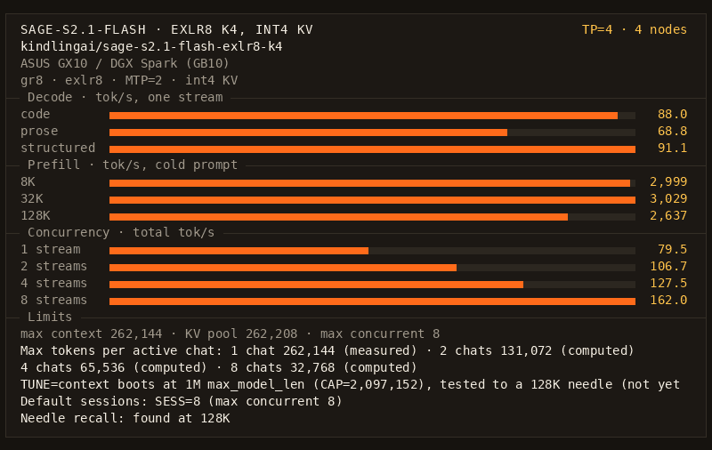
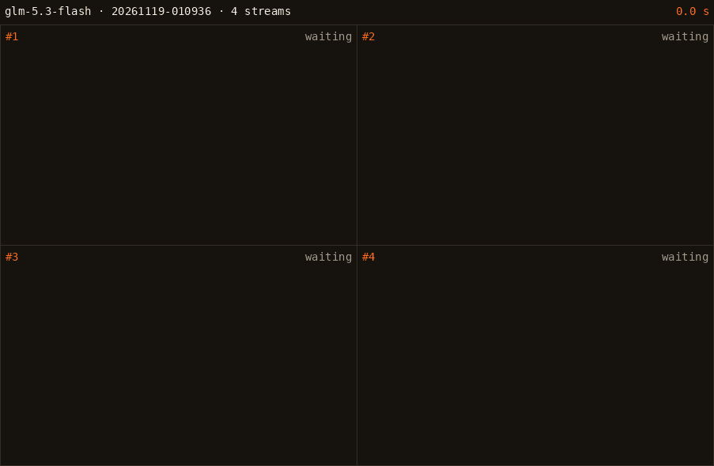

# Sage-S2.1-Flash EXLR8 on 4× DGX Spark



If you are an agent booting this for someone, read [AGENTS.md](AGENTS.md) first, then the Quickstart. Join the
[KindlingAI Discord](https://discord.gg/8EAvYPV2rE) for help and updates.

Sage-S2.1-Flash on four DGX Sparks (GB10, 128 GB each) at `TP=4`, served by [gr8](https://github.com/kindlingai/gr8)
`v1.2.0` from the `k4` manifest of
[kindlingai/sage-s2.1-flash-exlr8-k4](https://huggingface.co/kindlingai/sage-s2.1-flash-exlr8-k4) with `int4` KV,
8 concurrent sessions, bit-exact shared-waterfill `MTP=2` drafting, an aligned prompt checkpoint cache on disk, and an
experimental 1M-context (`2,097,152`-token KV pool) option. This recipe runs gr8's published image pinned by digest,
with `.env` and a read-only `kv-store.yaml` mount. Nothing is compiled.

## Results

**`TP=4` (`k4`, `SESS=8`, `MTP=2`):** **88.0 tok/s** code · **68.8 tok/s** prose · **91.1 tok/s** structured · **2,999 / 3,029 / 2,637 tok/s** cold prefill (8K / 32K / 128K) · **162.0 tok/s** at 8 streams · **262,144** max context (1M option with `GR8_CP=1`) · **128K needle recall PASS** · 18 s warm boot

Four DGX Sparks on a 200G switch, `TP=4`, `gr8` `ca7e874`, `k4` (`e55da468`), `int4` KV, `SESS=8`, `CAP=262208`,
`MAX_MODEL_LEN=262144`, `MTP=2`, `S2_SHARED_WATERFILL=1`, `DFLASH=0`, `FLASH_CACHE=aligned`, measured 2026-11-18 with
`gr8` `bench/bench.py`. Every speed is in tokens per second (tok/s).

One request, short prompts:

| work | code | prose | structured |
|---|---:|---:|---:|
| tok/s, mean | 88.0 | 68.8 | 91.1 |

Prefill, cold prompt:

| prompt | prefill tok/s |
|---|---:|
| 8K tokens | 2,999 |
| 32K tokens | 3,029 |
| 128K tokens | 2,637 |

Requests at once (aggregate tok/s):

| streams | 1 | 2 | 4 | 8 |
|---|---:|---:|---:|---:|
| total tok/s (`SESS=8`, `MTP=2`, `S2_SHARED_WATERFILL=1`) | 79.5 | 106.7 | 127.5 | 162.0 |

Paired quick ruler: `79.4 / 106.8 / 130.2 / 163.0` and `79.3 / 107.6 / 127.0 / 163.8` tok/s at 1 / 2 / 4 / 8 streams.
The context preset (`CAP=2097152`, `MAX_MODEL_LEN=1048576`, `SESS=8`, `EXTRA_ENV=GR8_CP=1`) boots warm in 17 s at 1M
`max_model_len` with 46.5–48.2 GiB post-capture memory free per box and is tested to a 128K needle (pass, same `T=0`
output hash as default; not yet tested at 1M tokens).

Checks:

| check | result |
|---|---|
| needle recall at 128K | found |
| longest context (`max_model_len`) | 262,144 tokens (262,208-token KV pool; 1,048,576 / 2,097,152 with context preset) |
| max tokens per chat (1 / 2 / 4 / 8 chats) | 262,144 (measured) / 131,072 / 65,536 / 32,768 (computed) |
| warm boot | 18 s (17 s with context preset) |



[kindling.json](kindling.json) has these numbers in a form a program can read. The card above is drawn from it.

## Quickstart

On all four boxes, first turn off proactive memory compaction, configure ConnectX addresses ([Clustering](#clustering)),
and open TCP ports 7340 and 7341 between the boxes ([What you need](#what-you-need)). Then, on all four boxes:

```bash
npx @kindlingai/recipe sage-s2.1-flash-exlr8-4x-spark && cd sage-s2.1-flash-exlr8-4x-spark
# the CLI already copied .env.example to .env; edit it:
nano .env                  # set PEERS (and IPS, IPS2, or SHAPE=ring), or comment PEERS and uncomment MENTAT=localhost
docker compose up -d       # pulls the pinned gr8 image; first boot fetches this box's part (~47 GB)
docker compose logs -f     # on the head: ready at "serving: http://..."
```

This recipe lives in
[kindlingai/recipes](https://github.com/kindlingai/recipes/tree/main/sage-s2.1-flash/dgx-spark/4x/exlr8-gr8) at
`sage-s2.1-flash/dgx-spark/4x/exlr8-gr8`; a [sparse clone](https://github.com/kindlingai/recipes#run-a-recipe) also
works. Start all four boxes within 600 s (`JOIN_TIMEOUT`) of each other.

Once serving, verify the OpenAI-compatible API on the head's port 8100 (because `gr8 glm53f` serves the Flash engine
architecture, the served model name is `glm-5.3-flash`; `glm53f` also works):

```bash
docker compose exec gr8 /opt/gr8/gr8 glm53f smoke        # 14 checks against the API
curl -s localhost:8100/v1/chat/completions -H 'Content-Type: application/json' -d '{
  "model": "glm-5.3-flash",
  "messages": [{"role": "user", "content": "Write a haiku about a small computer."}],
  "max_tokens": 4096
}'
```

The model thinks before it answers; thinking is returned in `message.reasoning` and counts toward `max_tokens`.

Stop cleanly:

```bash
docker compose exec gr8 /opt/gr8/gr8 glm53f down         # on the head: stops every box
docker compose down                                      # on all four boxes (add -v to remove volumes)
```

### Running with `docker run` directly

If you prefer `docker run` without Compose, run the same pinned `gr8` image with your `.env` and read-only
`kv-store.yaml` mount on all four boxes:

```bash
docker run -d --name sage-4x-spark --gpus all --network host --pid host --device /dev/infiniband \
  --ulimit memlock=-1 --ulimit core=0 --cap-drop ALL --cap-add IPC_LOCK \
  --security-opt no-new-privileges --read-only --tmpfs /tmp:size=1g,mode=1777 --init --oom-score-adj 1000 \
  --env-file .env \
  -v "$PWD/kv-store.yaml:/etc/gr8/kv-store.yaml:ro" \
  -v sage-4x-cache:/var/lib/gr8/cache -v sage-4x-home:/var/lib/gr8/home \
  ghcr.io/kindlingai/gr8:v1.2.0@sha256:3de05aab8cda21fd5d6b4af89ccdba6ff5abdbd704729601fd348fa638ade9fd
docker logs -f sage-4x-spark
docker exec sage-4x-spark /opt/gr8/gr8 glm53f smoke      # on the head
```

## What you need

- Four DGX Sparks (or other GB10 boxes, 128 GB unified memory each) on a 200G switch or cabled in a ring
  ([Clustering](#clustering)), with no other model running on any box.
- Docker and the NVIDIA container toolkit on each box (both come with DGX OS).
- Free disk where Docker keeps volumes: about 47 GB per box for this box's part of the `k4` release, plus up to 64 GB
  for the prompt cache (`kv-store.yaml`).
- A LAN between the four boxes with TCP ports 7340 and 7341 open.
- Proactive memory compaction off on each box, once, as root (it holds across reboots):

  ```bash
  echo 'vm.compaction_proactiveness = 0' > /etc/sysctl.d/90-gr8-no-proactive-compaction.conf
  sysctl -w vm.compaction_proactiveness=0
  ```

## Settings

`cp .env.example .env` (the CLI already did). Every knob is documented in [.env.example](.env.example); the active
lines are the exact settings the Results numbers were measured with.

| knob | default | what it does |
|---|---|---|
| `GR8_MODEL` | `glm53f` | Selects gr8's Flash engine (`g6m4_flash-int4`). |
| `MODEL` | `kindlingai/sage-s2.1-flash-exlr8-k4@e55da468` | Weights pinned to the measured Hugging Face commit. |
| `VARIANT` | `k4` | The release's K4 width manifest (natively supported by `gr8`). |
| `TP`, `PEERS` | `4`, four LAN IPs | Four boxes' 10G LAN addresses, head first. Comment out `PEERS` and set `MENTAT=localhost` when using mentat. |
| `IPS`, `IPS2` | commented | ConnectX addresses on PCIe root 1 and root 2, in `PEERS` order. Omit with `SHAPE=ring` or `MENTAT=localhost`. |
| `SHAPE` | `mesh` (default) | `mesh` (switch) or `ring` (four boxes directly cabled in a ring). |
| `SESS` | `8` | Concurrent decoding sessions (1 to 8). |
| `CAP`, `MAX_MODEL_LEN` | `262208`, `262144` | Shared KV pool in tokens and longest single request (`<= CAP` less guard rows, max `1,048,576`). |
| `MTP`, `S2_SHARED_WATERFILL` | `2`, `1` | Bit-exact shared-waterfill `MTP=2` drafting. Set `MTP=1`, `S2_SHARED_WATERFILL=0` for the strict `MTP=1` baseline. |
| `DFLASH` | `0` | Uses MTP only and downloads no DFlash2 drafter. |
| `KV_FORMAT` | `int4` | Mixed-precision int4 MLA latent KV. |
| `FLASH_CACHE`, `KV_STORE` | `aligned`, `@/etc/gr8/kv-store.yaml` | Aligned prompt checkpoint cache on disk (`/var/lib/gr8/cache/prompts`, up to 64 GB/box) + spare RAM. Checkpoints align to the 8,192-token prefill grid (`4096 × 2` lanes). |
| `GROUP` | `gr8-sage-4x` | Mentat cluster group name when `MENTAT=localhost`. |
| `EXTRA_ENV` | unset | Space-separated engine env overrides: `GR8_CP=1` (experimental context-parallel KV for 1M context) or `GR8_GLM53F_VISION=1` (untested 1.13 GB vision tower). |
| `DEFAULT_MAX_TOKENS` | `32768` | Default `max_tokens` when omitted by a client. |
| `UNDECLARED_TOOL_CALLS` | `emit` | Returns undeclared tool calls as tool calls (`text` leaves them in text). |

### Tradeoff presets (edit `.env`)

| preset | `.env` overrides over default | tradeoff |
|---|---|---|
| **speed (default)** | `SESS=8`, `CAP=262208`, `MAX_MODEL_LEN=262144`, `MTP=2`, `S2_SHARED_WATERFILL=1` | Measured default (88.0 / 68.8 / 91.1 tok/s decode; 162.0 tok/s at 8 streams). |
| **context (experimental)** | `CAP=2097152`, `MAX_MODEL_LEN=1048576`, `EXTRA_ENV=GR8_CP=1` | 1M `max_model_len` / 2M KV pool with 46.5–48.2 GiB free RAM per box (tested to 128K needle). |
| **quality baseline** | `MTP=1`, `S2_SHARED_WATERFILL=0` | Strict `MTP=1` baseline. |

Every other option is gr8's launcher default, listed in
[gr8/KNOBS.md](https://github.com/kindlingai/gr8/blob/ab2eb95f426ff908543d5d002218cf5a2a5c5be6/KNOBS.md).

## Clustering

Give each box one address per PCIe root on a 200G switch (default `SHAPE=mesh`), or cable the four boxes directly in a
ring without a switch (`SHAPE=ring`; see `gr8/docs/DEPLOY.md`).

On a switch, the Spark's ConnectX card shows each physical port twice, once on each PCIe root, and the engines use both.
Run `ip -br link` on each box to list your port names; the names below (`enp1s0f0np0` and `enP2p1s0f0np0`) are examples.
`mtu: 9000` (jumbo frames) must be set on all four boxes and on the switch:

```yaml
# /etc/netplan/60-connectx.yaml on box 1. Boxes 2-4 use 10.0.0.{2,3,4} and 10.0.1.{2,3,4}.
network:
  version: 2
  ethernets:
    enp1s0f0np0:        # the first port on PCIe root 1
      addresses: [10.0.0.1/24]
      mtu: 9000
    enP2p1s0f0np0:      # the same port on PCIe root 2
      addresses: [10.0.1.1/24]
      mtu: 9000
```

Then run `sudo netplan apply` on each box.

- **Switch without `mentat`:** set all four boxes' 10G LAN addresses in `PEERS` (head first), and their matching
  ConnectX addresses in `IPS` (PCIe root 1) and `IPS2` (PCIe root 2) in the same order.
- **Direct ring without a switch:** set `SHAPE=ring`, list `PEERS` in cable order (each box's `f0` port cabled to the
  next box's `f1` port), and leave `IPS` and `IPS2` commented out.
- **With [`mentat`](https://github.com/kindlingai/mentat):** run `mentat` on each box
  (`docker run -d --name mentat --network host --restart unless-stopped ghcr.io/kindlingai/mentat:0.27.0`), comment out
  `PEERS`, `IPS`, and `IPS2` in `.env`, and uncomment `MENTAT=localhost`.

## Other sizes

- **Two boxes (`TP=2`, 4 sessions, 256K context):** [sage-s2.1-flash-exlr8-2x-spark](../../2x/exlr8-gr8)

## Help

Ask on [Discord](https://discord.gg/8EAvYPV2rE) or open an issue in
[kindlingai/recipes](https://github.com/kindlingai/recipes/issues) with `sage-s2.1-flash-exlr8-4x-spark` in the title.
Say which step failed, and include:

- the command you ran, and the end of `docker logs sage-4x-spark`, before you remove the container;
- if it still runs, `docker exec sage-4x-spark /opt/gr8/gr8 glm53f status`.

Remove addresses and hostnames before you post.

## Engine pin

This recipe has no engine code. It runs one published gr8 image, named in [compose.yaml](compose.yaml) and in the
`engine` field of [kindling.json](kindling.json):

| | |
|---|---|
| engine | [kindlingai/gr8](https://github.com/kindlingai/gr8) [`v1.2.0`](https://github.com/kindlingai/gr8/releases/tag/v1.2.0) at [`ab2eb95`](https://github.com/kindlingai/gr8/commit/ab2eb95f426ff908543d5d002218cf5a2a5c5be6) |
| image | `ghcr.io/kindlingai/gr8:v1.2.0` |
| digest | `sha256:3de05aab8cda21fd5d6b4af89ccdba6ff5abdbd704729601fd348fa638ade9fd` |
| weights | [kindlingai/sage-s2.1-flash-exlr8-k4](https://huggingface.co/kindlingai/sage-s2.1-flash-exlr8-k4/tree/e55da4682c090821efcac7f5fb85622cb06d1c54) (`e55da468`, `k4`) |

`gr8 v1.2.0` includes commit `ca7e874` (PR #541 literal control tokens for Sage-S2.1-Flash) and ships `g6m4_flash-int4`
for TP 1–4. Results above were measured on 2026-11-18 on `ca7e874`.

`python3 tools/check_pin.py --strict sage-s2.1-flash/dgx-spark/4x/exlr8-gr8`, run from the monorepo root, verifies that
`compose.yaml` and `kindling.json` agree on the immutable image digest.

## License

MIT, see [LICENSE](../../../../LICENSE). Sage-S2.1-Flash has its own licence: see the
[model page](https://huggingface.co/kindlingai/sage-s2.1-flash-exlr8-k4).
