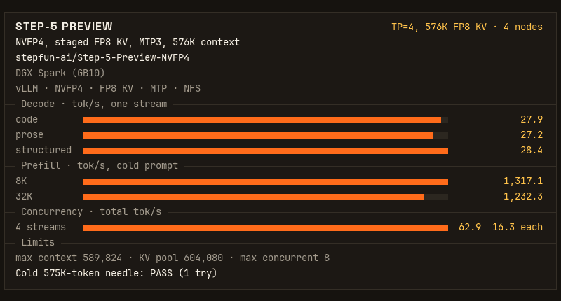

# Step-5 Preview NVFP4 on 4× DGX Spark



> **Status (`experimental`):** Measured results below are from the 2026-10-15/16 four-Spark runs. The Docker Compose conversion and digest-pinned vLLM image have not yet been re-booted end to end on four DGX Spark boxes.

`stepfun-ai/Step-5-Preview-NVFP4` served with upstream vLLM tensor parallelism (`TP=4`, multiprocessing executor) across four NVIDIA DGX Spark (GB10, SM121) boxes, using split NVMe storage shared read-only over NFS, dense attention, staged FP8 E4M3 KV cache (`fp8-kv/` overlay), and MTP3 speculative decoding.

## Results

**`b5-fp8` (default, 4× DGX Spark, 576K context, FP8 KV, MTP3):** 27.9 tok/s code · 27.2 tok/s prose · 28.4 tok/s structured · 1,317 tok/s 8K prefill · 1,232 tok/s 32K prefill · 62.9 tok/s aggregate at 4 streams (16.3 per stream) · cold 575K needle PASS.

Measured on 2026-10-15 and 2026-10-16 on four DGX Spark (GB10) boxes with `vllm/vllm-openai:step-5-preview`, checkpoint `stepfun-ai/Step-5-Preview-NVFP4@bc246cc2`, dual-rail C2 (`NCCL_CROSS_NIC=1`, 2 channels), dense attention, MTP3, and GPU clocks capped at 2000 MHz (`clk2000`). Three-repeat medians in tok/s; prefill is prompt tokens divided by client TTFT; decode is 512-token output including reasoning tokens. Every config's headline numbers also live in [kindling.json](kindling.json).

### `b5-fp8` — default 576K window (run `b5-fp8-20261016T002142Z`, 2026-10-16)

Settings: `MAXLEN=589824`, `FP8KV_BLOCKS=40000`, `GMU=0.86`, `VLLM_MEMORY_PROFILER_ESTIMATE_CUDAGRAPHS=0`, FP8 E4M3 KV (block size 16), `BATCH_TOKENS=4096`, `MAXSEQ=8`, `SPEC_TOKENS=3`, dense attention, dual-rail C2. KV pool: **604,080 tokens** (0.51 GiB captured CUDA graphs on rank 0). Minimum host `MemAvailable`: 8.2220 GiB; max GPU temperature: 57 C.

| Phase | Clock label | Sample source | SM MHz min/med/max | GPU W min/med/max | TTFT median (s) | Prefill proxy (tok/s) | Decode (tok/s) | MTP accepted/drafted |
|---|---|---|---:|---:|---:|---:|---:|---:|
| 8K prefill | clk2000 | in-phase 1s | 1969 / 1976 / 1995 | 7.7 / 25.9 / 27.9 | 6.22 | 1317.13 | — | N/A |
| 32K prefill | clk2000 | in-phase 1s | 1969 / 1989 / 1995 | 8.0 / 28.6 / 31.4 | 26.59 | 1232.33 | — | N/A |
| S1 prose, 512 output | clk2000 | in-phase 1s | 1969 / 1982 / 1995 | 8.1 / 18.1 / 18.6 | 0.57 | — | 27.24 | 969 / 1695 (57.2%) |
| S1 code, 512 output | clk2000 | in-phase 1s | 1969 / 1976 / 1989 | 8.4 / 18.2 / 18.7 | 0.34 | — | 27.89 | 991 / 1635 (60.6%) |
| S1 JSON, 512 output | clk2000 | in-phase 1s | 1969 / 1982 / 1995 | 10.2 / 18.2 / 19.3 | 0.34 | — | 28.40 | 997 / 1620 (61.5%) |
| S4, four × 512 output | clk2000 | in-phase 1s | 1969 / 1982 / 1995 | 8.0 / 21.5 / 23.7 | — | — | 62.93 aggregate; 16.28 per stream | 3882 / 6780 (57.3%) |

S4 aggregate repeats: 63.66, 60.91, and 62.93 tok/s (per-stream median pools all 12 streams). No b5 soak was run.

- **Cold 575K needle recall (`b5-fp8`):** PASS (1 try), 575,000 input tokens, zero prefix-cache hits, ~1,267 s aggregate-derived TTFT (~454 input tok/s mean prefill proxy), 1,306 s client end-to-end wall time, `max_tokens=256`, `temperature=0`.

### `b4-fp8` — safer 442K FP8 profile (run `b4-fp8-20261015T232239Z`, 2026-10-15)

Settings: `MAXLEN=442368`, `FP8KV_BLOCKS=30000`, `GMU=0.85`, `VLLM_MEMORY_PROFILER_ESTIMATE_CUDAGRAPHS=1`, MTP3, dual-rail C2. KV pool: **444,739 tokens**. Minimum host `MemAvailable`: 10.0592 GiB; max GPU temperature: 56 C.

| Phase | Clock label | Sample source | SM MHz min/med/max | GPU W min/med/max | TTFT median (s) | Prefill proxy (tok/s) | Decode (tok/s) | MTP accepted/drafted |
|---|---|---|---:|---:|---:|---:|---:|---:|
| 8K prefill | clk2000 | in-phase 1s | 1976 / 1982 / 1989 | 8.3 / 25.6 / 28.0 | 6.20 | 1321.13 | — | N/A |
| 32K prefill | clk2000 | in-phase 1s | 1969 / 1982 / 1995 | 7.8 / 28.5 / 31.1 | 26.58 | 1232.78 | — | N/A |
| S1 prose, 512 output | clk2000 | in-phase 1s | 1969 / 1982 / 1995 | 7.9 / 18.0 / 20.0 | 0.31 | — | 28.02 | 977 / 1674 (58.4%) |
| S1 code, 512 output | clk2000 | in-phase 1s | 1969 / 1982 / 1995 | 7.8 / 18.1 / 20.2 | 0.33 | — | 28.27 | 986 / 1653 (59.6%) |
| S1 JSON, 512 output | clk2000 | in-phase 1s | 1969 / 1982 / 1995 | 7.9 / 18.0 / 19.7 | 0.33 | — | 28.56 | 1001 / 1599 (62.6%) |
| S4, four × 512 output | clk2000 | in-phase 1s | 1969 / 1982 / 1989 | 8.5 / 21.4 / 23.0 | — | — | 63.71 aggregate; 16.86 per stream | 3906 / 6708 (58.2%) |

- **430K cached needle recall (`b4-fp8`):** PASS (prefix-cached retry after interrupted first attempt; cold prefill time not measured).
- **FP8 vs BF16 numerical diagnostics (`b4-fp8`):** Top-1 agreement 99.84% (8,181 pos, 8K prompt), 99.98% (32,757 pos, 32K prompt), 94.2% / 98.7% / 93.0% on short prose/code/JSON (69/79/71 pos); token-weighted mean NLL delta across 41,157 positions: **-0.0001** (-0.00012046).

### `b4-bf16-192k` — BF16 KV safe option (run `b4-20261015T223410Z`, 2026-10-15)

Settings: `MAXLEN=196608`, `KV_DTYPE=auto` (BF16), `GMU=0.85`, `VLLM_MEMORY_PROFILER_ESTIMATE_CUDAGRAPHS=1`, MTP3, dual-rail C2. KV pool: **258,523 tokens** (1.31×). Minimum host `MemAvailable`: 9.5595 GiB; max GPU temperature: 56 C.

| Phase | Clock label | Sample source | SM MHz min/med/max | GPU W min/med/max | TTFT median (s) | Prefill proxy (tok/s) | Decode (tok/s) | MTP accepted/drafted |
|---|---|---|---:|---:|---:|---:|---:|---:|
| 8K prefill | clk2000 | in-phase 1s | 1969 / 1982 / 1995 | 8.8 / 26.0 / 27.8 | 6.18 | 1324.84 | — | N/A |
| 32K prefill | clk2000 | in-phase 1s | 1969 / 1989 / 1995 | 8.4 / 29.0 / 32.0 | 26.49 | 1236.88 | — | N/A |
| S1 prose, 512 output | clk2000 | in-phase 1s | 1976 / 1982 / 1995 | 7.9 / 18.2 / 18.9 | 0.64 | — | 27.95 | 974 / 1683 (57.9%) |
| S1 code, 512 output | clk2000 | in-phase 1s | 1969 / 1976 / 1995 | 7.9 / 18.3 / 19.8 | 0.34 | — | 28.61 | 980 / 1668 (58.8%) |
| S1 JSON, 512 output | clk2000 | in-phase 1s | 1969 / 1982 / 1989 | 8.8 / 18.2 / 19.5 | 0.33 | — | 27.07 | 978 / 1677 (58.3%) |
| S4, four × 512 output | clk2000 | in-phase 1s | 1969 / 1982 / 1995 | 8.2 / 21.7 / 24.5 | — | — | 60.09 aggregate; 16.06 per stream | 3864 / 6840 (56.5%) |

- **190K needle recall (`b4-bf16-192k`):** PASS (1 try), 190,000 input tokens, 239 s end-to-end wall time.
- **256K BF16 alternative (`b4-bf16-256k`, not benchmarked):** `MAXLEN=262144`, `GMU=0.86`, 340,197-token KV pool, single 250K needle PASS (353 s end-to-end).

### Decode speed versus context depth

Single-stream decode slows as context grows because the vLLM Triton/FA2 attention path used for MTP verify does not split long contexts across the GPU on GB10. Without MTP (`SPEC_TOKENS=0`), decode is slower at short context but flatter past ~50K tokens.

| Profile | 0 | 8K | 16K | 32K | 48K | 64K |
|---|---:|---:|---:|---:|---:|---:|
| `b5-fp8` (default), MTP3, FP8 KV | 23.2 | 20.2 | 17.4 | 14.0 | 12.7 | 10.4 |
| `b5-fp8`, MTP off, FP8 KV | 13.8 | — | 12.6 | 12.2 | — | 11.5 |
| Stock BF16 KV (FA2), MTP3 | 22.7 | — | 18.7 | 16.2 | — | 12.3 |

Decode tok/s, one stream, 512 generated tokens after a prompt of the given depth, n=1 per cell, `clk2000`.

### Historical runs (b2 64K fullclk, b3 128K single-rail clk2000)

- **`b2` (`b2-20261015T201632Z`, 64K BF16, `fullclk`, 156,294 KV pool):** 8K prefill 1,175.73 · 32K prefill 1,116.56 · S1 prose/code/JSON 27.93 / 30.05 / 28.79 · S4 60.89 aggregate (16.08 per stream); 600 s mixed-load soak PASS (100 requests, 0 HTTP errors, mixed clocks).
- **`b3` (`b3-20261015T205109Z`, 128K BF16, single-rail, `clk2000`, 202,818 KV pool):** 8K prefill 1,141.46 · 32K prefill 1,073.19 · S1 prose/code/JSON 27.09 / 28.91 / 28.55 · S4 60.30 aggregate (15.74 per stream); 111,059-token needle PASS (132.4 s).
- **Comparison reference ([0xSero Step-5-Preview-Four-Sparks](https://github.com/0xSero/Step-5-Preview-Four-Sparks/blob/main/README.md#measured), checked 2026-10-15):** different EXL3 mixed-format checkpoint, FP16 KV, MTP2, 262K context; reported 8K cold prefill 1,106–1,327, 32K 1,445, S1 ~25–30, S4 code 66.5 / prose 40.3. Not a matched benchmark.

## Quickstart

Complete the host storage and read-only NFS setup first (see [Storage and read-only NFS](#storage-and-read-only-nfs)), then on **each of the four DGX Spark boxes**:

```bash
npx @kindlingai/recipe step5-tp4-gb10-recipe && cd step5-tp4-gb10-recipe
# the CLI already copied .env.example to .env; edit .env on each node:
#   - NODE_RANK=1 / 2 / 3 on workers, NODE_RANK=0 on the head box
#   - NODE0..NODE3, NETWORK_IFACE, RDMA_HCA, STEP5_ROOT, CACHE_DIR
```

Start the worker ranks (`1`, `2`, `3`) first, then rank `0`:

```bash
docker compose up -d          # pulls the digest-pinned vLLM image; starts rank $NODE_RANK
docker compose logs -f        # rank 0 is ready when the OpenAI API answers on 127.0.0.1:8100
```

Once serving, send one smoke request to rank `0`:

```bash
curl -sf http://127.0.0.1:8100/v1/models
curl -sf http://127.0.0.1:8100/v1/chat/completions -H 'Content-Type: application/json' -d '{
  "model": "step5",
  "messages": [{"role": "user", "content": "Reply with a short greeting."}],
  "max_tokens": 64,
  "temperature": 0
}'
```

Stop the cluster with `docker compose down` on each box.

## What you need

- Four NVIDIA DGX Spark (GB10, SM121) boxes with working GPU drivers, Docker, and the NVIDIA Container Toolkit, with no other model running on them.
- A working dual-rail inter-node RDMA fabric (`/dev/infiniband` and both active HCAs per node).
- Local NVMe capacity on holders 0–2 for the split weights (~94 GB on rank 0, ~78 GB on rank 1, ~224 GB on rank 2), plus container image and `/var/cache/step5` space.
- Kernel NFS server utilities on holders 0–2, NFSv4 client utilities on all four compute ranks, SSH, `rsync`, and Python 3.
- Do not expose port 8100 directly to untrusted networks; the server runs on `network_mode: host` without authentication.

## Settings

`cp .env.example .env` (the CLI already did). Every knob is documented in [.env.example](.env.example).

| knob | default | what it does |
|---|---|---|
| `PROFILE` | `b5-fp8` | Selects the coupled KV/context/GMU/graph-budget profile (table below) |
| `NODE_RANK` | `0` | Rank on this box: `0` serves the OpenAI API; `1`–`3` run `--headless` |
| `NODE0`..`NODE3` | `192.168.50.11`–`.14` | Fabric IP of each rank; `NODE0` is `--master-addr` |
| `NETWORK_IFACE` | `eth0` | Host interface passed to `NCCL_SOCKET_IFNAME` and `GLOO_SOCKET_IFNAME` |
| `RDMA_HCA` | `mlx5_0,mlx5_1` | Dual-rail HCAs passed to `NCCL_IB_HCA` |
| `API_PORT` | `8100` | Host port for the OpenAI API on rank `0` |
| `MASTER_PORT` | `29511` | Distributed multiprocessing rendezvous port on `NODE0` |
| `STEP5_ROOT` | `/srv/step5` | Root of the split storage tree (same absolute path on all four boxes) |
| `CACHE_DIR` | `/var/cache/step5` | Writable host cache mounted at `/cache` |
| `MAXSEQ` / `BATCH_TOKENS` | `8` / `4096` | Concurrent sequence cap and batched token limit |
| `SPEC_TOKENS` | `3` | MTP draft tokens (`0` disables speculative decoding) |
| `STEP5_DENSE` | `1` | Disables SM90/SM103-only sparse attention for GB10 (SM121) |
| `LMONLY` | `1` | Passes `--language-model-only` (text-only; skips vision encoder) |

Profiles set `STEP5_FP8KV`, `KV_DTYPE`, `MAXLEN`, `FP8KV_BLOCKS`, `GMU`, and `VLLM_MEMORY_PROFILER_ESTIMATE_CUDAGRAPHS` together:

| `PROFILE` | window (`MAXLEN`) | KV cache | `FP8KV_BLOCKS` | `GMU` | graph estimate | notes |
|---|---:|---|---:|---:|---:|---|
| `b5-fp8` | 589,824 (576K) | FP8 E4M3 (staged overlay) | 40,000 | 0.86 | 0 | Default; benchmark + cold 575K needle PASS |
| `b4-fp8` | 442,368 (442K) | FP8 E4M3 (staged overlay) | 30,000 | 0.85 | 1 | Safer FP8 option; benchmark + 430K cached needle PASS |
| `b4-bf16-192k` | 196,608 (192K) | BF16 (`auto`, no overlay) | — | 0.85 | 1 | Safe BF16 option; benchmark + 190K needle PASS |
| `b4-bf16-256k` | 262,144 (256K) | BF16 (`auto`, no overlay) | — | 0.86 | 1 | BF16 alternative; 250K needle PASS (not benchmarked) |
| `custom` | explicit | explicit | explicit if FP8 | explicit | explicit | Provide all profile variables in `.env` |

## Storage and read-only NFS

The 95 weight files and 12 metadata files are split across three NVMe holders so each compute rank sees the complete checkpoint through a symlink view (`${STEP5_ROOT}/model`): local shards come from local NVMe and remote shards come from read-only NFSv4 mounts. Keep the pinned file lists in `lists/` unchanged.

| Compute rank | Storage role | Weight files | Weight bytes (decimal GB) |
|---|---|---:|---:|
| 0 | Holder 0, plus 12 config/tokenizer files | 21 | 93.58 |
| 1 | Holder 1 | 17 | 77.50 |
| 2 | Holder 2 | 57 | 223.09 |
| 3 | No local weight files | 0 | 0 |

Default layout (mounted read-only at the same absolute path inside every container so symlink targets resolve):

```text
/srv/step5/weights        local subset on holders 0–2
/srv/step5/nfs/holder0    remote holder 0, except on rank 0
/srv/step5/nfs/holder1    remote holder 1, except on rank 1
/srv/step5/nfs/holder2    remote holder 2, except on rank 2
/srv/step5/model          complete 107-entry symlink view
/var/cache/step5          writable container cache (/cache)
```

Host setup steps (all scripts automatically read `.env` in this folder, or `STEP5_CONFIG` if set):

```bash
# 1. On a staging machine with enough disk space:
hf download stepfun-ai/Step-5-Preview-NVFP4 \
  --revision bc246cc2848e17b37f377eda8fd825c5b3018d1f \
  --local-dir /mnt/model-source
scripts/copy-shards.sh

# 2. On holders 0, 1, and 2:
scripts/verify-shards.sh 0     # use 0, 1, or 2
sudo scripts/export-nfs.sh

# 3. On each compute rank 0, 1, 2, and 3:
sudo scripts/mount-nfs.sh 0    # use this node's rank (0..3)
scripts/mklinks.sh 0
```

Mounts use NFSv4 with `ro,nconnect=8`. `scripts/export-nfs.sh` creates temporary kernel NFS exports; re-run after reboot or configure persistent exports.

## Attention, FP8 KV overlay, and boot notes

- **Dense attention on SM121:** DSA sparse-attention kernels in the vLLM image require SM90/SM103. `STEP5_DENSE=1` passes `--hf-overrides '{"text_config":{"sparse_config":{"enabled":false}}}'`.
- **Staged FP8 KV overlay (`fp8-kv/`):** Stock FA2 on SM121 does not support FP8 KV. When `STEP5_FP8KV=1`, `compose.yaml` mounts `./fp8-kv` read-only at `/opt/step5-fp8kv-bundle`, `scripts/entrypoint.sh` verifies the six-file `overlay.sha256` manifest, prepends `/opt/step5-fp8kv-bundle/overlay` to `PYTHONPATH`, and passes `--block-size 16 --num-gpu-blocks-override "$FP8KV_BLOCKS"`. `fp8-kv/overlay/step5_fp8kv/hook.py` verifies `SOURCE_SHA256` on `vllm.models.step5.nvidia.model` in memory (fail-closed if the upstream image changes that file; no image files are modified). See [fp8-kv/README.md](fp8-kv/README.md#capacity-and-limitations).
- **BF16 rollback:** Switch to `PROFILE=b4-bf16-192k` (or `b4-bf16-256k`). `scripts/entrypoint.sh` sets `STEP5_FP8KV=0`, omits the overlay from `PYTHONPATH`, and drops `--num-gpu-blocks-override`.
- **Boot-time page-cache workaround (optional host step):** Earlier boots saw NVRM errors during KV allocation. If needed, run `sudo scripts/drop-page-cache.sh` on each host while the cluster starts (writes `1` to `/proc/sys/vm/drop_caches` every 10 s for 15 minutes and exits; inspect with `scripts/drop-page-cache.sh --dry-run`).

## Benchmarking and local validation

To re-measure this recipe on the repository's standard benchmark suite (required before moving out of `experimental`), run `kindlingai/gr8`'s `bench/bench.py` against rank `0` (`--url http://127.0.0.1:8100 --stages info,decode,concurrency,prefill,correct`); see [CONTRIBUTING.md](../../../../CONTRIBUTING.md#benchmarking).

The recipe also keeps its CPU-only unit test suite, FP8 overlay contract tests, privacy scanner, and historical `scripts/bench.py` harness:

```bash
PYTHONDONTWRITEBYTECODE=1 python3 -m unittest discover -s tests -v
PYTHONDONTWRITEBYTECODE=1 python3 -m unittest discover -s fp8-kv/tests -v
for script in scripts/*.sh fp8-kv/integration/*.sh fp8-kv/scripts/*.sh; do bash -n "$script"; done
(cd fp8-kv && sha256sum -c overlay.sha256)
scripts/privacy_scan.sh
```

## Other sizes

Only the 4× DGX Spark (`TP=4`) topology is documented for Step-5 Preview NVFP4. On the same four boxes, switch `PROFILE` in `.env` between `b5-fp8` (576K default), `b4-fp8` (442K safer FP8), `b4-bf16-192k` (192K BF16), and `b4-bf16-256k` (256K BF16).

## Help

Ask on Discord (https://discord.gg/8EAvYPV2rE) or open an issue in the recipes repo
(https://github.com/kindlingai/recipes/issues) with `step5-tp4-gb10-recipe` in the title. Say which step failed and
include the end of `docker compose logs` before removing the container. Remove addresses and hostnames before posting.

## Engine pin

This recipe has no local Docker build. It runs the upstream published vLLM image pinned by digest in [compose.yaml](compose.yaml):

| | |
|---|---|
| engine | [vllm-project/vllm](https://github.com/vllm-project/vllm) (`step-5-preview`) |
| image | `vllm/vllm-openai:step-5-preview` |
| index digest | `sha256:8bc189bb3f57183bcaf4f01405b29d4d92d782a182b384aac79b4b2885fb1fda` |
| `linux/arm64` digest (GB10) | `sha256:784f5812c03fe18b11e33a01ea04e063b31fc14bc0fb1a1109f908adcc0619d1` |
| weights | [stepfun-ai/Step-5-Preview-NVFP4](https://huggingface.co/stepfun-ai/Step-5-Preview-NVFP4/commit/bc246cc2848e17b37f377eda8fd825c5b3018d1f) (`bc246cc2`) |

> **Live-boot note:** `fp8-kv/overlay/step5_fp8kv/hook.py` enforces `SOURCE_SHA256` on `vllm.models.step5.nvidia.model`. Confirm that the pinned digest matches `SOURCE_SHA256` on a live four-Spark boot before switching `status` from `experimental` to `stable`.

## License

MIT, see [LICENSE](LICENSE). The vendored FP8 KV overlay carries its own MIT license in [fp8-kv/LICENSE](fp8-kv/LICENSE) (exported from commit `38b5249`). The model ([stepfun-ai/Step-5-Preview-NVFP4](https://huggingface.co/stepfun-ai/Step-5-Preview-NVFP4)) and vLLM image retain their own licenses.
